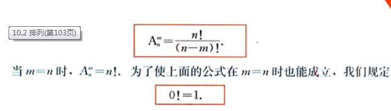
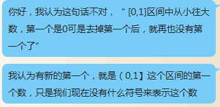
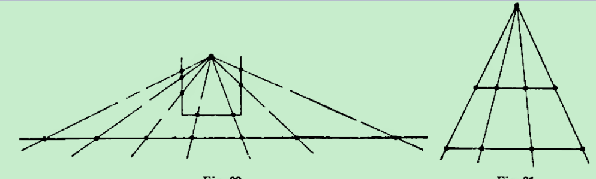
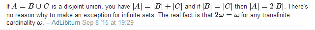
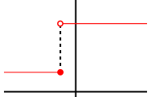
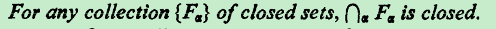

把0的值带进去不化简的结果定义为momentum（势头），这种考虑是从链式法则看起来似乎可约想到的：As we see, in this form the chain rule has the appearance of a trivial algebraic identity; it is easily remembered because the Leibniz fr actional notation fo r derivatives suggests that du can be canceled fr om the two "f r actions" on the right.

3×0和5×0的值相等，但这是为了达到定义0的除法的目的的话，就要说或定义他们的势头不相等，最简单的来讲就是形式上它们是不相等的，就相当于Python里边的=和is的区别

在期间0~10和区间0到一亿上面取到某个指定的数（比如7.12345……的概率都是0，但是这种可能性还是有区别吧，所以要比0更0的。以所有整数的数目为一个整体然后从中取

既然无穷大有很多种，那么0为什么就不可以有很多种呢？这似乎为上面的0形式不简化找到了一点形式上的理由，另外又怎样将这些很多种的无穷大和很多种的0联系起来呢？这也是个问题

要知道发明导数的根本原因是因为没有定义零的除法，如果把这个问题妥善解决了之后的话，那么似乎就可以另辟蹊径，或许可以从另外一个角度得到微积分的一系列结果。实际上在计算导数的过程中也要求data X不=0，这从另外一方面来看就是利用了不等于0的带入使得无法直接一下子化简到0损失了必要的信息，就说有多少个0我不直接划归为一个【值】0，而是我在过程中保留这些信息，以便进一步利用起来

如果我们不把0*6简化为结果0，而是保留0*6这个形式，那么便可以定义0的除法0*6/0=6，问题是保留0*6这个形式的价值是什么？

0个爱因斯坦和0个爱迪生是不同的，我们强调的主体不同，0个6和0个5强调的主体也不同，我希望在数学上找到其存在的演义，保留0*6这个形式的价值

5/0和6/0不能简单地通过极限方式表示为无穷大就不管了，希望找到其是不同无穷大的意义

一方面不能定义0的除法，另一方面也不能把无穷大当作数，如果想到办法妥善处理这一切便不就成了？

当我们研究月亮绕地球运动的时候，用牛顿力学中的引力定律的时候，不就是把地球这么大的东西看成了一个点嘛。物理学家认为只要能解决问题就可以。但是数学家想在理论上完善它。到了上世纪六十年代，创立非标准分析的人发现，可以把牛顿莱布尼兹当年关于无穷小无穷大的想法严格化。当年是因为没有找到严格化的程序，所以不再采用这种概念。我认为，这也是数的概念发展中非常重要的事情。非标准分析中的实数域、复数域现在还没有被大家所普遍接受，但是我相信有一天会被大家接受的，就像复数的发展历程一样。（就像复数一开始不被接受，慢慢被接受那样）……实数是无处不在的，复数在工程上应用很广，比如电学中的交流电，量子力学，量子场论等离开 i 都是不行的，我相信非标准分析有一天也会和复数一样应用广泛。

△（x^2)=2x(△x)+(△x)^2的0增量

和

△（x)=(△x) 的0增量

虽然都是0，但是增量的变化率不一样

很有趣的规定，能否在等比数列和那里也这么规定

http://www.kebenzhan.com/renjiaoban/gaoer/shuxuexiace_b/2016-10-24/40201.html

我们总说实数系是连续的，可我们不但不能指出紧跟在1后面的下一个数是谁，甚至也无法用符号或什么表达式来表示这个数，这岂不是有点讽刺？紧跟在1后面的下一个不可能是实数吧？1+无穷小量吗？无穷小量造就了连续吗？是什么造就了连续？

紧跟在1后面的下一个不可能是实数   如果紧跟在1后面的下一个是实数a，那么（1+a）/2就是中间的实数，这就出现问题了

我认为这样的数是存在的，只是根据我上面这个假设导出矛盾看来或许“这紧跟着的下一个”根本就不在实数系里，[1，+∞)这个区间去掉左端点1之后，那么区间（1，+∞)的起始第一个数就应该是紧跟在1后面的下一个数（在一个连续的数系里就应该这样），只是我暂时还无法用符号或什么表达式来表示这个数。BTW，目前极度怀疑这种数需要实数+无穷小量来表示

给“紧跟着的下一个”一个严格的数学定义就是>0但又小于任何正实数  此乃无穷小量也，无穷小量造就了连续     无穷小量应该在笼统的数系无理数里，但是无理数里没有最小数（都是有限数），不具备这种无限小的性质   也许表示这种笼统无理数的符号还不够

我们一开始发明的是有限数，以至于我们用其发现的其它数也是有限数，所以我们需要新的符号来表示无限数

需要一个代表无限数量级的标准，（0,1）区间内点的数量（∞）？这样子0+这些点的长度和=1

自然数的个数？有理数的个数？同时也因为没有能够表示这些数量的数值大小，所以发明这样的无限大数量级有意义，这种无限大数在数轴的无限远处，像数轴上的其它数一样，其前后也有比它大小的无穷大，1000/x和1/x在无限远处应该交于同一点，因为1000/x-1/x的无穷大极限值为0

点的长度是0还是无穷小ε         无穷大乘以（0,1）内的任何数，结果把它们弹出这个区间，最后剩下0这个孤点，周围的单位区间空着，这是说明数轴上还有空隙吗？还是无穷大不存在？   无穷大倍率放大镜（有问题啊：我们不能认为无穷大乘以0还是0啊~~~，因为无穷大的运算可能和普通数不一样，这样的话就应该存在0/1000，0/2这类0，那么它们存在的意义是什么呢？是应该存在除了y=0之外的y=x/1000，y=x/2这类的数轴吗？可它们存在的意义又是什么呢？因为直角坐标系的x=0数轴吗？这可以作为线索吗？）

点的宽度可能不是唯一的无穷小量

无穷小量构成无理数

是什么造就了线段的连续？无穷小量

找不到按大小排列有理数、无理数的方法，无穷小量排列它   最终hyperreal可以排列

元素个数与距离长度是两回事

用平行光来比，同一标准，同一基点

1m和0.5m的橡皮筋       可以一一对应，但是长度不相等    比较的基准出了问题

rational infinitesimal

找老师

http://www.math.uiuc.edu/~henson/

https://www.google.com.hk/search?q=Lectures+on+the+Hyperreals%3A+An+Introduction+to+Nonstandard+Analysis&oq=Lectures+on+the+Hyperreals%3A+An+Introduction+to+Nonstandard+Analysis&aqs=chrome..69i57&sourceid=chrome&ie=UTF-8

https://www.google.com.hk/search?q=Elementary+Calculus%3A+An+Infinitesimal+Approach&oq=Elementary+Calculus%3A+An+Infinitesimal+Approach&aqs=chrome..69i57j69i60j69i61j69i60&sourceid=chrome&ie=UTF-8

严谨的解说之后+无限倍率放大镜

一开始一一对应的思想在无限里有问题        数羊和数对应

点0宽度  胡说    区间套定律

The next number 

the next succeeding number right after $0$ in the real number system, exist ?

有理数后面可能直接跟着有理数吗？有理数和无理数及其无穷小量在数轴上面的排列方式

"the axiom of choice", from which we can prove that there exists a well-order of any set, including R. The fundamental property of a well-order is that every non-empty set has a minimum. It follows that every element which is not maximal, has an immediate successor.

http://math.stackexchange.com/users/622/asaf-karagila

A mathematical theory is not to be considered complete until you have made it so clear that you can explain it to the first man whom you meet on the street.

 

 Professor Hrbacek

khrbacek@sci.ccny.cuny.edu

I think the "one-to-one correspondence"(bijection) is not a good standard for comparing the size of two sets, bijection can help judge if two finite sets have the same size or not without doubt, while when using bijection to compare the size of two infinite sets, sometimes it is problematic,  we can even get different conclusions from different perspectives , for example , think about the set of all positive integers **N** and its subset all positive even numbers **E**, intuitively the size of **E** should be half of the size of **N** when considering from this relation, while if you regardless of the relation between them and only consider the bijection between the two sets, then the size of **E** should be the same as the size of **N**.

a good stand shouldn't produced 

Does Cantor believe that "one-to-one correspondence" of two  **infinite** sets can also ensure the two  **infinite** sets has the same size, and even use it as an axiom to develop the set theory? 

开区间的第一个点

hypernatural

the field of real numbers is Archimedean, 

Let x be any element of K. Then there exists a natural number n such that n > x.

Alternatively one can use the following characterization:

For any positive ε in K, there exists a natural number n, such that 1/n < ε.

最大的positive infinitesimal？？？

there is neither a greatest infinitesimal nor a least positive rational

https://webusers.imj-prg.fr/~maksim.maydanskiy/

https://en.wikipedia.org/wiki/Non-Archimedean_ordered_field

科学的本质是什么？我认为是：试图去找到的“行之有效”的方法（可以有多种方法）去解释现象，或者用这些方法去解决问题。各位是怎么理解的？

x<0, y>0, x= -1/n,y=1/n, 0<y-x=2/n

如果存在N使得2/n>=1/N   =>  2N>=n

但是存在n>2N ,比如  n=3N  那么y-x=2/3N<1/N， 那么就不存在N使得2/n>=1/N，也就是

可以构造出比 p/q大和小的非0有理数----分子分母加减1  =0的情况，有理数的此性质并不能证明左边界只可能是0的无理数满足阿基米德公理----由于固有观念   这种例子可能不容易被接受   还是用  极限定义和之前的example吧

阿基米德公理   或许要写成 阿基米德property，不能写成公理，因为它本身有问题 

无穷小量实际上是比阿基米德实数小的实数

无理数可以看作是number continuum的补集

In common calculus infinitesimal is a variable whose limit is zero. In the non-standard analysis developed by Abraham Robinson (1960) infinitesimal is a quantity whose absolute value is less than that of any real number. Infinitesimals have been widely (and uncritically) used by the creators and the pioneers of calculus. Non-standard analysis supplied a fundamental justification for their genius.

即便我的理论正确，那么（0,1/n）的长度仍然不为0，所以还有待进一步开采

y>-1/n ,  x<1/n ，看这时候其值可以小到什么程度

至于对于以前的自然数1/2n<1/n，因为1/2n是变量，我们要的是固定的数，所以可以暂时不考虑这种情况，我们应该注意的是x-y的范围可以组成一个非空集合，并且在小于一切满足阿基米德公理的正数内，这个范围内就有我们要的无穷小

http://mathoverflow.net/questions/105515/archimedean-property-of-real-numbers

Weierstrass continuum

number continuum与函数连续的定义

that they are like the points on a line, and corresponding to every point there is a real number. 

the x-axis -- is composed of points.

Will the real continuous function please stand up?Mathematician Keith Devlin (email: devlin@csli.stanford.edu)http://web.stanford.edu/~kdevlin/

阿基米德没错，错的是我们忽略长度大于0的区间里没有数存在

那些区间的交集   因为是nested 所以是这些区间中的一个， 但是任何一个的长度都大于0，那么总应该包含数，包含数但最终又被阿基米德公理说没有的原因是因为……，数系有待进一步扩充

7在数轴上的位置界定是【7-ε，7+ε】（基于x>7和y<7时x-y>0之差值得到的），ε是数的宽度的一半,区间长度必须是2ε的整数倍才能完整包含数

一个集合里只有7（归属界定）表示为【7,7】={7<=x<=7} ，闭区间长度只需大于等于0都可以包含到数        

两种区间界定一个数的方法是不同的，表示的意义是不同的，

完全是两种不同的计数法，前者是基于无穷小量和数宽度，后者居于数的大小关系，

定义成小于一切正实数没问题吗？小于自身？

5x（x>0）的集合下确界不可能是0吧？5个正数加起来这样子就不可能取到最小正数了吧？

所有的【-1/n，1/n】的交集是闭集【0,0】是不是意味着1/n=0是可能的还是极限思想（用没有得到有

For any collection {F.} of closed sets, n. F. is closed.

His Archimedean property defines a number x as infinite if it satisfies the conditions |x|>1, |x|>1+1, |x|>1+1+1, ..., and infinitesimal if x≠0 and a similar set of conditions holds for x and the reciprocals of the positive integers. 

