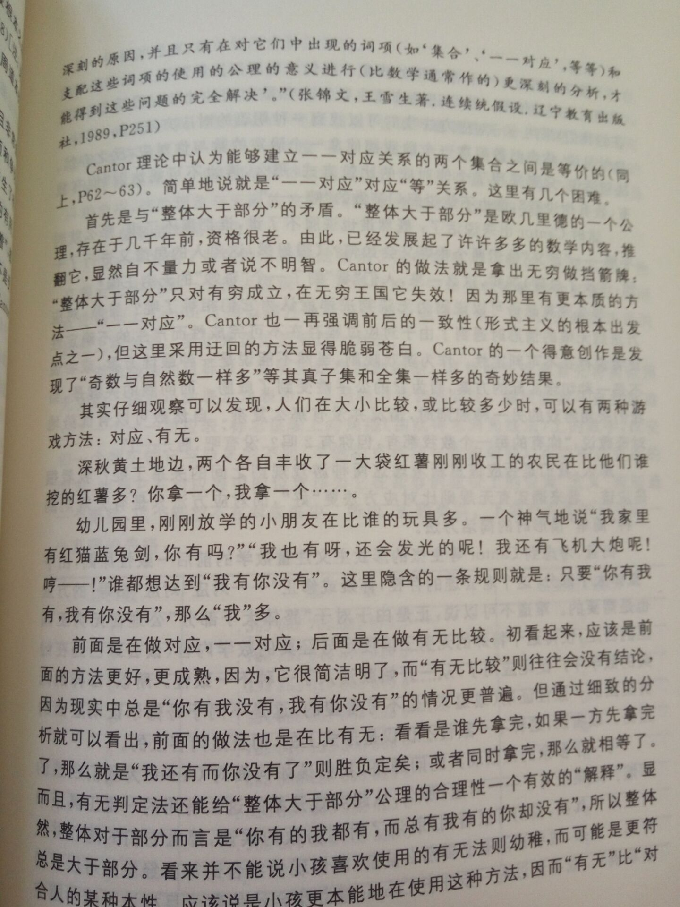
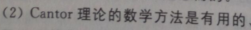
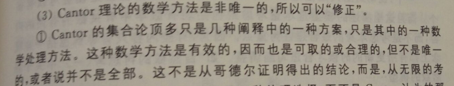
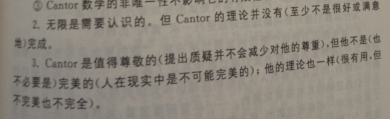

两部检测基准，一定要按顺序，第一步检测成功则无需第二步：

（1）A里的元素都在B里，并且B里有A里没有的元素，则A<B，如{偶数集}<{整数集}

（2）按照康托一一对应的思想，如{偶数集}={奇数集}

---

一一对应是康托用的方法

有无比较法是下面文中的观点，但是文中讲得措辞上稍微夸张了点。

这两种比较无穷的方法都是源自于有限集和大小比较的情形，现在不经过证明就认为他们也适用于无穷集合的比较，或者是把它们都当作公理去比较无穷，各自都会产生一些感觉合理的结论，究竟该采用哪种比较方式得看是否能创造出有用的、能解决问题的、能带来斐然成果的数学（这是我看《古今数学思想》获得的认识），康托的方法无疑已经显示其具备这种资质，而“A包含于B，但是B中有不在A里的元素，那么B的元素个数更多”的标准能否也具备这种潜质，目前我还不知道，估计还需要用它来发展些理论看看再说。

有无比较法的一个要解决的问题是：偶数集和除去1的奇数集谁大谁小？

我的方案是奇数集里的元素各自都减去1，进而转化来的集合包含于偶数集，但是偶数集里的元素0不在转化来的集合内，所以偶数集比除去1的奇数集元素个数更多。

另外一种方案是：奇数不要1集是A={2n+1|n∈Z,n≠0},我取转化为([x/2]+1)那么所有的A中元素可以转化为整数集除去1，它包含偶数集，这就表明奇数集除去1大于偶数集

这两种自相矛盾，仍需要仔细思考或另辟蹊径才行！

另外，要比较有理数集和无理数集该怎么办？请继续思考！

沈宏梁《无限的探索》  

https://books.google.co.jp/books?id=lnxGDwAAQBAJ&printsec=frontcover&dq=無限的探索&hl=zh-CN&sa=X&ved=0ahUKEwiVsLuKltveAhULybwKHfexCtYQ6AEIKDAA#v=onepage&q=無限的探索&f=true

（用上面的规则来比较）Paradoxically, there are exactly as many points  on a line (or line segment) as in a plane, a three-dimensional space, or finite hyperspace, since all these sets can be put into a one-to-one correspondence with each other.

The denial of the law of excluded middle gives rise to a new possibility, undecidable propositions. The intuitionists maintain, with respect to infinite sets, that there is a third state of affairs, namely, there may be propositions which are neither provable nor unprovable. As an example of such a proposition, let us define the kth position in the decimal expansion of -n to be the position of the first zero which is followed by the integers 1. .. 9. Aristotelian logic says that k either exists or does not exist and  mathematicians following Aristotle may then proceed to argue on the basis of these two possibilities. Brouwer would reject all such arguments, for we do not know whether we shall ever be able to prove that it does or does not exist. Hence all reasoning about the number k is rejected by the intuitionists. Thus there are sensible mathematical questions which may never be settled on the basis of the statements contained in the axioms of mathematics. 

直观主义（intuitionism）者的指导哲学思想我基本上不认同，但是他们的一个论调震撼了我——传统的逻辑法则是在有限集的基础上总结起来的，集合论里之所以会产生悖论是因为不假思索地、想当然地将这些有限集里总结的规律应用来处理无限集。其中一个典型例子说到了排中律（二态律， the law of excluded middle）。对于一个有限集内的表述，因为我们总可以经过有限个步骤后确定表述正确与否，那么在未做这种确认之前我们就可以断定这个表述只可能居于正确或错误两种状态，但是对于一个涉及到没有规则产生的无限集的表述，因为我们无法完成对其内无限个元素的正确与否的核对，所以这个表述除了正确或错误两种状态外多了第三种状态——不可定状态，这可能是个undecidable propositions，这种对错外的第三种状态增加了考虑问题的维度，增加了考虑问题的复杂度。