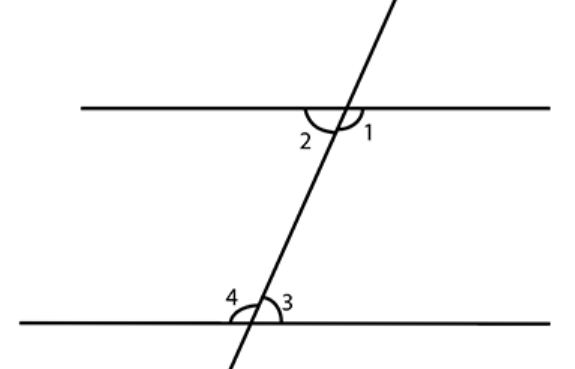

那种定义两条线平行为交点在无限处的方法等同于∠3=0，进一步也等同于tan∠3=0=a/l，这样似乎就有了理由1/x=0，目前因为没有这种大的数，所以采取了另外一种描述方法，lim1/x=0=0,。实际上我们描述6/x=2里的x的另外一种方法就是lim6/x=2，所以极限是区别于算式（直接描述方法）的另外一种间接描述一个数的方法，基于这个理念似乎预示着无限大的数的存在。（即便是用极限符号语言描述这个要求最终也可以转换为l是大于任何指定长度的结论预示着无限大数存在）
另外一个预示着无限大数存在的案例就是芝诺悖论1-已走过的段数的和=1/2^n，要到达终点就得解出1/2^n=0里的n的值，似乎也预示着无限大数存在
两种情况如果假设值是有限的就会导出矛盾，所以只能为无限大