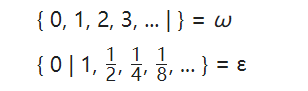

需要用无穷来度量的量：自然数的个数（其它数的个数）、射线的长度（由线段长度的极限出发）、直线的长度

绕圆走下去：因为有起点也有终点，所以在这个过程中走过的总路程终归有限，永远走下去也只能是趋于无限。这符合我们对无限的探索认识，从有限不断变得越来越大，从而走向无限，极限也就是采用这个思想

只要有起点也有终点走过的路程就是有限的，但这有限的路程里可以分出无限个分段（一半的一半），从运动的观点来说只能到达有限里包含的无限

1/x x变到0

有起点也没终点得模型：射线

没起点也没终点得模型：直线

螺线

整数怎样被走到尽头，这个事情是难以想象的，但是当我们通过芝诺悖论压缩到那个区间里面来看的话，就很明了了，如果走不完所有的整数，那么就不会到达终点。从另外一个角度来讲，我们到那里需要1/2＾n=0

对于减法的定义要慎重——似乎不能有减法

https://en.wikipedia.org/wiki/Aleph_number

https://en.wikipedia.org/wiki/Ordinal_number

So in the following sequence:

0, 1, 2, ..., ω, ω+1

ω is a limit ordinal because for any smaller ordinal (in this example, a natural number) there is another ordinal (natural number) larger than it, but still less than ω.

https://en.wikipedia.org/wiki/Regular_cardinal

https://en.wikipedia.org/wiki/Surreal_number

the surreal number system is an arithmetic continuum containing the real numbers as well asinfinite and infinitesimal numbers, respectively larger or smaller in absolute value than any positive real number.

There are also representations like

where ω is a transfinite number greater than all integers and ε is an infinitesimal greater than 0 but less than any positive real number. Moreover, the standard arithmetic operations (addition, subtraction, multiplication, and division) can be extended to these non-real numbers in a manner that turns the collection of surreal numbers into an ordered field, so that one can talk about 2ω or ω − 1（在我的构造里感觉不能谈这个） and so forth.

Hypernatural

https://en.wikipedia.org/wiki/Hypernatural

 His Archimedean property defines a number x as infinite if it satisfies the conditions |x| > 1, |x| > 1 + 1, |x| > 1 + 1 + 1, ...

however it is possible to proceed using onlyalgebra and topology, and proving the transfer principle as a consequence of the definitions. In other words hyperreal numbers per se, aside from their use in nonstandard analysis, have no necessary relationship to model theory or first order logic, although they were discovered by the application of model theoretic techniques from logic. Hyper-real fields were in fact originally introduced by Hewitt (1948) by purely algebraic techniques, using an ultrapower construction.

https://en.wikipedia.org/wiki/Hyperreal_number

the set of natural numbers, denotable by {0, 1, 2, 3, 4, 5, ...}, has infinitely many elements, and we cannot use any normal number to give its size.

https://en.wikipedia.org/wiki/Hyperinteger

定义1+1+1+……=∞？然后得出1+2+3+……=？要剔除结合律、交换律时效的情形

When considering these large objects, one might also want to see if the notion of counting order coincides with that of cardinal defined above for these infinite sets. It happens that it does not; by considering the above example we can see that if some object "one greater than infinity" exists, then it must have the same cardinality as the infinite set we started out with. It is possible to use a different formal notion for number, called ordinals, based on the ideas of counting and considering each number in turn, and we discover that the notions of cardinality and ordinality are divergent once we move out of the finite numbers.

就从无穷极速求和这件事情上来看，虽然说我们可能没有办法一个一个加到无限把它加完，但是这并不妨碍我们处理这个无穷级数的求和，我们从有限和无限排除的两个角度就可以搞出这个结果。但前提还是要确认一下，无穷级数的存在所依赖的相关概念不会产生循环论证

我也想要看一下之前他发给我的书本，书中的崛起的与无穷相关的问题，我看一下我的理论能不能解决

1/X=0的解释，不唯一的，是有无数多的，针对之诺悖论那里的说法的话，我应该解出来的n=aleph0。但是费用的也就打破了分子相同分母必定相同的这种规则。

The theorem that the ordinal number of an aggregate is unaltered by changing the order of the elements of the aggregate no longer holds

