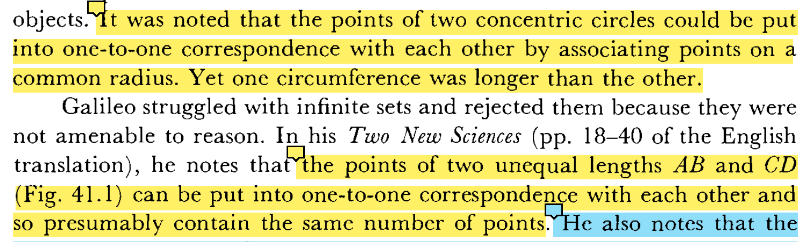
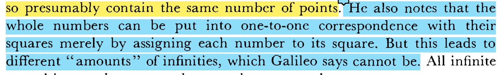

文章里面说到的就是当一一对应建立的时候，另外一个集合里边还有对应不起来的元素的时候，才会用到局部小于整体这个方式去比较大小关系。
似乎从一个角度来看，他们是先用一一对应来测试，然后如果对应不起来的话，再用局部小于整体的方法来得出最后结论。那么为什么不一开始就两个标准联合起来界定这个东西呢？即便是对于偶数和自然数的比较。

如果两个条件都满足的话就界定了小于这种关系，如果无法满足局部小于整体的这个条件的时候那么就按照一一对应的关系来比较，这样的话可能得出的结论就是相等。

对于整数集是偶数集的几倍问题，可以根据数出现的密度来计算确定数量关系

产生矛盾的起因或前提是什么？
①点组成？点没有长度，线段有长度，没有长度的点构成了有长度的线段，很是匪夷所思
②一一对应对于不可数无穷的比较是否有效？

可见即便是可数无穷大的比较也会有些问题，所以进一步深思“一一对应”是否适用，我只知道对于有限可数有效

According to his [Brouwer's] view and reading of history, classical logic was abstracted from the mathematics of finite sets and their subsets. . . . Forgetful of this limited origin, one afterwards mistook that logic for something above and prior to all mathematics, and finally applied it, without justification, to the mathematics of infinite sets. This is the Fall and original sin of set theory, for which it is justly punished by the antinomies.从有限集总结的规律不假思索就以为仍然适用于无限集引出了集合论里的矛盾

As a specific example of a logical principle that is applied too freely, **Brouwer cites the law of excluded middle**. This principle, which asserts that every meaningful statement is true or false, is basic to the indirect method of proof**. It arose historically in the application of reasoning to subsets of finite sets and was abstracted therefrom. It was then accepted as an independent a priori principle and was unjustifiably applied to infinite sets. Whereas for finite sets one can decide whether all elements possess a certain property P by testing each one, this procedure is no longer possible for infinite sets（无限个元素确认不完，所以存在了“无法证实”这种实际存在的第三种状态）. One may happen to know that an element of the infinite set does not possess the property or it may be that by the very construction of the set we know or can prove that every element has the property. ****In any case, one cannot use the law of excluded middle to prove the property holds.**
**Hence if one proves that not all elements of an infinite set possess a property, then the conclusion that there exists at least one element which does not have the property is rejected by Brouwer.**
The law of excluded middle can be used in cases where the conclusion can be reached in a finite number of steps, for example, to decide the question of whether a book contains misprints. In other cases（involved with infinity） the intuitionists deny the possibility of a decision. 排中律不能不加证明就应用到无规则产生的无限集
**The denial of the law of excluded middle gives rise to a new possibility, undecidable propositions. **The intuitionists maintain, **with respect to infinite sets,** that there is a third state of affairs, namely, there may be propositions which are neither provable nor unprovable. As an example of such a proposition, let us define the kth position in the decimal expansion of -n to be the position of the first zero which is followed by the integers 1. .. 9. Aristotelian logic says that k either exists or does not exist and mathematicians following Aristotle may then proceed to argue on the basis of these two possibilities. Brouwer would reject all such arguments, for we do not know whether we shall ever be able to prove that it does or does not exist. Hence all reasoning about the number k is rejected by the intuitionists. Thus there are sensible mathematical questions which may never be settled on the basis of the statements contained in the axioms of mathematics.
直观主义（intuitionism）者的指导哲学思想我基本上不认同，但是他们的一个论调震撼了我——传统的逻辑法则是在有限集的基础上总结起来的，集合论里之所以会产生悖论是因为不假思索地、想当然地将这些有限集里总结的规律应用来处理无限集。其中一个典型例子说到了排中律（二态律， the law of excluded middle）。对于一个有限集内的表述，因为我们总可以经过有限个步骤后确定表述正确与否，那么在未做这种确认之前我们就可以断定这个表述只可能居于正确或错误两种状态，但是对于一个涉及到没有规则产生的无限集的表述，因为我们无法完成对其内无限个元素的正确与否的核对，所以这个表述除了正确或错误两种状态外多了第三种状态——不可定状态，这可能是个undecidable propositions，这种对错外的第三种状态增加了考虑问题的维度，增加了考虑问题的复杂度。
With respect to the concepts they will accept as legitimate for mathematical discussion, **the intuitionists insist on constructive definitions.** For Brouwer, as for all intuitionists, the infinite exists in the sense that one can always find a finite set larger than the given one. To discuss any other type of infinite, the intuitionists demand that one give a method of constructing or defining this infinite in a finite number of steps. Thus Brouwer rejects the aggregates of set theory.
The requirement of constructibility is another ground for excluding any concept whose existence is established by indirect reasoning, that is, by the argument that the nonexistence leads to a contradiction. Aside from the fact that the existence proof may use the objectionable law of excluded middle, to the intuitionists this proof is not satisfactory because they want a constructive definition of the object whose existence is being established. The constructive definition must permit determination to any desired accuracy in a finite number of steps. Euclid's proof of the existence of an infinite number of primes (Chap. 4, sec. 7) is nonconstructive; it does not afford the determination of the nth prime. Hence it is not acceptable. Further, if one proved merely the existence of integers x, y, z, and n satisfying xn + yn = zn, the intuitionist would not accept the proof. On the other hand, the definition of a prime number is constructive, for it can be applied to determine in a finite number of steps whether a number is prime. The insistence on a constructive definition applies especially to infinite sets. A set constructed by the axiom of choice applied to infinitely many sets would not be acceptable.
**Brouwer and his school have not limited themselves to criticism but have sought to build up a new mathematics on the basis of constructions they accept. They have succeeded in saving the calculus with its limit processes, but their construction is very complicated.** They also reconstructed elementary portions of algebra and geometry. Unlike Kronecker, Weyl and Brouwer do allow some kinds of irrational numbers. Clearly the mathematics of the intuitionists differs radically from what mathematicians had almost universally accepted before 1900.

Cauchy, like others before him, denied the existence of infinite sets because the fact that a part can be put into one-to-one correspondence with the whole seemed contradictory to him.

by which he meant what was later called the one-to-one correspondence between the elements of the two sets. This notion of equivalence applied to infinite sets as well as finite sets. He noted that in the case of infinite sets a part or subset could be equivalent to the whole and insisted that this must be accepted.
Brouwer和Cauchy都反对↑

Numbers could be assigned to infinite sets and there would be different transfinite numbers for different infinite sets, though Bolzano's assignment of transfinite numbers was incorrect according to the later theory of Cantor.
Bolzano的观点和Cantor的不一样并不代表他的就是错的，同样值得思考

GPT:It should be noted that while the specific viewpoint pointed out that transfinite numbers aren't required, Calculus does inherently involve the concept of infinity in several areas such as limits, derivatives, and integrals. However, these can be maneuvered in practical application without explicitly dealing with transfinite numbers or actual infinity.
那么换一个角度我们是不是可以直接利用 transfinite numbers or actual infinity来处理微积分问题呢？

