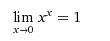
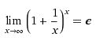
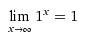
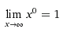
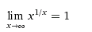

极限无穷远处重新定义  
$                         $
$\lim\_{{{x}\to{0}}}{x}^{{x}}=1$
$\lim\_{{{x}\to\infty}}{x}^{{0}}=1$
$\lim\_{{{x}\to\infty}}{1}^{{x}}=1$
  
  
&e^lnx=x&
  
  
  
  
  
  
& lim\_(t->oo)-t^(1/-t  )=lim\_(t->oo)e^ln(-t^(1/-t)) =  lim\_(t->oo)e^((ln-t)/-t)&
& lim\_(x->-oo)x^(1/x  )=lim\_(x->-oo)e^ln(x^(1/x)) =  lim\_(x->-oo)e^(lnx/x)&
  
&(-1)^(3/2)=^2sqrt((-1)^3)&
  
&(-x)^(1/-x  ) !=-1\*x^(1/-x  )&  
  
  

 

 

 

 

 

 

 

 

                                             

  
