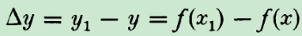

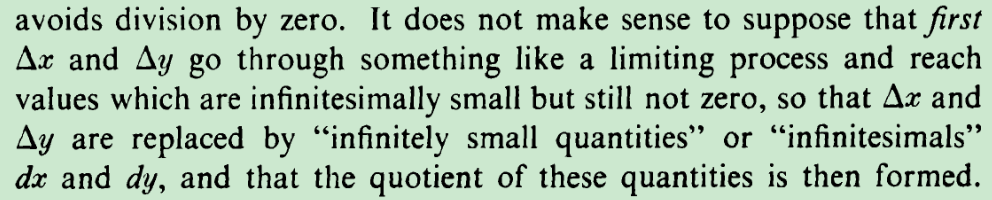

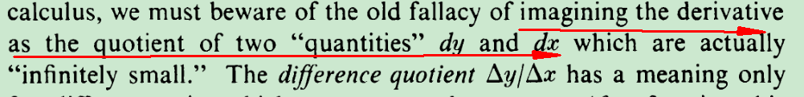

  

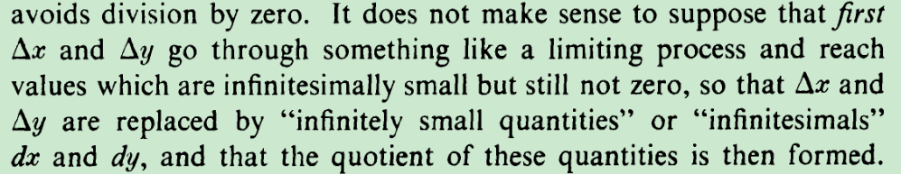

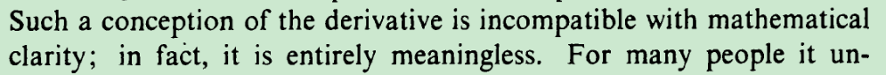

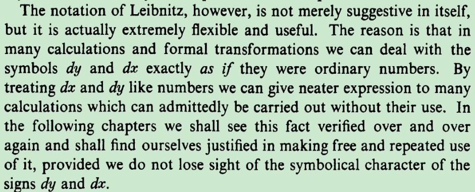

---

160

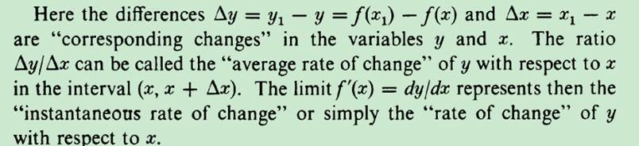

 

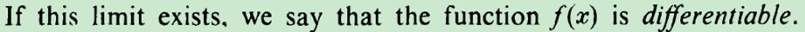

 

 

171

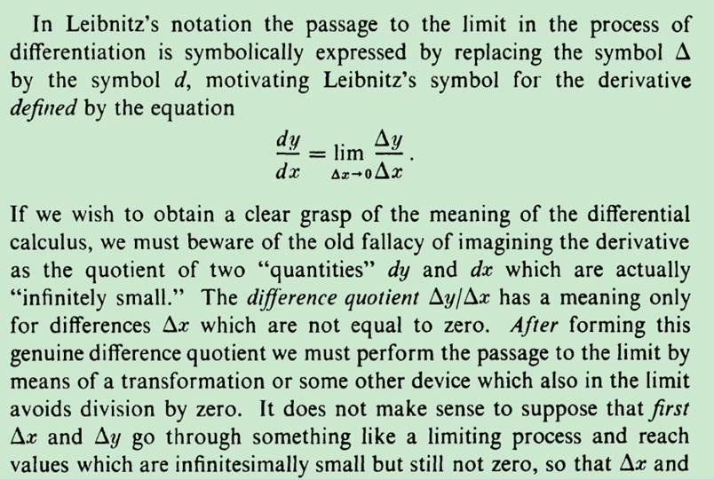

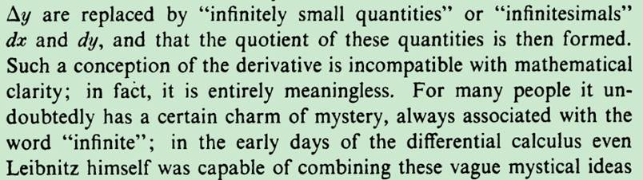

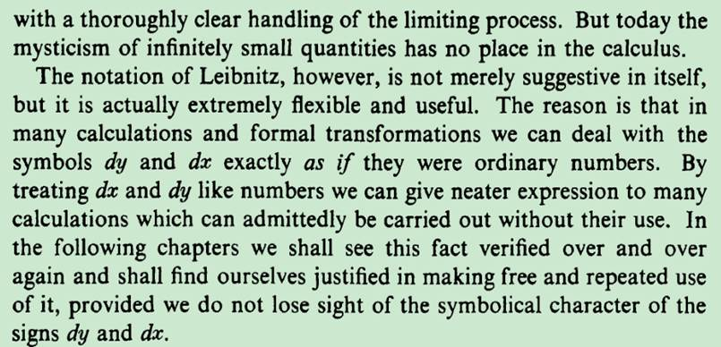

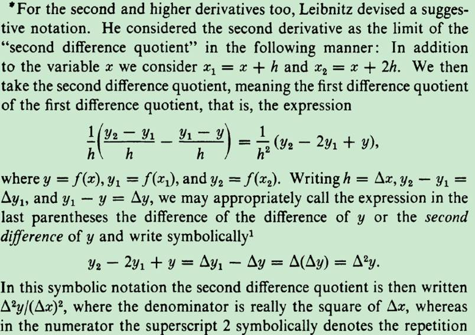

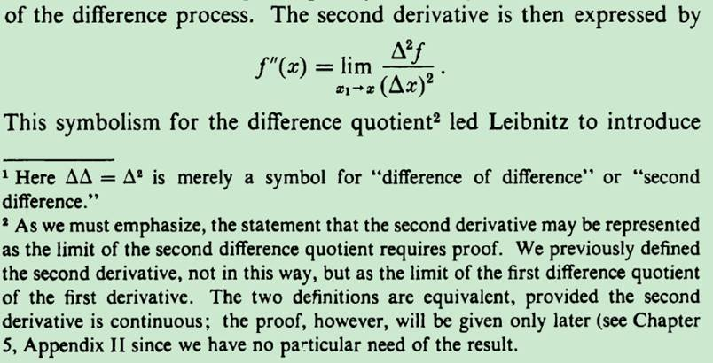

 

 

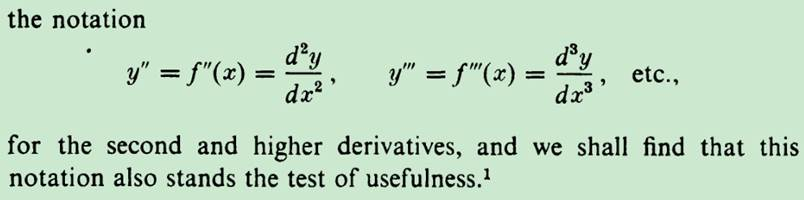

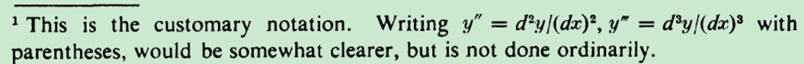

 

 

至此，dy dx代表的还是非常小的量

 

179

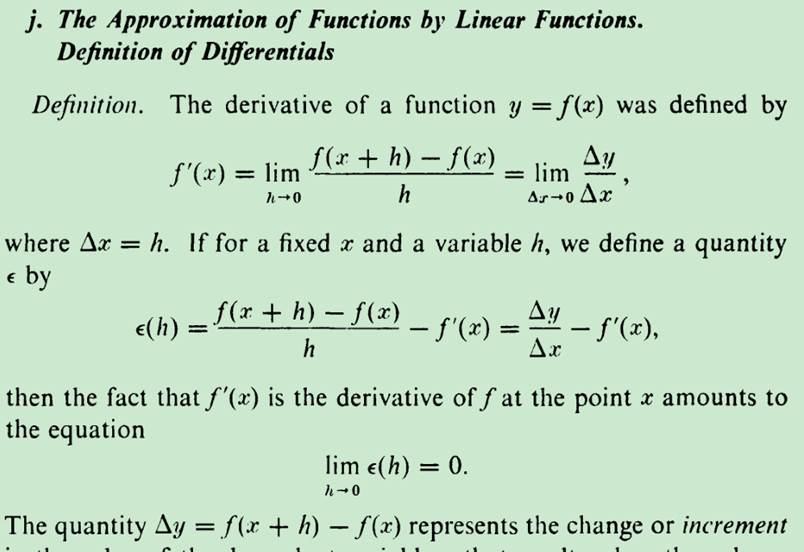

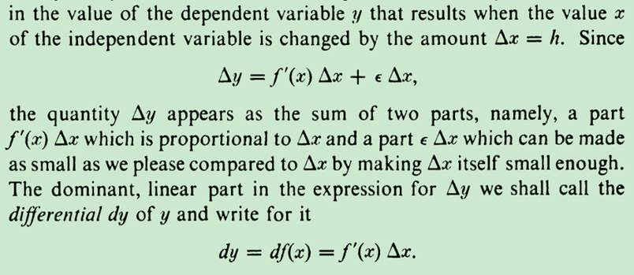

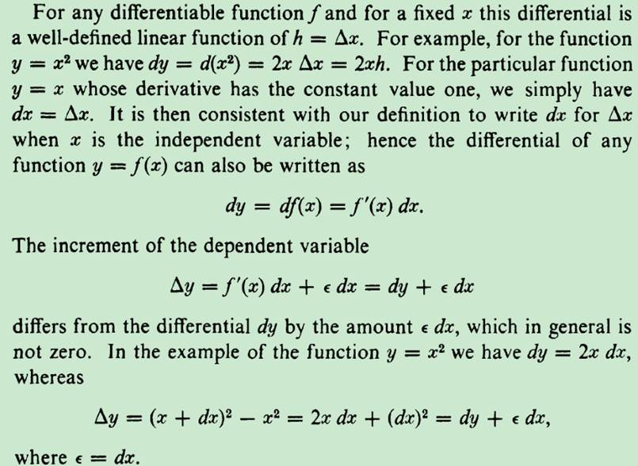

 

 

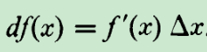

也就是df(x)=导数乘以△ x，那么按照同样的定义，对于f(x)=x,我们得到

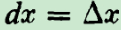

至此，dy  dx代表的已经是一个线性该变量了，而不再是非常小的量

为了今后使用，我们就干脆把按照

这个定义来使用dy  dx 吧

 

 

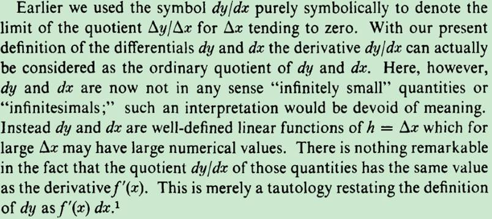

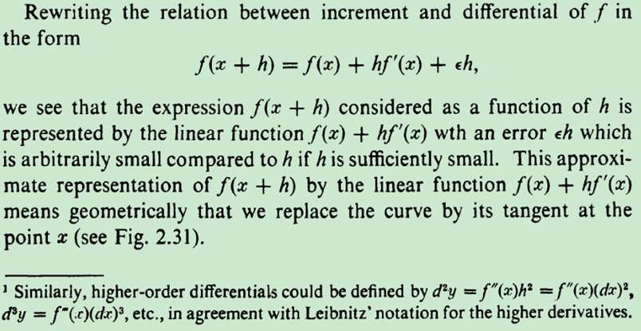

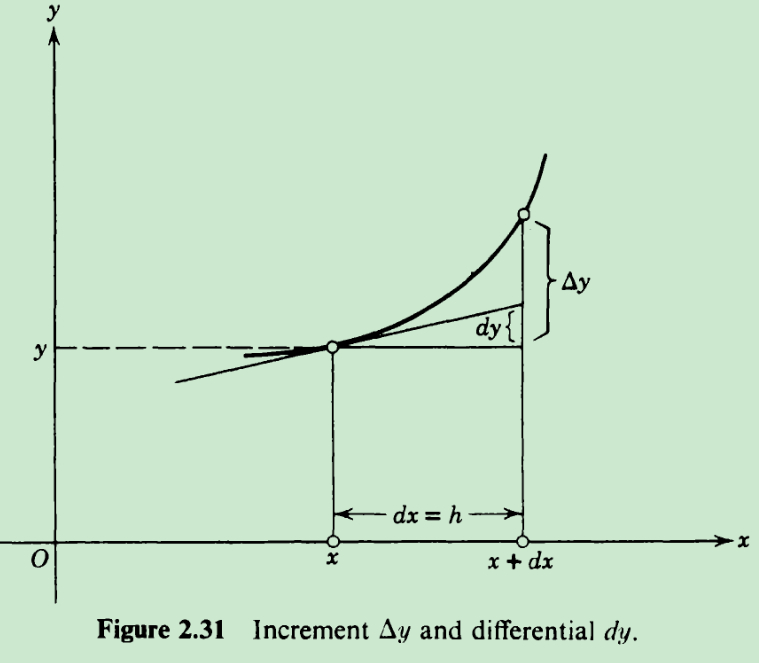

 

 

morris的书

however, that the symbolism dy / du, for example, does not mean a quotient. The entire symbol stands for a limit, which is not a quotient but a number approached by the entire fraction Δy / Δu as Δu approaches 0.

https://books.google.com.hk/books?id=WverDwAAQBAJ&lpg=PA245&ots=HzliZa4A7b&dq=Lectures%20on%20general%20arithmetic%20Stolz&hl=zh-CN&pg=PA242#v=onepage&q=Lectures%20on%20general%20arithmetic%20Stolz&f=false