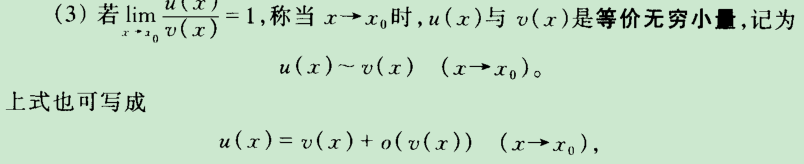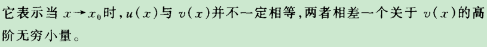  
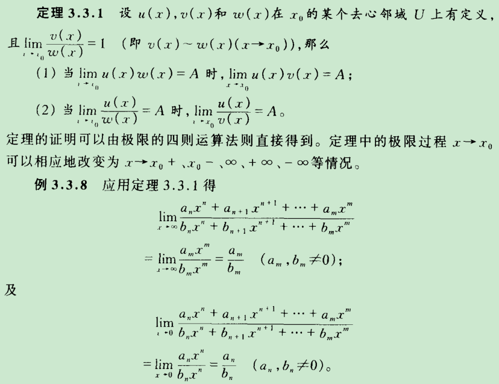  
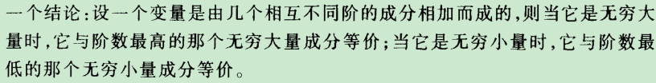  
  
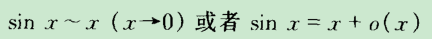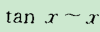（x→0） （提示：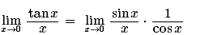）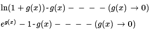  
&ln(1+g(x))  ~    g(x)----(g(x)->0)&
  
  
&e^g(x)-1  ~    g(x)----(g(x)->0)&  
  
~传递性   两边同时加减乘除依然成立  
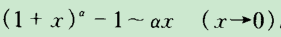  
  
  
  
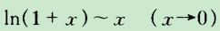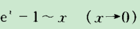  
  
  
  
  
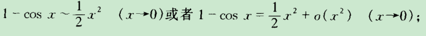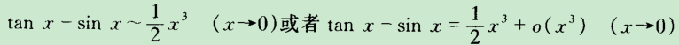  
  
  
  
  
  
  
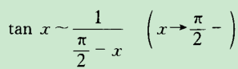  
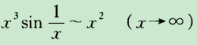  
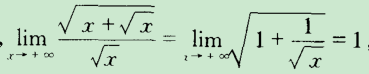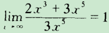  
  
  
在这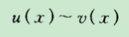两边同时乘除，加减同一个函数，成立啊啊啊啊  
  
  
  
  
$x \sim \sin x,$
  
$x \sim \arcsin x,$
  
$x \sim \tan x,$
  
$x \sim \arctan x,$
  
$x \sim \ln(1 + x),$
  
$1 - \cos x \sim \frac{1}{2}x^2,$
  
$a^x - 1 \sim x \ln a,$
  
$(1 + x)^a - 1 \sim ax.$
  
  
  
  
  
  
  
  
  
  102