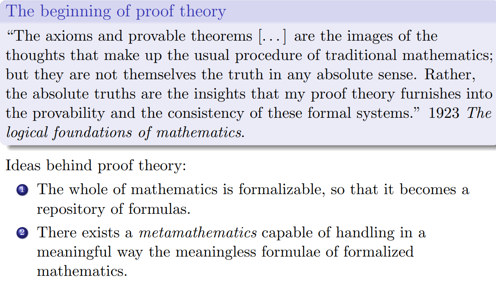

http://www.ihes.fr/~seiller/documents/projet/Giorgio2slides.pdf

The axiomatic method requires an historical development of a science

before formalization.

These axioms may be arranged in five groups. Each of these groups

expresses, by itself, certain related fundamental facts of our intuition.

When we are engaged in investigating the foundations of a science, we must set up a system of axioms which contains an exact and complete description of the relations subsisting between the elementary ideas of that science. The axioms so set up are at the same time the definitions of those elementary ideas; and no statement within the realm of the science whose foundation we are testing is held to be correct unless it can be derived from those axioms by means of a finite number of logical steps.

The axioms are implicit definitions

The concept of axiom starts to change

 “In order to investigate a subfield of a science, one bases it on the smallest possible number of principles, which are to be as simple, intuitive, and comprehensible as possible, and which one collects together and sets up as axioms. Nothing prevents us from taking as axioms propositions which are provable, or which we believe are provable.” 1922 The new grounding of mathematics.

“Certain formulas which serve as building blocks for the formal structure of mathematics are called axioms

Foundational axioms arithmetic and logical in character. Their validity again rests on intuition

they give meaning to signs, through their intuitive character, and so they link intuition to mathematical practice.

“The fundamental idea of my proof theory is none other than to describe the activity of our understanding, to make a protocol of the rules according to which our thinking actually proceeds

Indeed G¨odel’s theorems say that there cannot be a set of foundational axioms for mathematics, that deserves this name.

Thus the concept “provable” is to be understood relative to the underlying axioms-system

Thus the development of mathematical science as a whole takes place in two ways that constantly alternate: on the one hand we drive new provable formulae from the axioms by formal inferences; on the other, we adjoin new axioms and prove their consistency by contentual inference”

---

Hibert and intuition

We will try now to understand the many references to intuition that we can find in Hilbert's work in both periods. Our thesis is that it is exactly the intuitive character of axioms that marks the main difference between the two periods33.

Fist of all we need to stress the difference between "intuitive" and "evident", since the confusion between these two concepts has always been source of ambiguity. By "evident sentence"we mean a sentence that does not need an active work of the mind to exhibit its truth. By "intuitive sentence"we mean a sentence whose truth, in a given context and due to a given background knowledge, is immediately perceived, so that it is possible to skip some step of reasoning that, in other cases, would be necessary. This distinction pertains to the difference between the level of validity and that of justification. Unlike evidence, which is innate within our mind, intuition can be educated thanks to training and mathematical practice. The intuition we are referring to, that we could call a contextual intuition, is not an intuition that depends on a specific faculty of the mind different from intellect. In other words it is not a Kantian-style intuition, i.e. a faculty whose structure depends on pure forms, that are given once and for all, like space and time, and that governs sensible knowledge. On the contrary the intuition we are considering here can be refined by the same knowledge that it helps to create.

We also distinguish two modes of intuition; following [Parsons, 1995] we call them intuition of and intuition that, to stress the difference between the conception of intuition as a kind of perception - à la Gödel34 - and the idea that intuition can be a propositional attitude. In neither cases intuition is, in principle, a form of knowledge. What any kind of intuition lacks to become knowledge is the evident character that makes clear the intuition of an objective reality and true the propositions intuited. What is important to stress here is that intuition, once distinguished from evidence, may become knowledge thanks to a rational process.

Moreover, in what follows we will also consider intuition as a faculty of the mind, à la Kant. However, we have to recall that this type of intuition is not intellectual, since it acts in perception and makes perception possible.

