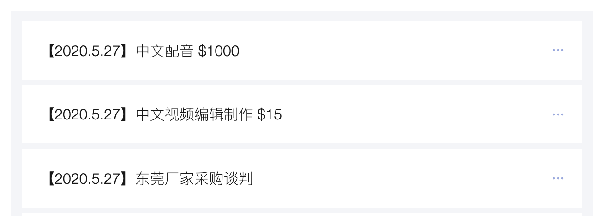
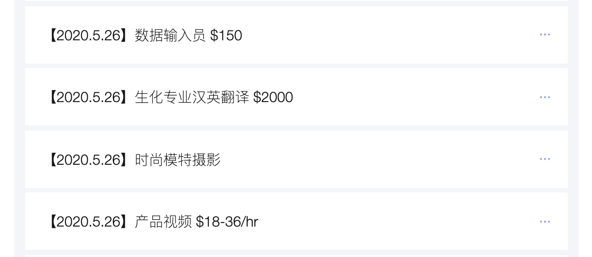
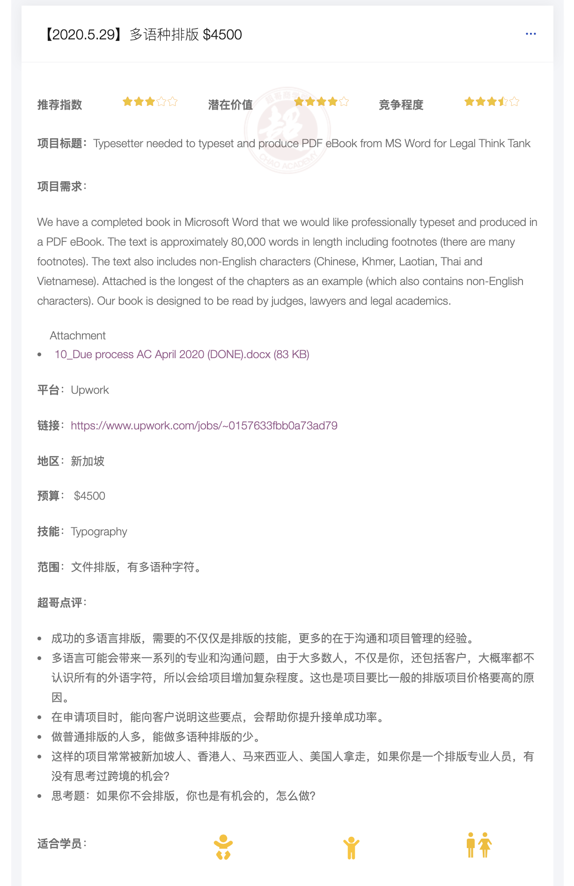
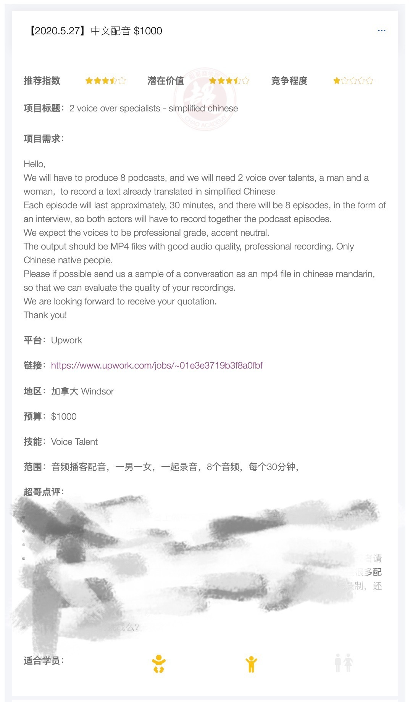
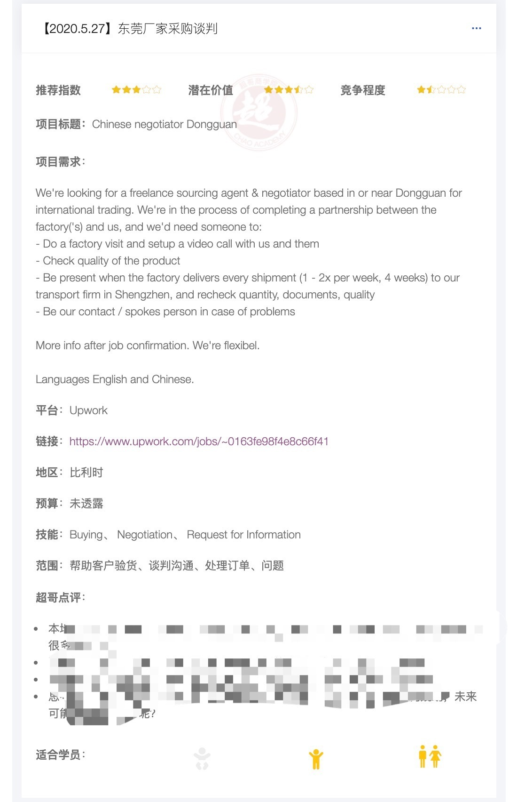

|   |
| - |
| 嗨，Lee  在全球跨境自由职业平台（Upwork），你有没有这样的状况：  注册了账号，尝试了很多次投标，却很久拿不到订单？  每天花时间搜索了很久，却找不到几个适合自己的项目？  偶然拿到了一个项目，但后来就再也没有进展？  只能在低端市场和一大堆人竞争，感觉没有出头之日？  有你感兴趣、看上去不错的项目，但是你却没有经验，没有技能，不知道值不值得申请，不知道如何能拿下它？    很多人觉得平台没有前途，就放弃了，  拿不到单的人占了平台注册用户的85%，概率太低了，我好悲观。  一年赚到2万美金（14万人民币）以上的同学屈指可数，这样的收入不值得投入。  大多数项目价格很低，感觉做了是鸡肋，价格高的项目自己也做不了。  很多名校生也长期在接10-25美金/小时单价的项目，我是不是没有办法超越？    事实上，平台上的高手并不一定是学历最高、技能最强、工作时间最长的人。    想象一下，假如你能够知道：  什么项目适合新人，大提升早期赢得订单的概率？  如何筛选优质的项目，哪些是你也可以做，但你却不知道的？  如何成功说服客户，了解赢得项目的关键是什么？  如何判断项目的未来发展潜力？如何知道是否值得争取？  如何超越高手，获得竞争优势？    那么，你的跨境自由职业征程，就会变得很不一样。    你将会得到更强的自信、更好的项目、更高的收入、更大的成绩。    一个好消息！有人一直在提供这样的实时情报和指导。    我几乎每天都在做一件事，每天都在帮助同学们，搜索、归纳、整理、分析、推荐有潜力的工作机会。    实时分析第三方平台有价值的项目机会  内部分析各类平台高价值机会。   发现有价值的项目，可以提交项目链接、截图、详细需求，要求超哥点评。  我会不定期发布最新项目分析，我承诺平均每天至少分析一个有价值的机会。  帮助大家获得分析的思路，举一反三。      日常的项目推荐          每个项目展开后，你可以看到具体的项目分析和点评。  有推荐指数、潜在价值，以及竞争程度  点评中有项目的具体分析，以及竞标的指导细节  适合学员：宝宝（新手）、少年、成年            在跟随我们一起分析几十个、数百个项目之后，相信你的战斗力将会大大提升。    很多时候，可能一个项目、一条点评就能让你快速赚回票价，在未来的日子里，让你获得十倍、百倍的回报。  同学们的反馈  &quot;我本想主攻市场营销，但发现了不少感兴趣、值得做的的&quot;杂活”，而这些&quot;杂活”其实能帮到我的主业。超哥的这个&quot;平台机会分析”板块给了我不少有价值的指引。  平台上有太多的劣质工作，我要花时间去筛选，对于每个工作机会，我都要花时间去分析可靠性，价值，还要考虑价格等等。  但在分析的过程中，因为缺乏足够的经验，往往会轻易放弃不少可能有潜在价值的好项目。  有的是不知道该怎么做，有的是没有案例，但超哥给出的建议往往能给我不少信心，有时候还有一语点醒梦中人的感觉。  另外，超哥给出的分析，如果与我的想法不谋而合，那说明我对于工作机会的分析也在不断进步。”    ——小V，跨境虚拟助理、项目管理，上海      &quot;信息不对称是赚钱的秘方。通过超哥俱乐部里的高手分析、项目机会分析等等板块，我更感觉到了这一点。  其实，很多机会就在我们身边，但往往我们没有办法发现这些机会。有的时候，只需要几句话的点拨，我就知道原来我也可以，原来是这样。  我想到一句歌词，借我借我一双慧眼吧……让我把这世界（赚钱的机会）看个清清楚楚明明白白真真切切……哈哈。”  ——小L，网站设计，上海     &quot;能发现一些平时注意不到的点，了解隐藏机会。”  ——小S，跨境营销，深圳       &quot;超哥俱乐部里的”平台机会”是超值的，我觉得最大的收获在于，可以通过当下实际的有效工作案例，了解在遇到现实的工作机会时，应该如何思考、应对。  但要做到真正拿到订单，还是需要积极思考、记录、讨论和探索。”  ——小M，文案，深圳     &quot;作为技术人员，我有自己的找单逻辑，但在俱乐部中，超哥从各个层面、各个角度对平台、对高手、对项目的分析让我得到了很多有益的启发。  超哥对项目的推荐也蛮有意思的，我觉得不仅对新手（宝宝），对成长发展期的平台玩家也很价值，其实很多类型的项目已经都有涉及，能帮助大家构建一个很好的项目筛选机制，已经是超值的投资了。  实时跟踪平台的各种机会，也让这个俱乐部显得更有意义。一些意想不到、有趣的项目，有人同时也在研究，会让人觉得有知音、不孤单。”  ——小P，IT，北京  如何得到平台项目分析？    马上加入迷你创业精英俱乐部    今天的问题：对于你来说，在跨境平台拿单最大的挑战是什么呢？    程超  超哥商学院  chaoacademy.com |

|   |
| - |
| 为了保证你能收到邮件，请确保添加 chao@chaoacademy.com到你的地址簿，或者给我们白名单。  想要退订？ Unsubscribe.    ©超哥商学院  上海浦东新区紫薇路750弄134号 |

