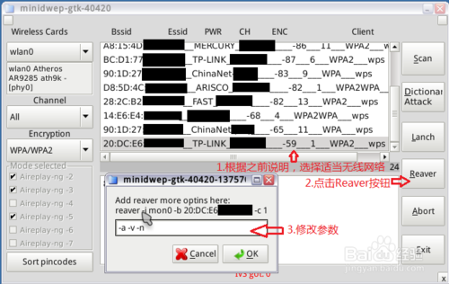

文件在/usr/local/etc/reaver/MAC地址.wpc拷贝下来，下次启动替换。  
  
将S改成n（注意是n不是N,这是为了防止漏码。），另外将-l后面的"300“改成”60“,之后点ok即可。  
  
  
2014.1.23更新，修改桌面背景，更加美观，增加webQQ，将reaver原默认参数“-a -v -S -x 20 -r 100:10 -l 2”改为“-a -v -n -x 20 -r 100:10 -l 60 -d 0” 防止漏码，还原伪防pin路由真实等待速度，加快pin的速度。  
  
  
  
建议把参数改成 **-a -v -n**  ,默认的参数在某些情况下会有问题。点OK就开始破解啦。

  
  
  
  
