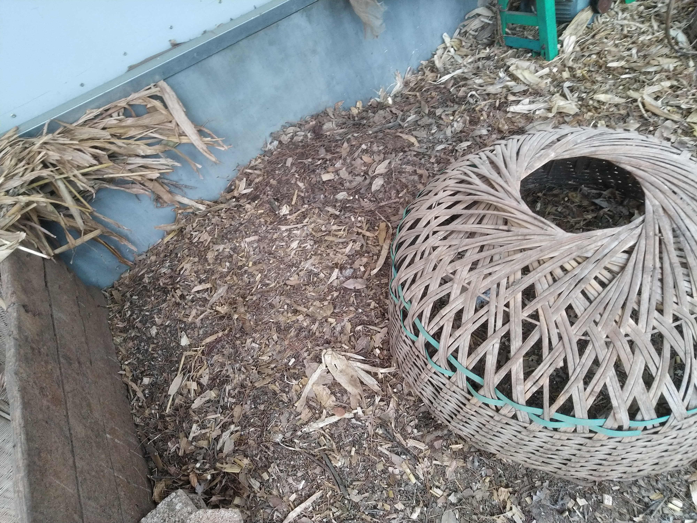
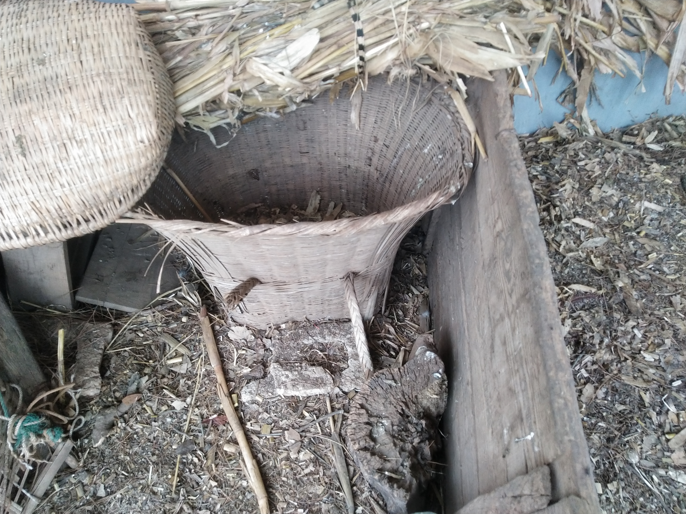

打击照理机会自然飞进去，到时候用网盖。
旁边的照起来就可以

【】7个小鸡有可能会躲在角落里用棍子去看一下，打出来拿进去，盖🧱严

最里最外里面的猪两潜盘糠，，可能两三票水，按量灵活配。

最里面1.5康➕1面
两个猪，两间盘糠+两盘面
里外，鸡的两处水
下大雨记得收糠
猪草

鸽子里17级鸡，压🧱关，

粪桶水栓

一个猪1盘玉米面，半盘麦面，一盘1.5糠，0.8鸿通水

挂着的面限时吃了后挂起来