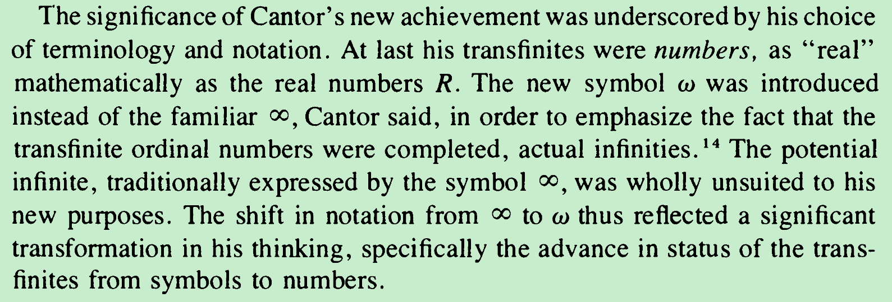
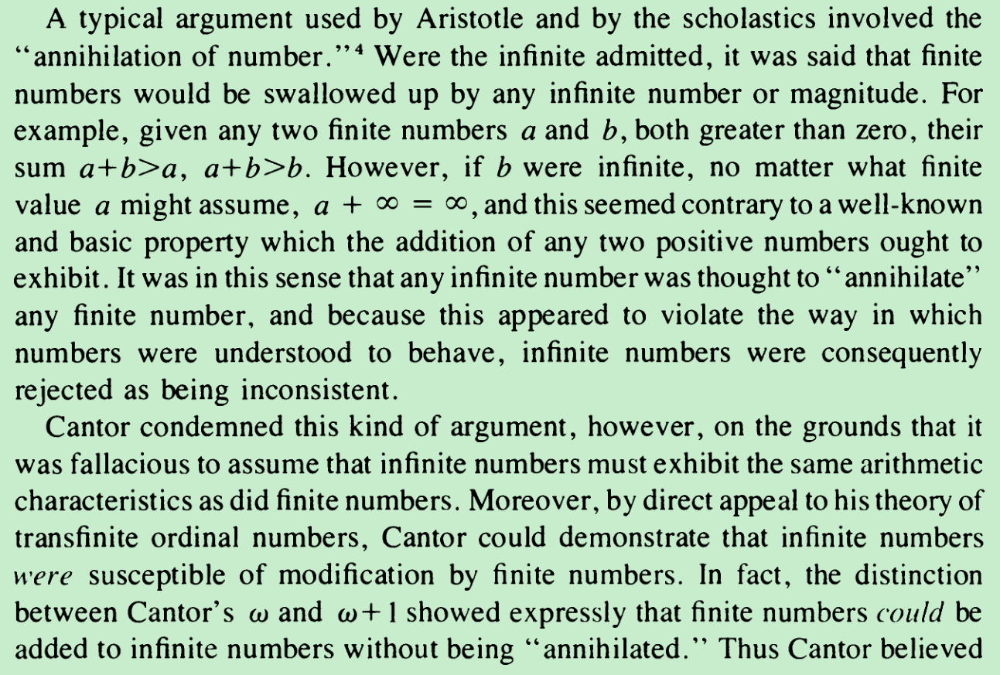
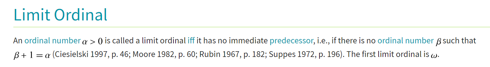
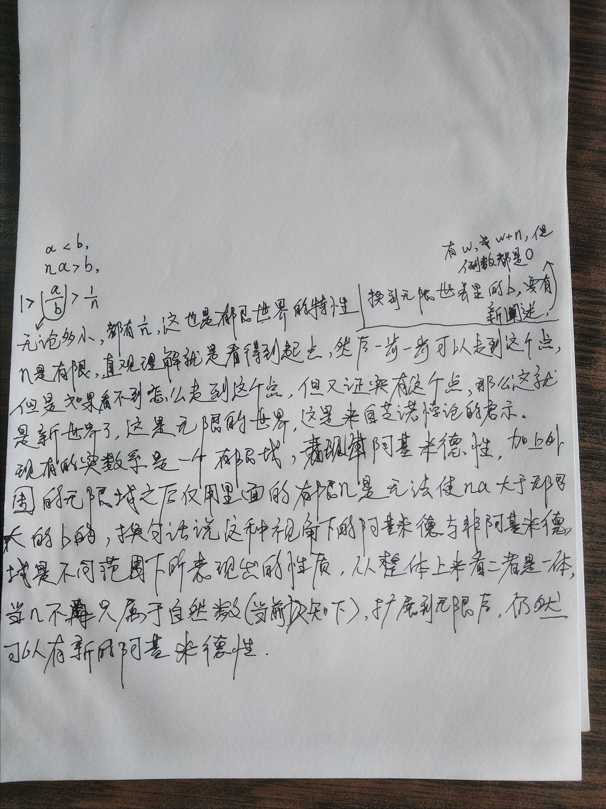

Important ideas discussed by David Burton in his book The History of Mathematics: An Introduction

There's always the next doesn't mean. Uh we cannot come to the end（咋一想感觉走完一个还有下一个似乎永远走不完，但实际根据实际情况还是可以到达终点这一点来。看的话，似乎我们的这种想法是有一定的问题的，似乎就必须承认无穷的存在，承认无穷是可以到达并且跨越的；从反面来想，无限排除法也可以到达终点，但是背后也是有用到无限的，）

If it is never zero， Then will never cross over to the destination（对的，这个从反面想也是挺有利的说服方法，应该要加到文章里面去）

从123到欧米伽的那个系列可以看出来，我想到的是极限只是帮助我们通过有限的方式引到了无穷，就是说通过极限是一种用有穷思维的有限思维的方式引入无穷，极限的方式似乎是一条船帮助我们从有限世界引入到无穷世界，因为人类认识的都是有限世界里边的东西，所以要过渡到无限的话，那么通过极限是一个不错的方式，但是从目的来看，他引入的还是无穷，通过极限引入的是无穷，进而呢，再对无穷进行一些应用，也是基于无线的方式建立起来的，
另外一方面极限只是从有限引入到接洽到无线，他的任务就结束了，那么从无限到更高级的无限，那又是新的世界。无限只是从有限推到无线，接到无线就结束了，至于要到更高级的无线，那估计又得重新再说明一下。 无限的目的只是用一种有限的方式，间接的方式引入无穷，更直接的方式就是直接对无穷的应用。极限只是一种把有限推到无限的方式，并且只是也仅仅只是推到无限，这过程就结束了。
极限的方法，琼结的方法，实际上都是用一种间接的方式，从把有限推到推到无线，更直接的方式就是对无穷的使用，但是因为人类一直生活在有限世界里边，对无穷的把握没有经验参考，所以就只能用一只常常丑鱼用这种有穷穷结的方式来做，那现在引入了无穷之后呢，就可以直接使用更方便更直接。后面改写转化成无线的时候，即便是趋近于有限的点，也可以引入无线来，进入这个过程就更方便来使用了
反过来讲有无限大就应该有无限小，而我这里的无限小应该是各种不同的菱形式，但是那些菱形是要进行怎样妥善的理解呢？我现在还拿不准

把w那一点看成是极限点的话，就能够理解为什么w这点的前面没有紧跟着的东西。

正是因为自然数的无限才能够导致级数等式的成立，这里也涉及到无限了。

从n/1的那个开区间里边没有数来思考，然后再结合康头的一个一个累积的那种只诺贝尔的那里的做法

任何一个自然数，目前看来都没有办法帮你达到那里，无数个多个自然数让你达到那里，而无数多个自然数的存在就意味着是无限大的自然数才可以让你达到那里，所以最终结论似乎就只能得到无限大的自然数使这个等式成立

知诺悖论那里无线分割的时候有限步骤始终是无法完整，但是一旦加入了无线，那就结束了（因为这里用上无线穷解法就结束了）

无法直接触碰到无线的话，那么就通过有限不停止的方式来探测无线。因为有限是可以把握的，所以就通过有限不加停止的方式来探测无线

自然数集的无穷是唯一可以应用的无穷，是the only applicable infinity
就像函数的曲径转为用海涅定理转为数列的曲径一样，似乎数列的方式自然数的趋近方式，自然数的无穷级才是可以应用的无穷carrying out limiting processes

当我们说N趋向于无穷大的时候，如果n没有把这个战术级遍历过电力烷，那么是不能够称之为n，趋向于无穷大的。结合这点，再结合对芝诺悖论里的运动，n跑完整个自然数集来思考。如果恩没有跑完自然数据，那么是不足以称之为趋向于无穷大的。 N值有两种选择，要么遍历完所有的自然数，要么没有没有的时候呢就不会到达，所以就没有办法，就必须得遍历完所有的自然数。换个想法，我来看那个集数里边的，如果恩停在了任何一个自然数那里，都不可能会到达的，所以那么N经历了所有的自然数。

当我们在思考x/1在x期间无穷大的时候，它的值会趋近于谁的时候，我们目前用的也是一种无限排除的方法，最终得出它毕竟的是零，而不是其他的比零大的实数，这也同样是一种间接的方法，当我的结论出来之后呢，我们可以得到一个直接的结论

能对这个公里进行调整，让它能够扩展得到一个真正的广泛适用的实数系

今早所看的知识点，至少让我在宏观上有了对之前的极限的etc龙德塔定义，它是一种从间接方向，消除无穷大和无穷小的方式，那么这样子的话，对于我思考构建无穷大树，用一种更直接的方式，我觉得似乎就有价值所在了。他们当年似乎只是定义了实数，然后用排除法的方式消除了，掩盖了无穷大队和无穷小的使用，那么接下来我要做的就是正式定义无穷大。（我要看一下戴德金那个小册子的后面有没有对无穷大的定义）
无限极和有限极应该是粘连在一起的，这是我从可以通过有限级无线排除法得到和有限相关的结论，这一点想到的

作为现有基点的话，其实是可以依赖于扩展的实收系那个为基点来做一些工作，问题是怎样扩展到加1。对于它的头数的话，可以依赖于极限去定义，或者说是无限多个1/n和0的区间内的那个点

对于减法的定义，一开始是想到了用差距的方式，但是更根本的还是用我之前区别康妥的定义方式，所以估计还是要从我的方式来深入思考，然后再结合差集吧。（对于减法的定义，感觉也是可以的，只是定义出来要和那个自然数间的关系说清楚我这里比如说w-2也是无穷大的和那个有限的自然数完全是两回事，二者怎样协调共存是要说明的任务）
看成是index的集合，那么就总有下一个了，w+1似乎也很容易有了，然后通过集合包含真子集的方式比较大小（甚至可以定义减法？这要和极限点厘清关系）

在定义新形式的数，比如说有理数和实数都是先定义了新的形式，然后再既已有的数的基础上定义四则运算法则。
It is, however, sometimes useful to denote such expressions by the symbol ∞ (read, “infinity”), provided that one does not attempt to operate with the symbol ∞ as though it were subject to the ordinary rules of calculation with numbers.尽管如此，但是把这个东西当成一个数来操作时候还是有效的，所以这也致使我们去思考能不能将它的存在合理化

难点在于如何严谨的引入这个数，引入之后它的推广呢，就可以继皮亚诺公里进行很好的推广，那个问题不太大。另外一个难点就是如何让它和已有的自然数集产生联系，比如说大小关系呀

Left undefined does not mean it is prohibited to define it。当前觉得不好定义，所以就让它left undefind

然后反过来看那个有理数的定义，其实他们已经断定分母上只能为正整数也就把0排出去了，所以就失去了这种创造无限大树的契机，另外因为他们觉得反过来拟运算之后乘以0都等于0就不具备被意义，所以也就没有继续追寻。

The significance of Cantor's new achievement was underscored by his choice
of terminology and notation. At last his transfinites were numbers, as "real"
mathematically as the real numbers R. The new symbol ω was introduced
instead of the familiar <*>, Cantor said, in order to emphasize the fact that the
transfinite ordinal numbers were completed, actual infinities.14 The potential
infinite, traditionally expressed by the symbol oo> was wholly unsuited to his
new purposes. The shift in notation from o° to ω thus reflected a significant
transformation in his thinking, specifically the advance in status of the
transfinites from symbols to numbers.

As he
explained, though 1+ω=ω might be said to annihilate the unit on the left,
(ω)+1 =(ω+1) just as clearly did not.8 Added on the right the unit did in fact,
under the rules of transfinite arithmetic, modify the actually infinite number ω.

从皮亚诺公理来看，无论是以零开头还是以w开头，似乎都具备同样的性质，就可能被视做同一类事物吧
在定义的人的那里，其实也可以引用一下n/1的无限个自然数的那个交集等于0，二者联合一下。这个就像0到1的那个开期间，虽然说在一那里没有包含一类点，但是已经把小一的都排出了，所以最终有的那个结果就是一类似同样的思想到那里也就是0

Nevertheless, the overriding basis for Cantor's rejection of infinitesimals rested upon the question of consistency. On the basis of his own definition of linear quantity, the infinitesimals were contradictory. Hence they were unacceptable
--
所以我的结果也符合康妥的预测

Non-zero linear numbers £(in short, numbers which may be thought of as bounded, continuous lengths of a straight line) 这个概念不错，和我之前的设想的定义方式感觉是一样的
On the strength of this conclusion, Cantor went on to demonstrate that the Axiom of Archimedes was no axiom, but a proposition about the system of real numbers that could be proven. Non-Archimedean systems could not be generated, he argued, simply by discarding the axiom, since it was not an axiom at all. As long as he believed it was actually a theorem following directly from the concept of number itself, infinitesimals were necessarily contradictory.从这个角度看来实数系里就不会有无穷小了，没有存在的空间了，在戴德金公理体系下面Non-Archimedean systems could not be generated，w可以通过无穷大的极限和1/w=0与自然数建立联系，

Limit ordinals: ω represents the smallest infinite ordinal, corresponding to the natural numbers in their order. It's called a limit ordinal because it doesn't have a specific predecessor.
ω is a limit ordinal because for any smaller ordinal (in this example, a natural number) there is another ordinal (natural number) larger than it, but still less than ω.这似乎可以作为引入无穷大定义或极限定义的方式
如果讨论x/1在第一象限的时候，在零这一点的时候，它的值实际上是无限大的，而在第三象限的时候，在临界点它的值是负无限大，单独写出来的时候，为了区分在零，这一点到底是在哪个象限的值的话，我觉得在您的后面加个正号或加个负号，这样子做一个区分是有必要的。当然回到回过头来说，现在的极限符合也能够处理这种情况。但现在是无法用静态的方式来描述那一点的现象，只能通过极限的那种不断变化的方式来说，超越了所有的数，也不是说超越了所有的数，只是说对于任何时候都可以被超越，那么就一直以为超越了所有的。但是有了这种扩展定义之后，那么似乎就可以用静态的方式来描述这个事情了，但这一点就是也可能涉及到x/2的值得定义。
之所以想到这一点，是因为一开始看到冯诺伊曼对自然数的定义的时候，它包含了零，但是之前自己学的时候说是是否包含您，这只是一个规定，但是当我看到由此想到的这一点，如果不包含您的话，那么当我们代表没有啊，不存在的时候呢，似乎就只能用<1的方式来表示了，可见当无法直接由给定的数来表示的时候，就只能通过这种大于符号小于符号的间接方式来表达，那么同样的最最最大值我马上想到的直接表达方式就是比任何数都大，但是因为最大数是个什么东西，目前也没有明确的定义，所以就不能这样说，因为没有定义出来，所以又更退了一步，在动态的过程中说是超越了一切数，噢不对，说是超越了任何给定的数，显然就做出了如此多的让步跟间接的描述，那么当我的定义成立之后呢，就想希望能够通过有直接的描述方式来做一个静态定义。

By adjoining the elements 
+
∞+\infty  and 
−
∞-\infty  to 
�
,
{\displaystyle \mathbb {R} ,} it enables a formulation of a "limit at infinity", with topological properties similar to those for 
�
.
{\displaystyle \mathbb {R} .}
同样的，等我的定义正式建立起来之后，也可以说在w处的值

这里边的motivation部分可以作为是有必要建立我说的无限大数的原因跟动力的次要因素
Addition and multiplication work as normal for finite values, and are extended by the rules 
�
+
∞
=
∞
+
�
=
∞{\displaystyle n+\infty =\infty +n=\infty } (
�
∈
�
∪
{
∞
}
{\displaystyle n\in \mathbb {N} \cup \{\infty \}}), 
0
×
∞
=
∞
×
0
=
0
{\displaystyle 0\times \infty =\infty \times 0=0} and 
�
×
∞
=
∞
×
�
=
∞{\displaystyle m\times \infty =\infty \times m=\infty } for 
�
≠
0
m\neq 0.
似乎同样的，可以应用这种句式来说明我的无限大数

写的文章里面发现的那个问题来讲，如果停在任何一个有限的自然数，都不可能使得那个等式成立，也就不可能有那个事实。也正是因为自然数的无限多个差使那个事实成立。从另外一方面来讲，自然数的无限多个也就意味着要有无限大的自然数，但是现在对于无限多个这种表述没有一个明确的构造，所以导致现在还没有办法认识到无限大的自然数的存在这种情况。当然我也在想，如果我们现在所认识到的自然数集，所使用的自然数集，如果认识到的只是局部，或者如果只是某一个更大的数集的子集的话，那么似乎也显示了我们认识的局限性。

如果不把自然数的描述距离皮亚诺公理，我们用另外的定义啊，比如说陶喆轩书里边说的那种，或者说是弗洛伊曼的定义，就是不拘泥于形式的描述之后，再来看这个问题之后呢，自然数可能只是某一种更大集合的一个子集。而已，在这个更大的集合里边，我的问题也得到了解答

**<u>另外一方面就是要看一下到底是有理数的，哪一条定义使得那个等于零是不可能的</u>**
Von Neumann definition
If one does not accept the axiom of infinity, the natural numbers may not form a set. Nevertheless, the natural numbers can still be individually defined as above, and they still satisfy the Peano axioms.
The natural numbers are thus ordinals by this definition. For instance, 2 is an element of 4 = {0, 1, 2, 3}, and 2 is equal to {0, 1} and so it is a subset of {0, 1, 2, 3}.

By the [axiom of infinity](https://en.wikipedia.org/wiki/Axiom_of_infinity), there exist sets which contain 0 and are [closed](https://en.wikipedia.org/wiki/Closure_(mathematics)) under the successor function.
axiom of infinity，It guarantees the existence of at least one infinite set, namely a set containing the natural numbers
---

A consequence of this definition is that every natural number is equal to the set of all preceding natural numbers. The count of elements in each set, at the top level, is the same as the represented natural number, and the nesting depth of the most deeply nested empty set {}, including its nesting in the set that represents the number of which it is a part, is also equal to the natural number that the set represents.
**However, the other axioms are insufficient to prove the existence of the set of ****all**** natural numbers, **{\displaystyle \mathbb {N} _{0}}. Therefore, its existence is taken as an axiom – the axiom of infinity. **This axiom asserts that there is a set I that contains 0 and is closed under the operation of taking the successor**; that is, for each element of I, the successor of that element is also in I.
Thus the essence of the axiom is: There is a set, I, that includes all the natural numbers.
The infinite set I is a superset of the natural numbers. To show that the natural numbers themselves constitute a set,
---

The Peano axioms can be derived from set theoretic constructions of the natural numbers and axioms of set theory such as ZF
Set-theoretic definition of natural numbers，就是说自然数的定义，除了皮亚诺公理之外，还有集合论的定义方式，那么后续我的构造似乎就还是可以依照于集合论一贯的做法在拓展到高一层次的数的连续体。但是为了方便理解，似乎也可以指使读者按照高一层次的皮阿诺公理套进去来拓展，然后后面如果有必要的话再强调一下，皮亚诺公理也可以从集合论的基本公里推出来
This is different from ω because in ω only 0 does not have a direct predecessor while in ω + ω the two elements 0 and 0' do not have direct predecessors.

The set N and its elements, when constructed this way, are an initial part of the von Neumann ordinals. Quine refer to these sets as "counter sets"

Transfinite ordinals are used in set theory to define the size or cardinality of sets (ordinal numbers correspond to initial ordinals, which are used for cardinality).

the process of division cannot be seen or awared to be exhausted or completed.

properties of ordinal arithmetic

你还是要有产品意识，把震惊的放在同一个部分，这样子的话加大火力，比如说当那里首先等于零成立之后，然后当分子分母是欧米伽加一比上欧米伽的时候，同样是等于1的，这种就和有限世界里面的产生的差异，这也是一个震惊的点

it was Gerhard Gentzen [Gentzen 1936] who has discovered that,assuming the validity of the law of mathematical induction along Cantor’s ordinal segment[ 0, 1, 2, 3, ... ω, ω+1, ... , ... ε0 ] ,one can prove the consistency of Peano arithmetic. 

如果确定了所有自然数集合的尺寸是w的话，那么偶数的和奇数集合的尺寸要怎么定义呢？
It is, however, sometimes useful to denote such expressions by the symbol ∞ (read, “infinity”), provided that one does not attempt to operate with the symbol ∞ as though it were subject to the ordinary rules of calculation with numbers.

如果这种数确认了存在之后呢，那么极限上的正确表述也要留意一下，unending  Procedure，or endless，就是一个不对的表达，而是应该改成end-unseen

现在的极限过程感觉只是引入了无限，把这个无限的过程当成极限的过程就是如此而已，是因为引入了无限

**让我想到完全可以直接依赖于冯诺伊曼的定义，然后引入他的那个等于0的算法，在这个基础上再扩展**

现在的一个问题就是他们定义的那些加减乘除是基于什么现实的需要吗?

In particular, the use of the infinite was buried deep by the use of e.g. the familiar e-S definitions for limits, which avoid mention of infinitesimals.
--
实际上不管对无穷大还是无穷小，都通过这种定义之下的无限排除法掩盖了，那么我们可不可以得出更直接的方式呢？
 "Actual infinity does not exist. What we call infinite is only the endless possibility of creating new objects no matter how many exist already".[17] Carl Friedrich Gauss's views on the subject can be paraphrased as: "Infinity is nothing more than a figure of speech which helps us talk about limits. The notion of a completed infinity doesn't belong in mathematics."[18] In other words, the only access we have to the infinite is through the notion of limits, and hence, we must not treat infinite sets as if they have an existence exactly comparable to the existence of finite sets

It was noted that the points of two concentric circles could be put into one-to-one correspondence with each other by associating points on a common radius. Yet one circumference was longer than the other.
这种在我看来就是似乎就不能用这种方法来比较了，那么可以放在同一基底上来比较，根据它的周长的计算公式的话，那种比较方法还能够得出一定的比例关系。射一束平行光来比较

一一对应的方式也许可以用，但是我只承认加法建立起来的联系，因为乘法的那种会进行放大，

He sought next to distinguish infinite sets as to "size" and, like Bolzano, decided that one-to-one correspondence should be the basic principle. 

According to his [Brouwer's] view and reading of history, classical logic was abstracted from the mathematics of finite sets and their subsets. . . . Forgetful of this limited origin, one afterwards mistook that logic for something above and prior to all mathematics, and finally applied it, without justification, to the mathematics of infinite sets. This is the Fall and original sin of set theory, for which it is justly punished by the antinomies.

一一对应似乎只适用于可数个集合元素，如果一个是可数无限个，另外一个是连续的无限个，最多只能说明克数无限个小于联系无限个，那么对于两个连续无限歌又怎么比较呢？如果用一一对应的话，任何两条长度不同的线段都可以一一对应，这似乎说不过去，所以我打算用长度来进行比较，长度就是一种容量的代表

因为对意义对应比较的方式的不满意，所以我想到了用包含关系用差集的方式，但是比如说0~1跟2~5这种区间的比较呢，我又想到了，用加减法的方式来建立对应关系，不能够用乘除法，不然的话又会出现一一对应的关系。这种比较方式也可以先告一段，最重要的是要，但我知道有什么必要性要研究它这种大小关系、比较方式

要比较无穷大的话就需要一把标尺，我想可以用连续体这一把标尺，然后在此的基础上衡量可数无穷大及其不可数无穷大，要找到这种衡量、量化的方式。可以把可数无穷大作为其中一把标尺或者说一种基底，然后把连续无穷大作为另外一把标尺，或者说是统一的标尺，反正都要思考来决定

The attitude of most mathematicians toward this problem was to ignore what they could not solve. On the whole they also avoided the explicit recognition of actually infinite sets, though they used infinite series, for example, and the real number system. They would speak of points of a line and yet avoid saying that the line is composed of an infinite number of points. This avoidance of troublesome problems was hypocritical, but it did suffice to build classical analysis. However, when the nineteenth century faced the problem of instituting rigor in analysis, it could no longer side-step many questions about infinite sets. 7.
如此看来，实无穷的接受是一种必然的要求，绕不过去的要求，

按照芝诺贝论的分割方法，最终会产生的数目是现在自然数无法描述的（只能说对于任何自然数，总有比他更大数目的分割），所以就希望有一种能够描述这个数目的数字

从局部上来看，走完一个店还有下一个点，所以感觉永远走不完。但是从一个拳击的视角来看，走到一个点再走到下一个点，整体还是在前进，我们之所以认为到不了，是因为我们认为在有限的时间内无法跨过这么无限多个点。简单来讲也就是无限无穷大是跨越不了的，接下来的解释可以，就根据我的那种无限排除法来讲了。

就看n这个数列，它不断变大的过程中，它超越任何自然熟，这个过程中它是在似乎在朝向一个比任何自然数都大的数，但前提是要有办法能够合理地构造出这么一个东西出来。据此我想到的是弗洛伊曼的定义

【如果两个集合中的任意一个可以对应到另外一个一对应之后另外一个还有多一个元素的话，那么就是另外一个的元素的个数比前面的那个要多。我要明确说明的时候是对应的关系不只是从a到b也可以从b到a，这种顺序是可以任意的】康拓的一一对应的搞法，嗯，在我看来的话，我从另外一个角度分析了一下，据说这两个集合产生一一对应的时候呢，如果有一种一一对应另外一个元素里边有多余的元素，那么另外这个元素的个数就比之前的那个要大，啊，这是通过啊，比较偶数局和整数集的对应方式，想到的偶数局也可以直接和整数集产生完全一一对应的关系，但是呢，它也还有存在另外一种不完全一对应的方式。那么我们就看这个不完全一一对应的方式呢，这种情形之下呢，整数集里面有多余的元素出来呢，我们就通过这个标准判定了整数集的个数比偶数集多。
之所以想到这个不需要双边一对应的思想呢，是因为我从有限g的比较情形之下思考得来的，因为有限级的情形之下，比如说让羊跟石头对应的话，我只用从羊这边对应到石头那边，如果把羊这边对应完之后，石头还有多余的话，我就可以判定石头的个数比羊多，并不需要从石头这边再对应到羊这边来，推而广之呢，也就是说从羊这边对应到石头那边，如果存在一种一对应的方式，以至于石头的个数比羊多了，我就可以判定石头的总数比羊的总数要多那么同样的情况我依据这个道理我推广到无限集合呢，我想通过这种标准来比较无限集合大小的个数。所以我现在的比较方式就是说如果存在一种从某个集合对应到另外一个集合的一一对应方式对应完之后，另外一个集合里边还有多余的元素呢，我就可以说明另外这个几何的元素的个数比前面那个集合的个数多。

康拓的无穷大理论它的那个无穷大也并没有直接应用到微积分里面去啊，微积分好多地方都涉及到无穷大，所以能不能把康托的无穷大和微积分的联系起来，或者说是创造一种新的理论可以直接使用无穷大

并且当这个理论成真的时候呢，连系统假设也就不是问题了，并且也看到了科亨和戈德尔的预测说是他是错的，到时候也是一个明显的事实，也比较符合他们的这种预期

通过芝诺悖论知道无穷也是可以被遍历过的（并且必须被遍历过才能够到达），进而排中律也可以被否定，自然数集合的构造w也就可以被接受了，实无穷可以被接受。
在芝诺悖论那个无穷无尽的过程里边，当到达终点的时候也就说明走完了无穷，通过现象我们知道了不得不接受实无穷的存在。
换句话说潜无穷的尽头就是实无穷，潜无穷很显然是可以直接理解而存在的，当到达终点的那一刻，也就走完了潜无穷的一个里程，不得不接受实无穷的存在。
走完一步还有下一步，当到达终点的时候来看的时候呢，也就走完了这无穷多步，从这个角度来看呢，就可以把无穷当做一个整体阶段性的，一个整体无穷的，后面还有更大的存在，所以呢，从这个有限的点可以把无穷当做一个完整的整体来看待，后面还有更大的无限。到达终点的时候就有了阶段性无穷，并且这个无穷是可以和自然数集合一对应“”完“”的无穷。
如果是从无限的角度理解无限，那么是很难理解的，因为我们是生活在有限的世界里边，为了理解无穷大就只能把无穷大压缩到有限里边来理解。
刚到达终点的时候，实际上已经就跨过了那无数多步，当没有跨过那无数多步的时候，就不会到达，这里的无数首先我们用和自然数集的一一对应的那个有限的定义的反面来给出——如果没有这种1对1的话就是无线）
一开始认为这个无穷无尽的过程是走不完的，但是当到终点的时候呢，我们却又不得不承认这个无穷的过程是已经被走完了，所以就说我们的潜意识对无穷的理解存在错误存在问题，换言之无穷是以我们的不理解的方式是可以被走完的。因为我们生活在有限的世界里边，我们的经验都是有限的，我们的生活里面没有无限的这种经验，以至于我们就会错误的认识无线是做不完的，所以才产生了这个悖论。

本来趋向于无穷大，有很多个无穷大，但是受制于人类认知的极限，所以目前的无穷大应该视为w

论文题目： 1/x=0 and the unification of the ~~transfinite number ~~the cardinals and the ordinals

就像一元二次方程没有，有理数解一样，这里也是没有自然数可以解了，所以呢就开始创造新一类的数

1/2的n次方把n提出有限过来，剩余的那个因子它有无线部分，但是以他的那个次方上面也不是w了，那部分也同样为0，其实通过这种方式的话，可以说明减掉n次方之后也是0这个结果

如果要问我为什么接受无穷大的存在，那是因为如果只有自然数集，如果不能够把自然数据当做一个整体，那么1/2的n次方等于0就没有解；换另外一种方式就是那种分法就会产生无限多段，反正就是没有镜头嘛，但是呢，当到达终点的时候呢，再回过来看的话就必须跨越就无限多段，所以从这个角度来看呢无穷它是一个存在的一个整体，不得不接受。

从定义的角度最严实的角度看一下为什么不能等于1x/0为什么不等于0？
然后为什么会没有最后一个自然数？这样究竟是因为哪一个有限制？
 W-1会出现什么问题？最终应该也可以证明它仍然是一个无限的树，那么有没有无限大的自然数呢？

如果认为自然数只是一个更大数集的其中有线的那个部分（从这个角度来看的话，任何一个数的前面都有一个，后面也有一个，也就不存在说是什么最后一个自然数了），那么前面这个有限的部分自然数集和后面的部分要通过什么界限来划分呢？（这个问题空想好像没什么太大的帮助，必须通过具体的问题来解决，比如说芝诺悖论）通过芝诺悖论及其结合无限排除的思想，我知道必须用尽全部的自然数才会使得到达；然后另外一个划分的方式就是这个集合可以和它的子集产生一对应的关系；并且我也感觉他们现在的这种w分法似乎是一种想当然的行为但是最终碰巧也是那个意思也还正确了。

因为我们生活在有线世界里边，从有线一直走走走都是有线，所以就不存在绝对的无穷大，任何都可以被超越，（（后记，后面回顾的时候应该跳过这部分，先看最初的思想：但是有没有一种是感觉走不到但又确实存在的呢？——芝诺悖论的启示））
一致依旧，这就是一个有限的世界。我们的经验，我们的数学基本上都局限在这里，以至于无法发展的无穷大之外。

关于Infinity does not mean “never complete” or “going on forever”，==“无穷”是一个数学概念，并不意味着“无法完成”或“永远持续”。
infinity is often used todescribe a set that is not finite, such as the set of natural numbers. But itdoesn't mean "never complete" in a literal sense; rather, 【itsignifies that there is no last element in the set】作为极限点来理解的话，其前面确实没有predecessor，但是基于极限点w的话凭空想象可以构造出w-1，并且代入无穷大的极限式子里运算也是有效的，所以既然可以表达0→w，那么为什么不可以表达w→0，并且逐步w-1，w-2，w-3，，，跑到0呢？应该要有一种包容w前面确实有predecessor的说法的理论进来；
发展下面的理论前要了解一下现在为什么没有predecessor的理由，然后再考虑修补发展创新。
或者我们说w没有0-based predecessor，但有w-based predecessor（进一步：极限点-based predecessor），为什么有为什么没有的原因我想到的是在于是否具有可构造性，是否有可构造的基底，从0开始的后面无限大显然不太可以基于0来明显构造出来，因为比较困难好像也找不到明显的方法。
另外极限过程估计应该可以说成是包含无限过程的现象，数列极限自然不必说，函数极限的话也可以转换成数列极限的表达方式，进而看出了包含的无限过程，这样似乎就可以表达w→1或0的过程吧，（只要中间包含无限就可以用→表示，就可以代表极限过程^_^；另外，这也可以描述x→∞并非 increases or decreases without bound，无限地增长，而是只要包含一个自然数集的无限过程就可以了。
it increases or decreases without bound 我的理解是：应该也不是超越无限之后还可以增长吧，它所做的是使得1/n刚好等于0就可以了，也就是到达第一个无限就可以了；这种情况下也要注意predecessor存在是否会造成问题，1/(w-1)是否合理或没矛盾也要好好想想。
