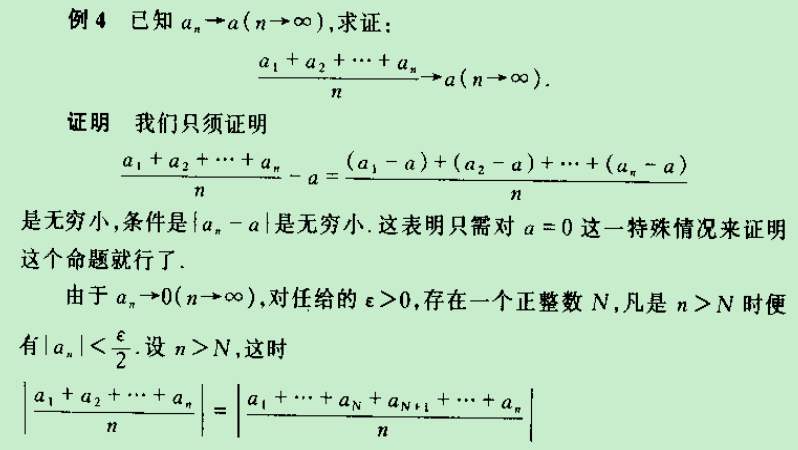
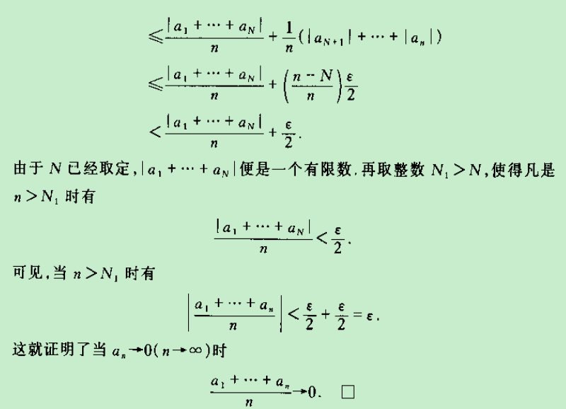
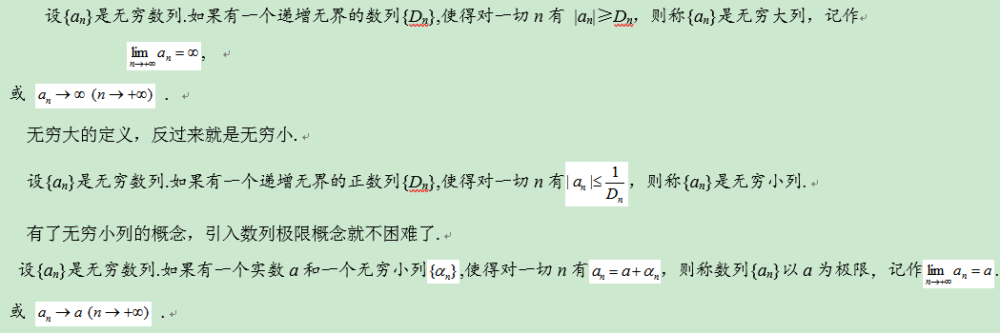

> 数学系有一个传统的习题，求证无穷小数列前n项的算术平均也是无穷小，北大很多学生开始做不出来。著名数学家徐利治先生认为，不用柯西定义做不出此题。用我的定义做此题就比较简单。不知道您是如何讲这个题目的。 

关于这个问题，我认为更一般的结论是下面这个

但是如此冗长复杂的证明，无论是教师讲完或学生自己看完之后一般都极其容易被这种复杂的符号演算过程而蒙蔽，以至于难以看清楚这个题目背后的思想是什么。我始终认为并且也提倡要能避开公式符号之障目、看清背后的数学思想或实质才是重点。对于这个问题，我认为随着n越来越大，分子里会出现越来越多的接近极限值a的项，那么它们的和的平均值显然会随着n越来越大而越来越接近极限值—— 我认为这就是本题背后的本质，这才是我们应该领悟到的思想。至于证明的书写，已经可以以这个思想为指导利用(ε, δ)定义给出。我知道张老师你曾因为(ε, δ)定义给学生带来的学习障碍而另辟蹊径，但是如果我们找到了理解该定义的简单方法（如我上次的文章介绍的那样），那么我们就不必排斥(ε, δ)定义，转而欣然接受并用之。

关于极限现象，有很多不同的描述方式，(ε, δ)定义只是其中一直，而描述，就如文学创作里提到的那样应该生动、形象、贴切，依这个观点来看我认为(ε, δ)定义的描述是不够直观和贴切的，进一步来讲主要就是没有反映出极限现象的动态性（我前面的文章里也详细地谈到了），按照我在文章里的观点来看(ε, δ)定义是一种可以被推导出来的结论，省去推导过程而直接向学生呈现这种结论性的描述也是让学生对该定义感到费解的原因之一，而这我认为正是大多数教科书的做法。张老师你给出的极限定义在直观性方面比(ε, δ)定义好了很多，

如果要“鸡蛋里挑骨头”的话我谈两点自己的看法：

1. 此处的极限定义我觉得换成这种方式似乎更直观：如果{a_n-a}是无穷小，那么a是数列{a_n}的极限；

1. 您的极限定义中因为引入了无穷大和无穷小来描述极限，所以在下看来还是有点不够直接，私以为关于极限现象好的描述应该在兼顾前面提到的几个特点的情况下尽可能少或避免多余概念的引入而直达其本质——我这里的看法似乎和奥姆剃刀原则（“如无必要,勿增实体”）有点相似。总的来说这不是一个对或错的问题，而是一个关于个人数学品味或喜好的问题。

最后，我研究极限定义和学习数学都没有张老师用时那么长，所以如有不对之处还请批评指正！