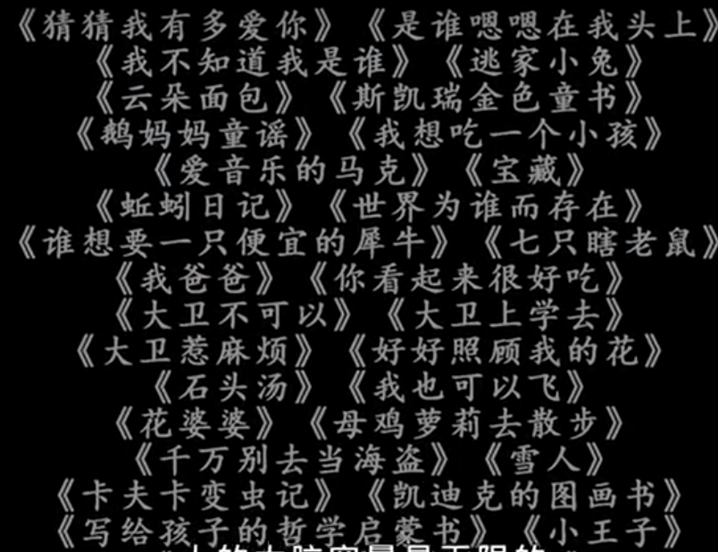
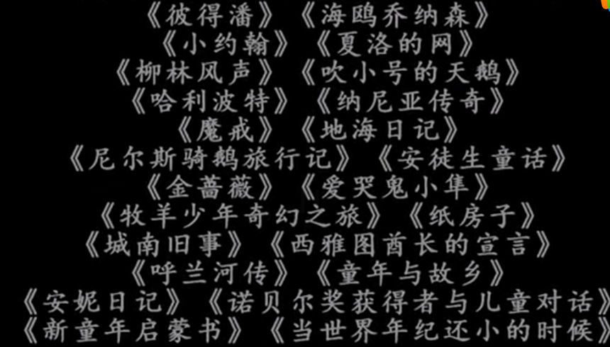

 

 

少年音乐和美术的故事》丰子恺著

骑鹅旅行记》 ［瑞典］拉格洛芙著

海底两万里》 [法]凡尔纳著

一千零一夜》(《天方夜谭》)

风到哪里去了》 [美]夏洛特·左罗托夫著

列那狐传奇故事》 [法]季 诺著

 

《伊索寓言》、

郑渊洁《皮皮鲁传》

《八十天环游地球》

 

《克雷洛夫寓言》

塞尔玛·拉格洛夫《尼尔斯骑鹅旅行记》或《骑鹅旅行记》、

《鲁滨孙漂流记》