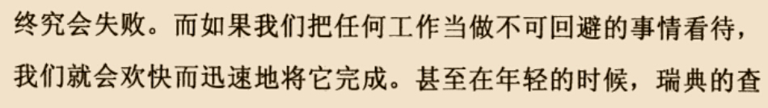

是为了避免过上朝九晚五的低效率生活或者说是被这种生活所绑架，最近一次的面试说是周二至周五每天工作时间是13:30-19:00（午觉都不能睡，所以整个下午只能低效率混日子了），然后周末两天9:00-19:00，整个一周只有周一休息，说心里话还是不想被这种生活绑架，或者是那种职业并非我兴趣所在，说心里话对我来说意思不大（我觉得有意思的职业不多吧，去从事那些迁就的职业就是一种浪费吧，所以只能自己创造了）。我希望多一点业余时间做自己喜欢做的事情。为了争取我想要的自由来做我喜欢做的事情，为了避免到时候没有选择而过上这种被绑架的生活，我现在必须努力。

英语，人活一世，我想去威尼斯、欧洲、德国、美国、澳大利亚走走看，英语能力对于走世界很有必要，并且从事学术研究、追求我的科研梦想也需要这种能力，再退一步说：为了争取我想要的自由，英语培训行业可能是为数不多的选择之一，要入行就得英语好，所以学下去吧！

歌唱让我开心，要继续！

街舞，这是很酷的锻炼方式，也要继续，从长远来讲，人活一生，总需要一个锻炼身体的方式吧，街舞是个不错的选择！

从下面这个角度或一生的角度来考虑事情谁不要完成，然后设立目标吧：

