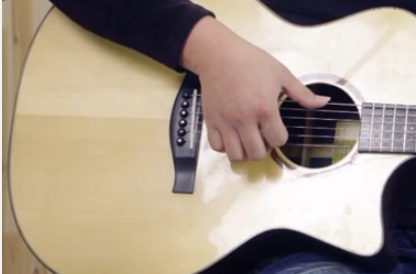

民谣吉他经典教程

张文忠的《民谣吉他经典教程>是最合适的

练习曲可以选 杨永喜的吉他之王2 这个胜在简单 但是不足就是不是每首都有MP3 所以读谱能力要好

或者蒋志军的木吉他独奏教程：指弹篇

其实每种书都有自己的特点，没有一本书能够包罗万象，面面俱到。建议这几本书搭配起来看，取长补短

选吉他：银杉沙比利   41寸   500以下

6 5 4铉大手拇指往下拨，3铉食指尖往上钩，2中指，1无名指

手型，拇指最前方

