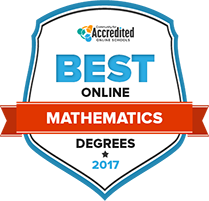

Earning an Online Mathematics Degree

There are many disciplines of study that require at least some degree of classroom instruction, laboratory work or on-site internships. However, the subject of mathematics is conducive to earning a degree in an online-only format.

Students who opt for an online mathematics school don’t study in complete isolation. Online courses encourage and facilitate interaction with peers and instructors through a variety of communication tools. Message boards, emails, chat forums, Skype and other technologies allow students to get answers to questions, discuss class material with peers or professors, and engage in group study.

Top Online Math Programs: 2017

- 2-Year Colleges

- 4-Year Colleges

OUR METHODOLOGY +

Those with a love of numbers and number theory often pursue a degree in mathematics, giving them opportunities in accounting, research, higher education and more. An online degree can give them the flexibility they need to pursue higher education at their own pace and without having to make sacrifices in other areas of their lives. But finding the program that offers the courses and specialization they need is tough. We compiled the data to offer our list of the best colleges for math in 2017.

| Rank | School Title | Net Price | Financial Aid | Total Programs | Student-Teacher ratio | Grad Rate | Ranking Score | School Description | Additional Benefits: | Placement Services | Counseling Services | Credit for Experience |
| - | - | - | - | - | - | - | - | - | - | - | - | - |
| 1 | University of Massachusetts-Lowell | Net Price | FINANCIAL AID %59% | TOTAL PROGRAMS3 | STUDENT-TEACHER RATIO | GRAD RATE54% | Ranking SCORE99.73 | The University of Massachusetts-Lowell has a bachelor’s degree in mathematics designed for students who want to become math teachers, engineers, or scientists. Students in this program can tailor their studies by choosing a concentration in teaching, bioinformatics, computer science, probability and statistics, or business applications. The math department also offers master’s degrees in general and industrial mathematics, and graduate certificates in applied statistics and mathematics for teachers. Those enrolled in graduate degree programs are required to complete an internship of at least 350 hours, as well as a reflective seminar that focuses on what students learned in the internship. | Additional Benefits: | Placement ServicesYes | Counseling ServicesYes | Credit for ExperienceNo |
| 2 | Texas A &amp; M University-College Station | Net Price | FINANCIAL AID %54% | TOTAL PROGRAMS3 | STUDENT-TEACHER RATIO | GRAD RATE80% | Ranking SCORE95.96 | The mathematics undergraduate degree program at Texas A&amp;M University-College Station exposes students to the adaptability and versatility of the math discipline, while instilling them with problem solving skills. Students in this program benefit from small class sizes, opportunities to participate in research programs and independent study projects, and close relationships with professors and advisors. On the graduate level, master’s degree students can choose one of three different tracks: traditional, teaching, and applied. Students who choose the applied master’s program can focus their studies on computational math, math biology, or computational math. | Additional Benefits: | Placement ServicesYes | Counseling ServicesYes | Credit for ExperienceNo |
| 3 | Harvard University | Net Price | FINANCIAL AID %56% | TOTAL PROGRAMS1 | STUDENT-TEACHER RATIO | GRAD RATE97% | Ranking SCORE95.87 | Since 1636, Harvard University has presented students with an extensive selection of mathematics and sciences programs. In 1825, Benjamin Peirce, the first American to produce original mathematics, entered the university. For today’s undergraduates, key core coursework is expected in functions and calculus, linear algebra, probability and statistics, and multivariable calculus. Students intending to enroll in master’s degree programs need to provide prior grades and GRE test scores, applications essays, and faculty recommendation letters. Graduate students are supported by national and Harvard fellowships, and teaching assistantships. Three international fellowship programs support study abroad. | Additional Benefits: | Placement ServicesYes | Counseling ServicesYes | Credit for ExperienceNo |
| 4 | Saint Mary-of-the-Woods College | Net Price | FINANCIAL AID %98% | TOTAL PROGRAMS1 | STUDENT-TEACHER RATIO | GRAD RATE62% | Ranking SCORE95.86 | A Catholic, coeducational liberal arts college, Saint Mary-of-the-Woods College was founded in 1840. More than $5 million in scholarships are offered to students each academic year. The college’s 125 credit hour bachelor degree program in mathematics includes 37 hours of focused mathematics core studies. Studies focus on the fields of computer programming, discrete mathematics, modelling, linear and abstract algebra, and calculus. Classes are small and include a large percentage of women in them. Electives in the undergraduate program include studies in advanced statistics and geometry. There is also an 18-hour mathematics undergraduate minor available including calculous studies. | Additional Benefits: | Placement ServicesYes | Counseling ServicesYes | Credit for ExperienceYes |
| 5 | Chadron State College | Net Price | FINANCIAL AID %66% | TOTAL PROGRAMS2 | STUDENT-TEACHER RATIO | GRAD RATE42% | Ranking SCORE94.50 | Chadron State College was founded in 1911 and currently offers students a choice of 52 undergraduate programs and eight graduate degrees. More than 80 percent of the current faculty holds the highest degrees available in their fields. Undergraduates in mathematics can choose a baccalaureate in mathematics or a bachelor of science in education with a mathematics teaching specialization. To earn the bachelor in mathematics, students must complete 36 hours of math coursework in subjects including a history of mathematics, calculus, differential equations, probability and statistics, linear algebra, and an advanced seminar. | Additional Benefits: | Placement ServicesYes | Counseling ServicesYes | Credit for ExperienceYes |
| 6 | Columbia University in the City of New York | Net Price | FINANCIAL AID %46% | TOTAL PROGRAMS1 | STUDENT-TEACHER RATIO | GRAD RATE95% | Ranking SCORE94.22 | Undergraduate mathematics majors at the Columbia University in the City of New York begin their academic careers in the required honors mathematics or calculus sequence. As part of the curriculum, students must complete an undergraduate mathematics seminar in their junior or senior year. Majors are required to choose from calculus I-IV and linear algebra, or honors mathematics, along with interdisciplinary studies in applied mathematics, computer science-mathematics, mathematics-statistics, and economics-mathematics. At the graduate level, Columbia University offers a master’s degree in finance that may be completed in three semesters or in 2-3 years on a part-time basis. | Additional Benefits: | Placement ServicesYes | Counseling ServicesYes | Credit for ExperienceNo |
| 7 | University of Arkansas at Little Rock | Net Price | FINANCIAL AID %50% | TOTAL PROGRAMS1 | STUDENT-TEACHER RATIO | GRAD RATE19% | Ranking SCORE93.97 | Established as a community college in 1927, the University of Arkansas at Little Rock today serves over 11,000 students at its &quot;metropolitan research university”. It offers more than 60 baccalaureate and 50 graduate degree programs. The Department of Mathematics &amp; Statistics gives undergraduate students a choice of a BS and BA degree, and math degrees with a secondary education option requiring a minor in education. Graduate students can enroll in UALR’s Master of Science in Mathematical Sciences comprised of 33 semester credit hours. Master’s requirements include completion of a research project and both written and oral comprehensive examinations. | Additional Benefits: | Placement ServicesYes | Counseling ServicesYes | Credit for ExperienceNo |
| 8 | University of Illinois at Springfield | Net Price | FINANCIAL AID %93% | TOTAL PROGRAMS1 | STUDENT-TEACHER RATIO | GRAD RATE47% | Ranking SCORE93.94 | More than 5,000 students enroll each year at the University of Illinois at Springfield to complete one of 31 bachelor degrees or one of 20 master’s degree programs. The university was founded as Sangamon State University in 1969. The university’s BA in Mathematical Sciences and master’s degree program in Data Analytics are offered on campus or entirely online. The undergraduate degree requires completion of 61 upper-division semester hours including the eight mathematics courses comprising the educational core. Students can complete a minor in mathematics requiring 24 semester hours, including 12 upper-division credits. | Additional Benefits: | Placement ServicesYes | Counseling ServicesYes | Credit for ExperienceYes |
| 9 | Western Kentucky University | Net Price | FINANCIAL AID %37% | TOTAL PROGRAMS2 | STUDENT-TEACHER RATIO | GRAD RATE50% | Ranking SCORE93.93 | Western Kentucky University was established at its current hilltop campus in Bowling Green in March 1906. Today it is home to more than 20,000 students enrolled in campuses in Bowling Green, Elizabethtown, Owensboro, and Glasgow. The largest student growth in the last five years at Western Kentucky has been at the graduate-degree level. Undergraduate mathematics students can opt for tracks leading to a general baccalaureate in mathematics, a teacher certification major in mathematics, or a specialization in data-driven analytical economics. The Master of Science degree in mathematics requires a concentration of coursework in analysis, applied mathematics, topology, and algebra. The degree also requires a minimum of 30 hours of graduate-level studies for graduation. | Additional Benefits: | Placement ServicesYes | Counseling ServicesYes | Credit for ExperienceNo |
| 10 | University of Idaho | Net Price | FINANCIAL AID %78% | TOTAL PROGRAMS1 | STUDENT-TEACHER RATIO | GRAD RATE56% | Ranking SCORE93.14 | The University of Idaho was founded in Moscow in 1899 as a land-grant research university and to date has granted over 118,629 degrees. Today it serves more than 11,000 students at the main campus or at centers in Boise, Coeur d'Alene, Twin Falls, and Idaho Falls. For mathematics majors at the undergraduate level, UI has seven bachelor degree options, along with minors, with a focus on applied-statistics, applied-computation, applied-scientific modeling, applied-actuarial science and finance, applied-operations research, or applied-mathematical biology. Graduate programs in mathematics lead to the master of arts in teaching, the master’s of science in mathematics, or master’s degree in bioinformatics and computational biology. | Additional Benefits: | Placement ServicesYes | Counseling ServicesYes | Credit for ExperienceYes |
| 11 | University of Minnesota-Twin Cities | Net Price | FINANCIAL AID %54% | TOTAL PROGRAMS2 | STUDENT-TEACHER RATIO | GRAD RATE73% | Ranking SCORE93.07 | Additional Benefits: | Placement ServicesYes | Counseling ServicesYes | Credit for ExperienceYes | 12 |
| College of Our Lady of the Elms | Net Price | FINANCIAL AID %97% | TOTAL PROGRAMS1 | STUDENT-TEACHER RATIO | GRAD RATE68% | Ranking SCORE92.79 | Additional Benefits: | Placement ServicesYes | Counseling ServicesYes | Credit for ExperienceYes | 13 | Mayville State University |
| Net Price | FINANCIAL AID %76% | TOTAL PROGRAMS1 | STUDENT-TEACHER RATIO | GRAD RATE39% | Ranking SCORE92.73 | Additional Benefits: | Placement ServicesYes | Counseling ServicesYes | Credit for ExperienceYes | 14 | University of Hartford | Net Price |
| FINANCIAL AID %97% | TOTAL PROGRAMS1 | STUDENT-TEACHER RATIO | GRAD RATE52% | Ranking SCORE92.30 | Additional Benefits: | Placement ServicesYes | Counseling ServicesYes | Credit for ExperienceYes | 15 | Emporia State University | Net Price | FINANCIAL AID %76% |
| TOTAL PROGRAMS1 | STUDENT-TEACHER RATIO | GRAD RATE42% | Ranking SCORE91.74 | Additional Benefits: | Placement ServicesYes | Counseling ServicesYes | Credit for ExperienceNo | 16 | Clarkson University | Net Price | FINANCIAL AID %99% | TOTAL PROGRAMS1 |
| STUDENT-TEACHER RATIO | GRAD RATE70% | Ranking SCORE91.66 | Additional Benefits: | Placement ServicesYes | Counseling ServicesYes | Credit for ExperienceNo | 17 | Montana State University | Net Price | FINANCIAL AID %66% | TOTAL PROGRAMS1 | STUDENT-TEACHER RATIO |
| GRAD RATE49% | Ranking SCORE91.11 | Additional Benefits: | Placement ServicesYes | Counseling ServicesYes | Credit for ExperienceNo | 18 | Mercy College | Net Price | FINANCIAL AID %88% | TOTAL PROGRAMS1 | STUDENT-TEACHER RATIO | GRAD RATE34% |
| Ranking SCORE90.60 | Additional Benefits: | Placement ServicesYes | Counseling ServicesYes | Credit for ExperienceYes | 19 | University of Houston | Net Price | FINANCIAL AID %51% | TOTAL PROGRAMS1 | STUDENT-TEACHER RATIO | GRAD RATE46% | Ranking SCORE90.19 |
| Additional Benefits: | Placement ServicesYes | Counseling ServicesYes | Credit for ExperienceNo | 20 | University of Washington-Seattle Campus | Net Price | FINANCIAL AID %34% | TOTAL PROGRAMS1 | STUDENT-TEACHER RATIO | GRAD RATE81% | Ranking SCORE90.05 | Additional Benefits: |
| Placement ServicesYes | Counseling ServicesYes | Credit for ExperienceNo | 21 | Indiana University-East | Net Price | FINANCIAL AID %47% | TOTAL PROGRAMS1 | STUDENT-TEACHER RATIO | GRAD RATE25% | Ranking SCORE89.89 | Additional Benefits: | Placement ServicesNo |
| Counseling ServicesYes | Credit for ExperienceNo | 22 | Nicholls State University | Net Price | FINANCIAL AID %32% | TOTAL PROGRAMS1 | STUDENT-TEACHER RATIO | GRAD RATE39% | Ranking SCORE89.88 | Additional Benefits: | Placement ServicesYes | Counseling ServicesYes |
| Credit for ExperienceNo | 23 | Ottawa University | Net Price | FINANCIAL AID %100% | TOTAL PROGRAMS1 | STUDENT-TEACHER RATIO | GRAD RATE40% | Ranking SCORE89.77 | Additional Benefits: | Placement ServicesNo | Counseling ServicesYes | Credit for ExperienceNo |
| 24 | The University of West Florida | Net Price | FINANCIAL AID %45% | TOTAL PROGRAMS1 | STUDENT-TEACHER RATIO | GRAD RATE45% | Ranking SCORE89.54 | Additional Benefits: | Placement ServicesYes | Counseling ServicesYes | Credit for ExperienceNo | 25 |
| University of South Carolina-Columbia | Net Price | FINANCIAL AID %47% | TOTAL PROGRAMS1 | STUDENT-TEACHER RATIO | GRAD RATE72% | Ranking SCORE89.36 | Additional Benefits: | Placement ServicesYes | Counseling ServicesYes | Credit for ExperienceNo | 26 | The University of Texas at Brownsville |
| Net Price | FINANCIAL AID %7% | TOTAL PROGRAMS1 | STUDENT-TEACHER RATIO | GRAD RATE23% | Ranking SCORE88.92 | Additional Benefits: | Placement ServicesYes | Counseling ServicesYes | Credit for ExperienceYes | 27 | Slippery Rock University of Pennsylvania | Net Price |
| FINANCIAL AID %29% | TOTAL PROGRAMS1 | STUDENT-TEACHER RATIO | GRAD RATE62% | Ranking SCORE87.67 | Additional Benefits: | Placement ServicesYes | Counseling ServicesYes | Credit for ExperienceNo | 28 | Southern New Hampshire University | Net Price | FINANCIAL AID %71% |

Pursuing a Mathematics Degree

Students studying mathematics can choose from a wide variety of educational paths. They may pursue the general mathematics degree, or specialize by taking courses in statistics, actuarial studies, accounting, computer science and more. The associate degree program forms a foundation for various math-related careers, while the bachelor’s degree program dives deeper into those basic areas and also introduces new concepts. The master’s degree is designed for those who have a clear educational path in mind, and the potential programs reflect that variety of options. Those who seek the PhD, aiming for the peak of their profession, can leverage their skills and education in almost any career that utilizes mathematics.

Program Highlight:

Online Mathematics Degree – Bachelor’s

Students enrolled in an online bachelor’s degree in math will gain an understanding of how society has used math historically and up to today. They must learn how to solve real-world problems using mathematical concepts and theory, as well as how to apply their knowledge to a variety of fields, such as science and technology.

Most bachelor’s programs require 120 credit hours to graduate and include required courses like English and the humanities. Students also have the opportunity to take electives and specialize in a particular field. Coursework for online programs is provided via Blackboard or college-based proprietary software, allowing students to access information at their convenience. However, students must have strong motivation and dedication.

Online mathematics degree programs are just as rigorous as traditional campus programs. Graduates may go on to careers in education, consulting, actuarial firms, operations research or government.

Associate Degree: Online Mathematics School

The two-year associate credential is the first step toward either entering the job force or moving into a higher degree program. The first year of the associate degree typically focuses on core requirements, including English and science, as well as the basic courses needed to begin the journey through mathematics instruction. While general education classes may seem to stray from the path of a math major, they help to strengthen the communication and teamwork skills that are vital in STEM careers.

The second year of an online math degree program emphasizes classes that focus on mathematics, such as statistics, reasoning and applications. The following table includes common courses students can expect to take when pursuing an online math degree at the associate level:

| COURSE NAME | overview |
| - | - |
| Algebra and Applications | Focuses on real number systems, linear equations, coordinate systems, powers and roots, algebraic operations, polynomials and factoring. |
| Quantitative Reasoning | Explores mathematical and statistical reasoning important for day-to-day life. Emphasizes percentages, probability, modeling and statistical thinking, based on examples of medical, financial and environmental decision making. |
| Mathematical Applications | Studies trigonometric functions, vectors, measurement and approximate numbers, functions and graphs, linear equations, determinants, quadratics, variation and geometry. |
| Nature of Mathematics | Discusses problem-solving, number theory, Euclidean and Non-Euclidean geometry, infinity, probability, plus other topics like fractals, chaos and topology. |

Bachelor’s Degree: Online Mathematics School

Earning the bachelor’s degree in mathematics typically takes four years of full-time study, depending on a student’s schedule. Graduation requirements include general education courses, although a student may have already completed some of these core classes in an associate degree program. The coursework also covers more in-depth mathematical concepts. Below are some examples of the curriculum in an online mathematics degree at the bachelor’s level:

| COURSE NAME | overview |
| - | - |
| Data Analysis and Interpretation | Focuses on measurement, sampling, summarizing and displaying data, inferential methods, qualitative research designs and methods, interpreting search results and research design, among other topics. |
| Foundations of Analysis | Studies the definition of real numbers, order properties, completeness, infinite sequences, convergence, basic notions of series and convergence, functions and function limits. |
| Complex Variables | Includes study of elementary functions, line integrals, power series, residues and poles, and conformal mappings. |
| Modern Algebra | Explores the development of groups, integral domains, fields, number systems and complex numbers. Covers number theory, including divisibility, congruences, primes, perfect numbers and other problems. |
| Differential Equations | Explores basic notions of differential equations, solutions of first-order equations and liner equations, nth-order initial value problems and power series solutions. |
| Stochastic Calculus | Cover probability, Brownian motion, stationary and evolutionary processes, differential equations and random walk. |
| Topology | Examines set theory, including cardinal and original numbers, and topological properties of the real-line and metric spaces. |
| Mathematical Foundations of Cryptography | Focuses on congruences and residue class rings, Fermat’s Little Theorem, Chinese Remainder Theorem, one-way functions, public-key cryptosystems, digital signatures and other groups, such as finite fields and elliptic curves. |

Online Mathematics Degree – Master’s

An additional two years of study beyond the bachelor’s degree is usually required to complete the master’s in mathematics, although this depends on a student’s other commitments. The master’s degree can be highly specialized, depending upon the end goal of the student. For example, those who intend to teach mathematics can fill their schedule with courses that focus on mathematics for teachers, while those who want to pursue the PhD in mathematics can opt for a broader spectrum of education, ending with a master’s thesis.

Specific tracks for online math degrees vary widely by subject, school and department. The following courses are just a sampling of the core courses available for those attending graduate programs:

| MASTER’S PROGRAM CORE COURSES | overview |
| - | - |
| Theory Functions of a Real Variable | Explores measure and integration theory, metric space topology and elementary Banach space theory. |
| Theory of Functions of a Complex Variable | Covers infinite products, entire functions, Picard’s theorem, Riemann mapping theorem and functions of several complex variables. |
| Algebraic Topology | Explores fundamental ideas, including homotopy and simplicial complexes, fundamental groups, covering spaces and duality theorems. |
| Mathematical Modeling | Studies modeling for applications, including ordinary and partial differential equations, stochastic models, discrete models and optimization, modeling error and uncertainty quantifications. |
| Mathematics of Image Processing | Covers image acquisition, enhancement, transformations, linear and nonlinear filters, image compression, segmentation and edge detection and pattern recognition. |
| Computers for Mathematics Teachers | Focuses on integration of the computer into the mathematics curriculum, focusing on problem solving through software packages. |
| Optimization Techniques in Operations research | Emphasizes linear programming, nonlinear programming, integer functions, analysis and application of optimization techniques. |
| Teaching Seminar | Designed for students who intend to teach on the college level, includes board work, teacher-student interaction, technical support, test writing, grading policies, student needs and more. |
| Special Problems | Focuses on specialized study not necessarily included in-depth in other courses. |
| Master’s Thesis | Includes in-depth research, mentoring and preparation for the final thesis report. Enrollment is required during each term the thesis is in progress. |

Online Mathematics Degree – Doctorate

Those who want to reach the pinnacle of their profession may go on to earn a doctorate in mathematics. The terminal degree typically takes at least four year of study after completing the master’s degree, including time spent on dissertation research and defense. The timeframe for completion can vary depending on opportunities for graduate teaching or research assistantships.

While graduate programs may specialize in either theoretical or applied mathematics, some courses for the PhD may resemble those required for the master’s degree. Students can look for dual online math degree programs that lead to a master’s and a PhD, or they can opt to take PhD courses during their master’s degree study with the goal of completing the doctorate in a shorter period of time.

Career Opportunities after Online Mathematics School

Those who pursue a degree in the mathematics may choose to enter one of many career paths, including computer science, biomathematics, actuarial science, finance, teaching, statistics, medicine and other occupations. Students can begin with a basic mathematics degree and specialize their electives, creating an educational pathway to help them prepare for diverse careers where number crunching is valued. Quantitative skills are in demand in almost every industry, and math graduates may find significant flexibility in the job market. Before enrolling in a program, students should check on occupational requirements and educational qualifications. For example, mathematicians working for the government or for research institutions typically hold a master’s degree.

Here are a few examples of mathematics-related careers that students can explore after graduating:

Featured Careers

- Mathematical Science Occupations

- College Mathematical Science Teachers

- Mathematical Technicians

- Mathematicians

- Operations Research Analysts

- Statisticians

- Mathematical Science Occupations

Mathematicians and other professionals in the mathematical sciences use their expertise to solve practical problems in various fields including science, business, and management. They develop computational methods, apply mathematical theories, and develop statistical models to analyze data and come up with viable solutions. They typically share findings through reports, papers, and presentations at professional conferences.

Median Salary: $56,120

Median Hourly: $26.98

Est. Growth: 13.3%

No. Employed: 1,220

Minimum Education: Bachelor’s