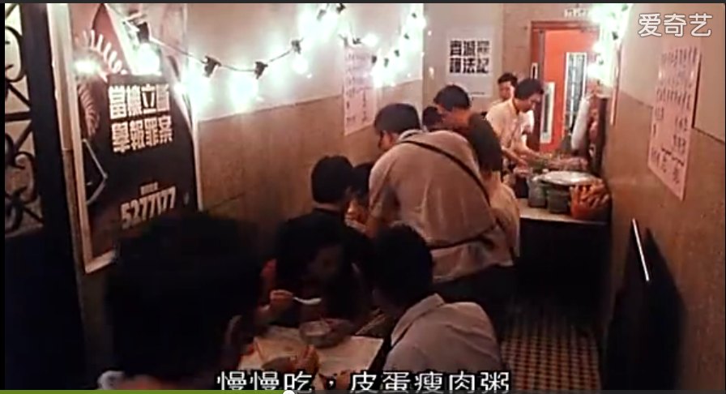
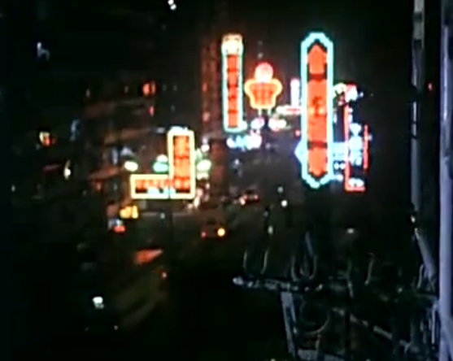

一连开始找了两个月的交互设计工作，但是都没有找到，其原因可能是缺乏工作经验或自己现在的能力还不够，然后在找工作的过程中我发现自己的创新想法也很难得到赏识，明明是一个很有创新意义的设计，最终却被面试官用各种各样的原因来否定了，这让我很愤慨，这让我有了自己动手做个产品出来，让他们都闭嘴的想法

过去差不多一年的时间我的主要精力放在交互设计上面，本想找的是设计方面的工作，只不过后来

找设计工作的过程中不断碰壁，由于我会设计和编程，于是我开始思考这二者的关系，思考最终要走的职业道路，而我的结论就是：设计只是把一个idea更细化，设计的实现依托于代码，所以代码才是真正具有决定性力量的东西，代码才能改变世界！在找设计工作的面试过程中，我也向很多面试官展现了自己设计作品中的创新之处，不过最后也很少得到认同，这使我认识到设计师的设计方案一旦通不过评审，那么最终再创新再天才的想法都会化为一堆废纸，老实说这让我有点不甘心，这激起了我“自己动手改变世界”的想法，这就让我开始找编程工作，过程中面试了几家公司，发现自己在编程方面欠缺的也比较多，主要是服务端编程的知识（之前一直都在折腾本地客户端），然后计算机基础方面的东西也不扎实，还有算法，之前完全没有学，最主要的是之前没有经历一些大一点的项目，所以经验欠缺，导致面试不上喜欢的工作，

设计改善世界，代码改变世界。我想改变世界，

因为自己现在数学没有是一个层次，所以对于编程现在能做的就是苦力活，毫无竞争力可言，最终能达到的是那种任何一个人在那种工作状态下多干一久就会有的水平，工作经验有了，貌似就很牛，实则毫无自己的竞争力可言，这种牛完全是用时间堆积出来的，毫无竞争力可言

这些都不是主要是，最关键的问题是在面试过程中我看到很多和我一样的年轻人逗着电脑很沉闷地就写一整天的代码，然后做的还不是自己喜欢的工作，只是机械化的苦力，我就想这是否值得

广州这边，看见好多年轻人来这边打工，来这边租房子，我住的这一带是过来打工的年轻人租房住处的聚集地，每天早上我买早点回来的时候，我看见大批在这边住的年轻人倾巢而出去上班，看见他们个个都是正处于精力旺盛的青年时期，好多女生也打扮得很年轻很漂亮，我就想这么好的年华用来为老板卖命是否值得，这么好的年华用来为老板加班是否值得，然后打工做的很多事情看起来也不是自己真正想要做的事情，我要做的是去研究数学物理，精力旺盛的这几年（30岁以前)黄金时光拿来为老板卖命下班后自己还有多少精力和时间投入到喜欢的数学物理上面去？要在打工过程中不断悔恨不断捉襟见肘挤时间在精力不佳的状态下强迫自己看数学呢还是利用人生的这一段好时光不顾一切的向梦想努力迈进创造自己的谋生方式，到时候30岁出来打工也不晚啊，到时候通过这期间的学习能力更高了，选择也就比现在更多了

以前读书的时候我想能开公司的人应该都是比较有能力，有本事，有想法的人，可是这次在找工作的过程中我发现并完全非如此

为那些掌握着点资本（有点钱）的人出卖自己的青春大好时光受否值得   其实我有更重要的事情要用这段好时光去做

（1   我找工作辗转南北，一位面试官说妈的，很折腾

2 挂羊头卖狗肉   被忽悠了去那家活动策划公司面试

3 TCL实习HR妈的说招聘到ending了，过来合适就上班了，呵呵）一点也没有对人才的尊重意识        唯利是图      有用就拉着你的手，无用不会邮件

我相信自己是个天才，但是这个过程中老是不被人家接收（后面面试个英语助教也搞不定，说是不地道），

一生都努力在回家的路上——不是你回不了家，而是你以为你无法选择回家，你真的回不了家吗？

即便是让我去世界或者国内顶尖的互联网公司做设计我也自豪不到哪里去，相反用自己的聪明才智去解决一些人工智能领域的棘手问题更适合作为我毕生的一项追求。

先回去半年，要是局面打不开，那么再回来也不迟

到时候出来做一个算法工程师，次一点的话做个设计师

不管到时候以什么职业出来，总之之前用最好的年华已经为梦想奋斗过了，无怨无悔

利用这段时间回去充充电也好

先冒点风险去做最想做的事情，至于人生其他的职业仍然摆在那里，即便追梦计划失败了再去从事这些职业都不迟

坚持兴趣，让它成为职业

每天下班拖着个疲惫的身躯空腹站在公交站台，闻着让人呕吐的汽车尾气，挤上足满人的公交车，继续空腹继续闻着让人呕吐的气味，看着周围的人都无精打采地滑着手机疲惫地打发着时间，公交车轰隆轰隆地走走停停，马路上车辆横飞喇叭也拼命无奈地叫着，一切都身不由己，一切都疲于奔命，就这样，我在无数个这样的下班日子里不断蹉跎自己的青春，时日一久，疲惫了激情，疏远了甚至是嘲笑了自己曾经的梦想

好不容易熬到终点站，在炎热的气温中勉强找到一家可以应付肚子的小餐馆，选来选去就那么几个有点看不下去的菜，哎，还是将就选两个吃了吧，就这样再难吃也忍着呼呼噜噜地吃完，然后满头大汗地回到住处，开启风扇，让风大起来，脱掉全身的衣服，然后疲惫地躺在床上，啊，好累，我什么事情都不想做了，我只想休息，就这样，等精力勉强恢复的时候已经是晚上九点半了，还要看数学吗？在一觉休息到明早和接看数学之间斗争

然后，勉勉强强疲于奔命……

他們給你多少薪水，讓你放棄你的夢想？

https://www.youtube.com/watch?v=C31JGR-Qq1E

以后来看别人用很少的钱就买走了你人生最具活力的怎么几年，划不来啊

老虎伍兹：从贫民区的破房子里走出来

http://www.zunniu.cn/yule/2015/10/126161.html

求生与谋职

http://www.time-weekly.com/story/2011-11-24/120652.html

抓紧人生A计划

http://bd.kuwo.cn/yinyue/5609847?from=dq360

 2016/07/27

我回到了家，开始按照自己的愿意展开行动

父亲见我找不到工作回家“窝着”，母亲说他有点气，而我让他尝我从杭州拿回来的茶他也有些不情愿，脸上的表情并不是太开心，相反母亲倒是挺自在的，也许是她之前担心我，而这次我回到了家，那么她就可以随时看到我，关爱我了，提醒自己不能处于溺爱之中。

回到昆明，最明显的感觉就是气温如此宜人，再也不必因为深圳广州杭州的高温而无精打采，没有做事情的动力，失去深入思考和内心宁静的环境了，为什么我必须到炎热而又让自己无法平静的地方去找工作，在家乡如此宜人的环境下难道就不能找到或创造出我的道路吗？路上得到了两位讲家乡话的女生的热心帮助，感觉很亲切，很朴实，想必她们也是勤劳朴素的人吧，比那些过度打扮的大城市女生更实在，这也不错，哈哈哈哈……

大城市车水马龙，车车密集，飞驰着来来往往，拼命地怒吼着轰隆着叫着，再加上空气燥热，然后周围环境嘈杂，商店促销的歌声，喧嚣夺目的广告，四周都是钢筋混凝土高楼大厦的建筑，一个热燥的环境，似乎会让人失去平静，失去深入学习一个领域的坚守

回到家后，因为没有车水马龙的来来往往的喧嚣，没有高楼大厦钢筋混凝土这比视野，天然无污染干净的湖水，山水一色，山清水秀，生机盎然的树木果树竹子山上的花草树木，鸟儿的叽喳（它们都是大自然的孩子），一切都很静谧、平静、默默地按照自己的本性生长，对，投入大自然的怀抱真好，农村的原味生活真好，这种环境中可以平静，可以深入，可以沉浅，可以攀登高峰，乐于默默无闻，乐在其中，只为心中的理想地，默默前进。

回家后，吃住都不缺，不是问题了，甚至是丰裕了。因为之前尤其是到杭州的一个星期，都是投宿到各个青年旅馆，差不多每天上午都得计划今晚可以住到那个好一点的便宜的青年旅社，然而每天基本上也都是50块以上的住宿费，感觉花销挺大的，然后就是吃饭问题了，价格是我一般每餐吃10多块的炒饭或者是一个菜配饭的种种，超过20元一餐我都认为是贵了，我不知道这是不是节俭，因为在外面每餐吃不吃全凭自己决定，所以有好几次我都是一天一餐，甚至一两天都完全不吃饭，主要是求职不顺利及其自己的道路不明确然后我又无法控制自己的情绪导致的，所以后面我渐渐消瘦，手臂非常细、扁的状态，母亲说我瘦了出现那种很骨头轮廓的样子，我穿上那件垮脖的衬衣的时候尤其明显。在外面吃饭的问题是干不干净是问题，营不营养更是问题，最大的问题是很多时候吃过之后的两三个小时都是不消化的状态，哽在胃里好难受，这时候会如果强行做要做的事情，那么这种胃哽的状态就会更加持续着，好难受，无法集中精力于所做之事，只能休息，结果耽误了自己做其他事情的时间。回家后，住处，宽敞了，明亮了，床铺宽大了，被子舒服了，因为都是自己家的，所以更放心，和它们更亲近了，每天也不用交房租了，真的少了很多忧虑，多了很多亲近。至于吃嘛，家里边食物丰富，而且全部是土生土长原汁原味的，由于好吃的太多，而自己又吃不了多少，所以就只能每样尝一点，都太好吃了，结果无法深入的品尝一味食物的滋味。吃早晚饭是必须的例程了，所以每天都能保证早晚两餐。母亲早晚两顿都是她做，数十年如一日，任劳任怨，手艺也非常棒，好辛苦，很难得，我要继承母亲的好手艺，周末争取全部由我把控吧。

在家里一个人通过电脑探索道路的话，可以说基本陷入自己的个人世界里了，少了和各种人打交道的经历，自然就会江湖经验欠缺，但是有失有得，因为我可以在这种环境里深入了，减少看新闻微博微信的频率势在必行。

广州印象   大广州给我的感觉是热火朝天的卖卖卖、买买买，大搞进出口，发展经济和搞工业生产，很多发传单、店前站台接待，打红旗一行人成群结队引人注目的营销推广方式，是一个商业集聚地，结果河流都被污染成臭水沟了，车辆多多、物欲太强，城市过于喧嚣，很多脏乱差的小巷子，地铁非常发达，图书馆建筑有艺术性，藏书丰富，运营很积极，好棒

杭州印象  杭州这边这种感觉稍微弱一点，多了些文化气息，保留并继承了很多具有地域（我认为是江南）风格的建筑，比如窗挡样式、亭子、餐馆招牌等等，传达出这个地方的文化和人们对美的追求，很惬意。昆明这边的建筑基本上没有了本地的特色，失去了建筑传统文化，基本上都效仿西方的盒子式讲求实用性的功利主义建设风格，在实用性的基础上加上艺术或传统的审美追求装饰便会给人们带来更多的惬意和实用功利主义外对真善美的追求，科技改变世界，艺术让生活更惬意。

越发达的城市政府越作为，广州、杭州、深圳这些地方已经用上了电动公交车（昆明的依然烧汽油），轿车限拍，没有绿色标志不让通行等等保护环境的措施

一些目标：

数学学习

探索出窝在家里发展的道路（编程技术课程、数学课程、远程职位、网络接单……）

继续看设计理论，每天早上读这些设计理论，练习英语口语，6：30 - 23:00是工作时间

看历史书，别人推荐我看些近代史和伟人传记，林肯、亚历山大、拿破仑……

母亲的慢性咽炎，我要想办法帮她调理

家里的摆放有点乱，想办法让它更整齐，更光洁，启动网络渠道

酸菜肉丝饭

虾仁炒饭

新人，人家看不起，根本不重视（华为递面试邀请）

龙虎榜 粱  龙舟 臭水沟珠江

我看到地铁里吹竽的老奶奶 上海滩 马路天桥下吹萨克斯的男人

