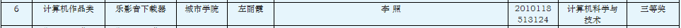
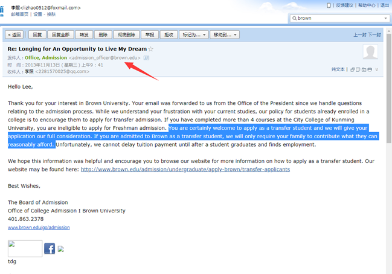
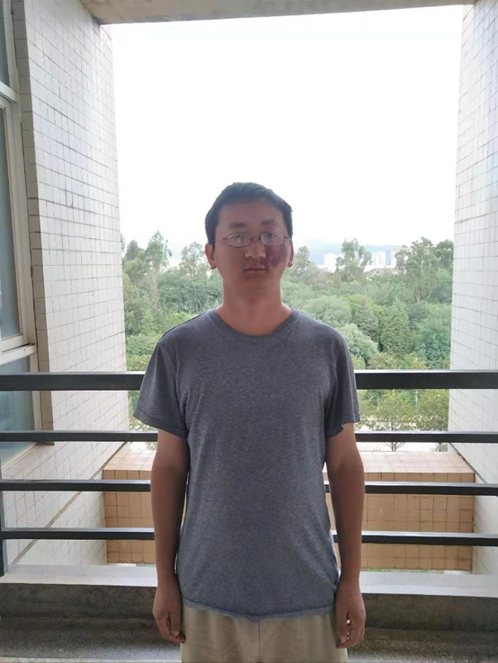

入校学习申请

尊敬的学校领导：

您好！

我原本是昆明理工大学城市学院2010级的学生，后来因为无法适应学校教育而退学了。虽然说我远离校园环境已经有5年了，不过从初中时期开始就建立起来的做研究的志向至今一直未变，这几年我也一直努力在这条路上——一直在坚持自学数学，虽然说也有了些进展，但我也认识到这样无师无友地独学下去是有些问题的。作为一个退学者，为了走上学术道路而长期孤独奋斗，完全看不到希望和尽头，能否实现梦想的困惑始终萦绕于心，这给我带来了不小的压力，再加上周围没有志趣相投的人可以交流，只能独行，所以不时也感到孤独和彷徨，心情不愉快，以至于不能高效前进。幸运的是根据近来我的两项经历我找到了减轻这种困厄带来的影响的一个方法——在团体中学习，具体来讲好的方式是在校园环境中自学，这也许可以解释为“如果想走得快，请独行，如果想走得远，请与众同行（If you want to walk fast, walk alone. But if you want to walk far, walk together）”，所以我申请允许我回到呈贡校区图书馆自学，主要因为这边环境和学习氛围都更好，图书馆资源也更丰富。具体落实起来我希望能在学校有宿舍可住和有张饭卡可用就够了，或者要求再低一点：能进入学校自学和有张饭卡可用即可，估计一两个学期应该就可以助我找到下一步的发展方向。所以不知道能否请您考虑为我提供这样的学习机会呢？这便是我本次写信的请求。

我的这种举动在一般人看来似乎还是过于理想化、不接地气，但对一个退学后还孜孜不倦地为了实现梦想而奋斗多年的学生来说这是我目前找到的有利于我在学习和研究上前进的方式，武汉大学老校长刘道玉先生也说过“特殊人才是由特例造就的”。最近一段在校园环境中自学的经历让我觉得几乎每一天都可以在高效和充实的奋斗中度过，所以接下来如果能有条件在这种环境中继续奋斗将会利于我的前进。

下面我再提供一点与我有关的信息助您了解我，相信看完之后你会更愿意考虑我的请求，所以还请耐心阅读，谢谢！

以前在学校的时候，我请教了数学老师杨小芹几个数学问题，后来她到呈贡这边上课的时候拿我的问题和其他老师讨论，有老师看后可能觉得问题有一定的价值，说了一句“想不到城市学院还有这样的学生”——这是杨老师后来告诉我的。后期虽然由于某些原因不去上课，但是我始终以认真的态度对待学习，在校期间自学为主，独立开发的软件在学校计算机比赛中也得过奖，学校网站上面至今还保留着有我的获奖名单，这可以作为我自学能力的见证。http://jwc.kmust.edu.cn/info/1014/2377.htm

此外，现在我看的数学、软件、音乐方面的书都是英文版的，也能用英文写作。说这些并不是为了炫耀，而是想说明我可能还是有些才能值得您考虑给予帮助的。几年前我也曾写信求助过美国的布朗大学，后来校方回应说会给予我充分的考虑，并给予经济上的援助，

可惜当时由于自己实践经历不多，却要孤身一人远渡重洋，再加上经济等问题，我没有足够的胆魄和觉悟付诸于行动，现在回顾起来觉得十分可惜。本次我再提这个事情是想说明我有些资质可能还是不错的，希望您可以结合我下面所说的情况充分考虑我本次的求助，谢谢！

如今我离开学校快5年了，我做研究的志向仍然不改，这几年也一直努力在这条路上，现在我从事的是软件开发的自由职业，这样才能有更多时间学习数学和其它想学的知识。我目前还在学习微积分和数学分析，自认为这两门课自学起来很不容易，不过我已找到学下去的方法了。我也花费了很大功夫了解了数学理论的来源、演化、工作原理。平时除了学习知识点外我也对一些主题进行研究，研究的问题都是我自己想到的。结合我的自学经历及其了解到的情况来看国内好多大学生学习高等数学是比较困难的，主要还是因为没有好的中文教材。把在学习过程中那些自己好不容易弄懂的知识点通过简单易懂的方式写出来或录成视频讲座，然后发在网上帮助后学之人让我觉得是件有意义的事，目前我仍在做，我也获得了很多学生的感谢。下面我列举其中一些内容，一方面可作为我能力的证明，另一方面也可作为我是否值得您帮助的参考。其中，2017-02-12重新发布的视频《dx dy 的意思 微分的定义 导数符号的意思》目前有7.7万多次观看量；2018-10-18发布的文章《高等数学和数学分析教材推荐及其学习方法浅谈》目前有6万多次阅读量。最近我也写了两篇自认为具有新意的文章，第一篇是《极限定义新讲：动态定义与静态定义》，这是一篇短小的文章，可以让读者一瞥我的潜力。大约六七年前我就想写这篇文章了，但当时能力不够，一筹莫展，后来在为后面这篇文章准备资料的过程中我突然得到灵感遂成此文。第二篇是《无理数的定义和实数理论的建立》，这是目前为止我花费最大功夫、最长时间完成的文章，写作过程中我也花了好一部分功夫去了解相关的数学史，即便最终我探究的结果不正确，我也深刻体会到了杰出数学家丘成桐先生所说的“夫筹学之道，求根创新”和清代学者皮锡瑞的“凡学不考其源流，莫能通古今之变；不别其得失，无以获从入之途。”从时间上来说，我从2017年开始研读相关资料，于2018年1月写出了第一版，后来发现文章有逻辑缺陷，所以又开始于2020年8月份左右开始修改，中间由于某些事情的耽搁，再加上一边还要做些工作来谋生，以至于到了2021年四月份才再度开始，不过在过去这段时间内我看了更多的相关资料（发现关于这个主题的论文也不少），也终于想出了更简单的实数构造方式，此后我尽量每天花一个上午或下午去完成这篇文章，一直到6月22日才算完稿。此外，如果你感兴趣的话那么我的博客上的“高等数学”这一栏里的其它文章也可供你评鉴。我写的这些文章虽然不一定能产生新知识，但至少提供了一种简单好懂的学习途径，当然，如果因为我的经历而带着成见去看这些内容的话可能会认为它们毫无价值。我也开了个与之相关的微信公众号“高数变简单”，目前关注者有3438人。

很多受益于这些文章的学生向我表达过感谢，可是有时候我也会苦恼——我帮得了别人，但谁又能帮助我呢。对于本次的请求，除了母校外我想不到还有别的什么学校愿意关爱一个孜孜不倦的学子。如果可以请考虑我的请求，非常感谢！

李照

附：

1. 我的手机号和微信号：13529123633。

1. 我的照片

