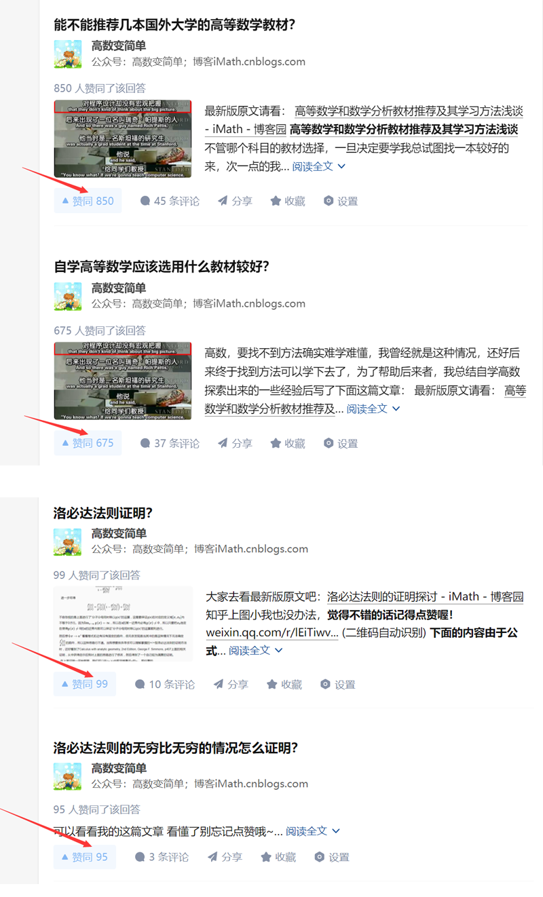

张老师：
您好！几年前为了不想让自己努力获得的知识受益的只有自己一人，也想帮助别人少付出点劳动尽可能高效地越过相关的难点，于是我把自己好不容易弄懂的认为有价值的知识点写成文章分享出去，主要是发布在知乎和自己的博客上面，虽然说也获得了很多读者的认可和感谢，但是因为也没什么收入，如今我在这方面难以进行下去了，另外我也碰到了求学方面的问题。本次写信给你是希望你能了解下我的情况，然后如果可能的话请为我接下来的求学打算提供一点建议。谢谢！
我的志向是去搞数学和物理方面的研究（当然如果后面有机会对AI的工作机制产生兴趣的话也不排除去搞这方面的研究），但如今却在前进的道路上不知道何去何从。我的困惑得从我的教育经历说起。我出身农村，在我的学习和成长历程中接触到教育都不算太好，没有受到多少好的引导，一路成长基本全靠自知自觉自学自悟，所以我的道路走得十分曲折，以至于成长得也非常慢。高中时期状态好时我也曾年级上考了两次第一，但后来受到了干扰，由于自己性格内向不善于处理人际关系去解决这种干扰，最终导致成绩下滑，后面高三备考的时候觉得老师的教法不利于我学习，所以回家备考。因为受到了学校某老师错误的备考方法误导，再加上那时候由于条件限制学习中出现的问题利用网络无法及时很好地解决，还有自己的学习方法的问题等因素使我高考失利。后面本来想复读但又受到某大学老师的劝导，说是大学里很自由，有很多时间可以自学，我想这种情况不是很能发挥我学习的主动性吗？结果就去了一所二本大学——昆明理工大学城市学院，不幸的是面的教育让我觉得是在浪费时间，甚至是在自欺欺人，不但不能建立我的自信相反让我变得没有底气，再加上自己内心的清高、理想主义、高标准，无法妥协，后面也由于我对学院里安排的课程失去了兴趣，所以于2015年11月退学了。如今虽然说我远离校园环境已经有8年了，不过从初中时期开始就建立起来的做研究的志向至今一直未变，这几年我也一直努力在这条路上——一直在坚持自学数学，虽然说也有了些进展，但经历了这么多年的探索与奋斗我认识到这样独学下去是很难行得通的，目前这条我行我素的道路似乎是走到了尽头。
我原本计划通过自学完成本科专业方面的学习，但是后来我发现这种做法对于我来说是问题太多难以完成的，其中一个主要原因是因为我比较细心，常常能够注意到一些细节问题（比如说能发现教材上的错误或不足，具体见后文），然后就会对其中的一些问题刨根究底，有的问题一研究下来可能一年半载就过去了，但是当那个阶段结束之后自己在升学晋升的这条路上却还是原地踏步，没有任何改变，类似的这种研究经历我有过两三段之后觉得这样搞下去前途茫茫——除了学习上的进步外现实中课程进度和学术职业生涯方面没有任何进展，有了这样的认识之后那么重新走入大学似乎就是一个必然选项。
再次进入大学似乎有国内和国外的可以选择。如果要重新进入国内大学的话，那么我预计至少有1.5年的时间是不得不耗掉的，比如首先得花一年时间准备高考，然后进入大学还要学习一些对我帮助不大的思政、英语课程，还不得不参加一些学生的军训和党团活动，这些情况让我感觉对自己消耗会比较大，如今32岁的我实在是不想再耗费自己的时间了，所以我对重新通过高考走入国内大学感到踌躇。对于国外大学的话，主要是学费比较贵现阶段不太能负担得起。目前我已申请上了University of Illinois Springfield，允许先远程学习，后面再线下学习一段时间后按国家规定就能获得国内认证。本月25日就要开始上课了，因为费用还是有点贵（一门课3~4个学分，然后一个学分说是360美元左右），所以我对是否应该抓住这个机会也茫然不知所措。最近这三年我从事的是软件开发的自由职业，做这种职业也不是为了赚钱，为的是能有更多时间学习数学和其它想学的知识，所以只要赚够当月的生活费我就基本不做了，最近不知道是不是受疫情影响近来几个月基本接不到单做软件，目前生活也开始难以为继了。前一阵子我也开始尝试过找国外的远程开发工作，想着如果找到的话收入可能会多一点，应该可以挣到学费，但是我投了一些简历之后没有收到任何面试邀请，这让我思考这条路是不是行得通。也许再花点时间提升一下自己的软件开发能力后面就会找到一份海外远程开发工作，但是目前要做出走哪条路的选择时间上很紧迫，究竟走哪条路比较好在这个节骨眼上我拿不定注意。因为我觉得你具备更宽广的视野，可能会给出好的建议，所以就来信想听听你的看法，请多多指教！
最后，如果你好奇我是一个何种水平的学生，那么请让我补充一点这方面的说明。首先，因为我比较细心，所以能发现教材里的错误，这两篇文章里记录了我发现的教材里的错误——《教材小错误：极限四则运算法则里的除法前提》和《不定积分的符号定义问题》。其次，因为也花费了很大功夫了解了数学理论的来源、演化、工作原理，也探索得够久，这让我开始有了提出与课本上不同的方式看待问题的底气，比如在《极限定义新讲：动态定义与静态定义》这篇短小的文章里我试着给出了极限的动态定义，大约六七年前我就想写这个主题的文章了，但当时能力不够，一筹莫展，后来在为后面这篇文章准备资料的过程中我突然得到灵感遂成此文。《无理数的定义和实数理论的建立》是目前为止我花费最大功夫、最长时间完成的文章，写作过程中我花了好一部分功夫去了解相关的数学史，即便最终我探究的结果不正确，我也深刻体会到了杰出数学家丘成桐先生所说的“夫筹学之道，求根创新”和清代学者皮锡瑞的“凡学不考其源流，莫能通古今之变；不别其得失，无以获从入之途。”从时间上来说，我从2017年开始研读相关资料，于2018年1月写出了第一版，后来发现文章有逻辑缺陷，所以又开始于2020年8月份左右开始修改，中间由于某些事情的耽搁，再加上一边还要做些工作来谋生，以至于到了2021年四月份才再度开始，不过在过去这段时间内我看了更多的相关资料（发现关于这个主题的论文也不少），也终于想出了更简单的实数构造方式，此后我尽量每天花一个上午或下午去完成这篇文章，一直到同年6月22日才算完稿。此外，如果你感兴趣的话那么我的博客上的“高等数学”这一栏里的其它文章也可供你评鉴。写这些文章的主要原因是因为结合我的自学经历及其了解到的情况来看国内好多大学生学习高等数学是比较困难的，把在学习过程中那些自己好不容易弄懂的知识点通过简单易懂的方式写出来或录成视频讲座，然后发在网上帮助后学之人让我觉得是件有意义的事，我写的这些文章虽然不一定能产生新知识，但至少提供了一种简单好懂的学习途径。其中，2017-02-12重新发布的视频《dx dy 的意思 微分的定义 导数符号的意思》目前有15.6万多次观看量；2018-10-18发布的文章《高等数学和数学分析教材推荐及其学习方法浅谈》目前有8万多的阅读量，2019-03-02发布的文章《洛必达法则的证明探讨》目前有2万多的阅读量。很多受益于这些文章的学生向我表达过感谢，如下是我在知乎上的回答的赞同数截图

有时候我也会苦恼我帮得了别人但谁又能帮助我，如今走到如此境地的我不知道何去何从，如果可以能否请你给我点指引和帮助呢？非常感谢！
祝您身体健康，工作愉快！
李照