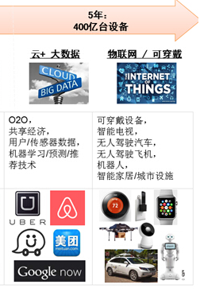
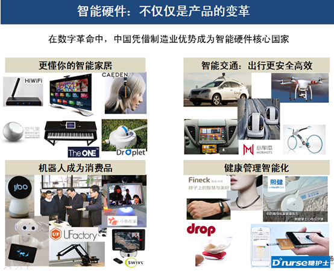

具有未来趋势，代表未来科技       电动车、新能源、基因 Tesla  新能源公司  生物科技  寿命长久的产品

大多数用户基本每天都会用到的产品

智能硬件 机器学习 机器人 大数据  人工智能 物联网 车联网  医疗 机器人

Machine Learning

Engineer（寻找之类职业的公司的其他招聘）

云+大数据和物联网/智能硬件

在家办公

纯互联网   互联网结合的实体

新能源、新材料、信息产业、新医药、生物育种、节能环保、电动汽车

生物 

医药

新材料

环境能源现代农业 能源 太阳能和风机 健康

 

中国正在实施创新驱动发展战略，大力推动大众创业万众创新、互联网+和中国制造2025 机器人产业“十三五”发展规划

