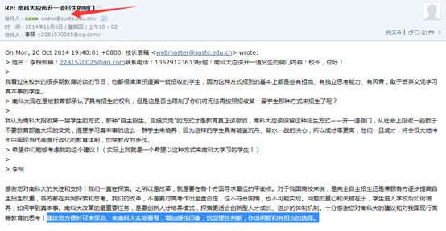
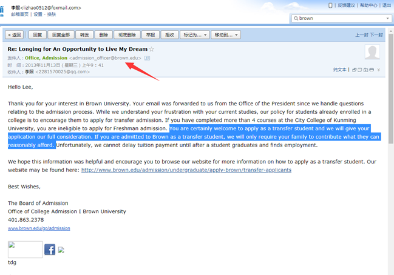

尊敬的校长：

你好！大约6年前的时候我写邮件来说自己想来南科大做一名不要文凭的学生，

当时由于自己很多事情还没经历，所以对于校长办公室回信里说的来南科大实地考察看看的建议我没有足够的觉悟和胆魄付诸于行动。如今差不多6年过去了，这期间我在行动和思想上都经历了很多，仔细思索之后我觉得是时候来南科大看看了。

我想来体验下南科大老师的教学和身临其境地感受下学生们的水准，为期可能要一个月到一个学期吧。这便是本次写信的请求。

我想来南科大看看是因为我觉得自己现在处于困境之中，而我又有个搞科研的梦想不想放弃，来南科大见识一番之后将有助于我下一步的抉择。我本无意用实际行动来麻烦你们，但是仔细考虑过好几次之后还是觉得现阶段只能通过行动来增加认识以助自己解开迷惘。

我之前是昆明理工大学城市学院的学生，后来觉得里面的教育让我学不到什么知识相反却不得不浪费大量的时间而退学，这是经历了一年多的思想挣扎和行动上妥协后又反弹的最终抉择，希望得知这个情况的您还能克制住成见，因为一旦有了成见那我们便无法再耐心聆听，更不能做出理性的判断。

我有一个去搞数学或物理方面科研的梦想，但是我又从大学退学了，而又不想再次走高考这条路，以至于如今还在坚持的我看不出路在何方，这便是我的困境。目前我想到的可能有助于我做出下一个重要决定的一个辅助方式是去感受一下名校师生的水准，开阔一下自己的视野，南科大便是我的选择，所以才写了这封求助邮件。

如今我虽然离开学校有5年了，但一直未变的是我仍然努力在以后去做学术搞科研的这条路上。目前仍在自学高等数学，自认为这门课自学起来很不容易，不过如今我已摸索到了学下去的方法，把在学习过程中那些自己好不容易弄懂的知识点通过简单易懂的方式写出来或录成视频讲座，然后发在网上帮助后学之人是我目前在做的事情之一。我的微信公众号“高数变简单”目前关注者有2803人，2017-02-12 重新发布的视频《dx dy 的意思 微分的定义 导数符号的意思》目前有5.2万次观看量；2018-01-10发布的文章《从有理数到实数和数的连续体》是我看了好多英文资料才写出的，目前有 7779次阅读量； 2018-10-18发布的文章《高等数学和数学分析教材推荐及其学习方法浅谈》目前有47311次阅读量。对于数学这种小众的兴趣，这些作品能有这些观阅量已让我感到很欣慰了。需要的话我还能提供更多资料证明我的学术能力。此外，我会编程，较为熟悉Python，有软件作品可以证明能力；英语方面，读写基本没什么大问题；我也懂一些设计方面的理念并能做一些设计。

类似本次的求助信我在2013年时就写过给美国的布朗大学，后来校方回应说会给予我充分的考虑，并给予经济上的援助，

可惜还是像前文所说的那样当时由于自己实践经历不多，却要孤身一人远渡重洋，再加上经济（我家是农村的）等问题，我没有足够的胆魄和觉悟付诸于行动，现在回顾起来觉得十分可惜。本次我再提这个事情是想说明我有些资质可能还是不错的，希望南科大可以考虑我的请求。

回顾往昔，因为得不到好的教育而让自己起点比别人低了很多，自己本身有问题的时候又得不到老师或家长的指正，以至于陷入了如今的困境，但我仍然相信自己的能力，我迫切渴望一个学习和学术都很浓的氛围来开拓自己的视野，增长自己的见识，因为这样的环境极有可能助我找到下一步的方向。目前我也很担心因为没有这样的环境而最终落得“橘生淮北则为枳”的结果，请南科大再次考虑我的请求，非常感谢！

本次为了不增加篇幅长度以至于占用您太多时间，所以上述内容略去了很多细节，了解详情可进一步和我沟通，我的手机号和微信号：13529 123 633。

李照