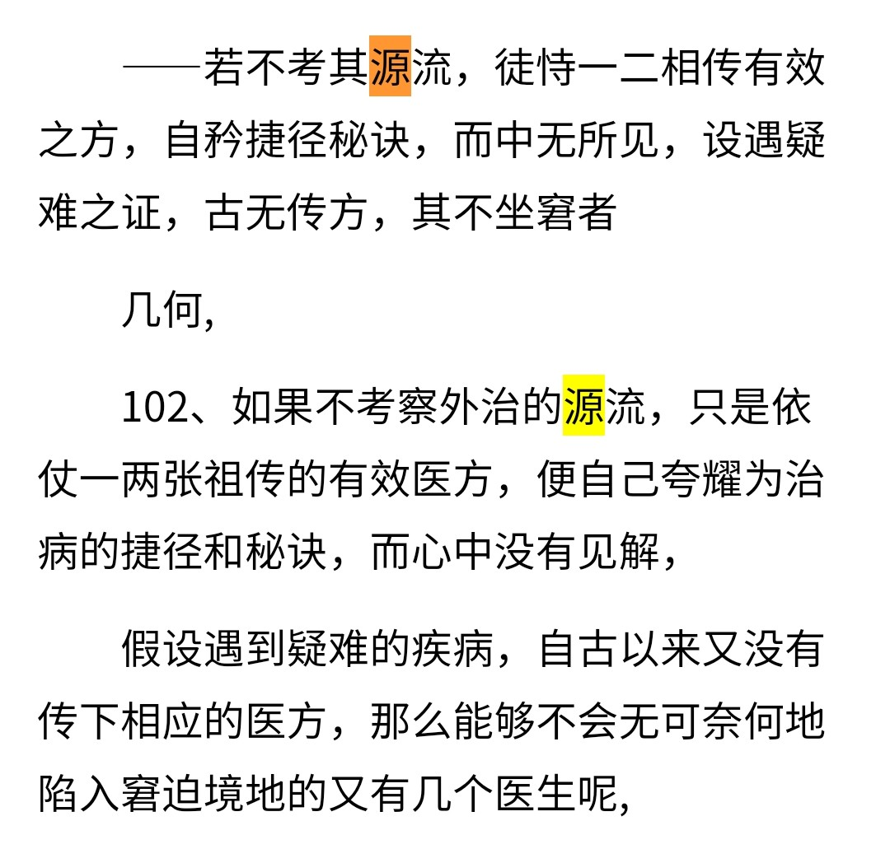

假传万卷书，真传一个”字。如何挑出核心精华的部分是要思考的问题

学习一个知识点的时候，我们对本质的把握可能因为引导材料的不同而导致，可能是从侧面看的，而最好的情况是从正面来看。而在万花缭乱的情况下，要从正面来看的是了解历史，回到最初来源上面来看。第1手资料。

降本流末的危害把握不到本质。

不考其源流，莫能通古今之变；不明其得失，无以获从入之途。

应该说不考其源流的话，就不能够明白演化，不明白为什么是现在的样子，便有助于明白现在做法对本质源头描述的得失差别，降本流末损失了哪些信息

认识了本质之后呢，就要考虑一下我们当前对它的文字描述是否贴切，是否有不足，是不是还可以更好更贴切更准确？

这一切都取决于对现在的理论，是否能够更准确更贴切的描述所有研究的问题的本质  的思考。从数学的经验来看，有一些理论对试试本职的把握，让我觉得是从一种隐晦的角度去描述的，不够正面也不容易理解，也就不容易抓到事实的本质。

有时候难学让我思考我们是不是没走正道，而是走了偏道或偏门，把握不到实质，以至于揪着一个残影或“非全貌”在思来想去不得要领。解决方法：回到要研究的问题的基本概念上来看，自己想想能否创造出自己的路、还有没有别的路