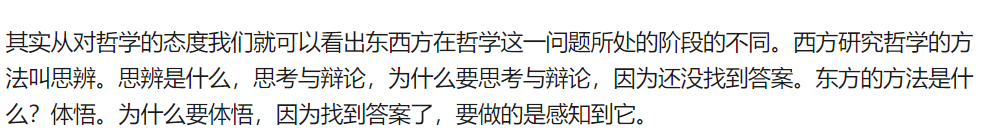
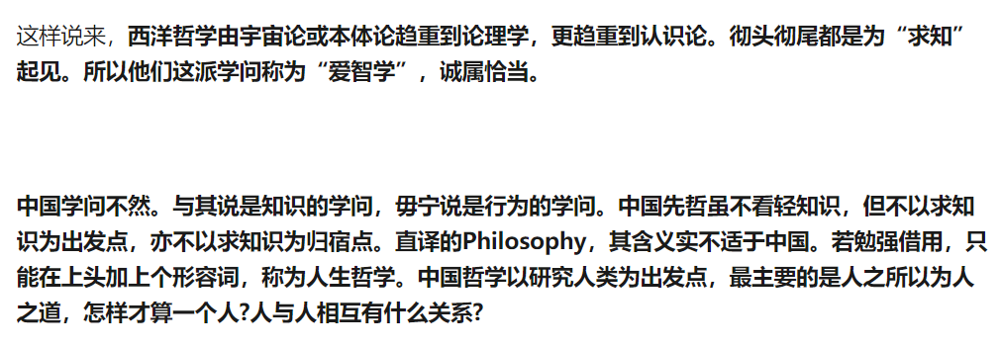
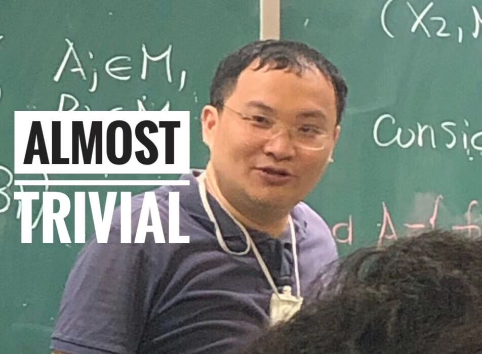

“事实”唯一就是客观实在，其他一切都非事实。从这个层面，科学并非事实，而是主观对于客观的解释

甚至我目前的想法还更极端一点。我目前认为，只有自己能感受到的感知和自己作出的行为才能作为一个思维框架的根基，比如说“我做出了某某行为会导致我最终得到某某感知”之类的…

我目前觉得这种“彻底否认客观存在”想法最直接的会导致思考效率降低。

同时，和其他有意识的东西的交流的规律就会彻底沦为“我说什么，他会作出什么反应让我感知到”的规律，这也许是有点恐怖的。但是不排除在根本上成立的可能性吧…

-----------------

这个观点我也是不反对的，所有很久以前的理论都被人证明有某种欠妥之处。所以，如果直接将“存在”理解为“感知”是最简单的方法，毕竟我们所有对于这个世界的认识都源自于色、香、声、味、触、法（Sorry，我是佛教徒，就顺便说了几个名词）。所以我们没有理由认为我们感知到的一定客观存在。

我们对这个世界的感知只能是主观的吗？

你除了听觉、视觉、嗅觉、触觉，还有什么能感知世界吗？

这种问题苦恼了一阵之后其实发现这种事情其实对自己无伤大雅，而且特别忌讳提前下结论给自己贴标签让自己束手束脚

跟着感觉走就行了

也就是主观内心观察客观事物，除了感知，我们别无他法

如果你认为从感官感受到的无法认识客观实在，否定因果，否定知识。那其实也很难驳倒你

所以他的问题就是第一块砖怎么确定，而且既然是在客观世界之外，想用来认识客观世界也是很困难，甚至不可能了

如果想走出不可知论的怪圈，可以试试看看康德，康德调和了不可知论和唯理论

https://www.zhihu.com/question/26478898/answer/100214067

在这个回答里，不过这里第四段我个人不太同意

嗯…感觉这段话在暗示东方哲学没有思辩

感觉他说的“思辨”其实是我们日常生活中的“不断完善、拓展某一理论”

并不是我理解意义上的“思辨”

有时间的话可以看看古希腊哲学，然后和咱们社里推荐的读物比较比较，会有体会的

学术悲哀↓

