https://weibo.com/1609792612/HcWezaqK3?from=page_1005051609792612_profile&wvr=6&mod=weibotime

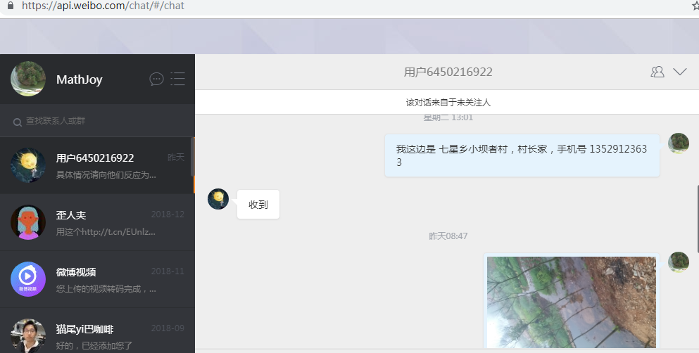

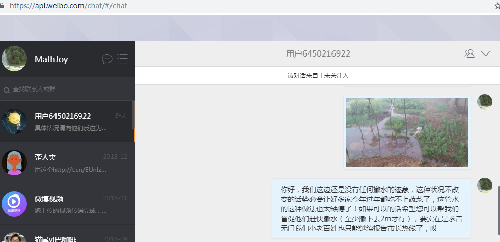

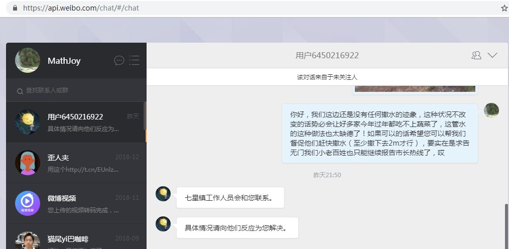

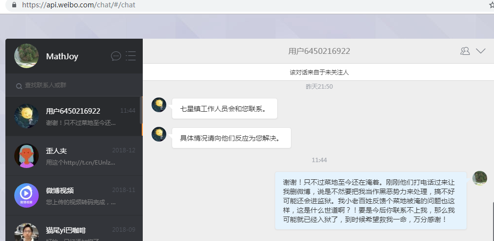

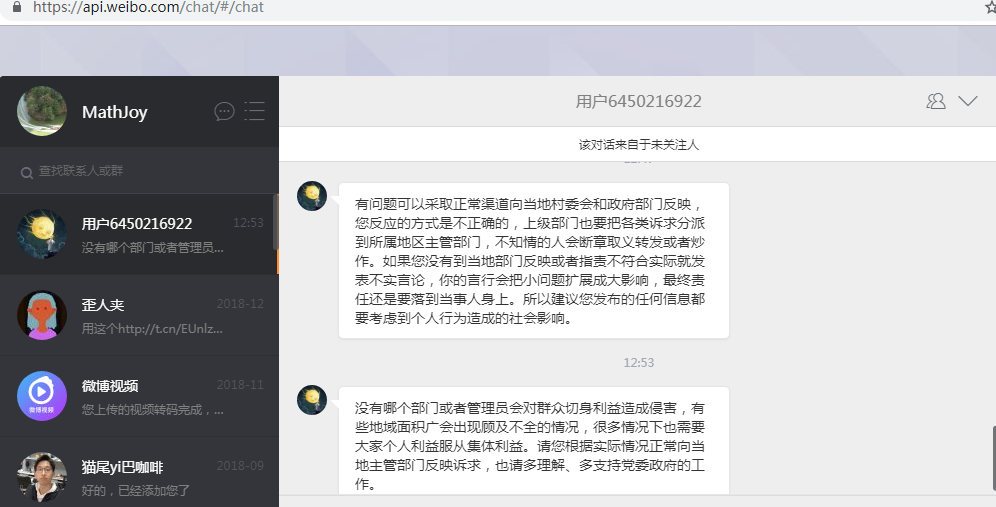

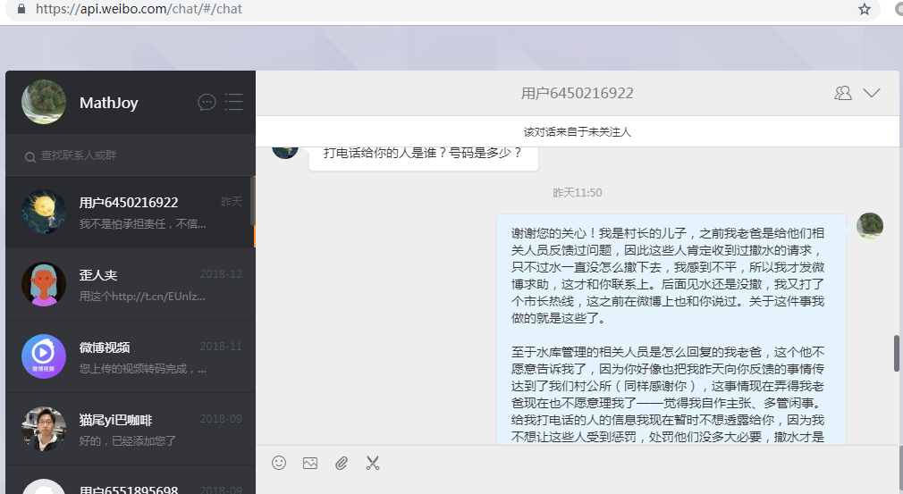

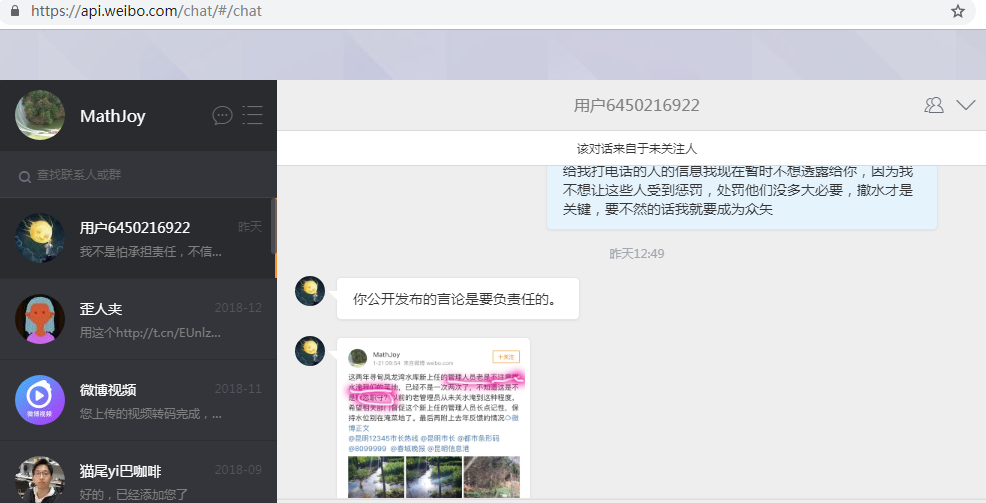

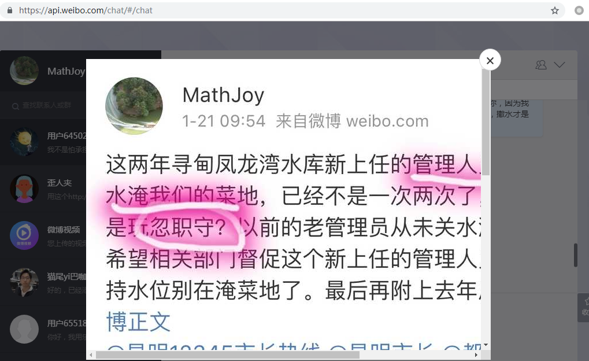

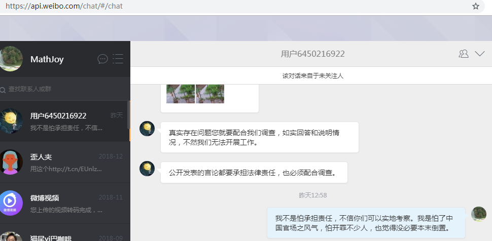

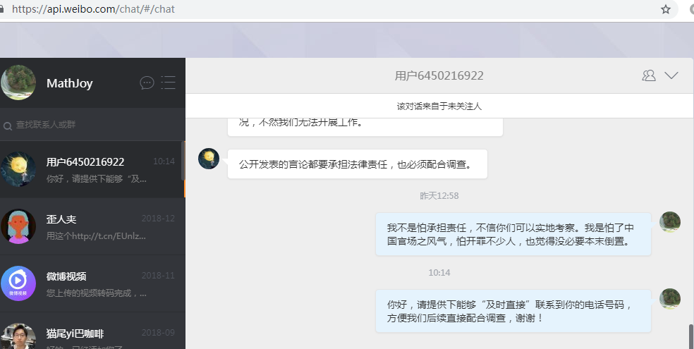

- 有问题可以采取正常渠道向当地村委会和政府部门反映，您反应的方式是不正确的，上级部门也要把各类诉求分派到所属地区主管部门，不知情的人会断章取义转发或者炒作。如果您没有到当地部门反映或者指责不符合实际就发表不实言论，你的言行会把小问题扩展成大影响，最终责任还是要落到当事人身上。所以建议您发布的任何信息都要考虑到个人行为造成的社会影响。

- 

没有哪个部门或者管理员会对群众切身利益造成侵害，有些地域面积广会出现顾及不全的情况，很多情况下也需要大家个人利益服从集体利益。请您根据实际情况正常向当地主管部门反映诉求，也请多理解、多支持党委政府的工作。

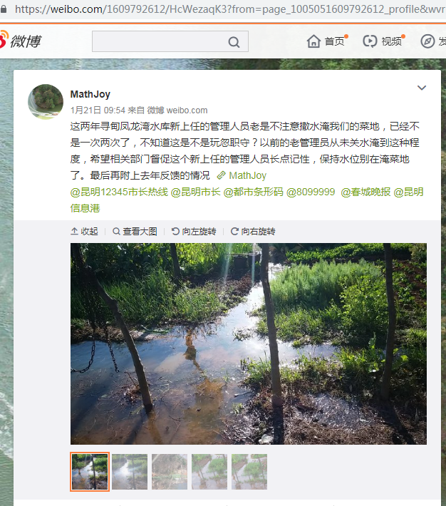

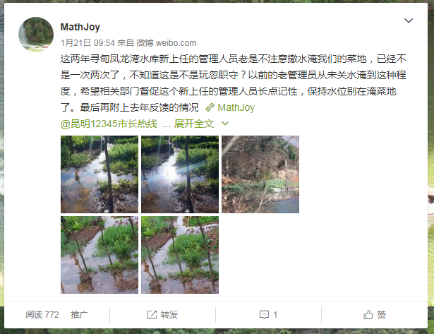

先让我说话，有不同意见的话等我讲完你们再说，不然出什么大问题，你们就要做好心理准备！

今天，水利局、公安局、村公所都来了，有些可能是被形势所迫、很不情愿地也来了，

当时我们只是要求撤水，但是没想到你们竟然会使得你们来处理今天的事情。撤水就完事，要干起今天的大阵仗。

等上面来调查个水落石出、各方责任后再动手不迟

如果违章建筑，我不会阻挠各位执法，以下这些话不得不讲。批评别人想做自我检讨，今天你们要处理这些老百姓的问题，你们也请你们先想想自己有没有问题，自己有没有工作不认真？

有人工作位不认真，以至于让人轻而易举、毫无阻碍地开始（加上最近这两年的）带头搞违章建筑，各位今天来讲得不好听一点可以说是帮他擦屁股，请你们记住是因为谁的责任疏忽导致了各位来干这个自己也很不情愿的烦心事？

是哪家带头搞起的？他们家为什么可以轻而易举、毫无阻碍地违章建筑？请你们摸清后面是不是有人睁一只眼闭一只眼？徇私枉法？

这些违章建筑的事情已经过了半年多了，本来已经平息了，但现在谁又坐不住了，想再来挑起风波？请各位回想一下是谁发动各位今天到场的！

违章建筑的原因之一是因为涨水，管水的难逃其责？法律规定？法律来源的基础是事实，请尊重事实，你不可能涨水把我们的房屋淹了也说是法律许可的嘛，请尊重事实！

所以这件事我们老百姓是犯了点错，但是某些当官也难逃其责，要干起来查个水落石出谁都难以高枕无忧，最简单的方法就是以后管水的长个记性别在起水淹菜地，各自相安无事、各得其乐。如果你们执意要干，这些所谓的违章建筑物也话费了这些农民上千或上万的钱，你以为你就可以轻松搞定？你们要查的消息发出来这么久，难道我们就没想过对策？你们自己想想！

