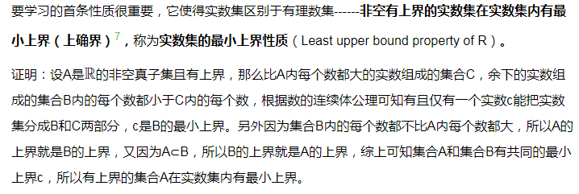

1.对数学知识的公理化整理，寻求道理背后的道理，寻求不可证之理，这一过程让数学家们认识到可以通过改变公理的方式发展出与先前截然不同的数学理论，这样数学就进入了free mathematics的状态，数学理论不再唯一了，数学家们可以更自由地创造数学理论了。

2.更改了《从有理数到实数和数的连续体》，主要是这个部分

另外，之前写这篇文章的英文版导言现在看来也是比较有价值的，一并分享出来吧

[Number Continuum Based on Line Continuity Axiom.pdf](attachments/Number Continuum Based on Line Continuity Axiom.pdf)

