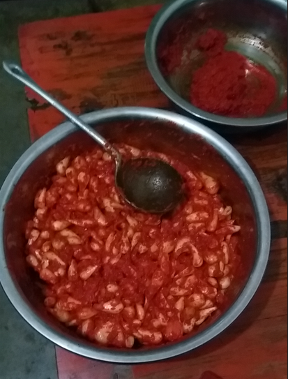

炸鸡油（或加点香油）”，碎大蒜，辣椒，姜，酱，碎八果，炒，差不多放鸡肉进去，加盐，一起炒拌，半小时后放入高压锅，水淹4/5，盖盖子，冒气后15min，放气开锅，ok

香油欢，下小鱼，不要经常翻，否则会碎

腌制鱼？水，姜，下雨肉 

肉沫：炸姜蒜，然后炸酱，然后下肉沫，炸啊

拌茄子：煮茄子或蒸茄子，

番茄豆腐，活红辣椒  碎蒜沫，油欢下锅炼一下，然后下豆腐，不用就经常拌，和两下就行了，差不多放豆腐

炸鱼保存，油很欢，盐腌过的鱼放几块进去炸，翻面炸，黄到翻褐色收起来，

干焙辣

辣椒，大蒜，敲诈，香油炒，差不多放酸醋和味极鲜

酸汤洋芋片

花椒，干辣椒，油炒，辣椒黄下洋芋片和酱丝，一会儿后加水放盐

水煮肉片

白菜先炒一会儿，再放点水煮一会儿，再放金针菇，豆芽菜，差不多就收起来，水煮肉片，差不多就收起来放在一起，最上面铺好姜蒜，辣椒，花椒，炼油欢的时候用勺舀起来撒在上面，烫作料，拌起来

炒干巴

香油欢，放大把辣椒，赶快下干巴片，炸炒一会儿（不放盐），差不多可以收锅的时候放点醋，好了

芍子尖鸡蛋

水炸芍子尖去草味，滤水后和鸡蛋搅拌均匀，炒吧

炸洋芋

香油欢，放几段切碎的干辣椒，炸一会儿，然后下洋芋块，炸到翻红褐色时虑出来，然后碎蒜酱，芫荽，酸菜，辣椒面，盐，味极鲜 拌起来

腌酸菜

洗洁精洗好的罐子（现出的罐不用洗，要洗的罐子那是吃完酸菜放了好几天的那种，有油的罐子不能用）准备好 ，晾干后用酒湿润一遍罐子 ，涮罐子的酒就倒在切碎的青菜里边，把昨天晚上洗好并晾干的青菜切碎 ，食盐的用量比做菜的时候少那么一点 ，辣椒粉 ，红糖粉（可以买得到现成的） ，搅拌均匀之后放入罐子里边 ，每1/3的时候就按实，离装满浅下去一点儿，最头上倒一点酒，这样子说是不会烂，因为腌制发酵会出水，要过三天到一个星期（这期间找一个碗盖住罐口就行了）差不多稳定后才加水封口，用保鲜膜和橡皮筋封口吧

糊辣鱼

清水煮着鱼，香油炸碎蒜，葱和姜，然后再放酱和辣子一起炒，差不多混合，泡的小米辣切碎也放进去，酸辣子，进去吧，盐；另外一边，清水煮着鱼，鱼熟差不多两边混合。

酸辣鱼

炒作料：碎蒜，辣子，酱，后放花椒果，盐，味精，炒一会儿，加水，水开，下炸好的鱼块，煮一会儿，翻面，桂花辣，葱

炸臭豆腐

香油欢（或专门炸臭豆腐的油），把臭豆腐块全部放进去，炸，翻，前后三个回合，表皮黄、饱，滤网勺虑出来，臭豆腐的油专门保存在缸里以后炸豆腐使用，炸其他不行。放花椒面、单山蘸水、盐，拌起来。

煮粑粑丝

水沸腾，加油、姜丝、盐，粑粑丝烫软就可以了。

清汤鱼

涨水煮鱼，下盐，葱，过程中锅铲翻底。差不多收锅，蘸水

制作洋芋片和炸洋芋片

活洋芋切片，漂去洋芋粉，加盐，水煮至透心，捞起来，晒。油欢下片，差不多漏勺捞起来，不用放盐

炸小鱼

油欢下鱼，不要经常翻以免弄碎糊，差不多再翻面，炸黄翻黑捞起来。把大的捡出来，再炸一下

花椒叶套面

鸡蛋，面粉，水搅拌混合（量不用太多），花椒叶进去搅拌混合，然后拈进去一片一片炸，用筷子翻面，

蒸鸡蛋

鸡蛋加盐搅拌均匀，加1/3左右的热水，加油搅拌均匀，蒸锅上气放进去蒸

晒干洋芋片

擦子出洋芋片，漂洗三次虑去洋芋粉，一桶一大锅煮（水漫出一指头高），半夹生捞起来（也可以生一点），赶快泼冷水防止余热腾熟变碎，捞完之后拿去摆。辣太阳晒一天就行了，第二天晾去水分就完工。

沫辣子+教头

红辣椒洗干净滤水，拿去街上加上大蒜，八果，花椒果磨碎，拿回来盐，红糖，姜丝搅拌均匀，（如果要加教头就首先洗好教头，剪子一个一个去头尾，然后再拨去不要的皮，最后全部洗一遍，加盐腌一晚），腌一晚上，第二天觉得盐味够装进用酒涮过的罐子，不够就到时候再加点盐，（该混合就混合吧），装完后按实，酒像水浇地一样浇表皮，水封口

教头辣，工艺差不多，盐不宜多，辣椒机器大片磨碎

猪油罐子不通用，香油罐ok

肉沫料

油欢下辣椒段，下肉，差不多点放姜沫、蒜末，然后放酱、胡椒粉

粑粑丝

水涨，下油盐，豌豆尖，粑粑丝下去烫一会儿就完了

鱼块腌制（充分混合盐巴），清汤鱼的盐巴比糊辣鱼的多一倍，

