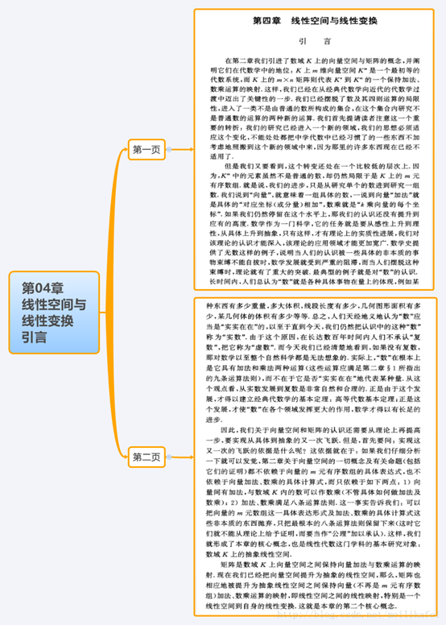

线性代数教材和学习大略

https://zhuanlan.zhihu.com/p/37760826

第一作者Otto Schreier 虽然只活了28岁，但有自己的维基条目，还让自己的名字和若干定理挂上了钩。至于第二作者Emanuel Sperner 

Paul Halmos也写了一本

他一开始就把数学研究的一般方法，线代这门课的体系都呈现出来，不知道别人如何，我自己是很受教益。

丘维声线性代数

https://www.bilibili.com/video/av49041482/?share_source=qq&p=1&ts=1633933582&share_medium=iphone_b&bbid=1e0a055e7fd475c647838ab5748758da

https://www.bilibili.com/video/av6179111/?share_source=qq&p=1&ts=1633934181&share_medium=iphone_b&bbid=1e0a055e7fd475c647838ab5748758da

好一朵 成品菜很好看令人惊叹，但最重要的其实是这菜当初是怎么做出来的。知道这个，下次自己也能尝试做出属于自己的新菜式了ｌｏｌ

掌握要略、把握本质

很久以后，我终于靠自己解答了这些疑惑。在此过程中，我知道了所谓的线性代数是线（段）之代数（algebra of line segment),故它天然地是门关于几何的学问，故天然地导向几何代数。解答这些疑惑的关键，是一定程度上了解了那位奠立了相关学问的普鲁士中学老师。他给我们创造了每一个理工科人都得学习的线性代数之基础——外代数，后来的几何代数、矢量分析都是他的革命性思想的自然延续或者歪曲，他为我们提供了三色（叠加）定律，他还给我们提供了描述费米子体系和使用超空间概念的特殊数，他敢于放弃牛顿第三定律以发展电动力学，他就是在大学时从没上过数学、物理课的语言学家东方学者格拉斯曼。格拉斯曼（Hermann Gunther Grassmann
