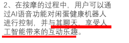

比较文雅的歌曲至今仍为人熟悉的，有《天涯孤客》、《啼笑姻缘》与《一水隔天涯》

妮在港推出首张个人粤语专辑《奋斗》

们所唱的歌曲很多都是改编自日本歌曲。张国荣的《不羁的风》（大泽誉志幸《La Vie En Rose》）、《Monica》（吉川晃司《モニカ》）、《H2O》（泽田研二《TOKIO》），谭咏麟的《酒红色的心》改编自安全地带（玉置浩二）的《ワインレッドの心》，周慧敏的《最爱》(原曲柏原芳惠《最爱》；原作者中岛美雪及后也翻唱本曲)，张学友的《蓝雨》（原曲德永英明《Rainy Blue》）、《太阳星辰》（原曲德永英明《BIRDS》）、《每天爱你多一些》（原曲桑田佳祐《真夏の果实》）、《还是觉得你最好》（米米CLUB的《爱してる》），梅艳芳的《梦伴》改编自近藤真彦的《大将》，而梅艳芳的《夕阳之歌》更与陈慧娴的《千千阙歌》及Blue Jeans的《无聊时候》同时改编自近藤真彦的《夕烧けの歌》、罗文的《好歌献给你》来自西城秀树的《ブルー·スカイ·ブルー》，吕方的《回来吧》（德永英明的《风のエオリア》），徐小凤《喜气洋洋》（五轮真弓《恋爱ともだち》）、薰妮《故乡的雨》（千昌夫 《北国の春》）

Human我生

要做的功能是怎么得出来的？

老人还是年轻人：会玩手机吗

设计产品的时候应该考虑：who（使用人群是谁）, what（要解决的问题是什么）,   how（怎么做,用户需要怎样使用你的产品）,why（为什么要那么做或那么用）, when(什么时候用产品), where（在哪里用,在那种场合下通常会发些什么状况）

控制界面硬件or【软件】？

语音助手？有必要吗？（单独的硬件、玩手机

不得不做的功能、商城？   先把不得不做的、最基本的模块做好，然后赶快拿到市面上去试用，通过用户的反馈调整后续的产品开发

