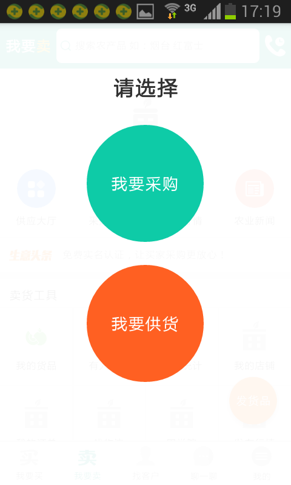
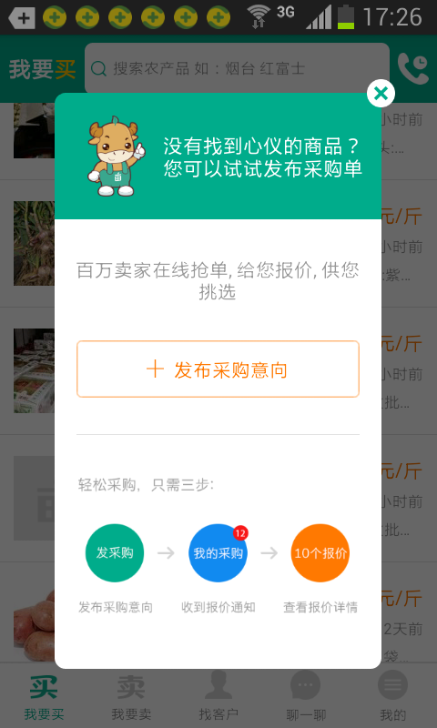
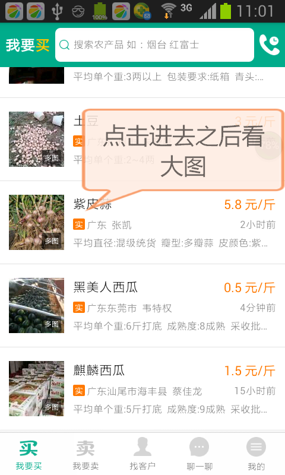
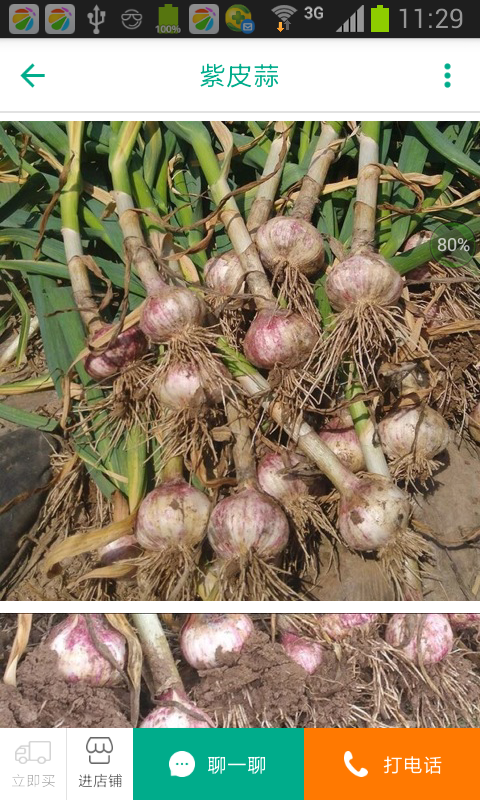
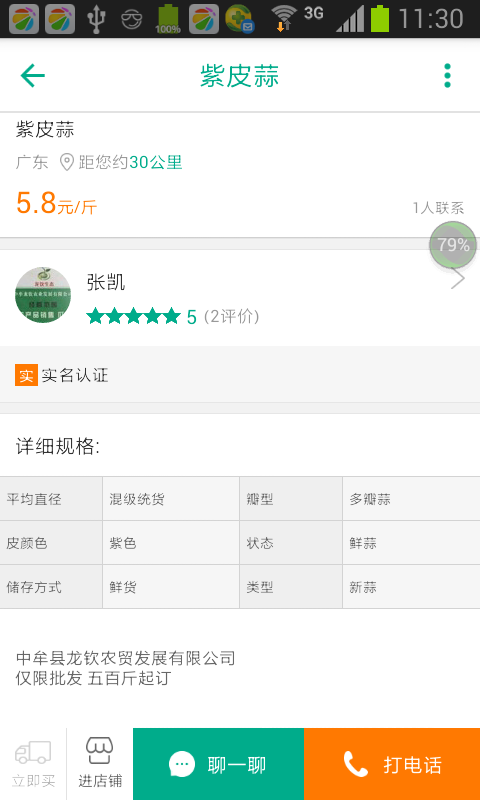
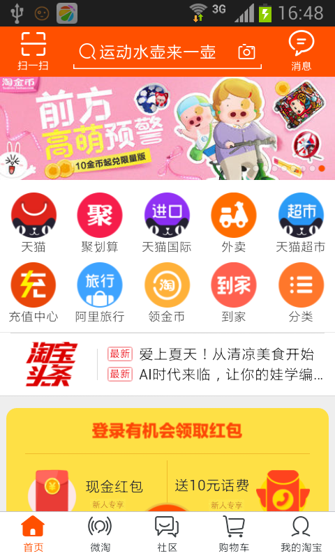
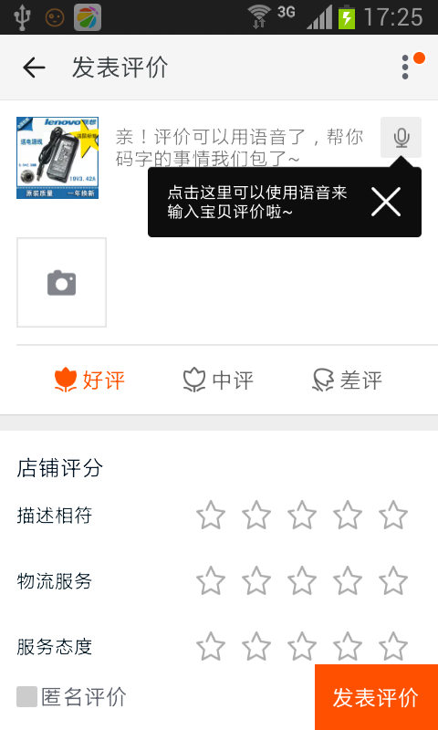
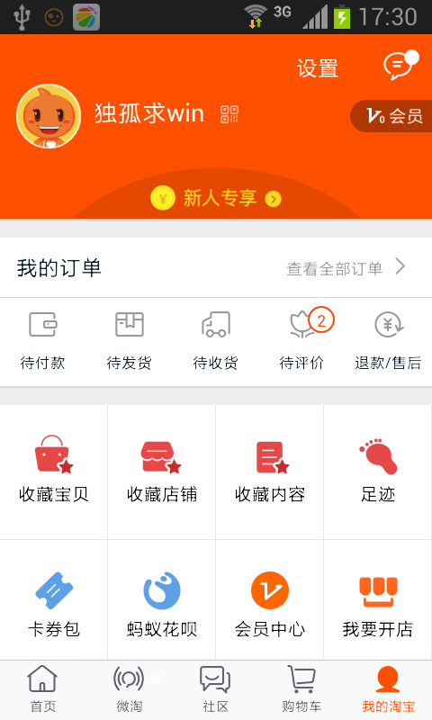
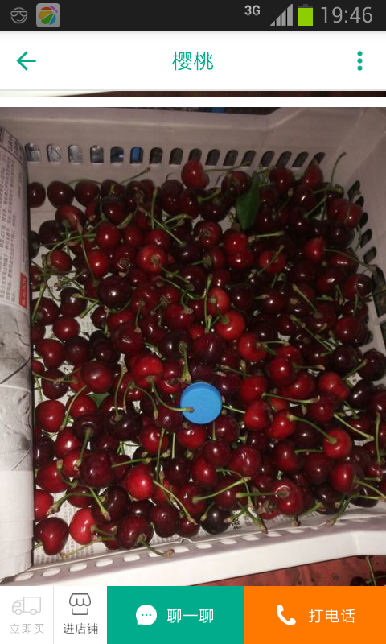
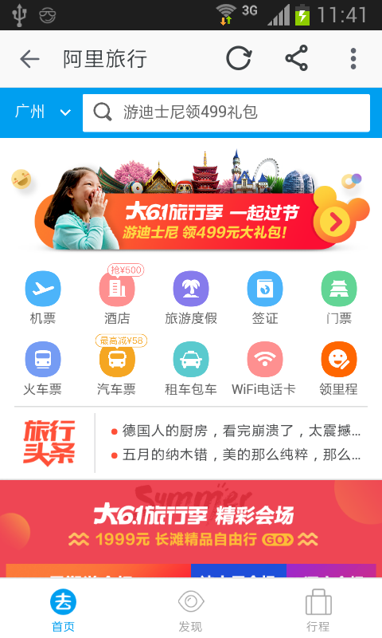

Loading页可作特色宣传      单页一句话概括  或者多页轮播图展示  写出关键的痛点就行了，像下面这种就成电商功能了

设计的idea

建议反馈

一大波好图

看完图后

分享

进入店铺

结尾应该还要有个相关（同类）推荐

行情要有吗？？？

顶部轮播推荐  - 亮点

下面有默认推荐的列表（竞价排名）   右边有最新（按照第一次发布的时间算~~~~   类似于拉钩   口碑中心

建立可信度   良品保证  可靠交易

运送、物流

关注店铺

顶部栏做搜索

限时抢购  天天特价

轮播推荐 →特色栏目--九宫格入口→列表

把线下转到线上、线上的优势罗列

开店

精选

经验分享   类似于拉钩的那个功能

水果名称、地点、总量、单价  几天到货    多少斤起

在网上放一久，没卖掉，变质

这种拍照有一套啊

居于地点的搜索框，居于距离的搜索    （默认推荐的关键词

降价提醒

FAQ

买家之间的互动沟通

