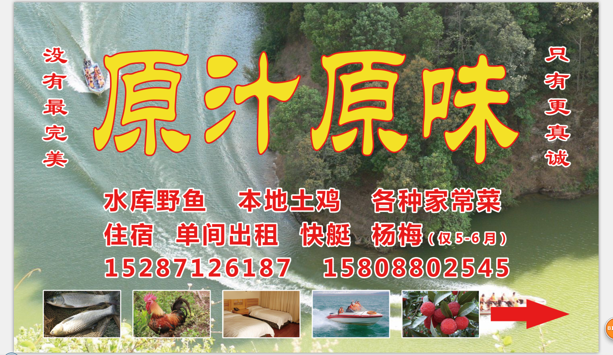

我做两条横幅

文字：快艇12人仅480我方便宜坐，1m高，文字大小是高度的95%

文字：快艇12人仅480我方便宜坐 别处800，0.5m高，文字大小是高度的95%

快艇12人仅480我方便宜坐

1m宽

字大小0.95m

快艇12人仅480我方便宜坐 别处800

0.5m宽

字大小0.95m

地址：昆明市寻甸县七星乡小坝者村

      原汁原味农家乐（缕缕炊烟农家苑）

这是我们餐馆招牌的设计，上面的文字图片都要，“原汁原味”和两侧的口号放到名片另外一面

上面的几个展示图可以到这里下载https://pan.baidu.com/s/1O5Jz5SirEdlZQ7W9pIto0Q

另外一面：

样式类似于这种，把螃蟹换成二维码，下方写上“微信扫一扫地图导航到本店”

地址：昆明市寻甸县七星乡小坝者村  原汁原味农家乐（别把这里的空格去掉了）

文字：

快艇12人400元便宜坐

本地土鸡、水库野鱼和土生土长的蔬菜让你吃出原汁原味

没有最完美，只有最真诚

15287126187 15808802545