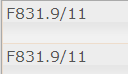
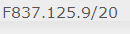
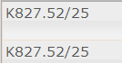
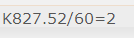
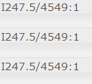
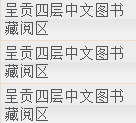
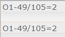

这三本书  以第一本就借第一本《这次不一样》

，没有第一本借第二本《动物精神》，没有第二本就借第三本《大而不倒》，总之只用借一本就行啦，有第一本最好《这次不一样》。。。。

| http://book.douban.com/subject/11613937/ |
| - |
| 李政 20:11:13   http://book.douban.com/subject/20366369/ |
| 李政 20:12:37   http://book.douban.com/subject/5297291/ |

这次不一样：八百年金融危机史：珍藏版, (美) 卡门 M. 莱因哈特, 肯尼斯 S. 罗格夫著

|   |
| - |
|  F831.9 |

这次不一样?：800年金融荒唐史：eight centuries of financial folly, (美) 卡门 M. 莱因哈特, 肯尼斯·罗格夫著

动物精神, (美)乔治·阿可洛夫(George A. Akerlof)，(美)罗伯特·希勒(Robert J. Shiller)著

|   |
| - |
|  F0-49  |

大而不倒, (美) 安德鲁·罗斯·索尔金著

曾国藩家书家

K827=52

曾文正公嘉言钞：文白对照版, (清)曾国藩著

曾国藩．血祭

居里夫人自传

|   |
| - |
|  K835.656.13=51 |

什么是数学

心理学   

