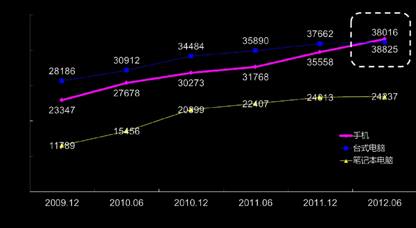
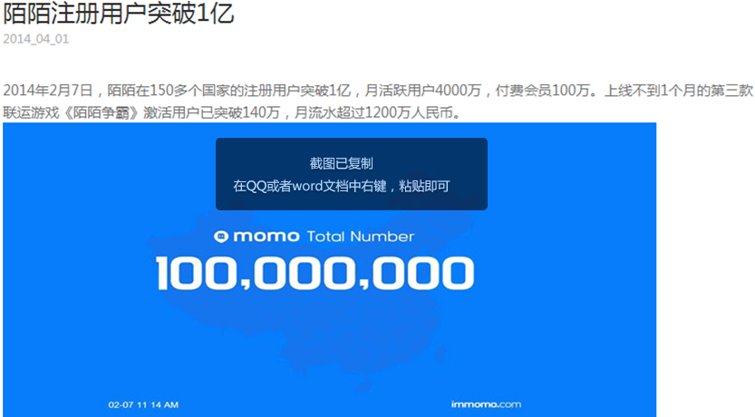
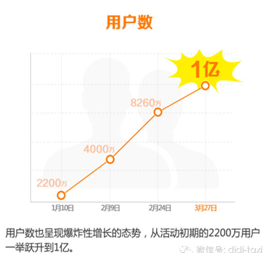

创业，两个字，一横一竖；错的，倒下；对的；站着。

自从2011年开始，我转向QQ开放平台业务，见证了中国互联网第二波最美妙的创业红利大潮，陪伴了几百个创业团队从暗淡走向光亮，或从坟墓中走向重生。时至今日，回想这三年的历程，有一个时间点是从一个用户行为习惯的纬度，划分出了中国互联网的新格局，这个时间点是2012年6月。在那个时刻，国内用户的手机拥有量超过PC拥有数量。（下图单位：万台（部））

这个新格局是一个爆发增长但模糊不清的局面，它属于跑得最快的创业者。在这些创业者里面，我看到了几家爆发增长且打破了模糊局面的产品，这其中已经有突破10亿美金的公司，而其它几家向10亿美金逼进的公司。

1.陌陌

（此图有亮点，腹黑人等请自寻）

2011年8月成立，2012年注册用户数：2,250万，2013年注册用户数：8,423万，2014年注册用户数：1.2亿。这是一个让BAT这样的巨头都羡慕瞠舌的数字，而在资本市场，去年还估值几亿美金的陌陌，据说今年已经估值20亿美金，且据说要去IPO了。这一系列美妙数字的背后，蕴藏着什么移动互联网的爆发法则？

法则之一：人性至上

在腾讯的平台上服务了六年多，最大的感受是对公司精髓的认知越来越强烈。很多外行人认为腾讯是家社交公司，很多业内人士认为腾讯是家游戏公司，而身在围城内的我来看，腾讯是家人性数据挖掘的公司。从腾讯平台的眼光看陌陌，真是感受到移动互联网带来的洗牌式变革——懂人性的产品会爆发。很多人都会喜欢对不熟悉的产品打标签，陌陌身上背负的最大的标签就是“约炮”，但标签仅仅是外显性的认知，真正的价值是其在人性弱点上的洞察。电影《七宗罪》里所讲的人性弱点，在陌陌的产品上有着强烈的渗透：性需求只是一个引子，让异性之间产生火花，让同性之间产生傲慢、嫉妒、愤怒；而懒惰是互联网带给年轻人最可怕的颠覆，陌陌让年轻人更轻松地找到共同兴趣的人、附近的人，甚至使用“漫游”功能实现随机交友；再说到贪吃，这是众多年轻人释放压力的秘籍，也在社区氛围中最容易得到快速的传播。前两天和周黑鸭的投资人聊天，对方打趣到，感觉QQ用户习惯吃周黑鸭，陌陌用户更钟爱吃哈哈镜，因为后者更年轻，更聚群，更懒，连下楼去门店都觉得麻烦。

2.滴滴打车

去年3月，当我走进中关村E世界一个不到100平的办公室，里面挤满了30多人，人声鼎沸，70%的人在大声打电话，一听就知道在和的哥沟通，答疑解惑。另外30%的电脑屏幕上全是数据、报表、代码。坐在狭小的会议室，我看到几个细节：满玻璃的便签（写满各种brain storming）和一个大大的黑板。谈到兴奋的地方，滴滴运营同学直接跑到黑板上画出双方合作界面的交互效果，在他的言语之间我感受到他的激情与缜密。当我作为滴滴用户，提出几个产品体验的建议时，他都一一记录，而且反复和我确认细节——金额，时间，地点。当时突然觉得《非诚勿扰》里面舒淇的台词很到位：人与人之间是有味道的吸引，只有对了味道，才能臭味相投。这让我想起了十几年前，当QQ还叫OICQ的时候，A8音乐董事长刘晓松在网易丁磊的引荐下，来到腾讯讨论投资事宜。他当时被Pony、Tony对数据的挖掘和用户体验的极致追求所震撼，最终投了腾讯。滴滴打车在两年不到的时间就获得一亿用户，估值10亿美金，它的逆袭法则又是什么？

法则之二：连接未知

每个企业都有自己的基因或者说宿命。超出基因范围的探索多是劳民伤财的徒劳。BAT巨头面对O2O都有野心，但是线下格局变化莫测，不适用大体系下的慢火烤全羊策略，而应当野蛮生长，跑马圈地。滴滴打车恰好深谙其中奥妙，他们核心团队大多来自BAT，他们预判巨头很难快速跟进，而移动互联网的快速增长和数据壁垒让他们更坚信需要凶悍地拓展自己的地盘。去年到今年各大互联网大佬都在强调“连接”，而滴滴打车这样的O2O平台恰好连接到了巨头所未知的领域。假象一下，一个经常往返国贸-三里屯-苹果社区的女性白领用户是不是适合送给她一张优购商城的礼品卡？滴滴最开始打破信息不对称的格局是一次业务模式创新，而后面基于LBS的数据分析，是其走向10亿美金公司连接未知的商业模式创新。

3.今日头条

这一阵张一鸣同学可真是一鸣惊人了。遇到这样的舆论挑战，作为一个技术男，他并没有变成惊弓之鸟，而是依旧踏实地做产品优化并积极地备战。记得第一次在创业者扎堆的小饭桌聚会上看到一鸣同学，听到他讲为何选择做新闻产品，我很意外。那时候他已经做了半年，虽然增速很快，但是很明显，巨头都开始回过神了，重金砸向新闻客户端，这是一个看似红海的江湖。原来一直不理解技术男如何做好一款重运营的媒体产品，可是如今将近2年的发展时间，它已经获得1亿用户和5亿美金的估值，真是惹得众门户客户端眼红。那今日头条有着什么秘密法则冲破土豪的防线？

法则之三：少即是多（Less is More）

媒体是最容易被操纵的，也是最容易变成一个官僚权力纷争的名利场，它被太多外在因素干扰。而技术是一种手段，可以公正公平地让每个用户感知到自己的偏好，而且通过不断智能筛选还能提高用户的粘性和数据的多维度。我想这才是真正的互联网手段去颠覆传统媒体，当然这也是那些来自报社杂志社的在各家门户琢磨着标题党的同学们不敢想、不屑想的手法。媒体最强调的就是调性，强调影响有影响力的人，而在移动互联网大潮中，找到屌丝用户的诉求才是夹缝中爆发的关键路径。举个用户刚需的例子，大家估计都能猜出百度搜索量最大的关键词类别吧，而各家门户都不好意思把这个分类放到自己的新闻客户端里面。而今日头条深知用户看新闻的动机和行为数据，最后专门列出了“美女”类别。这个刚需的释放不仅仅在今日头条中被用户热捧，包括“内涵段子”“节操精选”“百思不得姐”都是如出一辙，仅仅通过社会化传播就横扫大把用户。

4.美柚

最后再说一个同样常陷入同行争议里的APP：美柚。2013年4月上线，截止2014年6月，14个月用户量突破5000万。这个数字展示出的效率堪比新浪微博，但可别忘了新浪微博的推广有门户导流、PC迁移、广告投放、明星效应。而美柚只是一个移动互联网的产品，而且CEO陈方毅还是一个85后小帅哥，他如何把女性app做成资本青睐的香饽饽，估值过亿美金？

法则之四：专注+极致

很多人说互联网是女性的，哪里有女性，哪里就有商机——电商基本上就靠女性剁手族；社交产品只要有了白富美就能引来大把屌丝男；资讯产品只要有了女性图片视频就能吸引大量的点击；就连游戏产品都是女性多的服，男性用户更活跃。那在美柚之前是否有人做过女性APP社区产品？我相信是有的，但坚持不让男性涌入的社区貌似并不多，这种极致的苛求是对女性用户最好的保护和对女性需求洞察的深刻理解。女性有个非常强烈的群体认同需求，比如说女性喜欢结伴上厕所，这是她们表达亲疏的一种社交方式。心理学上分析，男性的语言关注层级，旨在分个高下；而女性的语言关注连带，意在表达亲疏。这就是美柚专注地对女性社交特征分析后大力发展社区的动因。现在，每天有几百万的女性用户在美柚上生产超过200万帖的内容，形成上亿次的浏览，这些数据持续增长，给市场带来的价值可想而知。

10亿美金对很多创业者来说看起来是一个遥不可及的未来，就连苦熬10多年的迅雷IPO之后也不过这个市值。但是在移动互联网新格局下，做到人性至上、连接未知、少即是多、专注+极致这些法则，产品就能获得爆发性增长。

以上是我接触过的几个过亿美金创业公司的片断与感触。

本文作者是腾讯即时通信部商务副总监，腾讯学院讲师刘硕裴。以上观点属个人观点，不代表公司立场，欢迎关注公众号：小Q逗你玩。