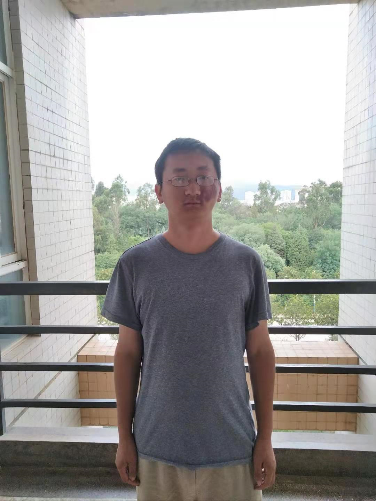

尊敬的施校长：
您好！我是看了你在《开讲啦》的演讲才对你有了解的，然后我也看了你曾经在西湖大学开学典礼上的演讲内容，你都提到的一点是：在满足“小我”的同时心中要有“大我”，要关怀社会、回馈社会。我很认同这种看法，觉得一个只想着捞好处，获得更好的教育，更高的社会地位，过更好的生活而不懂得帮助别人的利己主义者至少是让人不愿靠近的。平日在学习高等数学的同时我也在尽自己微薄的力量在帮助中国大学生更容易地学习数学（下文有详述），但在探索的路上有时我也在烦恼：我帮得了别人，但谁又能帮助我？我比较喜欢自学，研究性地学习，想要走上数学研究的道路，但在过往求学历程中我未能碰到开明的老师和开放的学习环境（[可点击本链接查看相关二三事](attachments/可点击本链接查看相关二三事)），以至于目前处于困境之中，你创办西湖大学致力于成为创新人才的孵化器，我想和你大致说说我的情况，如果可以的话希望您能给我点帮助。
为了实现自己做科研的梦想，我一直在坚持自学数学，如今我能对教材上的一些内容有自己的看法，并开始写有新意的数学文章，也能看出教材上的一些不足之处（具体请访问文字背后的链接了解详情：[其一](https://www.cnblogs.com/iMath/p/10461442.html)，[其二](https://www.cnblogs.com/iMath/p/11448659.html)）。诺贝尔物理奖获得者Gerard't Hooft和菲尔兹奖获得者丘成桐都表达过同样的观点：当你能够发现书里的不足之处时你就有不错的进步了。此外，现在我看的数学、软件、音乐方面的书都是英文版的，也能用英文写作。说这些并不是为了炫耀，而是想说明我可能还是有些才能值得您考虑给予帮助的。
……
我来自云南昆明，出身农村，在我的学习和成长历程中接触到教育都不算太好，不过从初中开始建立起来的做研究的志向一直未变。高中时期状态好时我也曾年级上考了两次第一，但后来受到了干扰，由于自己性格内向不善于处理人际关系去解决这种干扰，最终导致成绩下滑，后面高三备考的时候觉得老师的教法不利于我学习，所以回家备考。因为受到了学校某老师错误的备考方法误导，再加上那时候由于条件限制学习中出现的问题利用网络无法及时很好地解决，还有自己的学习方法的问题等因素使我高考失利。后面本来想复读但又受到某大学老师的劝导，说是大学里很自由，有很多时间可以自学，我想这种情况不是很能发挥我学习的主动性吗？结果就去了一所二本大学——昆明理工大学城市学院，不幸的是面的教育让我觉得是在浪费时间，甚至是在自欺欺人，不但不能建立我的自信相反让我变得没有底气，再加上自己内心的清高、理想主义、高标准，无法妥协，后面又由于我对学院里安排的课程失去了兴趣，所以于2015年11月退学了。
从大学开始到现在我的学习主要靠自学自悟，在摸索过程中也浪费了好些时间，不过经过一路的历练，我已掌握了有效的自学方法。如今我离开学校快7年了，我做研究的志向仍然不改，这几年也一直努力在这条路上，现在我从事的是软件开发的自由职业，这样才能有更多时间学习数学和其它想学的知识。我学的数学知识不多，目前算是自学完成了数学分析一学期的课程，自认为这门课自学起来很不容易，不过我已找到学下去的方法了。我也花费了很大功夫了解了数学理论的来源、演化、工作原理。平时除了学习知识点外我也对一些主题进行研究，研究的问题都是我自己想到的。结合我的自学经历及其了解到的情况来看国内好多大学生学习高等数学是比较困难的，主要还是因为没有好的中文教材。把在学习过程中那些自己好不容易弄懂的知识点通过简单易懂的方式写出来或录成视频讲座，然后发在网上帮助后学之人让我觉得是件有意义的事，目前我仍在做，我也获得了很多学生的感谢。下面我列举其中一些内容，一方面可作为我能力的证明，另一方面也可作为我是否值得您帮助的参考。其中，2017-02-12重新发布的视频《[dx dy 的意思 微分的定义 导数符号的意思](https://www.bilibili.com/video/BV1Jx41127SL/)》目前有7.7万多次观看量；2018-10-18发布的文章《[高等数学和数学分析教材推荐及其学习方法浅谈](https://www.cnblogs.com/iMath/p/9810722.html)》目前有6万多次阅读量。最近我也写了两篇自认为具有新意的文章，第一篇是《[极限定义新讲：动态定义与静态定义](https://www.cnblogs.com/iMath/p/14940837.html)》，这是一篇短小的文章，可以让读者一瞥我的潜力。大约六七年前我就想写这篇文章了，但当时能力不够，一筹莫展，最近在为后面这篇文章准备资料的过程中我突然得到灵感遂成此文。第二篇是《[无理数的定义和实数理论的建立](https://www.cnblogs.com/iMath/p/8257142.html)》，这是目前为止我花费最大功夫、最长时间完成的文章，写作过程中我也花了好一部分功夫去了解相关的数学史，即便最终我探究的结果不正确，我也深刻体会到了杰出数学家丘成桐先生所说的“夫筹学之道，求根创新”和清代学者皮锡瑞的“凡学不考其源流，莫能通古今之变；不别其得失，无以获从入之途。”从时间上来说，我从2017年开始研读相关资料，于2018年1月写出了第一版，后来发现文章有逻辑缺陷，所以又开始于2020年8月份左右开始修改，中间由于某些事情的耽搁，再加上一边还要做些工作来谋生，以至于到了2021年四月份才再度开始，不过在过去这段时间内我看了更多的相关资料（发现关于这个主题的论文也不少），也终于想出了更简单的实数构造方式，此后我尽量每天花一个上午或下午去完成这篇文章，一直到6月22日才算完稿。此外，如果你感兴趣的话那么我的博客上的“[高等数学](http://www.cnblogs.com/iMath/category/1067801.html)”这一栏里的其它文章也可供你评鉴。我写的这些文章虽然不一定能产生新知识，但至少提供了一种简单好懂的学习途径，当然，如果因为我的经历而带着成见去看这些内容的话可能会认为它们毫无价值。我也开了个与之相关的微信公众号“高数变简单”，目前关注者有3349人。
然而，我也认识到这样无师无友地独学下去是有些问题的。作为一个退学者，为了走上学术道路而长期孤独奋斗，完全看不到希望和尽头，能否实现梦想的困惑始终萦绕于心，这给我带来了不小的压力，再加上周围没有志趣相投的人可以交流，只能独行，所以不时也感到孤独和彷徨，以至于不能高效前进，心情不愉快。好一点的是根据我的两项经历我找到了减轻这种困厄带来的影响的一个方法——与团体一起学习，具体来讲好的方式是在校园环境中自学，这也许可以解释为“If you want to walk fast, walk alone. But if you want to walk far, walk together（如果想走得快，请独行，如果想走得远，请与众同行）”。另外，根据中国科学技术大学前校长朱清时和杰出数学家丘成桐的演讲稿我再次认识到在学习过程中有老师和同学的交流也是大有裨益的，“石本无火，相击方现灵光；水尚无华，相荡方现涟漪。同样地，人的大脑需要相互“碰撞”，思想需要互相激励，这样才能产生创造性的灵感。”所以我希望重返大学自学为主，交流讨论为辅。
因为一些原因目前我不想通过高考的方式再入大学，另外，经过之前一系列的摸索如今我找到了有效自学和高效前进的方法，我认为目前自己处于快速上升期，只要抓紧时间努力奋斗必然能在一两年内出些学术成果，是过去这几年的学习积累让我有了这种底气，所以再准备一年高考对我耽误很大。理想地说，我并不想按照大学的安排去学习，因为我并不喜欢绝大多数大学所安排的课程、选择的教材，也不太喜欢那种老师在上面讲学生在下面听为主的满堂灌的学习方式，我更喜欢自学，更完善一点讲是“先自学，再讨论，有必要就深入研究”的学习模式，这种方式已被好多学者肯定，如武汉大学前校长刘道玉、中国科学技术大学前校长朱清时、已故数学家王元等。我是一个追求学习独立性，喜欢独立探索的学生，在屡次跌倒又重新站起来的过程中我也不断反思改进，如今我有了很大的进步。
所以综合考虑我目前的情况来看，我想以不要文凭的方式回到大学自学。为的是能在校园环境中加快学习速度和保障学习效率，其次是希望能和老师同学交流一下（一个月三四次就倍感荣幸了），所以**只要能在学校有宿舍可住和有张饭卡可用就够了，或者要求再低一点：能进入学校自学和有张饭卡可用即可**，估计一两个学期应该就可以助我找到下一步的发展方向。所以不知道能否请您为我牵线搭桥，为我提供这样的学习机会呢？我的这种选择在一般人看来似乎还是过于理想化、不接地气，但对一个能够做出“退学”这种大胆选择的人来说是一种有意义的尝试，这种选择我认为也更利于我在学习和研究上前进，武汉大学前校长刘道玉老先生也说过“特殊人才是由特例造就的”。 最近一段在校园环境中自学的经历让我觉得几乎每一天都可以在高效和充实的奋斗中度过，所以接下来如果能有条件在好一点的环境中持续这种状态将会利于我快速进步和看清下一步的发展方向。
我是真的很想找到适合的学习环境，并获得良师益友，我很相信我的潜能在适合的环境下会助我做出更多有价值的成果。我不想放弃数学学习和研究，这是我的兴趣和长处之所在，我还会继续努力！如果可以，请您给我些帮助或指引吧，千里马常有而伯乐不常有！
最后，愿你创办的西湖大学能如愿成功，西湖大学的成长需要你来保驾护航、正本清源，所以希望你不要过度操劳，愿你身体健康，心情愉快！
李照
附：
（1）本次为了不让篇幅过长以至于占用您太多时间，所以上述内容略去了很多细节，欲了解详情可进一步和我沟通，我的手机号和微信号：13529123633。
（2）我的照片

