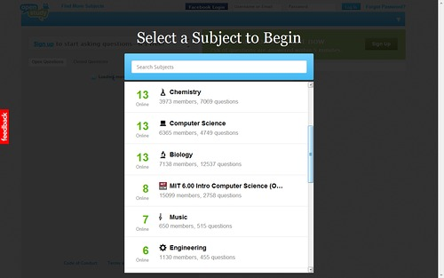
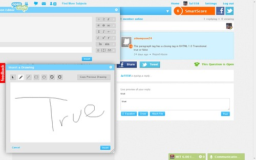
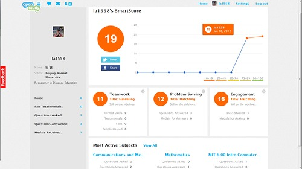
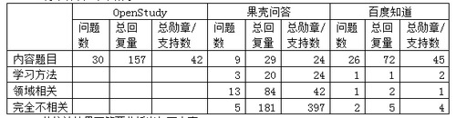

OpenStudy（http://openstudy.com）在很早以前就已经吸引我了，主要是因为它的主界面非常漂亮，也很专业。我一直以为它会是一个像Course Hero一样类似的提供学习资源的社区，直到注册登陆以后，找不到别的内容，才知道原来它只是一个问答社区。从首页的内容来看，它是一个倡导学生间相互帮助的问答社区，为170多个国家，1600多所学校的10多万名学生提供问答支持。登陆后的界面，如图1所示。

图1 登陆后的界面

其中界面最上端是通知、信息、好友信息、个人账户以及设置等。第二行为科目导航、积分系统和社交网络连接。第三行是主体部分，左方是提问和问题汇总区，右面是该科目的在线用户数量，点击左侧的问题后，右侧显示该问题的内容和回答情况。最后一行是状态栏，表示当前用户都关注了哪些科目，点击这个状态栏可以与该科目内在线用户实时聊天，图中橙色的“Mathematics”表示数学科目有人发了新信息。

OpenStudy社区最有特色的当属科目选择、问答工具和激励机制了。所以本文首先阐述这三部分特色，最后将本社区与国内的问答社区在内容上做一个粗浅的比较。

一、科目选择

OpenStudy的所有问答都是在一个个根据科目划分的封闭空间中进行的，每个科目都相互独立，在登录社区的第一时间，OpenStudy就会让你选择关注的科目，如图2所示。

图2 选专业界面

OpenStudy的科目列表是给定的，不允许用户修改了，里面包括了数学、计算机、物理、生物、化学、机械、历史、写作等常规中学和高等教育科目，还包括专门用于收集反馈信息的“OpenStudy Feedback”科目。因为OpenStudy和MIT开放课件（OCW）项目合作，所以科目列表中也有针对MIT多个课程的科目。每个用户可以关注多个科目，每关注一个科目，下方就有一个用于该科目的实时交流标签在状态栏打开。不用担心状态栏不够长，因为两侧都有箭头翻页。科目数量的选择，目前未发现有限制。

同科目中的问题与科目主题联系紧密，同时因为OpenStudy是以学生互助为核心的问答社区，里面的问题多为学生的作业、考试习题。再每个科目发布新问题时，无需再次选择科目名称，问题自动会加入到学生当前所在的科目中。

二、问答工具

与学习，尤其是专业学习有关的在线工具，必须要考虑其输入的便捷性，尤其是像数学公式、化学符号等的输入和表述，如果没有得力工具的支持，很难让学生在遇到问题的第一时间低成本的输入问题，影响用户体验进而导致用户流失。OpenStudy注意到了这一点，除了常规的文本框之外，另外提供了公式编辑器、手写板和附件提交程序。这一设计为学生输入提供了非常非常大的便利，不但可以快速选择和输入符号公式，甚至可以摆脱选择的过程直接录入，十分方便。只可惜这一工具只在回复时才能看到，在问答框附近，只有“Post”一个按钮孤零零的。

除了每个问题都有连接FaceBook和Twitter社交媒体的功能外，OpenStudy还采用简化的Digg技术，任何学生都可给令你满意的回答“Best Answer”，当然一道题目你只能投票一个“Best Answer”，。所以仍旧需要仔细思考慎重决定的。

图3 OpenStudy的输入工具

三、激励机制（Smart Score）

近期在研究世界各地的学分银行系统，所以对OpenStudy的激励机制非常感兴趣。OpenStudy的激励机制——Smart Score定位于测量和记录一些传统课堂中学生不被记录的成就。主要包括三部分：（1）团队合作能力，包括建立关系、交流和合作的能力，积分因素有被关注的数量、邀请好友的数量等。（2）问题解决能力，包括帮助他人，解释概念和设计解决方案的能力，计分因素有回答问题的数量、提供的答案得到奖牌的数量等。（3）热情，包括在OpenStudy的投入和热情等，计分因素有在线学习的天数、抛出的问题得到奖牌的数量等。

Smart Score的总分用于标识用户等级，同时不同渠道的得分分开计算，有助于学生发现自己的长处和不足。此外，个人档案页面还可看到Smart Score增长的速度，以及学生在各个科目里的积分分布（包括问题数、回答数和奖牌数），这样的数据也可以让学生对自己每天的成就，在各个科目的表现有个参考和对比的依据。所以，这样既有综合数据，又有分享数据，且关注多维度的计分方式，应该得到很好的推荐。个人成就系统界面如图4所示。

图4 个人成就系统

作为Web2.0的问答社区，OpenStudy有些地方做的还不尽如人意。

首先是问题的管理。同一个版块的问题会不断累积，在屏幕上表现为向后刷屏。问题本身没有标签，甚至连题目也没有，只有内容用于问题表征。这样的方式不利于流失问题的找回，也不利于既有问题的组织管理。

其次，用户间的联系和交流不够充分。在OpenStudy有四种方式用于同学间联系：给对方发消息、关注对方、回答ta提出的问题，或者直接到科目的实时讨论区讨论。人际联系中更多的邀请、推荐、分享，甚至是协作学习共建项目等体现深度人际交互特性的功能，并未展现出来。

最后，简略的问题和回答信息，快速的刷屏顺序以及相互独立的问题本身，与激励机制协同作用，会督促每个人在看到问题后以最快的速度回答，抢答案抢徽章。这样做用户参与度非常高，然而一个非常关键的问题是，作为教育类社区，这种短频快的问答方式，不利于提问者的深入思考，也达不到OpenStudy倡导的，回答尽量避免只给答案，而应该取代以思考过程的建议。也就是说，这样的功能设置本身，为OpenStudy自身理念的实现设置了障碍。

四、与其他同类社区的比较

为了比较不同问答社区的特点，我选取了刷屏率较高的OpenStudy数学科目、果壳问答数学标签和百度知道数学话题进行了简单的数据收集和统计。方法并不严谨科学，而且时间有限也没有引入问答类国内最知名的知乎网站，只是抛砖引玉，先投出个思路，希望后续的文章能够用更科学严谨的方式回答这一问题。

我把问题分成了4类，分别是内容题目、学习方法、领域相关和完全不相关。内容题目为最直接的询问某个数学问题如何解答或某类问题如何解答的问题；学习方法指询问数学，或数学的某个概念该如何学习和深入理解的问题；领域相关则更为宽泛，但是和数学还有一定的关系，比如数学成绩和性别是否有关？完全不相关则是与版块内容和网站功能没有一点相似度的内容。

我从三个问答社区的数学版块分别取了最新的30个问题，分析了它们的类型、回复数量和得到的勋章、支持总数。我们可粗浅的认为，回复数量表示用户群体关注度和参与度，勋章、支持数表示用户群体的满意度，而类型与它们的结合则表示了社区的整体形势。其中，百度知道分为最有答案、推荐答案和支持三种激励方式，我们定义最有答案每个2分，推荐答案1分，支持1个1分，计算每个问题的总分。

统计结果如下表所示：

从统计结果可简要分析出如下内容：

（1）OpenStudy和百度的问题、用户关注度和满意度，高度聚焦于相关板块的内容题目本身，这种氛围是学习类问答社区最大的优势。但同时，这两类社区在这一类问题上都表现出了同一个问题，即学生把自己的家庭作业直接发布到问答社区中求答案，往往能够得到答案的回复，尤其是OpenStudy表现的非常明显，平均每个问题5个回复，就可以得到问题的答案了。这种趋势如果不加以引导和控制，聚焦于版块内容的优势就会发展为不利于学习的态度，最终延误学习效果。

（2）果壳用户对学习方法的关注和支持程度整体高于其他两个网站，相比于上一点的劣势来说，这真的是很好的现象。问题相关领域的关注度也是果壳的一个特色，说明果壳问答的用户对边缘性、发散性知识的关注度高于对理论或问题本身的关注，对案例的兴趣也许更大。学习迁移的能力对学习来说是必不可少的目标，但是这里需要特别注意内容不可太过边缘，以免知识性过差。

（3）最后需要格外注意的是，果壳用户对与版块内容完全不相关问题的关注和支持，远高于其他两个问答社区，甚至是果壳社区自身的其他所有方面内容。这种有违理性原则的关注和支持，延续了在分析（2）中表示的知识性过差的担心。

综上所述，OpenStudy作为支持学生之间相互帮助的问答社区，提供了包括科目选择、问答工具和激励机制在内的优秀支持，促使学生在各个科目内紧密围绕科目内容发问和解答，相互帮助以共同成长。而知识类问答社区的发展，应在发动用户参与相互帮助的同时，兼顾其内容走向，不但要保证学习氛围的热烈紧张，还要保证内容的科学性和知识性。

 