 

[Udemy体验报告（一）——伟大的教育C2C实践](http://tianshuohu.diandian.com/post/2012-09-14/40038219432)
--------------------------------------------------------------------------------------

From [Broadedu](http://www.broadedu.org/index.php/archives/183)

> 
> 2011年前后就要开始研究生学习的时候，我逢人便说的“伟大理想”就是网络教育淘宝店——教育C2C。期间还真的找过某个志同道合的副教授和一个VC一起讨论过，当得知我们需要自己拿出几十万启动资金的时候，这个项目就终止了。所以当我看到Udemy正在教育C2C理想的这条大道上奋力向前的时候，我忽然有一种热泪盈眶的感觉，体验了一个多月，竟然觉得没什么可写，不是因为平常，而是因为它实现的方式就是我一直思考的，我认为习以为常就该这样了而已。
> 
> 
> **一、Udemy的核心功能**
> 
> 
> **1. 选课功能**
> 
> 
> 对用户来说，进入教育C2C的第一个动作就是发现自己感兴趣的课程，Udemy的核心功能之一就在于此。在Udemy任意界面顶端都可找到“发现课程（Discover 
> Courses）”按钮，系统按照个性推荐、热度、门类和关键词搜索四种方式帮助学习者找到感兴趣的课程，如图1所示。
> 
> 
> 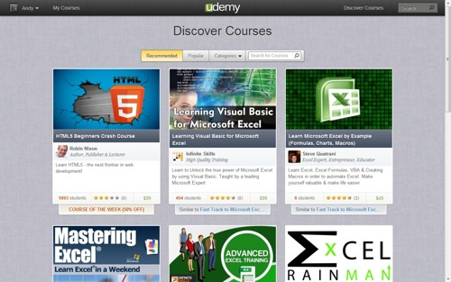图1 Udemy发现课程界面
> 
> 
> 值得一提的是课程的呈现方式，Udemy网站整体采用“简洁+重点突出”的风格，每门课程由一张大图、标题、课程主持人、课程简介、选课人数、标价、折扣与推荐理由等信息组成。这些内容集中在与背景差异明显的一小块特定区域显示，且课程标题和图片占据一半的空间，非常吸引眼球。这也就是在《如何提升Udemy课程（How 
> to Promote Your Udemy 
> Course）》这门Udemy官方课程中教学人员一直强调的，要用震撼的标题和美观大气的图片，让你的学习者耳目一新。
> 
> 
> **2. 课程学习功能**
> 
> 
> 新版本的Udemy最核心的亮点和进步，就在于对课程呈现的优化，对学习资源的整合，及对学习过程的支持。
> 
> 
> Udemy任意课程的课程首页如图2所示，清晰的指出了课程的标题和学习者已完成的学习进度。页面的主体部分大篇幅呈现了课程的教学大纲，章节、主题、形式、顺序、时长在大纲中都有体现，这是了解课程目标和内容的最好方式。学习者可在大纲任意位置点击进入（随机进入）的安排，也给了学习者很大的自主权。页面的其他部分则提供了课程通知、学习问题、课程评价、课程信息、选课用户、分享方式和定制方式等。该页面包含的信息量很大，但有详有略的设计让这个页面浑然一体、主体鲜明，非常值得仔细研究借鉴。在这个页面可以查看和关注其他的选课用户，但是课程主持人的名字却不是超链接，也就是说，你也许关注不了最想关注的那个人。
> 
> 
> 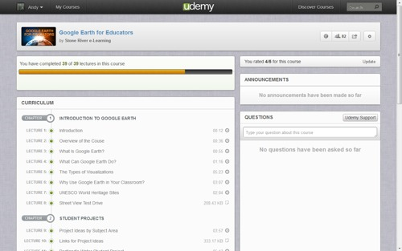
> 
> 
> 图2 Udemy课程首页
> 
> 
> 进入某一个主题后，界面更加干净整洁，如图3（视频形式）和图4（幻灯片形式）所示。近乎全部页面60%-70%的空间完全用于显示主体内容，无论是视频、文本、幻灯片、pdf还是音频文件，右面是针对该主题的问答互动、补充资源和学习者的个人笔记。这些安排难道不值得拍手叫好么，最核心的功能上页面，最主体的内容配最大的空间，不给学习者任何与学习无关的刺激，却让学习者的学习需求完全在单一页面中实现，这已经不只是产品设计了，而是对学习者的学习过程控制。同样，学习者不是接触单一的主题，Udemy的教学活动非常重视循序渐进的学习序列，学习者在进入主题前可以选择进入的位置，但是在进入后，控制权被极度淡化，在主体内容上下各有一个小三角，用于开启新内容和返回上一节内容，对学习者来说，一旦你决定了学什么，就请放下身段全身心的投入学习吧，不要因为反复的选择而分心了。这里课程主持人的控制权比学习者更高了一点，这也是对保证学习效果的贡献。
> 
> 
> 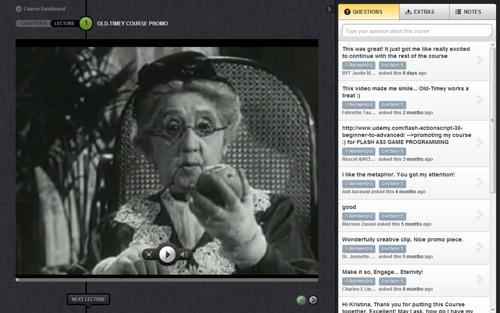图3 Udemy视频课程界面
> 
> 
> 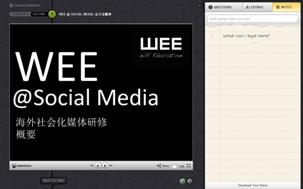
> 
> 
> 图4 Udemy幻灯片课程界面
> 
> 
> **3. 课程制作和发布功能**
> 
> 
> 对C2C平台的另一个C——教学活动主持人来说，课程制作与发布功能的实现程度起到了决定作用。图5展示了Udemy创建课程的首页，信息非常简单，课程标题、类别、一句话简介、关键词和内容语言，多是用于显示在全部课程页的信息，简洁却重要。图6是课程的详细创建页面，这里主题的组织方式就已经与用户看到的课程提纲类似了，非常直观。需要特别指出的是，课程制作工具本身只是整合工具，整合网络上可见的各种形式的资源和成果。从Udemy提供的“主题类型”，就可以看出在整合资源上Udemy下了非常大的力气。音视频、文本、pdf文档、幻灯片、Youtube、站外资源等一概支持。其中最大的亮点在于PPT和视频的同步制作工具。这一功能是以往三分屏课程的亮点，现在只需导入PPT和视频，就可以利用视频播放器或文本编辑器边播放视频，边设置PPT的同步时间了，非常方便，如图7所示。
> 
> 
> 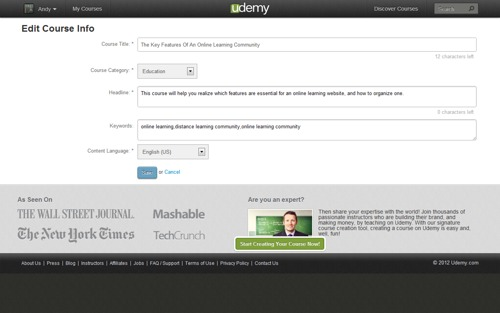
> 
> 
> 图5 创建课程首页
> 
> 
> 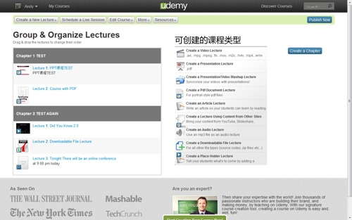图6 创建课程界面
> 
> 
> 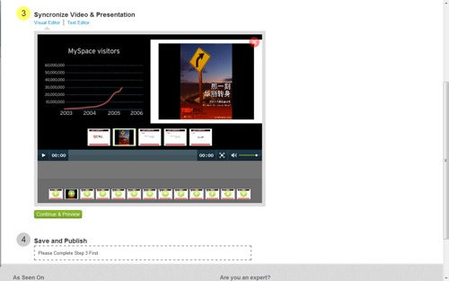图7 视频\_PPT同步设置工具
> 
> 
> 此外，课程还支持视频会议，如图8所示，课程主持人可以随时设置视频会议的安排。更详细的课程信息、隐私设置、资源下载权限、站外统计设置、邀请学生和其他主持人、修改价格等也都在这个页面里完成。
> 
> 
> 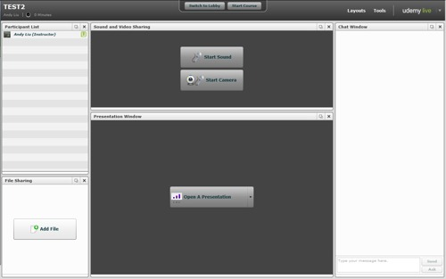图8 Udemy的视频会议系统
> 
> 
> **4. 个人界面和好友界面**
> 
> 
> 作为两类用户的连接者，Udemy对用户的友好性决定了其发展的未来，也就是说，成功的将其运转为一个社区的可能性有多大，Udemy的生存空间就有多大。社区的关键，则是人与人的连接。
> 
> 
> 先来看如何表征自己。图9是Udemy的新版个人界面，其主体部分仍旧是对课程的介绍，包括用户自身创建的课程和参与的课程。侧栏提供了个人的照片、简介、社交网络账号、关注和被关注等。像豆瓣用音乐、电影和书籍表征个人的爱好一样，Udemy也许希望用个体参加的课程表征用户，如果出于这种考虑，课程列表不应拖这么长，应该按照“发现课程”页面的方式一目了然的呈现，目前的显示方式也许并不便于其他用户了解页面主人。本页最大的槽点在于，关注和被关注那两个数字只是普通文本，不是链接。用户既不能看到自己关注了哪些用户，也没有时间线可以收到他们的更新动态。所以让人产生疑问的是，用户真的被连接起来了么？
> 
> 
> 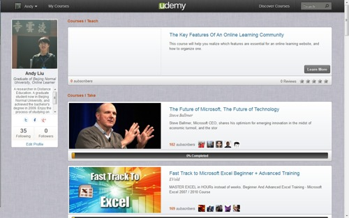图9 Udemy的新版个人页面
> 
> 
> 图10是新版的好友页面，它拥有和个人页面一样的显示方式和显示内容，当然也存在一样的问题。请额外注意图11，这是Udemy改版前的好友页面，大图片，图10 
> Udemy的旧版个人界面详细的title和介绍、此人的课程信息、以及关注他的好友。虽然显示效果没有新版本漂亮，但就内容来说，这是不是才更像一个好友页面呢？
> 
> 
> 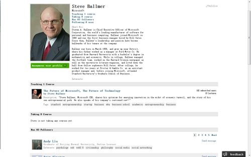图10 Udemy的旧版个人界面
> 
> 
> 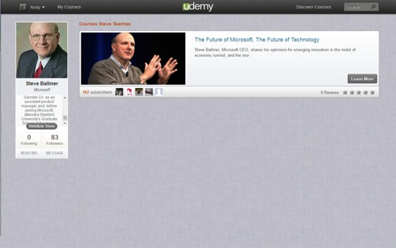图11 Udemy的新版个人界面
> 
> 
> 以上基本介绍了Udemy的核心功能，下面分析一下Udemy的优点和不足。
> 
> 
> **二、Udemy优缺点分析**
> 
> 
> **1. Udemy优点：整体简洁又统一的界面风格**
> 
> 
> Udemy改版前后最直观的变化就是其界面风格，不再像以前一样因内容庞杂而混乱。内容量的减少，以及更有效的分类和组织，使全部页面的风格都遵守简洁、直观、重点突出的风格，这对于容易分心、心烦气躁的学习者来说，是十分必要的。
> 
> 
> **2. Udemy优点：课程的展现方式更适合学习行为**
> 
> 
> 以学习流程组织课程，给予学习流程应有的关注是Udemy改版前后一直延续的特征，这也是Udemy实现得最好的部分。在学习开始前，学习者有多大的自主权，学习开始后，课程主持人又有多大的主动权，在主题页面里呈现的非常明显。左侧的大屏幕是主持人权力集中的表现，右面的问答和笔记，则是学习者权力集中的体现，此外没有任何多余的页面元素，一切权力、注意力和行动都只围绕学习过程。
> 
> 
> **3. Udemy最大的优点：明白教育C2C是什么**
> 
> 
> Udemy对课程学习过程的追求，可以推测出其对教育类C2C的定位很清楚，即教育类C2C绝不只是交换资源，那样的发展是表面且不可持续的，相反广泛利用各种资源达到个人的教学、学习目标的方法，却因个人喜好不同，拥有千万种可能性。
> 
> 
> **4. Udemy最大的缺点：用户人际交互太差**
> 
> 
> 如上文所说，用户在Udemy接触课程内容基本上不用付出多少精力，但是要找到一个人，那就费事了。无明显的用户搜索功能，用户的站内交流仅限站内信，不能关注其他用户的更新动态，无法看到自己或其他用户关注的其他人，即便推广课程，也只有通过邮件、Facebook等方式，不提供站内关注用户的推荐接口。可以说，在用户这个链条上，Udemy基本上没有拿下任何东西。
> 
> 
> **5. Udemy的缺点：缺乏用户引导**
> 
> 
> 每个主题中都有问答、补充资源和笔记。但是没有人告诉你问答的格式是什么，提问的技巧是什么，回答上又该注意什么风格和格式。对于课程主持人来说，在哪儿添加补充资源，我也没找到具体明确的提示。
> 
> 
> 综上所述，Udemy用最优化的课程学习和发布功能，以及精心设计的界面风格，为在线教育C2C打下了极其坚实的基础，奠定了自己教育C2C领域巨人的角色。国内从事教育C2C平台建设的从业者，一定要仔细研究Udemy的核心理念和核心功能，它将是Udemy及所有教育C2C的灵魂，掌握了这个灵魂，成功的创新唾手可得。而Udemy对于用户交互的忽视，倒是国内从业者现在就可以吸取的教训了。
> 
> 
> 

