下载cdlinux

http://www.pc6.com/softview/SoftView_72726.html#download

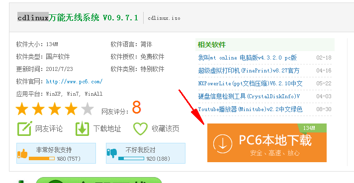

下载完后放到C盘，将其重命名为CDlinux.iso (注意文件后缀名)

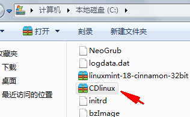

安装EasyBCD

http://baoku.360.cn/soft/show/appid/100114152

安装好EasyBCD软件后，打开这个软件，点击左侧的Add New Entry,再点击右侧上方的NeoGrub，然后点击下方的Install安装。如下图。

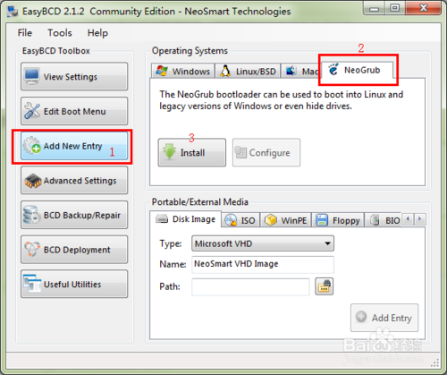

点击Configure按钮，在跳出的记事本编辑程序中，在末尾添加如下内容

title CDlinux

find --set-root /CDlinux.iso

map --mem /CDlinux.iso (hd32)

map --hook

kernel (hd32)/CDlinux/bzImage quiet  CDL_DIR=/ CDL_IMG=CDlinux.iso

initrd (hd32)/CDlinux/initrd

保存关闭

重启电脑。

不出意外的话，就会在启动项中看到NeoGrub Bootloader,用方向键选择这个选项

然后接下来每一步都按Enter

等待启动完成

请确保你的无线网路开关是开着的（指示灯没亮不打紧）

双击文件名为“minidwep-gtk”程序：

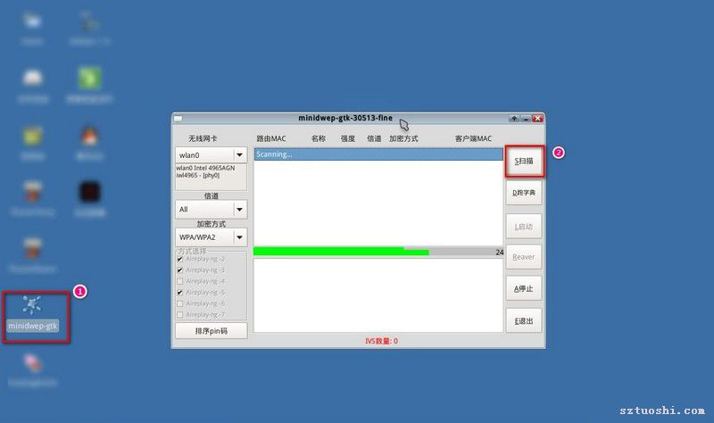

跳出警告的对话框点 OK 就可以了。

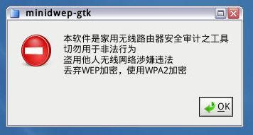

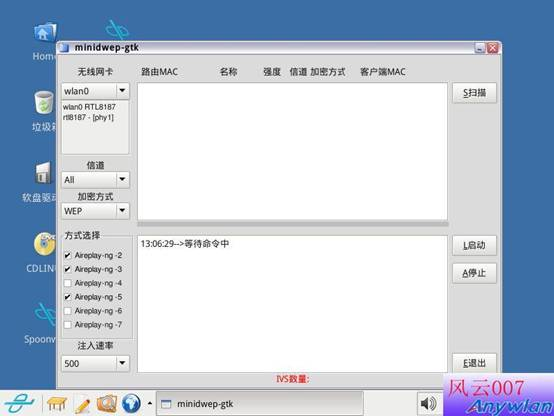

看看设置是不是一样的

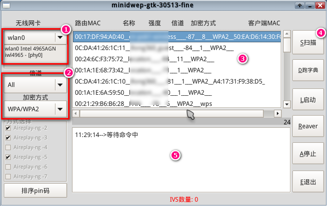

点击右侧的扫描（Scan）按钮，即可扫描附近的无线网络信号。等待数十秒后，会出现所有的wifi列表。

红框中的就是wifi名字，点击选中你要破解的那个wifi名字

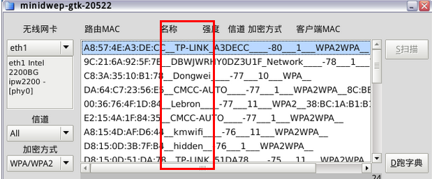

点右侧的启动（launch）

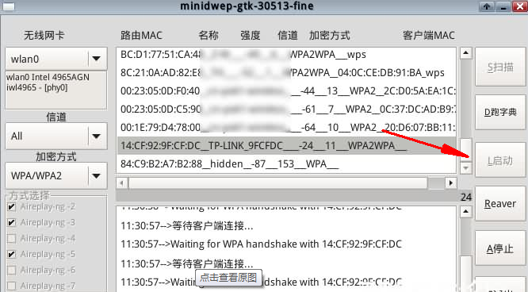

再稍等5分钟左右，就会提示获取到握手包了。

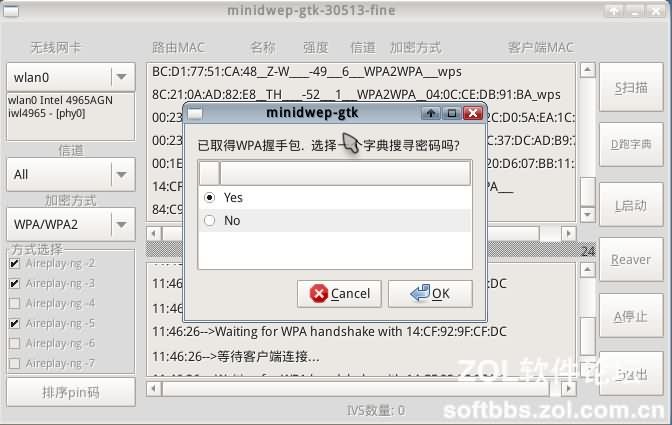

如果5分钟之后还没有跳出这个窗口，那么估计是现在没有人用这个wifi上网的话，估计得晚上重启电脑进入这个系统执行上面这些操作试试看了，因为晚上的话一般都有人上网的

问我们是否选择一个字典来搜寻密码，点“No”之后再点“OK”。

选择弹出窗口中的三个文件，复制他们

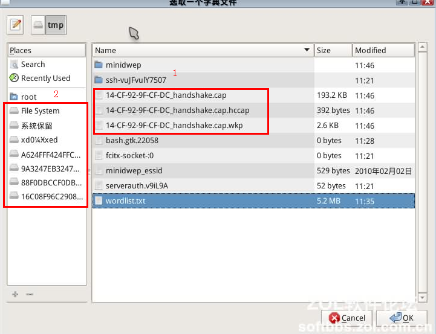

把这三个文件转到U盘，或者点击左侧的盘符，看看里面的内容应该就是你电脑上之前存在的文件，把上面的三个文件复制到你熟悉的地方，重新启动电脑，选择Windows，完成后找到那三个文件，然后发给我，我将帮你搞到密码

redstone-cold@163.com

