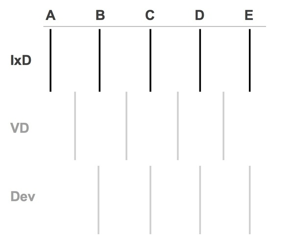
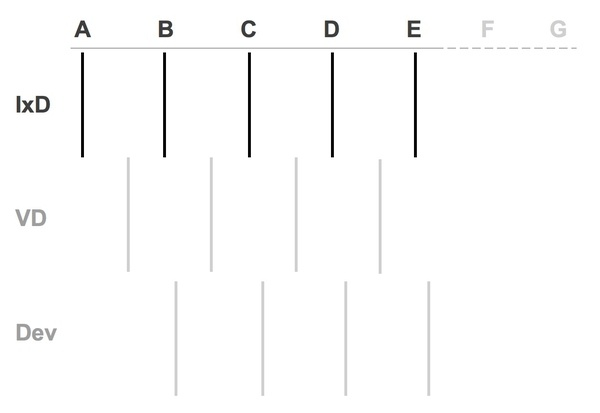
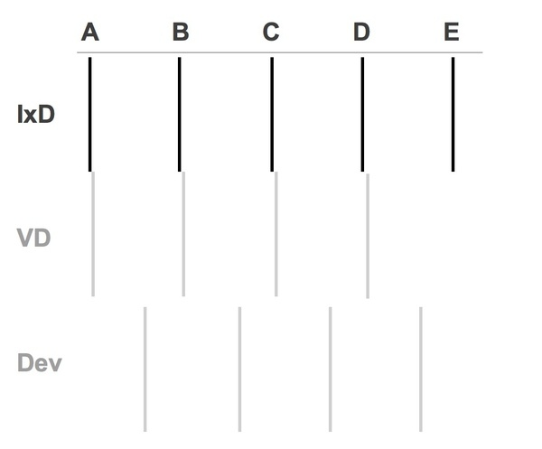
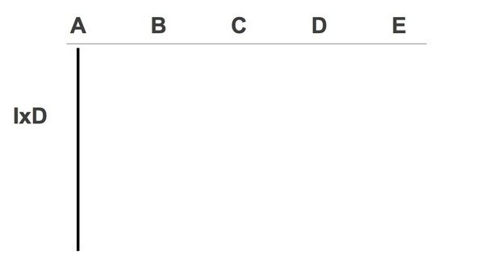
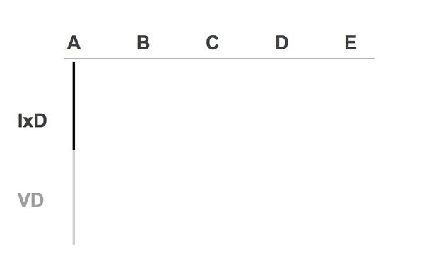
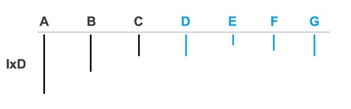
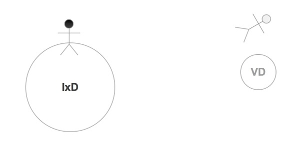

事情是这样发生的
--------

今天和我的经理聊了一下最近工作上发生的事：上周做了什么，这周和下周准备要做什么。刚刚结束了设计阶段（Design Sprint）1，和客户开了远程会议，收到了许多的反馈意见，各个方面的都有。

现在项目正处于一种（我觉得）特别尴尬的阶段：视觉设计师只出了初步的几个概念图，程序员还在准备框架，尚未开始写代码，但是根据原先的计划，这周就要开始开发了。作为交互设计师，一方面留着一大堆反馈意见还没有反映到线框图中，另一方面设计阶段2的任务已经要来了。虽然还没有开始设计，但从可能的流程上来看，任务量巨大，是一个特别复杂的系统，不光是设计一个新的交互方式，还是新的工作方式和商业模式，心里真没底。

我把自己的困惑告诉了经理：作为一名交互设计师，如何更好地与项目里的其他人合作？如何更好地利用大家的时间？他用了画图的方式跟我解释了一下，有些问题并没有直接的答案，但是我觉得解释的方式很有趣，我凭着记忆把它们重新画了一下，和大家聊聊合作的问题。

什么是敏捷开发（Agile）
--------------

先说一下总体的合作方式，我们用的是敏捷开发（Agile）的方式。维基百科上是这么解释的：

> 敏捷软件开发（英语：Agile software development），又称敏捷开发，是一种从1990年代开始逐渐引起广泛关注的一些新型软件开发方法，是一种应对快速变化的需求的一种软件开发能力。它们的具体名称、理念、过程、术语都不尽相同，相对于“非敏捷”，更强调程序员团队与业务专家之间的紧密协作、面对面的沟通（认为比书面的文档更有效）、频繁交付新的软件版本、紧凑而自我组织型的团队、能够很好地适应需求变化的代码编写和团队组织方法，也更注重软件开发过程中人的作用。
> 
> 

如果把这种方法简单视觉化一下，就如下图：IxD指的是交互设计（Interaction Design），VD指的是视觉设计（Visual Design）,Dev指的是开发（Development）。ABCDE在这里代表的是不同的阶段或任务，在frog我们叫做设计阶段（直接翻译可能是设计冲刺Design Sprint）。

这个图的意思就是：当一个设计阶段A结束时，交互设计师就会把工作移交给视觉设计师进行A的设计，同时开始B的交互设计；视觉设计师随后对A进行视觉设计，然后交给程序员进行A的开发；当程序员进行A的开发的时候，交互设计师的B也做好了，然后转交给视觉设计师……如此往复，敏捷开发的最大的特点就是不需要设计师把ABCDE全部设计完后才开始设计，而是在某个阶段结束后就开始进行软件开发。

什么是瀑布式开发（Waterfall Model）
-------------------------

与之相悖的方法叫做瀑布式开发（Waterfall Model），维基百科解释如下：

> 瀑布模型（或称瀑布式开发流程）是由W.W.Royce在1970年首次提出的软体开发模型，在瀑布模型中，软件开发被分为需求分析，设计，实现，测试（确认），集成，和维护这样的步骤依序进行。
> 
> 

纠结的交互设计师
--------

敏捷开发现在运用得越来越广，但是据（经理）说却让设计师更加纠结，这一点我确实有体会到。因为任务被划分成了一个一个小阶段，时间又很紧。我觉得任务A还没做完时，就必须开始做B，把A移交给其他人去做他们该做的事了。而随着任务BCD的进行，可能是需求变了，可能是视觉或开发遇到了问题，经常还要回头去改A，一旦交互改了，后面的视觉设计、开发也要跟着改。因为没有足够的时间去思考透彻A甚至全局，导致回头修改之前的设计的几率大大增加。  
更糟糕的情况可能是当你做完了ABCDE，却发现事情远远没有那么简单，其实还需要做FG等等才能把整个流程设计完毕（如下图）。怎么办？  
可惜，并没有直接的解决办法！有两种可能解决的方法：1. 交互设计师早一点开始，先把ABC都设计得差不多了，才移交给视觉和开发。这样做的原因是，给交互设计师更多的时间去理解问题，尝试解决多个方案，把整个的设计概念调整得差不多了，才交给视觉开始做更高保真的界面图（comps）。  
2.交互设计师和视觉设计师更紧密地在一起工作，减少交互和视觉之间的时间间隔。更早地看到高保真（high fidelity）的界面图，有问题可以立即调整，然后再把已经比较成熟的方案移交给程序员。(如下图）

切忌走得太深
------

再谈谈我纠结的“还没设计完善就就要进入下一步”的感觉。之前在我的心目中，交互设计师把线框图画完，整个设计的基本框架就定下来了，包括信息架构、交互模型（interaction model）、主要的模板，视觉设计师只是在线框之上锦上添花，表达更多的东西。而现在我移交给视觉设计师的线框图非常地低保真（low fidelity）。有些交互模型还不是最佳的选择，有些页面的非主要信息还没加上去，排版也不是特别好看，总之许多细节没有敲定。而之前在学校做项目基本上是一人全部操办，做完了线框图马上就做视觉稿了，甚至直接作出的线框图就挺简单好看了。我的经理给我的建议是，不要在一个小流程里做得太深入。打个比方，假设这是你作为一名设计师可以做出的深度：  
  
现在，作为一名交互设计师，要想办法把一部分工作让出来，给视觉设计师，自己只做到这么深就够了：  
交互设计师只负责低保真的线框图，让视觉设计师自己去操心怎么做出高保真的图来。这么做的原因有二：  
1. 这体现了交互设计师对视觉设计师的尊重。让视觉做自己擅长的事去，不必要越俎代庖，把别人的活也干了。  
2. 交互设计师节省了纠结细节的时间，把主要的精力放在“解决问题”上面去。让自己的头脑一直处于“解决问题”的模式。有利于项目整体的效率和成功。

初级交互设计师应走得宽
-----------

公司对于初高级设计师的期待是不同的。初级设计师应在同一个问题上走得更宽。假设下图反映的是同一个问题的不同解决方案ABC：  
假设现在有一个问题要解决，随便举个例子吧：如何让用户把商品放入购物车？一般来说，初级交互设计师会给出1-3个解决方案，这三个方案可能有的非常直接，可以做得很深入，有些比较麻烦，做得比较浅。有个几个方案后，会选出一个来更深入地探索。然而，如果是更优秀的初级设计师，应走得更宽一些。同一个问题，可能会想出ABCDEFG7个方案，这当中肯定会有一些看起来很荒谬或者行不通的方案，比如E。但是方案E中的某一个点很好，最后选中继续发展的方案可能是A中的一部分，加上了E中的一点，一个有突破性的好设计就这么诞生了。这一切的根基则在于能够产生足够多的点子来挑选。

我身陷泥淖，你放心飞吧
-----------

关于为什么要把交互设计和视觉设计分开，让不同的人负责，经理打了个比喻，我觉得很有意思：  
交互设计师生活在重力加速度g等于地球的10倍的地方，处理的是那些的最沉重最纠结的问题（heavy things）。视觉设计师则生活在加速度g等于地球1/6的地方，他们轻得可以飞起来。只有我们（交互设计师）竭尽全力在g等于10倍的地方把问题处理好了，他们（视觉设计师）才能够飞得更高、更自由。（我：那我可以理解为，我们使用的是不同的大脑半球吗？）部分是这样，但是在交互设计师在对解决方案进行发散分析的时候（所谓“走得宽”），也会用到右脑。画了个简单的示意图表示如下：  
那么，就让我专心地在泥淖中越陷越深，而你放心飞吧！：）

  
