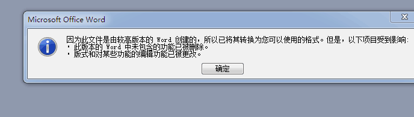
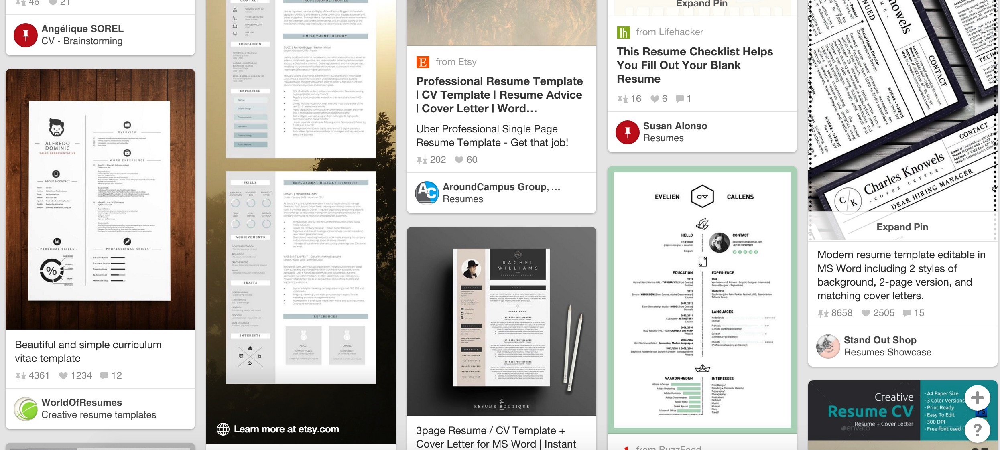

这简历 做的我看的 找不到重点

文字信息太多

审美不够 可以看看一些优秀的简历

文档版本不要 保存太高  不能保证面试官不会出现像我这样用低版本的吧   个人建议勿怪

重点没突出来  拧重点的重点  扼要精简

不知道，自己看吧，把你觉得的亮眼的，能直接反应出你的特点的留下。

个人感觉。。既然是设计师的简历 起码要有一定的设计感 突出你最拿手的东西 

 软件成果

至于看过的书什么的 HR不会感兴趣的

突出重点 技能 经验 成果就够了

通篇文字的话很难引起人兴趣

逻辑和系统的东西偏多，视觉的偏少

 做的我看的 找不到重点

文字太多了  把你要展示的重点 放出来就可以了 

那你就编

你可以在bat的招聘看看人家的招聘要求，再复制粘贴到个人技能去

从UI做起

一般只有大公司才会分工这么细致 

大些的公司才回有专门的ue职位

一般的公司 一般情况下ui和ue一个人做  或者 产品经理负责

不过程序的工作强度比设计大

程序员赚的是血汗钱，所以设计师也别老抱怨开发的工资高了。设计那点加班跟他们的加班，强度都不在一个点上

只是给出的工资，是根据工作强度来给的。并不是设计领的少钱，就是公司不注重设计。

要存在同类型的产品，就会有竞争。界面的好不好看，这时候的设计师竞争力就上来了。

作为一款产品，带给用户最直接的，最强烈第一感受的东西就是交互，虽然不能说把控产品的生死，到也起到了举足轻重的作用，小公司根本就不会有这个职务，大公司一般也就稀有的几个，作为产品灵魂体验的东西会交给一个新手吗？还是脚踏实地的做，一步步来，积累到一定经验的时候在考虑这个，不要给自己完成低不成高不就的局面，给自己挖坑

小公司一般都是ui自己做

