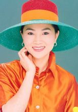
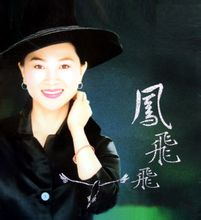
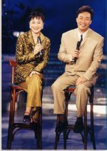
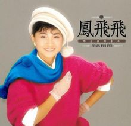
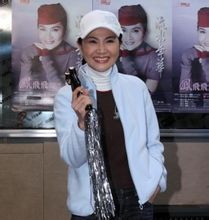
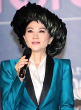
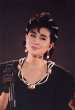

[编辑本段](http://baike.baidu.com/view/64900.htm?func=retitle#)个人档案
---------------------------------------------------------------

　　凤飞飞 　　在其歌唱生涯中，出版各类[唱片](http://baike.baidu.com/view/21691.htm)近百张，8次获得[金像奖](http://baike.baidu.com/view/25397.htm)最佳女歌星奖，两度摘取[金钟奖](http://baike.baidu.com/view/25569.htm)歌后桂冠。

凤飞飞个人照(10张)　　60年代末，她抱着对民谣的挚爱踏入歌坛，直至1997年最后一张《想要弹同调精选集》。 　　将近100张的唱片不仅使凤飞飞成为[台湾](http://baike.baidu.com/view/2200.htm)歌坛的大姐级人物，她没有压力的民歌作品更陪伴我们度过了那些苍白、艰难的岁月，成为记忆中的青葱。其中《[浮世情怀](http://baike.baidu.com/view/884021.htm)》与《想要弹同调》更入选台湾唱片百佳之列。但如今市面流传的凤飞飞精选只收入她早期整理及挖掘民间小调的一段历史，如《采槟榔》、《苏州河边》、《相思河畔》、《月光小夜曲》等歌曲，至多再[提提](http://baike.baidu.com/view/6567433.htm)唱成经典的[罗大佑](http://baike.baidu.com/view/9089.htm)的《[追梦人](http://baike.baidu.com/view/14959.htm)》，而对她民歌原创时期则轻易省略。其实这才是凤飞飞作为一个歌者最值得关注的一面。在她的歌中，你可以感觉本土歌谣最初的暖意，她带着我们再回到最早的脚印，寻回民间歌谣过往至今的足迹；让90年代的忙碌都停下脚步休息；让70年代的都市森林恢复它纯情的样子；让50年代隐藏在传统下的呐喊重现；让30年代台湾本土歌谣展现灿烂的情怀。凤飞飞就是一部台湾本土歌谣进化史，以至于在90年代后期她对“本土化”的执着与贡献已达到了令台湾同行惊赞的地步。[编辑本段](http://baike.baidu.com/view/64900.htm?func=retitle#)风云人生
---------------------------------------------------------------

　　**概述**

凤飞飞(15张)　　从1971年起，凤飞飞发表首支[单曲](http://baike.baidu.com/view/57999.htm)，开始了漫长而辉煌的[歌手](http://baike.baidu.com/view/53794.htm)生涯。因为每次出现在舞台上总搭配各式各样的帽子，人封“帽子歌后”，她的歌声红遍台湾，甚至全世界有[华人](http://baike.baidu.com/view/48232.htm)的地方，也都称她为“宝岛歌后”。 　　当时真正能称“歌后”的，除了凤飞飞，便是[邓丽君](http://baike.baidu.com/view/8696.htm)。两人歌艺不同，性情也大相径庭，但同样有着崇高的“江湖地位”。只不过邓丽君的知名度路人皆知，而凤飞飞在内地，始终只是一股涌动的暗流。如今，我们终有幸在家门口聆听凤飞飞，让原汁原味的《掌声响起》、《[月朦胧鸟朦胧](http://baike.baidu.com/view/379874.htm)》萦绕在耳畔。在历久弥新的感动之余，我们也第一次有机会近距离地体会歌后勤勉低调温婉的东方之美。 　　**曾经为口音困扰的凤飞飞**　　凤飞飞对歌曲的演绎堪称一绝，细腻的情感把握，毫厘不差的发声与转音，谁又能想到，她曾经为自己的口音而深陷困扰。 　　30年前的乐坛并不像现在以吐字模糊为荣，字正腔圆在那时是对歌手的基本要求。凤飞飞出生在我国台湾岛南部的[大溪镇](http://baike.baidu.com/view/829410.htm)，乡村出生的背景掩饰不了她在咬音吐字上的缺陷。她分不清平舌音和翘舌音，也常常把“YU”发成“YI”。如唱到“一道彩虹，挂在那云中”的“中”字，她发出的却是“踪”音。虽不是致命的问题，但勤奋要强的凤飞飞深知这个弱点会阻碍发展，于是专门拜在[刘家昌](http://baike.baidu.com/view/71282.htm)门下学习歌唱技巧，并向[左宏元](http://baike.baidu.com/view/71294.htm)、庄奴等优秀词曲人学习语言，如此认真的态度不仅让她获得了《我是一片云》、《流水年华》、 《掌声响起》等优秀歌曲的首唱，并得到这些音乐大师的首肯。多年后，刘家昌在接受媒体采访时，有记者问他谁是唱得最好的学生，也许问的人早已有了答案———邓丽君，想不到刘家昌的回答却是凤飞飞。或许这样的回答只是刘大师的一时之选，却也说明了凤飞飞的努力在刘家昌的心目中留下了多么深刻的印象。 　　其实不仅是口音，就算只说音色，凤飞飞也有安于人后的托词。她的声音介于邓丽君和[蔡琴](http://baike.baidu.com/view/63767.htm)之间，没有邓丽君的清澈甜美，也不如蔡琴的醇厚馥郁，她的成就更多地依赖于勤恳表演积累的经验和个人阅历对歌曲的掌控力。她的歌声有着无出其右的真实和温暖，在中音向高音的转化上轻松自如，不着气息又余音缠绕。 

活动现场(8张)　　上她歌曲的风格活泼轻松，总有一股积极向上的感人之气。[比如](http://baike.baidu.com/view/6814120.htm)思念恋人的歌曲《怀念的钟声》里，她用歌声勾勒出一副夕阳西下的风情画，凭借远处嘹亮的钟声寄意，莫忘了故乡的恋人正在盼望你早日回家。缠绵之余，丝毫不见哀叹；又如赠别友人之歌《祝你幸福》 ：人生的旅途有甘有苦，要有坚强意志，发挥你的智慧，留下你的汗珠，创造你的幸福。通篇振奋，激励人奋勇向上；还有她自我写照的歌曲《做个快乐的歌手》 ：想做个快乐的歌手走遍那天涯，弹着那吉他，寻找理想。正是永远努力勤学的信念，让凤飞飞一唱30年，红遍华人区。也因为如此，当你听到54岁的她还在风雨无阻，每天坚持慢跑健身练嗓时，便会觉得这不足为奇了。 　　**帽檐之下有哲学的凤飞飞**　　1974年，凤飞飞开始主持[电视综艺节目](http://baike.baidu.com/view/2009698.htm)，由于从小家庭条件不是很好，在刚踏入演艺圈的时候，凤飞飞经常为上台的“行头”费尽思量。有一次，她戴了一顶[鸭舌帽](http://baike.baidu.com/view/373910.htm)上台演唱，结果反响异常热烈，之后每次在舞台上，只要不是穿旗袍等传统服饰，凤飞飞总是用帅气的裤装搭配着风格迥异的帽子，配合着那富有磁性的嗓音和憨直的微笑，并用举手礼向观众致谢，这一切都成了她独特的标志，以至于后来她在电视节目里拿自己打趣：自己没有沉鱼落雁的姿色，但是又很懒，不愿意多花时间在化妆上，结果顶个帽子就出场了，想不到效果比美女还好！此后，“帽子歌后”这个称谓见诸各大报纸杂志。 凤飞飞

　　凤飞飞带帽子首先就是为了节约。与如今行头大过天的许多大牌[艺人](http://baike.baidu.com/view/355419.htm)相比，凤飞飞的时代就算连个造型师也没有，一切都要自己打理。帽子可以用碎布料做成，相对于上衣裙子，要经济节俭得多，乡村长大的凤飞飞很自然地选择了这种既便宜又有效果的舞台扮相。其实以当时凤飞飞的乐坛地位，要提要求在造型上大动干戈也并非是痴心妄想，但她宁可选择廉价的帽子，却没有想过要整日华服加身傲然枝头。 　　戴帽子的日子风光独好。有人说戴着帽子压抑了视野，但凤飞飞看来却是她看待世界的独特视角。压低了帽檐，遮蔽住虽然耀眼却并不必要的光芒，专心地让眼神与四下的歌迷观众交流。就像凤飞飞在她25岁时写下的一段自序里说的，“我从来不曾在生命的画布上,刻意地加上几许炫丽的色彩”。戴帽子的凤飞飞，安于她眼中的这个世界，也安于低调实在的自然做派，这便是她的帽子哲学。 　　**相夫教子激流勇退的凤飞飞**　　很多艺人都感叹谈恋爱难，结婚更难，这让凤飞飞的经历看上去像是一个异类，与娱乐圈格格不入。凤飞飞

1981年，27岁的凤飞飞嫁给了香港商人[赵宏琦](http://baike.baidu.com/view/2548844.htm)，赵宏琦虽非大富之家，但也算是家道殷实。1989年他们的儿子出 生后，凤飞飞便携夫定居香港，逐渐收敛起炫目的羽毛，全心全意相夫教子。关于这个时期的凤飞飞，有两件事值得纪念。1991年，影响了整整一代人的台湾作家[三毛](http://baike.baidu.com/view/2136.htm)在医院自尽，乐坛领袖[罗大佑](http://baike.baidu.com/view/9089.htm)创作了《追梦人》悼念她，在选择由谁来演唱时，他没有用三毛生前的御用唱将[齐豫](http://baike.baidu.com/view/4552.htm)、[潘越云](http://baike.baidu.com/view/89162.htm)、[林慧萍](http://baike.baidu.com/view/507225.htm)等人，而是想到了已经处于退休状态的凤飞飞，结果凤飞飞用她那平实无华、但余韵悠长的演绎交足满分。此歌后来被应用为合拍片《[雪山飞狐](http://baike.baidu.com/view/11272.htm)》的片尾曲，长白山的雪景，凤飞飞的歌曲，使该片留给了观众难以磨灭的印象，也成为许多内地歌迷对凤飞飞最深切的记忆。 　　1994年，凤飞飞低调来到北京，那次她的身份不是那个堪与邓丽君比肩的“帽子歌后”，也不是那个红透台湾娱乐圈的巨星，而是一个充满爱心的慈善家，她同夫婿赵宏琦向祖国捐赠了人民币60万元，在广西凌云县成立了希望小学。 

唱片封面(13张)　　这两件事情在茫茫人世间只是沧海一粟，但对凤飞飞来说，却是个人命运的写照。在凤飞飞看来，激流涌退的全部意义并不在于心安理得地做一名贤妻良母，追求过程的完满才是人生的真谛。在巅峰时刻[全身而退](http://baike.baidu.com/view/1575414.htm)需要的并非是堪于抵抗名利的坚定自信，而是对另一种生命、另一条轨迹的无比向往。也正因为此，若干年后，当原来的小心肝宝贝已经长成了94公斤的肥胖少年时，凤飞飞重新回到歌坛，于2003年在台湾举办了35周年演唱会。令人惊奇的是，凤飞飞的嗓子并没有因为告别舞台而褪色，而是愈发炉火纯青，当《温暖的秋天》旋律响起时，戴着白色礼帽配合白色礼服的凤飞飞如30年前般款款现身，一连串的老歌都经过了重新的编排，丝毫不见陈腐，反倒是散发出迷人的光彩。 　　**经典记忆中的凤飞飞**　　● 《掌声响起》的确是凤飞飞的首支名曲，也是她上千首歌曲中的翘楚之作。当凤飞飞看到这首歌的凤飞飞

歌词时，她就足足哭了三个小时，开始录音的时候，她还是要求先让自己哭完再进行录音，即便如此，每次在舞台上演绎这首歌的时候，她还是常常唱得泪流满面。 　　● 《流水年华》这首歌最先由70年代的白马王子[刘文正](http://baike.baidu.com/view/16708.htm)在内地唱红，这首原本是怀念异乡恋人的歌，成了当时年轻人的送别之曲。凤飞飞的演绎委婉低回，但没有传统女歌手的那种哀伤苦盼，乐观向上的信念贯穿全曲。 　　● 《我是一片云》这部同名[琼瑶](http://baike.baidu.com/view/6866.htm)电影异常火爆，不仅是因为影片云集了当时在台湾最红的林青霞、[秦汉](http://baike.baidu.com/view/104626.htm)、秦祥林这个三人组合，更因为剧情中的恋爱关系正好是三人关系的现实版，亦真亦幻的三角关系自然调足了观众的胃口。 　　● 《[往事如昨](http://baike.baidu.com/view/885577.htm)》1965年到1972年出生的人，只要在学生时代喜欢流行歌曲的，一定记得这首歌。虽然大家哼着歌曲或手抄歌词的时候，颇有些少年不识愁滋味的情怀，但“春去春回，年华易逝”的伤感只有在少年们的心中才表现得那么敏锐。 　　● 《祝你幸福》凤飞飞经常说自己是个幸运的人，在她1972录制第一张唱片的时候，便有《祝你幸福》这么优秀的歌曲。这首歌确实激励了整整一代人，以至于当凤飞飞举办35周年演唱会时，全场雷动，一起合唱“人生的旅途有甘有苦，要有坚强意志，发挥你的智慧，流下你的汗珠，创造你的幸福”。[编辑本段](http://baike.baidu.com/view/64900.htm?func=retitle#)艺术生涯
---------------------------------------------------------------

　　1968 参加中华电台歌唱比赛，荣获第一座冠军奖杯。凤飞飞

1969 以林茜之名首次登台于台北云海酒店。 　　1970 驻唱于台北真善美、小麒麟、[新加坡](http://baike.baidu.com/view/3593.htm)舞厅等地。 　　1971 第一首歌《初见一日》收录于歌林金曲奖唱片[专辑](http://baike.baidu.com/view/57960.htm)中。 　　1972 易名凤飞飞。 　　参加[华视](http://baike.baidu.com/view/1379364.htm)闽南语连续剧《燕双飞》演出，并演唱[主题曲](http://baike.baidu.com/view/230487.htm)，之后陆续演出《兄弟英豪》、《[开漳圣王](http://baike.baidu.com/view/621917.htm)》、《西螺七剑》、《包公传》等。 　　第一次消息见报，为《祝你幸福》唱片作宣传。 　　第一首台语歌曲《燕双飞》收录[于海山](http://baike.baidu.com/view/5512223.htm)唱片。 　　首次作秀于嘉义豪华大歌厅。 　　唱片专辑 　　三月出版第1张唱片【祝你幸福】。 　　六月出版第2张唱片【五月的花】。 　　九月出版第3张唱片【我没有错】。 　　1973 第一次上[中视](http://baike.baidu.com/view/958582.htm)金曲奖节目，演唱《红蔷薇》。 　　主持中视《每日一星》节目。 　　参加中视“爱情十字路”与“苦海女神龙”连续剧的演出。 　　◎ 唱片专辑 　　三月出版第4张唱片【串串风铃响】。 　　六月出版第5张唱片【爱的礼物】。 　　九月出版第6张唱片【你是否忘记了】。 　　十二月出版第7张唱片【花谢花飞飞满天】。 　　十二月出版第8张唱片【桃花又盛开】。 　　1974 首次赴新加坡演唱。 　　荣获[东南亚](http://baike.baidu.com/view/20086.htm)十大歌星之一。 　　◎ 唱片专辑凤飞飞

三月出版第9张唱片【爱要让他知道】。 　　四月出版第10张唱片【敲敲门】。 　　六月出版第11张唱片【碧城故事】。 　　九月出版第12张唱片【又是秋天】。 　　十月出版第13张唱片【雪花片片】。 　　十二月出版第14张唱片【十七、十八】。 　　十二月出版第15张八吋唱片【云飞何处】（合辑）。 　　1975 加盟台视，首先参加《银河璇宫》节目。 　　三月推出第一个个人电视专辑《歌星之夜》。 　　四月四日在[台北](http://baike.baidu.com/view/6809.htm)中山堂举办第一次歌友联欢会。 　　五月与[杨欣](http://baike.baidu.com/view/27140.htm)、蓝毓莉合演电视歌剧《金镶玉》。 　　三月出版第16张唱片【巧合】。 　　三月出版第17张八吋唱片【情场就是战场】（合辑）。 　　五月出版第18张唱片【金镶玉】（合辑）。 　　七月出版第19张唱片【乡下毕业生】（合辑）。 　　八月出版第20张唱片【微笑】。 　　十二月出版第21张唱片【呼唤】。 　　1976 ◎ [综艺节目](http://baike.baidu.com/view/1023137.htm)主持 　　首次主持大型现场播出综艺节目《我爱周末》。 　　拍摄第一个广告片－『国际牌五极三镜』，之后续拍台丽洗面皂、脱普洗发粉、耐斯洗发粉。 　　首度赴日宣慰侨胞。 　　荣获综合周刊举办第一届<金像奖>最受欢迎歌星榜首。 　　九月加盟歌林[唱片公司](http://baike.baidu.com/view/69123.htm)，并于十月出版【星语】专辑。 　　◎ 唱片专辑 　　一月出版第22张唱片【意难忘/怀念老歌】。 　　三月出版第23张唱片【枫叶情】。 　　三月出版第24张唱片【不一样的爱】。 　　六月出版第25张唱片【温暖在秋天】。 　　六月出版第26张唱片【怀念/怀念老歌 】。 　　七月出版第27张唱片【[夏日假期玫瑰花](http://baike.baidu.com/view/533960.htm)】。 　　九月出版第28张唱片【明天二十岁】。 　　九月出版第29张唱片【山鹰】（合辑）。 　　十月出版第30张唱片【落叶飘飘】。 　　十月出版第31张唱片【[祝你幸福](http://baike.baidu.com/view/773129.htm)/海山金唱片1】。 　　十月出版第32张唱片【碧城故事/海山金唱片2】。 　　十月出版第33张唱片【巧合/海山金唱片3】。 　　十月出版第34张唱片【又是秋天/海山金唱片4】。 　　十月出版第35张唱片【[枫叶情](http://baike.baidu.com/view/4000113.htm)/海山金唱片5】。 　　十月出版第36张唱片【落叶飘飘/海山金唱片6】。 　　十月出版第37张唱片【花谢花飞飞满天/海山金唱片7】。 　　十月出版第38张唱片专辑【意难忘/海山金唱片8】。 　　十月出版第39张唱片专辑【怀念/海山金唱片9】。 　　十月出版第40张唱片专辑【星语】。 　　十一月出版第41张唱片专辑【[王昭君](http://baike.baidu.com/view/3083.htm)/怀念金曲】。 　　1977 ◎ 综艺节目主持 　　四月推出第二个常态性综艺节目《你爱周末》。 　　当选弯弯香皂公司举办[曲线](http://baike.baidu.com/view/400.htm)最美小姐。 　　拍摄双喜芭乐汁、喷效蚊香、宾果蜂蜜口香糖广告片。 　　【我是一片云】唱片销售量突破四十五万张，获歌林唱片公司颁赠第一张金唱片。 　　由综合周刊出版第一本专辑－凤飞飞的感情世界。 　　◎ 电视专辑 　　二月十八日与[康弘](http://baike.baidu.com/view/4464063.htm)联合主持《抬头见喜》特别节目。 　　◎ 唱片专辑 　　一月出版第42张唱片【我是一片云】。 　　三月出版第43张唱片【心酸酸/台湾歌谣1】。 　　六月出版第44张唱片【奔向彩虹】。 　　十二月出版第45张唱片【月夜叹/台湾歌谣2】。 　　1978 首次赴[金门](http://baike.baidu.com/view/47836.htm)劳军。 　　赴美盖瑞郡德球场为中华青少棒队加油，亲任啦啦队队长。 　　参加台湾同乡联谊会首届年会。 　　拍摄津津小泰山果汁棒广告片。 　　◎ 综艺节目主持 　　七月推出第三个常态性综艺节目《一道彩虹》。 　　拍摄蔘美水晶霜广告片。 　　应新加坡总理夫人之邀，赴星洲国家剧场开个人慈善义演演唱会。 　　中美建交，捐“爱国自强基金”一百二十万。 　　◎ 电视专辑 　　二月六日主持除夕特别节目《飞来福》。 　　◎ 唱片专辑 　　一月出版第46张唱片【[月朦胧鸟朦胧](http://baike.baidu.com/view/379874.htm)】。 　　五月出版第47张唱片【花有情花有爱】。 　　八月出版第48张唱片【晨雾】。 　　十一月出版第49张唱片【[一颗红豆](http://baike.baidu.com/view/533947.htm)】。 　　十二月出版第50张唱片【阿里郎/怀念歌曲】。 　　十二月出版第51张唱片【[玫瑰玫瑰我爱你](http://baike.baidu.com/view/450787.htm)】。 　　十二月出版第52张唱片【[夜来香](http://baike.baidu.com/view/36877.htm)】。 　　十二月出版第53张唱片【苹果花】。 　　1979 元月赴纽约主持自由艺人爱国慈善义演会，义卖钻戒和帽子，返国後获海工会、文工会、新闻局颁奖表扬。 　　五月拍摄百吉机车与百吉棒棒冰[广告](http://baike.baidu.com/view/2324.htm)。 　　荣获首届你我他周刊举办《金嗓奖》最受欢迎歌星。 　　《流水年华》当选金嗓奖最受欢迎歌曲。 　　再获综合周刊《金像奖》最受欢迎歌星。 　　主演[第一部电影](http://baike.baidu.com/view/2853555.htm)【春寒】。 　　十一月推出第二部电影【[秋莲](http://baike.baidu.com/view/884019.htm)】，并随片登台。 　　十一月参加[金马奖](http://baike.baidu.com/view/9663.htm)，演唱入围主题曲《没有泥土那有花》。 　　◎ 唱片专辑 　　二月出版第54张唱片【雁儿在林梢】。 　　六月出版第55张唱片【春寒】。 　　十月出版第56张唱片【又见秋莲】。 　　十二月出版第57张唱片【西北雨/台湾民谣3】。 　　1980 蝉联第二届《金嗓奖》最受欢迎歌星榜首。 　　八月举行第一次全省巡回演出，分别在台北狄斯角、台中联美、台南元宝、高雄喜相逢登台表演。 　　美国第一夫人罗沙琳&#8231;卡特赠签名照及祝福语。 　　拍摄第三部电影【凤凰泪】，十月下旬推出上映。 　　十一月九日推出《凤飞飞电视专辑》。 　　十二月二十八日为响应国际残障年，于[国父纪念馆](http://baike.baidu.com/view/114713.htm)主持《残障年爱心义演会》。 　　◎ 唱片专辑 　　三月出版第58张唱片【金盏花】。 　　十一月出版第59张唱片【[就是溜溜的她](http://baike.baidu.com/view/533702.htm)】。 　　1981 二十七岁，于归香港赵家。 　　第四部电影【就是溜溜的她】於春节上映。 　　七月赴美领取中华文化基金会所颁赠之「玉音奖」。 　　荣获「华盛顿荣誉市民奖」和「[马里兰州](http://baike.baidu.com/view/190035.htm)荣誉市民奖」。 　　美国参议员马赛尔斯赠送签名及白宫图片奖状，同时华盛顿定是年的七月二十一日为「凤飞飞日」。 　　蝉联第三届<金嗓奖>最受欢迎歌星榜首。 　　八月三日返国，於家乡[大溪中正公园](http://baike.baidu.com/view/448509.htm)举行千人歌迷联欢会。 　　八月四日获新闻局颁赠「银盘奖」嘉勉。 　　十月以侨胞身份返国参加国庆阅兵大典，获侨委会颁赠「爱国侨胞奖」。 　　十月九日晚上参加《四海同心自强晚会》。 　　赴台中潭子及高雄楠梓[加工出口区](http://baike.baidu.com/view/389171.htm)访问，被誉为「劳工[天使](http://baike.baidu.com/view/8029.htm)」。 　　◎ 电视专辑 　　二月四日主持《凤舞龙翔》除夕特别节目。 　　五月十日推出《五月的温馨》母亲节电视纪念专辑。 　　十一月推出《凤儿有情》劳工之夜电视专辑。 　　◎ 唱片专辑 　　二月出版第60张唱片【[爱你在心口难开](http://baike.baidu.com/view/1099172.htm)】。 　　四月出版第61张唱片【凤飞飞精粹】。 　　十月出版第62张唱片【[好好爱我](http://baike.baidu.com/view/811540.htm)】。 　　1982 响应“三民主义统一中国”运动，于元月十日在[台北国父纪念馆](http://baike.baidu.com/view/365749.htm)举行「凤情千千万义演会」，并拜师学艺唱京剧，筹款三百万，全数捐给[中国大陆](http://baike.baidu.com/view/327945.htm)救济总会，做为空飘基金，并获救总颁赠感谢状。 　　第五部电影【[风儿踢踏踩](http://baike.baidu.com/view/533955.htm)】於春节上映。 　　三月十三日荣登<金钟奖>最佳女歌星宝座。 　　拍摄歌林电器广告。 　　五月一日当选模范劳工，获文工会颁奖表扬。 　　六月捐赠十万赞助第五届世界女垒赛，并亲赴会场为中华队加油。 　　蝉联第四届<金嗓奖>最受欢迎歌星榜首。 　　十月返国担任金马奖颁奖人。 　　◎ 电视专辑 　　元月二十四日「凤情千千万义演会」由中视播出。 　　四月远赴[泰国](http://baike.baidu.com/view/7026.htm)拍摄《湄南游记》专辑，由中视播出。 　　十月二十五日推出《凤怀乡土情》专辑，全部以闽南语发音，介绍台湾民风习俗。 　　◎ 唱片专辑 　　一月出版第63张唱片【凤情千千万-纪念专辑】。 　　七月出版第64张唱片【[我是中国人](http://baike.baidu.com/view/645163.htm)】。 　　八月出版第65张唱片【锣声若响/台湾民谣4】。 　　十二月出版第66张唱片【你来了】。 　　1983 三月再度蝉连<金钟奖>最佳女歌星奖。 　　《凤情千千万》获社会建设奖。 　　三月拍摄第六部电影【四傻害羞】。 　　六月十五日赴台南参加「端午节龙舟赛」。 　　蝉联第五届<金嗓奖>最受欢迎歌星榜首。 　　七月二日于[中山医院](http://baike.baidu.com/view/846453.htm)开刀治疗多年耳疾。 　　八月七日于来来[香格里拉大饭店](http://baike.baidu.com/view/429191.htm)参加全省歌迷举办的30岁「凤飞飞庆生会」。 　　八月七日凤迷成立「凤之友联谊会」，成为全台湾第一个拥有个人歌友会的歌手。 　　十一月为歌林拍摄的『舞狮打陀螺』广告片获得世界优良广告选拔赛「银盘奖」。 　　十二月七日再度赴金门劳军。 　　◎ 电视专辑 　　三月二十七日推出《你来了》专辑。 　　十月二十五日推出《凤怀乡土情》第二集。 　　十二月推出《浯江春晓》金门之旅专辑。 　　◎ 唱片专辑 　　四月出版第67张唱片【出外的人】。 　　八月出版第68张唱片【相思爬上心底】。 　　十二月出版第69张唱片【不知怨】。 　　1984 响应「送炭到泰北」活动。 　　在星马举行歌友联谊会，人数高达七万人，盛况空前。 　　拍摄歌林电器广告。 　　蝉联第六届<金嗓奖>最受欢迎歌星榜首。 　　七月三十日获得美国圣地牙哥大学「国际知名艺人荣誉奖」，美国[里根](http://baike.baidu.com/view/22981.htm)总统亲函致贺。 　　八月赴美举行四场慈善义演，并接受「国际知名艺人荣誉奖」之颁奖。 　　◎ 综艺节目主持 　　中视大型综艺节目《飞上彩虹》首集推出。 　　[何应钦](http://baike.baidu.com/view/91718.htm)将军颁赠镶有总统玉照之荣誉奖牌一面。 　　◎ 电视专辑 　　二月推出《又见彩虹》除夕特别节目。 　　十月推出《四海同心》国庆晚会专辑。 　　◎ 唱片专辑 　　七月出版第70张唱片【夏的季节】。 　　1985 五月获新加坡最受欢迎艺人榜首。 　　蝉联第七届<金嗓奖>最佳歌星榜首。 　　◎ 电视专辑十月二十五日推出《凤怀乡土情》第三集。 　　◎ 唱片专辑四月出版第71张唱片【[彤彩](http://baike.baidu.com/view/884020.htm)】 　　1986 拍摄歌林电器广告。 　　蝉联第八届<金嗓奖>最佳歌星榜首。 　　◎ 电视专辑 　　二月赴[日本](http://baike.baidu.com/view/1554.htm)录制《有凤来仪》春节特别节目。 　　九月推出《彩虹飞月》中秋特别节目。 　　十月返国主持《好歌大家唱》，【掌声响起】、【又见秋莲】荣获新闻局评鉴的好歌。 　　◎ 唱片专辑 　　一月出版第72张唱片【自我挑战】。 　　九月出版第73张唱片【掌声响起】。 　　1987 六月在台北国父纪念馆与[孙越](http://baike.baidu.com/view/1180359.htm)先生乘坐热汽球响应拒菸运动。 　　◎ 综艺节目主持 　　六月于台视推出第五个常态性综艺节目《我爱彩虹》，在节目中与[杨丽花](http://baike.baidu.com/view/308514.htm)小姐搭档演出《[唐伯虎点秋香](http://baike.baidu.com/view/153240.htm)》。 　　在香港制作巨型[海报](http://baike.baidu.com/view/30610.htm)（153×102cm），空运来台，首创歌坛防水、不褪色、撕不破之创举。 　　◎ 唱片专辑 　　六月出版第74张唱片【什么样的你】。 　　1988 元旦，电影【春寒】於[大陆](http://baike.baidu.com/view/37125.htm)北京隆重上映。 　　◎ 唱片专辑 　　二月出版第75张唱片【凤飞飞演艺生涯廿周年精选辑．上、下】。 　　1989 二月初喜获麟儿。 　　1990 加盟真善美唱片公司。 　　拍摄一匙灵洗衣粉广告。 　　十月返国参加国庆晚会《双十国庆喜洋洋》。 　　◎ 唱片专辑 　　二月出版第76张唱片【浮世情怀】。 　　1991　成立「飞飞工作室」。 　　参加[民生报](http://baike.baidu.com/view/884364.htm)「金曲龙虎榜」颁奖典礼，并演唱「浮世情怀」。 　　单曲「[追梦人](http://baike.baidu.com/view/14959.htm)」在新加坡蝉联八周排行榜冠军。 　　四月拍摄田园小城[房地产](http://baike.baidu.com/view/9346.htm)广告。 　　五月拍摄儿童身得壮奶粉广告。 　　八月四日参加凤迷为其举办的庆生会。 　　九月返台参加「联合报40周年社庆晚会」。 　　十月二十五日回国参加「区运之夜」晚会。 　　十二月拍摄台中文心凯旋房地产广告。 　　《心肝宝贝》入围「金曲奖」年度最佳歌曲。 　　单曲《回家的路我会自己走》获选为新加坡SBC电台年度大戏插曲。 　　◎ 电视专辑 　　三月三十一日推出《浮世情怀》专辑。 　　十二月推出《今天的女人和那昨天的女孩》专辑。 　　◎ 唱片专辑 　　十一月出版第77张唱片【今天的女人和那昨天的女孩】。 　　1992　◎ 电视专辑 　　九月推出《凤怀山水情》环保之夜专辑。 　　九月推出《想要弹同调》专辑。 　　◎ 唱片专辑 　　八月出版第78张唱片【想要弹同调1】，[小野](http://baike.baidu.com/view/566488.htm)著由皇冠出版之《想要弹同调》亦同步发行。 　　1993　应邀返台参加第30届金马奖晚会颁奖人，同时扮演[梁山伯](http://baike.baidu.com/view/62164.htm)与港星叶玉卿小姐合唱[楼台会](http://baike.baidu.com/view/2227489.htm)。与[王静莹](http://baike.baidu.com/view/47515.htm)小姐演出 〈草桥结拜〉，与[邱淑贞](http://baike.baidu.com/view/35661.htm)小姐演出 〈十八相送〉。为[侯孝贤](http://baike.baidu.com/view/30864.htm)执导的【戏梦人生】演唱电影插曲－《写伫云顶的名》。 　　1994　五月捐款二十万人民币给大陆的希望工程在[广西](http://baike.baidu.com/view/4652.htm)偏远山区兴建一所「凌云县希望小学」。返台参加台视台庆晚会与[费玉清](http://baike.baidu.com/view/35109.htm)同台演出。 　　◎ 唱片专辑 　　八月出版第79张唱片【陪伤心人说往事】。 　　1995　五月十四日母亲节携子由港返台，应邀为[台中市](http://baike.baidu.com/view/81770.htm)立棒球场的「味全龙对兄弟象」职棒比赛开球，母子首度在国内公开亮相。 　　◎ 电视专辑 　　三月推出《陪伤心人说往事》专辑。 　　◎ 唱片专辑 　　六月出版第80张唱片专辑【思念的歌/想要弹同调 2】。 　　1996　应邀回国参加「五二○总统就职[联欢晚会](http://baike.baidu.com/view/781486.htm)」，演唱重新编曲的《[掌声响起](http://baike.baidu.com/view/4526659.htm)》。 　　1997　◎ 综艺节目主持 　　四月十七日新节目《飞上彩虹》於台视盛大开录。 　　四月二十日《飞上彩虹》隆重开播。 　　五月三日与[刘德华](http://baike.baidu.com/view/1758.htm)一起参加「金曲奖颁奖典礼」，担任「金曲奖最佳女[歌手](http://baike.baidu.com/view/53794.htm)」颁奖人。 　　五月五日凤之友联谊会成立「凤飞飞全球资讯网」。 　　十月三日参加「礼赞重阳银发乐&#8231;怀念金曲[长春](http://baike.baidu.com/view/2172.htm)情－群星老歌演唱会」，演唱一系列国、台语组曲。 　　◎ 唱片专辑 　　六月出版第81张唱片专辑【想要弹同调精选辑】，是全台第一张采用HS－2088数位高音质技术录制的专辑唱片。 　　1999　「921」大地震，捐款新台币五十万元，援助中部灾民。 　　2000　应邀回国参加一月三十一日民生报社庆与华视除夕特别节目《辞旧布新庆团圆欢乐民生贺新春》节目的录影，节目於二月四日晚上八点播出。 　　2003　08 月 26 日 凤飞飞 35 周年演唱会门票开卖。 　　09 月 09 日 召开「凤飞飞 35 周年演唱会」记者会。 　　10 月 31 ， 11 月 01 日 「凤飞飞 35 周年演唱会」于[高雄](http://baike.baidu.com/view/28637.htm)至德堂揭开序幕，共演出 2 场。 　　11 月 14 日 ,15 日 ,16 日「凤飞飞 35 周年演唱会」于[台北国际会议中心](http://baike.baidu.com/view/1736025.htm)演出共 3 场，留下美好的回响。 　　2004　01 月 07 日 当日返台。首次上[新闻主播](http://baike.baidu.com/view/1894604.htm)台，接受民视现场直播专访。 　　01 月 08 日 召开「凤飞飞 35 周年演唱会」 CD 出版记者会。 　　01 月 09 日 出版「凤飞飞 35 周年演唱会」实况 CD ([环球唱片](http://baike.baidu.com/view/153413.htm)发行) 。同时接受各大电视、电台专访。 　　03 月 18 日 新加坡演唱会门票开卖。 　　05 月 12 日 首次发行个人影音产品「凤飞飞 35 周年演唱会」实况 VCD,DVD(环球唱片发行) 。 　　05 月 13 日 于新加坡召开世界巡回演唱会记者会。 　　05 月 14 日 于新加坡室内[体育场](http://baike.baidu.com/view/1154526.htm)举行万人演唱会。观众人数刷新凤飞飞过往个人室内演出之纪录。 　　2005　04月12日 召开「岁月与歌声之旅/凤飞飞2005演唱会」记者会，在会上凤飞飞曾说过那么一句话：「我认为每一次都准备好的歌者，才能拥有真正的舞台。」。 　　05月6日，7日，8日 「凤飞飞2005演唱会」于台北国际会议中心帅气登场，共演出3场。 　　05月21日 「凤飞飞2005演唱会」移师台中市中兴大学惠荪堂演出，全场四千多个位置座无虚席，这座怀有历史的惠荪堂，首次让凤飞飞给唱满了。 　　06月24日，25日 「凤飞飞2005演唱会」於[高雄市](http://baike.baidu.com/view/81727.htm)至德堂开唱，共演出2场。 　　07月02日 「凤飞飞2005演唱会」于台南市立文化中心为阔别25年的台南观众深情演出。 　　演唱会结会后，与来自海内外凤友们合影留念，在凤飞飞与歌友的欢笑声中，感性的点出，凤飞飞在2005年，演唱会的主题精神：「歌友珍惜我的歌声，而我珍惜大家陪我共度的岁月。」 　　2007年成功举办全台湾九塲演唱会之後 　　2007年9月15日凤飞飞[上海](http://baike.baidu.com/view/1735.htm)演唱会 　　2007年9月29日[美国](http://baike.baidu.com/view/2398.htm)LA演唱会 　　2008年5月17日新加坡演唱会 　　2008年6月14日云顶演唱会[编辑本段](http://baike.baidu.com/view/64900.htm?func=retitle#)人物逝世
---------------------------------------------------------------

　　据台湾“今日新闻网”消息，“帽子歌后”凤飞飞今天惊传已在1月3日过世，享年60岁。她因为[肺癌](http://baike.baidu.com/view/22315.htm)病逝于[香港](http://baike.baidu.com/view/2607.htm)，已经在2月12日安葬于台湾[桃园](http://baike.baidu.com/view/358403.htm)大溪。她生前的法律顾问江燕伟律师，在13日下午召开记者会说明状况，凤飞飞因为肺癌，在今年1月3日凌晨3点19分病逝，而因为她行事低调，加上又快要过春节，因此生前遗愿就是嘱咐律师等后事都办完之后，再对外公布消息。 在去年7月到9月期间，凤飞飞就接受化疗，但还是在今年1月不幸病逝。因为肺癌也影响到她的声带，去年本来预计要开的演唱会也取消。江燕伟强调，很抱歉这么晚才对外公布消息，但这是凤飞飞生前特别交代的遗愿。凤飞飞生前也告诉律师，她有很多在工作上帮助过她的人要感谢，　凤飞飞目前已经安葬在她最喜欢的地方，也就是她的故乡桃园大溪，在佛光山的宝塔寺长眠，让歌迷无限追思。[1][编辑本段](http://baike.baidu.com/view/64900.htm?func=retitle#)音乐作品
---------------------------------------------------------------

　　### 热门歌曲

|  |  |  |
| --- | --- | --- |
| 01． | [追梦人](http://baike.baidu.com/view/14959.htm) |  |
| 02． | [爱你在心口难开](http://baike.baidu.com/view/1099172.htm) |  |
| 03． | [掌声响起](http://baike.baidu.com/view/4526659.htm) |  |
| 04． | [阿里郎](http://baike.baidu.com/view/45409.htm) |  |

|  |  |  |
| --- | --- | --- |
| 05． | [天涯歌女](http://baike.baidu.com/view/611347.htm) |  |
| 06． | [玫瑰玫瑰我爱你](http://baike.baidu.com/view/450787.htm) |  |
| 07． | [溜溜的她](http://baike.baidu.com/view/385726.htm) |  |
| 08． | [我是一片云](http://baike.baidu.com/view/1498033.htm) |  |

|  |  |  |
| --- | --- | --- |
| 09． | [草原青又青](http://baike.baidu.com/view/8642889.htm) |  |
| 10． | [姑娘十八一朵花](http://baike.baidu.com/view/2362785.htm) |  |
| 11． | [春风吻上我的脸](http://baike.baidu.com/view/4428893.htm) |  |
| 12． | [我的心里只有你没有他](http://baike.baidu.com/view/82647.htm) |  |

[查看更多](http://mp3.baidu.com/songlist/%B7%EF%B7%C9%B7%C9.html)以上内容来自 ### 专辑

显示方式：专辑列表 | 专辑详情

| 专辑名称 | 发行时间 | 语言 | 试听专辑 | 详情 |
| [想要跟你飞](http://baike.baidu.com/view/7848026.htm) | 2009-12-18 | 国语 |  |  |
| 凤回首典藏辑 | 2006-11-08 |  |  |
| 凤舞飞扬 | 2006-08-30 | 国语 |  |  |
| 凤起云拥之我是中国人 | 2003-12-02 |  |  |
| [凤起云拥之掌声响起](http://baike.baidu.com/view/884034.htm) | 2003-12-02 | 国语 |  |  |
| [凤起云拥之雁儿在林梢](http://baike.baidu.com/view/884033.htm) | 2003-12-02 |  |  |
| 凤起云拥之金盏花 | 2003-11-12 |  |  |
| 凤起云拥之相思爬上心底 | 2003-11-12 |  |  |
| 凤起云拥之好好爱我 | 2003-11-12 |  |  |
| 凤起云拥之自我挑战 | 2003-11-12 |  |  |
| [凤起云拥之你来了](http://baike.baidu.com/view/884074.htm) | 2003-10-28 |  |  |
| [凤起云拥之晨雾](http://baike.baidu.com/view/884072.htm) | 2003-10-01 |  |  |
| 凤飞飞作品集 | 2003-10-01 |  |  |
| [祝你幸福](http://baike.baidu.com/view/773129.htm) | 2003-04-03 | 国语 |  |  |
| 国语原声典藏 | 2003-04-01 |  |  |
| 镭射唱片珍藏系列 | 2002-01-02 |  |  |
| [思念的歌](http://baike.baidu.com/view/5551274.htm) | 1995-06-01 |  |  |
| [驿站](http://baike.baidu.com/view/113965.htm) | 1994-08-01 |  |  |
| [想要弹同调](http://baike.baidu.com/view/8681797.htm) | 1992-08-01 | 国语 |  |  |
| 今天的女人和那昨天的女孩 | 1991-11-01 |  |  |
| [浮世情怀](http://baike.baidu.com/view/884021.htm) | 1991-01-01 |  |  |
| [掌声响起](http://baike.baidu.com/view/4526659.htm) | 1986-09-01 | 国语 |  |  |
| [自我挑战](http://baike.baidu.com/view/8349429.htm) | 1986-01-01 |  |  |
| [彤彩](http://baike.baidu.com/view/884020.htm) | 1985-04-01 |  |  |
| [仲夏](http://baike.baidu.com/view/25732.htm) | 1984-07-01 |  |  |
| 不知怨 | 1983-12-01 |  |  |
| [相思爬上心底](http://baike.baidu.com/view/8644839.htm) | 1983-08-01 |  |  |
| [出外的人](http://baike.baidu.com/view/8687768.htm) | 1983-04-07 |  |  |
| 你来了 | 1982-12-01 |  |  |
| [我是中国人](http://baike.baidu.com/view/645163.htm) | 1982-07-01 |  |  |
| [爱你在心口难开](http://baike.baidu.com/view/1099172.htm) | 1981-02-01 |  |  |
| [就是溜溜的她](http://baike.baidu.com/view/533702.htm) | 1980-11-01 |  |  |
| [金盏花](http://baike.baidu.com/view/57783.htm) | 1980-03-01 |  |  |
| [春寒](http://baike.baidu.com/view/1485877.htm) | 1979-06-01 |  |  |
| [雁儿在林梢](http://baike.baidu.com/view/533903.htm) | 1979-02-01 |  |  |
| [一颗红豆](http://baike.baidu.com/view/533947.htm) | 1978-11-01 |  |  |
| [玫瑰玫瑰我爱你](http://baike.baidu.com/view/450787.htm) | 1978-09-01 |  |
| [晨雾](http://baike.baidu.com/view/2613214.htm) | 1978-08-01 |  |  |
| [花有情花有爱](http://baike.baidu.com/view/8652931.htm) | 1978-05-01 |  |  |
| [奔向彩虹](http://baike.baidu.com/view/1323624.htm) | 1977-06-01 |  |  |
| [我是一片云](http://baike.baidu.com/view/1498033.htm) | 1977-01-01 |  |  |
| [星语](http://baike.baidu.com/view/432562.htm) | 1976-10-01 |  |  |
| [夏日假期玫瑰花](http://baike.baidu.com/view/533960.htm) | 1976-07-01 |  |  |
| [温暖在秋天](http://baike.baidu.com/view/6053934.htm) | 1976-07-01 |  |  |
| [枫叶情](http://baike.baidu.com/view/4000113.htm) | 1976-03-01 |  |  |
| [意难忘](http://baike.baidu.com/view/252437.htm) | 1976-01-01 |  |  |
| [流云](http://baike.baidu.com/view/2406548.htm) | 1975-12-01 |  |  |
| [巧合](http://baike.baidu.com/view/271925.htm) | 1975-03-01 |  |  |
| [十七十八](http://baike.baidu.com/view/7988751.htm) | 1974-12-01 |  |  |
| [花谢花飞飞满天](http://baike.baidu.com/view/273978.htm) | 1973-09-01 |  |  |
| [民歌小调](http://baike.baidu.com/view/884164.htm) | 1972-03-23 |  |  |

