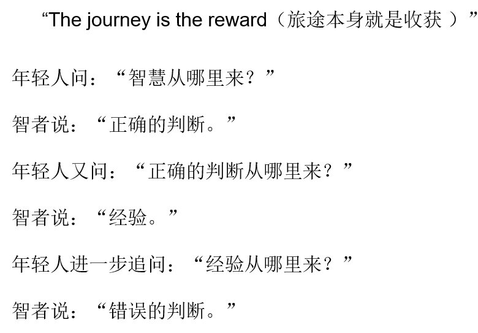

我主要是一个想下载学习数学，以后玩数学，人工智能、机器学习的人。现在编程也是为了未来打基础。

对于职业选择，之前想做设计师，是因为发觉编程是一个没什么想象力的工作，但后来认识到设计离了编程就是一纸空文，代码才是真正改变世界的力量。由于我自己平时想法比较多，但是要把这些想法变成现实的话基本上都得靠自己，另外自己面前还有两个软件等待继续维护更新，前一久因为找设计类的工作和学习设计而没有时间去维护，所以软件功能现在都有点broken了。然后因为找交互设计师的工作也不能加入自己具有认同感的公司，所以希望转变职业方向可以进入自己具有认同感的公司。

想做一个自己动手改变世界的人。

之前决定要做设计之后我看的主要还是编程方面的咨询，并没有看设计文章，

自己的创新想法貌似很难被别人接受，自己动手做个产品让用户赞叹不已的产品，知道原来每天被固化了的操作模式还可以更简单，震撼反对者！

做设计的话可能业余时间多点，但是我已经决定三年之后以做视频讲解为主业的打算。

转行的原因：找不到具有认同感的工作；认识到代码才是真正改变世界的力量；从设计方向or产品经理方向一直努力不知道何时是终点

转行后我就会重拾改变世界的力量，而做设计就不会有

国内互联网大佬基本都是程序员出身，未来式大数据、云计算、人工智能的时代，却不是“大设计”的时代

当时想做设计师也是因为听说设计师加班频率比程序员低，这样子就会有更多自己的时间，但和朋友聊过得知可以找不怎么加班的公司。

现在给我时间去学习编程或设计，在不考虑就业的情况下，我会选择编程，因为它是改变世界的力量，也说我近期的需要。

If you find a job you love, you will never work a day in your life

尝试之后会一切选择都会变得更加明朗，如果走错了，那么另外一条道路就是正确的

| Python程序员 | 交互设计师 |
| - | - |
| 拥有改变世界的力量 | 可能要依附于别的代码实现 |
| 最终想去玩人工智能、机器学习，做个吴恩达之类的人也不错 | 没有业界偶像，日后成为设计能力很强的人吗？似乎也不是那么期待 |
| 喜欢数学，应该很适合 | 不知道会不会浪费 |

| Python程序员 | 交互设计师 | 利 | 弊 |
| - | - | - | - |
| 利 | 弊 | 拥有改变世界的力量 | 软件界面不是自己设计的，用代码实现坏的设计 |
| 软件界面是自己设计的，做自己的好设计 | 可能做的是老板的设计，而不是自己的想法 | 朝着终极目标前进，过程中不断夯实基础 | 加班时间长 |
| 加班时间少 | 与长远目标不一致 | 获得认同的工作 | 找不到满意的工作 |
| 有长期承诺的公司 | 没有中国经验、关系 | 不必搬家 | 工作时间很长 |

         