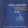
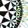
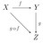
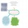

- 首页

- 发现小站

- 线上活动

- 部落

华罗庚关于科学研究的几篇文章

2012-05-30 09:36:42来自: 满园春色关不住(不敢高声语 恐惊天上人)

仅收录其中五篇作为纪念中国仅有的几位大数学家之一的学习体会，文中多有心灵鸡汤的嫌疑和政治套话，这是时代背景决定的，我们仍可以从中得到普适性的从事科研工作的一些要领与精神。这也许对初入门者有些帮助，仅供参考~

PS2：注意冯克勤，徐利治，龚升，史济怀这些老的中国数学工作者都是华罗庚的学生，写过一些纪念文章。

http://faculty.math.tsinghua.edu.cn/~jzhou/Hua.htm中有收录

1我从事科学研究工作的体会

在写这篇文章之前，我想到很多.第一，我知道我对科学研究还是一个小学生，既少

成绩，也还缺乏经验.第二，即使有一些经验，也是极片面的；因为我所熟悉的仅仅是科

学中的一部分——数学中的极小部分，其中的经验对于其他部分能否应用，是大可怀疑的

.且第三，我仍是一个年青的科学工作者，工作虽有一些，但就整个的一生来说，还仅仅

是开始，新经验还不断地在被发现，旧办法也不断地在修正和否定；所以，很可能我今天

所说的，在将来看来是极肤浅甚至于是错误的，当然更不要谈到它的完整性了.但我终于

写了这篇文章，最主要的是由于我觉得：哪管就是些点滴的体会，对那些比我更年青的科

学工作者来说，也许还有些参考作用.

科学研究要有坚实的基础

　　什么叫做坚实的基础？会背会默，滚透烂熟，是否就算已获得坚实的基础了呢？我认

为不算的，并且，我认为这不是建立坚实基础的一种最好的途径.因为真正懂得前人的成

果或书本上的知识的人，不一定要会逐字逐句地背诵；甚至完全相反，会逐字逐句背诵的

人不一定就是真懂的人.

　　所谓“真懂”，其中当然包括搞懂书本上的逻辑推理，但更重要的还要包括以下一些

内容：必须设身处地地想，在没有这定律(或定理)之前，如果我要发现这一条定律(或定

理)是否可能.如果可能，那是经过怎样的实践和思维过程获得它的.不消说，在研究证明

的时候，更重要的是了解其中的中心环节.因为对中心环节的了解，有时可以把这证明或

这定理显示得又直觉又简单.同时真正了解一本书或一章书的中心环节，对了解全部内容

也往往是带有决定性的作用的.不但如此，它还可以帮助记忆，因为由了解而被记忆的东

西比逐字逐句的记忆更深刻，更不易忘掉；而逐字逐句的记忆法，如果忘掉一字一句就有

极大的可能使全局皆非.

　　学完一本书(或一篇文章)之后，还必须做些解剖工作.对其中特别重要的结论，必须

分析它所依赖的是本书上的哪些知识.很可能一条定律是写在第二百五十页上的，但实际

上所需要的仅仅是其前的散见各处的二三十页.这种分析工作做得愈透彻，在做研究工作

时就运用得愈方便.在研究中可能遇到同第二百五十页相仿佛的问题，如果没有做过解剖

工作的人在解决这样问题时，就会牵涉到二百五十页的考虑，而做过解剖工作的人，他只

须考虑二三十页就可以了.

　　解剖固然重要，但不要忘掉解剖后的综合.换言之，中心环节之间的关系不可不注意

，就是能认识到它们之间毫无关联也好.因为这样的结论可以帮助我们作一个初步结论.如

果在较高阶段又发现了他们之间是有关联的，那可以帮助我们体会到我们的认识又提高了

一步.这比囫囵吞其始，囫囵吞其终的好得多.读完了一本书，还有必要把这本书的内容和

已往所读的联系起来，例如：在大学数学系学代数中的二次型的时候，就必须和中学里所

学的几何的圆锥曲线联系起来看.在学习积分方程对称核的时候，又必须和代数的二次型

联系起来看.

　　也许有人说，以上所说的很多是大学教师授课时所应当注意之点.是的.大学教师应当

把中心环节的指点说明提高到逐字逐句讲解之上，要把内容全面讲解清楚，而不要在枝节

上兜圈子.应当把本门学科和其他相邻学科的关键讲解清楚.但最主要的还是要依靠自己，

因为教师能指点的总是十分有限的，而我们可以自己了解的及需要我们自己去了解的，却

是无穷无尽的.

　　讲到基础，凡是作过科学研究工作或即将从事科学研究工作的人总会发问的：要多么

大的基础？如果我们笼统地回答说，基础愈大愈好，是不解决问题的.因为很有可能搞了

一生的基础，而基础还未打好.所以我们必须有一个具体标准，而又必须给它以充分发展

的可能性.关于基础的具体标准，我认为在今天比较容易圆满答复：就是以大学毕业生的

专业知识要求自己.但是切不要局限住自己，应当在专业研究的时候逐步扩大眼界，逐步

扩大基础，以备在更大的基础上建立起更高的宝塔.局限自己的方法有时是不自觉的.例如

：有些大学生看到了“数学通报”的问题解答栏中的问题，就认为这是中学水准的问题，

因而不加顾盼.解放前有些学习几何的同学对代数就丝毫不留意，更不必说学数学的对力

学不留意了.这种思想方法是会引导人进入牛角尖而不自觉的.当然重点是必不可少的，专

业是不可不固定的(至少在某一阶段相当长的一个时期内不要任意转移)；但是也不要放弃

任何可以扩大眼界、扩大研究领域的机会.

独立思考能力和导师

　　在从形式主义的了解中解放出来之后，独立思考能力就成为搞好研究工作的中心环节

.独立思考能力是科学研究和创造发明的一项必备才能.在历史上任何一个较重要的科学上

的创造和发明，都是和创造发明者的独立地深入地看问题的方法分不开的.因为唯有如此

，才能超越成规，不为前人的结论所局囿，深入事物本质，独辟蹊径，作出新的结论.由

于一切事物都在不断地发展着，昨天已经获得的成果，固然一方面变成了我们知识上的财

富，但另一方面，也随之而俱来而带来了一些偏僻之见.如果把已往的方法一成不变地用

来研究今天的事物，便不一定能够解决问题，获得成果.在发现某些问题不能用已往的方

法来解决的时候，我们就必须创造新方法，如此，便必须依赖于突破前人成规的独立思考

能力.

　　由于科学的本质和它在历史上发展的过程，我们可以体会到科学乃是逐步深入、乃至

无限深入的.由于科学是千变万化的，因之往往每去掉一层障碍就发现一些真理.在突破这

层层障碍的时候，往往要用和已往迥然不同的新的独创的方法，才能获得成功；所以科学

上的不断进展，是必须依靠独创精神的.也许如此说并不是过分的，独立思考是取得正确

认识的必要方法，也是科学中克服困难的不二法门.很多例子可以说明：有些大学生在学

校中功课学得很好，在教师指导下也是优等学生，但一旦离开教师参加工作，就停滞不前

，遇到困难便束手无策.这种现象就是由于只跟教师学得了若干知识，而并没有获得独立

思考的本领之故.

　　独立思考和不接受前人的成就是毫无共同之点的.如果有人认为研究工作是独创性的

，只要独立深思，不需要多读书、多接受前人的经验，也不需要依靠群众，这看法也是错

误的.这样的看法会把人引入前人已走过的失败的道路，因而白费精力.以数学上的“三分

角”为例吧.由于无知，有些人还硬想用圆规和直尺来三分任意角，这便是精力浪费.因为

三分任意角是中世纪的著名难题.但今天已经完全解决了(即已证明用圆规、直尺三分任意

角是不可能的).如果我们不肯接受前人成果，仍把自己的知识停滞在中世纪的水准上，盲

目地来进行这种无益的研究，当然就无怪乎要和中世纪的“三分角家”一样地浪费精力了

！

　　独立思考和不需要导师也是并不相容的.优良的导师有无数成功的和失败的经验，特

别是后者，往往是在书本上不易找到的——因为书本上仅仅记录了成功的创作，而很少记

录下在发明之前无数次失败和无数次逐步推进的艰苦思索过程.而优良的导师正如航行的

领航者一样，他可以告诉你哪儿有礁石，哪儿是航道.但是有一点必须指出，不独立思考

，一味依赖导师也是要不得的.因为导师也有主观或思索不到之处.另一方面，没有导师也

不必自馁.照我个人的经验，由于自修的关系，我对中学、大学程度的知识都进行了研究

，当然花费了不少的时间和精力，但我并不后悔，因为在今天，在我的研究工作中所以能

够自如地运用任何初等数学部分，都不能不归功于我早年的关于初等数学的研究功夫.同

时，每一个初走上研究道路的同志还必须看到，由于我国科学工作的幼稚，能胜任的导师

是不很多的.所以，我们必须坚强地树立起：有优良导师我们跟着他较快地爬过一段山路

，再独立前进；如果没有，我们便应当随时随刻地准备着披荆斩棘地奋勇前进！

进行研究工作前的思想准备

　　最先应当提出的一点：就是不要轻视容易解决的问题和忽视点滴工作.科学之所以得

有今日，并不是由于极少数的天才一步登天般地创造出来的，而是由于积累，长期的一点

一滴地积累而得来的；所以，尽管是一点一滴，也不应该忽视.因为江河之形成正是由于

点滴的聚汇且任何一个成功的科学工作，如果分析一下，都是由于不少步骤所组成的.由

第一步看第二步，是容易的，较直觉的；由前一步看后一步，也莫不如此.但是，一连若

干步贯穿起来，这便成为一件烦难而深入的工作了.所以如果任何人轻视在科学实践中的

点滴工作，也便一定不会有较大的创造发明.

　　轻视点滴工作的现象是相当普遍的，我自己也有过这样的痛苦教训.在了解容易了解

的部门时，如果漫不经心，在应用时就不能得心应手.当然，我并不是鼓励人们停滞在搞

容易解决的问题的阶段上.我的着眼点是从容易入手，而主要是逐步深入，一步不苟地进

入科学内核之中.

　　不轻视点滴工作，才能不畏惧困难.而不畏惧困难，才能开始研究工作.轻视困难和畏

惧困难是孪生兄弟，往往出现在同一个人的身上.我看见过不少青年，眼高手低，浅尝辄

止，忽忽十年，一无成就，这便是由于这一缺点.必须知道，只有不畏困难、辛勤劳动的

科学家，才有可能攀登上旁人没有登上过的峰顶，才有可能获得值得称道的成果.所谓天

才是不足恃的，必须认识，辛勤劳动才是科学研究成功的唯一的有力保证.天才的光荣称

号是决不会属于懒汉的！

　　在刚进入科学领域的时候，还必须在思想上准备遭受可能的挫折和失败.受了挫折和

失败之后，不要悲观失望，而应当再接再厉，勇敢前进.哪一个科学家没有经历过失败的

苦痛呢？甚至，如果总结起来，每一个科学家都不能不有这样的感觉：他所走过的失败的

道路比他所走过的成功的道路并不少些.但科学文献仅刊载了成功的记录，因而显不出科

学家的“胜败乃兵家之常”的情况.但我们必须注意一点，就是从失败中取得经验教训.如

果我们向一个困难问题进攻，而遭到失败，那我们必须弄清楚究竟是什么东西使我们招致

失败的.

　　雄心是要有的，但更重要的是步步可行的计划，不要一开始就抱着“一鸣惊人”的思

想.必须认识，在科学中出类拔萃的工作固然重要，但大量的平凡的工作也是推进科学进

展的重要部分.

　　为了不使篇幅加长，我这儿不再涉及学习哲学这个重要环节了.但是我简单地提一句

：毛主席的《实践论》是对科学研究工作最有用的文章.任何刚从事科学研究工作的人都

必须精读此文，这不但目前，并且将来，在科学研究的一生中都会得益非浅的.

喜欢

- 2012-05-30 09:37:53 满园春色关不住 (不敢高声语 恐惊天上人)

谈谈同学们学科学的几个问题

我们的祖国正以高速度前进.凡是热爱祖国的人，没有一个不感觉到无限兴奋的.在这

样情况下，青年们正以革命的精神，饥渴般地吸取科学成果，奋勇地去夺取科学堡垒，来

完成建设我们祖国的光辉任务，以缩短社会主义、共产主义到来的时间.在这里，我准备

谈一谈我所最不敢谈的问题——怎么才能学好科学.希望能多少有助于正向自然科学进军

的青年同学们.

学科学需要热诚，更需要持久的热诚

　　不经过黑暗的人，不知道光明的可贵；不经过严冬酷寒的人，不知道春日的可亲.旧

社会的过来人羡慕新社会中成长的青年.在旧社会里，政权操在剥削阶级的手里，要想做

一个于人民有利的科学家是不易的，但在今天的新社会里，人民作了主人的新社会里，就

完全不同了.我们对科学的致力，也就是对人民的贡献；科学上的发明和发现，也就是人

民的瑰宝.所以，在今天我们已经有了条件可以放心大胆地全心全意地搞科学了.

　　在这样光辉的时代里，每个青年当然都会有学习科学的无比热诚.但我还要提醒大家

一句，仅仅有一时的热诚还是不够的，还须要有连续的持久的热诚.所谓持久，也不是指

十天半个月，一年两年：也不是说中学六年，大学四年；也不是说大学毕业之后再干三年

五载，而是说无限期的持久.

　　如果说科学是有止境的，到达了之后可以休息，那是无稽之谈.科学是精益求精，日

新月异，永远前进的.科学成就是由一点一滴积累起来的.唯有长时期的积聚才能由点滴汇

成大海.科学本身在经常不断地考验自己，在经常考验中把人类的经验积累起来，这样，

才会解决更大的问题，才会更完整地解决问题.

　　“一曝十寒”固然要不得，就是“一曝一寒”也要不得，我们需要不断地锻炼，不断

地提高；我们需要经常地紧张工作；我们需要有持久的热诚.经验告诉我们，在科学领域

里，成功的科学家几乎没有一个不是辛劳的耕耘者.不少例证说明，科学上的重要发现，

是在科学家脑海中反复深思达二三十年之久方始成熟的.因而要想顺手拣来伟大的科学发

明是不可想象的；唯有由于持久热诚所支持着的不断努力，才是能有所成就的唯一的可靠

保证.

学科学要有雄心，但不能越级而进，更不能钻牛角尖

　　每一个毛泽东时代的青年都有远大的前程，当然也都有为人民为祖国大显身手的雄心

，这是我们每一个青年所应当具备的.但如何可以达到这一目的呢？这不是仅仅具有雄心

便可以了的.我以为：必须依照毛主席所常提示的“实事求是”的精神，来制定步步可行

的精密计划.古语说得好，“登高必自卑，行远必自迩.”如果我们不从头做起，按部就班

，那我们是不可能提到应有的高度的.

　　科学是累积性的东西，如果第一步不了解，第二步就会发生困难，而第三步更跟不上

去，也许原来的目的想跳过一步，求快，但结果呢？反而搞成了不能前进.我曾见过好高

骛远的人的失败的情况：对初级课程自以为念过了，懂得了，而高深的却钻不进去，很窘

.我以为学科学的要点在于一步不懂，不要轻易地去跨第二步；并要有坚持性，一天不懂

再研习一天.只有这样，科学的宝塔才会逐渐建筑得又高又大，不然有如沙上建塔，必塌

无疑.

　　我想告诉青年们一件非常遗憾的事.在近二、三年来，我收到成百封关于研究用圆规

及直尺三分任意角的信件，同时我也听说有人收到成百封关于发明了永动机的信件.这两

个问题戕害了不少青年，因为这是已经解决了的“不可能”问题，搞这问题的青年大部都

是成绩优异的青年，但他们把宝贵的时光花在这毫无出路的研究工作上.他们中的一部分

是受了无知者的影响，而另一部分则是为他自己的“雄心”所害.因为想一举成名，他们

不肯脚踏实地地去深入研究这些问题之所以不可能的论证，企图乱撞瞎碰，偶然得到成功

，但实际上这样是根本不会成功的.同样的时间，同样的精力，如果脚踏实地做去，有可

能把自己提到更高的水准.越级而进和钻牛角尖，只会把自己送进不可自拔的泥坑.

　　唯有按部就班地前进，唯有步步踏实地钻研，才可化雄心为现实.在这样基础上生长

的雄心，才不是幻想，才不是白昼梦.

学科学要能创造，但也要善于接受已有的成果

　　研究科学最宝贵的精神之一，是创造的精神，是独立开辟荒原的精神，科学之所以得

有今日，多半是得力于这样的精神，在“山穷水尽疑无路”的时候，卓越的科学家往往另

辟蹊径，创造出“柳暗花明又一村”的境界.所以独立开创能力的培养，是每一个优秀科

学家所必须具备的优良品质之一(注意：独立不是孤立).独立开创与拒不接受他人的经验

并无丝毫相同之处.科学的工作如接力赛跑，人愈多，路程也便会跑得愈远.我所理解的“

开创”，应当是基本上了解了前人成果之后的开创工作.因为在愈高的基础上努力，所得

的结果也更高.如上节所说的三分角、永动机的研究者，如果肯吸收前人的经验，就不会

白白浪费精力与时间.因为这两个问题的结论，正是建筑在若干世纪以来科学家们的无数

次失败的经验之上的，我们又何苦、更何必再走回头路呢？

　　但学习前人的经验，并不是说要拘泥于前人的经验，我们可以也应当怀疑与批评前人

的成果.但怀疑和批评必须从事实出发，必须从了解旁人出发，如此才可以把新的结论建

筑在更结实的基础上面.

　　一个人的生命是有限的、短促的，如果我们要把短短的生命过程使用得更有效力，我

们最好是把自己的生命看成是前人生命的延续，是现在共同生命中的一部分，同时也是后

人生命的开端.如此地继续下去——整体般地继续下去，科学就会一天比一天更光明灿烂

，社会也就会一天比一天更美好繁荣.总之，我们要善于总结及利用前人的经验，再在已

有的经验上进一步地提高——发展性或创造性的提高，更为后人开辟道路.

- 2012-05-30 09:38:38 满园春色关不住 (不敢高声语 恐惊天上人)

3.和青年谈学习

　　青年同学们常常希望我和大家谈谈学习问题，我虽然比一般年青人大一些，可是至今

仍然在摸索中学习，在不断失败中取得教训来进行学习.对于学习，我还没有一套成熟的

经验，没有一套好办法，但有一个愿望，准备一辈子学，一辈子不灰心地学，绝不因为一

时的挫折而降低学习的热诚和决心.

　　科学是老老实实的学问，半点虚假不得.因此，我老老实实地先交代一下，才转入正

题.下面谈的，也希望大家思考一下，看看哪些是对的，哪些是不对的，哪些是可以吸收

加工的，哪些是应该扬弃的.这样，也许可以吸收到人家一点有益的东西，避免犯人家的

缺点.

要有雄心壮志

　　现在我们面临着一个伟大的时代，我们要把一穷二白的祖国建设成为具有现代化工业

、现代化农业、现代化科学文化的新中国.担负着这样的任务，每个青年应当树立起雄心

壮志，以蓬蓬勃勃的朝气，敢于斗争，敢于胜利，敢于学习，敢于创造，敢于继往开来，

敢于做些史无前例的大事业.

　　但这并不是说，搞尖端的科学研究，搞创造发明才需要雄心壮志，搞一般工作就不需

要雄心壮志.任何工作都可以精益求精，所谓“行行出状元”.没有雄心壮志的人，是不可

能主动地把工作搞得很出色的.有些人以为参加农业劳动就不要雄心壮志了，其实不然，

如果某人的努力，能增加农业产量百分之一，这就是一件了不起的事情.而要做到这样，

就得树立雄心壮志.也有人以为，教中小学不需要雄心壮志，这也是不对的.培养下一代，

是国家建设中一项最基本的工作.认为当中小学教师不必去艰苦钻研学问，这是一种泄气

的看法，不是一种力争上游的看法.北京市一个小学教师说过：“小学生要的可能是一杯

水，但是我们得准备满满一壶水，才能充分满足他们的需要.”这话很有道理，当一个名

副其实的、优秀的、社会主义的教师，就需要多多积累知识，使饥渴的青年能得到满足.

我个人的经验也是如此，我有时担任大学一年级的数学课程，比高三仅仅高了一年，但在

我的教学过程中，深深感到我的知识不是够了、多了，而是大大地不足.我经常发现新的

、更好的材料或讲授方法，我经常觉得我的教学大有改进的余地，写好了的讲稿，讲了之

后就发现许多不足之处.古人说的教学相长，的确大有道理.我想，做任何工作都决不可得

过且过，平平庸庸，应付门面，而是应该精益求精，不断改进.

要飞上天，还得从地上起程

　　与雄心壮志相伴而来的，应是老老实实、循序渐进的学习方法.雄心壮志并不是好高

骛远、急躁速成，它和空想不同之处在于：有周密的计划——踏踏实实地安排好实现计划

的具体步骤.使我们通过努力，能一步步地接近目标.例如上天，谁不想上天？嫦娥、孙行

者式的上天，只是幻想、神话而已.要飞上天，还得从地上起程.五代词人韦庄有两阕《喜

迁莺》：“人汹汹，鼓冬冬，襟袖五更凤.大罗天上月朦胧，骑马上虚空.香满衣，云满路

，鸾凤绕身飞舞.霓旌绛节一群群，引见玉华君.”“街鼓动，禁城开，天上探人回.凤衔

金榜出云来，平地一声雷.莺已迁，龙已化，一夜满城车马.家家楼上簇神仙，争看鹤冲天

.”这是词人的幻想，幻想虽然美丽，但真正要做到天上归来，带着科学资料出云来，还

是要依靠多少年来无数人的踏踏实实的努力.

　　有人在中学里就要自学量子力学，算不算雄心壮志？这可能太早了一些.不了解力学

，不了解微积分，而自以为可以读懂量子力学，这是不可想象的事.我们要扩大眼界，但

是先不要忘记自己的知识水平.学习必须踏实，不能踏空一步.踏空一步，就要付出重补的

代价；踏空多步，补不胜补，就会使人上不去，就会完全泄气.不过，一旦发现自己在学

习上有踏空现象的时候也不要怕，回头是岸，赶紧找机会来补，不要不好意思.不补永远

是个洞，补了就好了，就纠正了一个缺点，走起来就更踏实、更稳更快了.

对“懂”的要求

　　做学问功夫，基础越厚，越牢固，对今后的学习就越有利，越容易登高峰，攻尖端，

得心应手地广泛用.有人说，基础宽些好，但到底多宽才好？有人为此而杂览群书.我的看

法，打好基础的第一要求是：对于一些基本的东西，要学深学透，不要急于看力所不能及

的书籍.什么叫学深学透？这就是要经过“由薄到厚”、“由厚到薄”的过程.

　　首先是“由薄到厚”.比如学一本书，每个生字都查过字典，每个不懂的句子都进行

过分析，不懂的环节加上了注解，经过这一番工夫之后，觉得懂多了，同时觉得书已经变

得更厚了.有人认为这样就算完全读懂了.其实不然.每一章每一节、每一字每一句都懂了

，这还不是懂的最后形式.最后还有一个“由厚到薄”的过程，必须把已经学过的东西咀

嚼、消化，组织整理，反复推敲，融会贯通，提炼出关键性的问题来，看出了来龙去脉，

抓住了要点，再和以往学过的比较，弄清楚究竟添了些什么新内容、新方法.这样以后，

就会发现，书，似乎“由厚变薄”了.经过这样消化后的东西，就容易记忆，就能够得心

应手地运用.

　　例如学数学，单靠记公式就不是办法，主要是经过消化，搞懂内容.“三角学”的公

式很多，但主要的并没几个，其他公式都是由这些推出来的.其中主要的一个sin2θ

+cos2θ=1，也不是新的，而是“几何学”上讲过的商高定理.

学越快

　　也许有人觉得，这样书是读“深”了，但“广”不起来；也许有人觉得，这样学习可

能进度慢了.其实不然，这样会愈学愈快.基础好了，以后只不过是添些什么新东西的问题

，而不是再把整本书塞进脑子里去的问题.这样学，就把“广”化为“添”，添些本质上

所不知道的东西，而不是把“广”化为“堆”，把同样的货物一捆一捆地往上堆.这样消

化着学，是深广结合的学法，是较有效率的学法.学了之后，巩固难忘，那就不必说了.

　　打好基础的另一办法是经常练，一有机会就练，苦练活练，不要放过任何一个机会.

比如说，学数学，最好不仅以会做自己学校里的试题为满足，旁的学校的试题也拿来做做

，数学竞赛的试题也拿来做做；读报纸了，看到五年计划要求某种产品增加一倍，也不妨

算算每年平均增加的百分比是多少.又如，弹道导弹的发射区的四点知道了，学数学的人

，不妨想想从中能推出些什么，等等.

老师没有讲过的

　　在打基础的同时，还必须注意培养独立思考的能力.一切事物都在不断向前发展着，

我们用老方法来处理新问题，必然有时不适合，或者不可能.针对新的问题，我们就必须

独辟蹊径，创造新的办法来处理.老师没有讲的，书上查不到的，前人未遇到的问题，就

要靠我们独立思考来解决.

　　培养独立思考的第一步，还是打好基础，多做习题，肯动脑筋，深透地了解定理、定

律、公式的来龙去脉，但最好再想一下，那些结论别人是怎样想出来的，如果能看得出人

家是怎样想出来的，那么自己也就有可能想出新东西来了.

牛顿的发现是偶然的？

　　强调独立思考，并不是不需要前人的经验，而恰恰是建立在广泛接受前人成就的基础

上.在资本主义国家里，流行着对科学发明的神秘化宣传，说什么创造发明可以由于偶然

机会碰出来的.说什么牛顿发明万有引力定律，只是由于偶然看见树上一个苹果落地，灵

机一动的结果.这是胡说八道！苹果落地的现象，自有人类以来便有不知多少人见过，为

什么只有牛顿才发现万有引力呢？其实牛顿不是光看苹果落地，而是经过长期学习，抓住

了开普勒的天体运行规律和伽利略的物体落地定律，并且经过长期的深思熟虑，一旦碰到

自然界的现象，便比较容易地得到启发，因而看出它的本质而已.科学是老老实实的学问

，不可能靠碰运气来创造发明，对一个问题的本质不了解，就是碰上机会也是枉然.入宝

山而空手回，原因在此.

　　我们要虚心学习别人的成功的经验，还应注意别人失败的教训，看别人碰到困难遭到

挫折时如何对待，如何解决，这种教训往往更为宝贵.不要光看到学者专家出了书，在报

纸杂志上发表了文章，他们丢在废纸篓里的稿纸，远比发表的文章多得多.我们应该知道

前辈学者寻求知识所经历的艰巨过程，学习他们克服困难、解决问题的方法.

勤能补拙，熟能生巧

　　最后，我想谈一谈天才与学习的关系问题.有些人自己信心不足，认为学习好需要天

才，而自己天才不够；又有一些人，自高自大，觉得自己有才能，稍稍学习就能够超过同

辈.实质上，这两种看法都有问题.当然，我们不否认各人的才能不一样，有长于此的，有

短于彼的，但有一样可以肯定：主动权是由我们自己掌握的，这就是努力.虽然我的资质

比较差些，但如果用功些，就可能进步得快些，并且一般地讲，可以超过那些自以为有天

才而干劲不足的人.

　　学问是长期积累的，我们不停地学，不停地进步，总会积累起不少的知识.我始终认

为：天才是“努力”的充分发挥.惟有学习，不断地学习，才能使人聪明；惟有努力，不

断地努力，才会出现才能.我想用一句老话来结束这篇文章：“勤能补拙，熟能生巧.”

- 2012-05-30 09:39:40 满园春色关不住 (不敢高声语 恐惊天上人)

4学习和研究数学的一些体会

人贵有自知之明.我知道，我对科学研究的了解是不全面的.也知道，搞科学极重要的

是独立思考，各人应依照各人自己的特点找出最适合的道路.听了别人的学习、研究方法

，就以为我也会学习研究了，这个就无异于吃颗金丹就会成仙，而无需经过勤修苦炼了.

　　今天把我五十年来的经验教训，所见所闻、所体会的向你们介绍，目的在于尽可能把

我的经验作为你们的借鉴，具体问题具体分析、具体的个人应当想出最适合自己的有效方

法来.

一 我第一点准备和同志们谈的问题是速度、是效率

　　速度是实现社会主义现代化的保证.例如说象我这样又老又拐的人，我在前头走你们

赶我不费劲，一赶就赶上，而我要赶你们，除非你们躺下来睡大觉，否则我无论如何是赶

不上的.现在世界上科学发展很快，我们如果没有超过美国的速度和效率就不可能赶上美

国.我们没有超过日本的速度和效率，我们就不可能赶上日本.如果我们的速度仅仅和美、

日等国一样，那么也只能是等时差的赶，超就是一句空话.所以说，我们应当首先在速度

和效率上超过他们.

　　但要我们的速度和效率超过他们有没有可能呢？这似乎是一个大问题，其实不然，我

在美国呆过，在英国呆过，也在苏联呆过.我看到他们的速度不是神话般地快不可及.我们

是赶得上超得过的！我们许多美籍华人，如果他们的速度不能超过一般的美国人的话，也

就不会成为现代著名的科学家了.所以事实证明，只要我们努力下功夫，赶超是完全可以

的.就以我自己来说，我是1936年到英国的，在那里呆了两年，回国后在昆明乡下住了两

年，1940年就完成了堆垒素数论的工作.1950年回国后，在1958年之前，我们的数论、代

数、多复变函数论等等都达到了世界上的良好的水平.所以经验告诉我们，纯数学的一门

学科有四五年就能在世界上见头角了.你们现在时代更好了，中央粉碎了“四人帮”，带

来了科学的春天.在这样的条件下边，我敢断言，只要肯下功夫，努力钻研，只要不浪费

一分一秒的时间，我们是能够赶上世界先进水平的.特别是我们数学，前有熊庆来、陈建

功、苏步青等老前辈的榜样，现在又有许多后起之秀，更多的后起之秀也一定会接踵而来

.

二 消化

　　抢速度不是越级乱跳，不是一本书没有消化好就又看一本，一个专业没有爬到高处就

又另爬一个山峰.我们学习必须先从踏踏实实地读书讲起.古时候总说这个人“博闻强记”

、“学富五车”.实际上古人的这许多话到现在已是不足为训了，五车的书，从前是那种

大字的书，我想一个指甲大小的集成电路就可以装它五本十本，学富五车，也不过十几块

几十块集成电路而已.现在也有相似的看法，说某人念了多少多少书，某人对世界上的文

献记得多熟多熟，当然这不是不必要的，而这只能说走了开始的第一步，如果不经过消化

，实际抵不上一个图书馆，抵不上一个电子计算机的记忆系统.人之所以可贵就在于会创

造，在于善于吸收过去的文献的精华，能够经过消化创造出前人所没有的东西.不然人云

亦云世界就没有发展了，懒汉思想是科学的敌人，当然也是社会发展的敌人.

　　什么叫消化？检验消化的最好的方法就是“用”.会用不会用，不是说空话，而是在

实际中考验.碰到这个问题束手无策，碰到那个问题又是一筹莫展，即使他能写几篇模仿

性的文章，写几本抄抄译译著作，这同社会的发展又有什么关系呢？当然我不排斥初学的

人写几篇模仿性的文章，但决不能局限于此，须发皆白还是如此.

　　消化，只有消化后，我们才会灵活运用.如果社会主义建设需要我们，我们就会为社

会主义建设服务，解决问题，贡献力量.客观的问题上面不会贴上标签的，告诉你这需要

用数论，那个是要用泛函，而社会主义建设所提出来的问题是各种各样无穷无尽的，想用

一个方法套上所有的实际问题，那就是形而上学的做法.只有经过独立思考和认真消化的

学者，才能因时因地根据不同的问题，运用不同的方法真正解决问题.

　　当然，刚才说消化不消化只有在实际中进行检验.但是同学们不一定就有那么多的实

践机会，在校学习的时候有没有检查我们消化了没有的方法呢？我以前讲过，学习有一个

由薄到厚，再由厚到薄的过程.你初学一本书，加上许多注解，又看了许多参考书，于是

书就由薄变厚了.自己以为这就是懂了，那是自欺欺人，实际上这还不能算懂.而真正懂，

还有一个由厚到薄的过程.也就是全书经过分析，扬弃枝节，抓住要点，甚至于来龙去脉

都一目了然了，这样才能说是开始懂了.想一想在没有这条定理前，人家是怎样想出来的

，这也是一个检验自己是否消化了的方法.当然，这个方法不如前面那种更踏实.总的一句

话，检验我们消化没有，弄通没有的最后的标准是实践.是能否灵活运用解决问题.也许有

人会说这样念书太慢了.我的体会不是慢了，而是快了.因为我们消化了我们以前念过的书

。再看另一本书时，我们脑子里的记忆系统就会排除那些过去弄懂了的东西.而只注意新

书中自己还没有碰到过的新东西.所以说，这样脚踏实地地上去，不是慢了而是快了.不然

的话囫囵吞枣地学了一阵，忘掉一阵，再学再忘，白费时光是小，使自己“于国于家无望

”事大.更可怕的是好高骛远.例如中学数学没学懂，他已读到大学三、四年级的课程，遇

到困难，但又不屑于回去复习，再去弄通中学的东西，这样前进，就愈进愈糊涂，陷入泥

坑，难于自拔.有时候阅读同一水平的书，如果我们以往的书弄懂了，消化了，那么在同

一水平书里找找以往书上没有的东西就可以过去了.找不到很快送上书架，找到一点两点

就只要把这一两点弄通就得了，这样读书就快了，不是慢了.

　　读书得法了，然后看文献，实际上看文献和看书没有什么不同，也是要消化.不过书

上是比较成熟的东西，去粗取精，则精多粗少.而文献是刚出来的，往往精少而粗多.当然

也不排除有些文章，一出来就变成经典著作的情况，但这毕竟是少数的少数.不过多数文

章通过不多时间就被人们遗忘了.有了吸取文献的基础，就可以搞研究工作.

　　这里我还要强调一下独立思考.独立思考是搞科学研究的根本，在历史上，重大的发

明没有一个是不通过独立思考就能搞出来的.当然，这并不等于说不接受前人的成就而“

独立”“思考”.例如有许多人，搞哥德巴赫猜想，对前人的工作一无所知，这样搞，成

功的可能性是很小的.独立思考也并不是说不要攻书，不要看文献，不要听老师的讲述了

.书本、文献、老师都是要的，但如果拘泥于这些，就会失去创造力，使学生变成教师的

一部分，这样就会愈缩愈小，数学上出了收敛的现象.只有独立思考才能够跳出这个框框

，创造出新的方法，创造出新的领域，推动科学的进步.独立思考不是说一个人独自在那

里冥思苦想，不和他人交流.独立思考也要借助别人的结果，也要依靠群众和集体的智慧

.独立思考也可以补救我们现在导师的不足.导师经验较差，导师太忙顾不过来，这都需独

立思考来补救.甚至于象我们过去在昆明被封锁的时候，外国杂志没处来，我们还是独立

思考，想出新的东西来，而想出来的东西和外国人并没重复.即使有，也别怕.例如说，我

青年时在家里发表过几篇文章，而退稿的很多，原因是别人说你的这篇文章那本书里已有

此定理了，那篇文章在某书里也已有证明了等等.而对这种情况是继续干呢？还是就泄气

呢？觉得上不起学，老是白费时间搞前人所搞过的东西.当时，我并没有这样想.在收到退

稿时反而高兴，这使我明白，原来某大科学家搞过的东西，我在小店里也能搞出来.因此

我还是加倍继续坚持搞下去了.我这里并不是说过去的文献不要看，而是说即使重复了人

家的工作也不要泄气.要对比一下自己搞出来的同已有的有什么区别，是不是他们的比我

们的好，这样就学习了人家的长处，就有进步，如果相比之下我们还有长处就增加了信心

.

　　我们有了独立思考，没有导师或文献不全，就都不会成为我们的阻力.相反，有导师

我们也还要考虑考虑讲的话对不对，文献是否完整了…….总之，科学事业是善于独立思

考的人所创造出来的，而不是象我前面所说的等于几块集成电路的那种人创造出来的，因

为这种人没有创造性.毛主席指出，研究问题，要去粗取精，去伪存真，由此及彼，由表

及里.做到这四点，就非靠独立思考不可，不独立思考就只能得其表，取其粗，只能够伪

善杂存，无法明辨是非.

三 搞研究工作的几种境界

　　1.照葫芦画瓢地模仿.模仿性的工作，实际上就等于做一个习题.当然，做习题是必要

的，但是一辈子做习题而无创新又有什么意思呢？

　　2.利用成法解决几个新问题.这个比前面就进了一步，但是我们在这个问题上也应区

别一下.直接利用成法也和做习题差不多，而利用成法，又通过一些修改，这就走上搞科

学研究的道路了.

　　3.创造方法，解决问题，这就更进了一步.创造方法是一个重要的转折，是自己能力

的提高的重要表现.

　　4.开辟方向，这就更高了，开辟了一个方向，可以让后人做上几十年，成百年.这对

科学的发展来讲就是有贡献.我是粗略地分为以上这四种，实际上数学还有许多特殊性的

问题.象著名问题你怎样改进它，怎样解决它，这在数学方面一般也是受到称赞的.在二十

世纪初希尔伯特提出了二十三个问题.这许多问题，有些是会对数学的本质产生巨大的影

响.费尔马问题我想这是大家都知道的.这个问题如用初等数论方法解决了，那没有发展前

途，当然，这样他可以获得“十万马克”.但对数学的发展是没有多大意义的.而库麦尔虽

没有解决费尔马问题，但他为研究费尔马却创造了理想数，开辟了方向.现在无论在代数

、几何、分析等方面，都用上了这个概念，所以它的贡献远比解决一个费尔马问题大.所

以我觉得，这种贡献就超过了解决个别难题.

　　我对同志们提一个建议，取法乎上得其中，取法乎中得其下.研究工作还有一条值得

注意的，要攻得进去，还要打得出来.攻进去需要理论，真正深入到所搞专题的核心需要

理论，这是人所共知的.可是要打得出来，并不比钻进去容易.世界上有不少数学家攻是攻

进去了，但是进了死胡同就出不来了，这种情况往往使其局限在一个小问题里，而失去了

整个时间.这种研究也许可以自娱，而对科学的发展和社会主义的建设是不会有作用的.

四 我还想跟同学们讲一个字，“漫”字

　　我们从一个分支转到另一个分支，是把原来所搞分支丢掉跳到另一分支吗？如果这样

就会丢掉原来的.而“漫”就是在你搞熟弄通的分支附近，扩大眼界，在这个过程中逐渐

转到另一分支，这样，原来的知识在新的领域就能有用，选择的范围就会越来越大.我赞

成有些同志钻一个问题钻许多年搞出成果，我也赞成取得成果后用“漫”的方法逐步转到

其它领域.

　　鉴别一个学问家或个人，一定要同广，同深联系起来看.单是深，固然能成为一个不

坏的专家，但对推动整个科学的发展所起的作用，是微不足道的.单是广，这儿懂一点，

那儿懂一点，这只能欺欺外行，表现表现他自己博学多才，而对人民不可能做出实质性的

成果来.

　　数学各个分支之间，数学与其它学科之间实际上没有不可逾越的鸿沟.以往我们看到

过细分割、各搞一行的现象，结果呢？哪行也没搞好.所以在钻研一科的同时，把与自己

学科或分支相近的书和文献浏览浏览，也是大有好处的.

五 我再讲一个“严”字

　　不单是搞科学研究需要严，就是练兵也都要从难，从严.至于说相互之间说好听的话

，听了谁都高兴.在三国的时候就有两个人，一个叫孔融，一个叫弥衡，弥衡捧孔融是仲

尼复生.孔融捧弥衡是颜回再世.他们虽然相互捧得上了九霄云外，而实际上却是两个饭桶

，其下场都是被曹操直接或间接地杀死了.当然，听好话很高兴，而说好话的人也有他的

理论，说我是在鼓励年青人.但是这样的鼓励，有的时候不仅不能把年青人鼓励上去，反

而会使年青人自高自大，不再上进.特别是若干年来，我知道有许多对学生要求从严的教

师受到冲击.而一些分数给得宽，所谓关系搞得好的，结果反而得到一些学生的欢迎.这种

风气只会拉社会主义的后腿，以至现在我们要一个老师对我们要求严格些，而老师都不敢

真正对大家严格要求.所以我希望同学们主动要求老师严格要求自己，对不肯严格要求的

老师，我们要给他们做一些思想工作，解除他们的顾虑.同样一张嘴，说几句好听的话同

说几句严格要求的话，实在是一样的，而且说说好听话大家都欢迎，这有何不好呢？并且

还有许多人认为这样是团结好的表现.若一听到批评，就认为不团结了，需要给他们做思

想工作了等等.实际上这是多余的，师生之间的严格要求，只会加强团结，即使有一时想

不开的地方，在长远的学习、研究过程中，学生是会感到严师的好处的.同时对自己的要

求也要严格.大庆三老四严的作风，我们应随时随地、人前人后地执行.

　　我上面谈到过的消化，就是严字的体现，就是自我严格要求的体现.一本书马马虎虎

地念这在学校里还可以对付，但是就这样毕了业，将来在工作中间要用起来就不行了.我

对严还有一个教训，在1964年，我刚走向实践想搞一点东西的时候，在“乌蒙磅礴走泥丸

”的地方，有一位工程师，出于珍惜国家财产的心情，就对我说：雷管现在成品率很低，

你能不能降低一些标准，使多一些的雷管验收下来.我当时认为这个事情好办.我只要略略

降低一些标准，验收率就上去了.但后来在梅花山受到了十分深刻的教训.使我认识到，降

低标准1％，实际就等于要牺牲我们四位可爱的战士的生命.这是我们后来搞优选法的起点

.因为已经造成了的产品，质量不好，我们把住关，把废品卡住，但并不能消除由于废品

多而造成的损失.如果产品质量提高了，废品少了，那么给国家造成的损失也就自然而然

地小了.我这并不是说质量评估不重要，我在1969年就提倡，不过我们搞优选法的重点就

在预防.这就和治病、防病一样，以防为主.搞优选法就是防止次品出现.而治就是出了废

品进行返工，但这往往无法返工，成为不治之症.老实说，以往我对学生的要求是习题上

数据错一点没有管，但是自从那次血的教训，使我得到深刻的教育.我们在办公室里错一

个1％，好象不要紧，可是拿到生产、建设的实践中去，就会造成极大的损失.所以总的一

句话，包括我在内，对严格要求我们的人，应该是感谢不尽的.对给我们戴高帽子的人，

我也感谢他，不过他这个帽子我还是退还回去，请他自己戴上.同学们，求学如逆水行舟

，不进则退.只要哪一天不严格要求自己，就会出问题.当然，数学工作者，从来没有不算

错过题的.我可以这样说一句，天下只有哑巴没有说过错话；天下只有白痴没想错过问题

；天下没有数学家没算错过题的.错误是难免要发生的，但不能因此而降低我们的要求，

我们要求是没有错误，但既然出现了错误，就应该引以为教训.不负责任的吹嘘，虽然可

能会使你高兴，但我们要善于分析，对这种好说恭维话的人要敬而远之，自古以来有一句

话，就是：什么事情都可以穿帮，只有戴高帽子不能穿帮.不负责任地恭维人，是旧社会

遗留下来的恶习，我们要尽快地把它洗刷掉.当然，别人说我们好话，我们不能顶回去，

但我们的头脑要冷静、要清醒，要认识到这是顶一文钱不值的高帽子，对我的进步毫无益

处.

　　实事求是，是科学的根本，如果搞科学的人不实事求是，那就搞不了科学，或就不适

于搞科学.党一再提倡实事求是的作风，不实事求是地说话、办事的人，就背离了党的要

求.科学是来不得半点虚假的.我们要正确估价好的东西，就是一时得不到表扬，也不要灰

心，因为实践会证明是好的.而不太好的东西，就是一时得到大吹大擂，不会多久也就会

烟消云散了.我们要有毅力，要善于坚持.但是在发现是死胡同的时候，我们也得善于转移

，不过发现死胡同是不容易的，不下功夫是不会发现的.就是退出死胡同时，也得搞清楚

它死在何处，经过若干年后，发现难点解决了，死处复活了，我就又可以打进去.失败是

经常的事，成功是偶然的，所有发表出的成果，都是成功的经验，同志们都看到了，而同

志们哪里知道，这是总结了无数失败的经验教训才换来的.跟老师学习就有这样一个好处

，好老师可以指导我们减少失败的机会，更快吸收成功的经验，在这个基础上又创造出更

好的东西.还可以看到他的失败的经验，和山穷水尽疑无路，柳暗花明又一村，怎样从失

败又转到成功的经验，切不可有不愿下苦功绕幸成功的想法.天才，实际上在他很漂亮解

决问题之前是有一个无数次失败的艰难过程.所以同学们千万别怕失败，千万别以为我写

了一百张纸了，但还是失败了，我搞一个问题已两年了，而还没有结果等就丧失信心，我

们应总结经验，发现我们失败的原因，不再重复我们失败的道路，总的一句话，失败是成

功之母.

　　似懂非懂，不懂装懂比不懂还坏.这种人在科学研究上是无前途的，在科学管理上是

瞎指挥的.如果自己真的知已和承认不懂，则容易听取群众的意见，分析群众的意见，尊

重专家的意见，然后和大家一起做出决定来，…….特别对你们年青人，没有经过战火的

考验(战火的考验是最好的考验，错误的判断就打败仗，甚至于被敌人消灭)，也没有深入

钻研的经验，就不知道旁人的甘苦.如果没有组织群众性的搞科学研究的锻炼和能力，就

必然陷入瞎指挥的陷井.虽然他(或她)有雄心想办好科学，实际上会造成拆台的后果.所以

我要求你们年青人有两条：(1)有对科学钻深钻懂一行两行的锻炼.(2)能有搞科学实验运

动，组织群众，发动群众，把科学知识普及给群众的本领.不然，对四个现代化来说就会

起拉后腿的作用.对个人来说一事无成，而两鬓已斑.

　　当前在两条不可得兼的时候，择其一也可，总之没有农民不下田就有大丰收的事情，

没有不在机器边而能生产出产品的工人.脑力劳动也是如此，养得肠肥脑满，清清闲闲，

饱食终日无所用心的科学家或科学工作组织者是没有的.

　　单凭天才的科学家也是没有的，只有勤奋，才能勤能补拙，才能把天才真正发挥出来

.天资差的通过勤奋努力，就可以赶上和超过有天才而不努力的人.古人说，人一能之己十

之，人十能之己百之，这是大有参考价值的名言.

六 要善于暴露自己

　　不懂装懂好不好？不好！因为不懂装懂就永远不会懂.要敢于把自己的缺点和不懂的

地方暴露出来，不要怕难为情.暴露出来顶多受老师的儿句责备，说你“连这个也不懂’

”，但是受了责备后不就懂了吗？可是不想受责备，不懂装懂，这就一辈子也不懂.科学

是实事求是的学问，越是有学问的人，就越是敢暴露自己，说自己这点不清楚，不清楚经

过讨论就清楚了.在大的方面，百家争鸣也就是如此，每家都敢于暴露自己的想法，每家

都敢批评别人的想法，每家都接受别人的优点和长处，科学就可以达到繁荣、昌盛.“四

人帮”搞得大家对问题表态不好，不表态也不好，明知不对也不敢暴露，这样就自然产生

僵化，僵化是科学的死敌，科学就不能发展.不怕低，就怕不知底.能暴露出来，让老师知

道你的底在那里，就可以因材施教.同时，懂也不要装着不懂.老师知道你懂了很多东西，

就可以更快地带着你前进.也就是一句话，懂就说懂，不懂就说不懂，会就说会，不会就

说不会，这是科学的态度.

　　好表现，这似乎是一个坏事，实际也该分析一下.如果自己不了解，或半知半解而就

卖弄他的渊博，这是真正的好表现，这不好.而把自己懂的东西交流给旁人，使别人以更

短的时间来掌握我们的长处，这种表现是我们欢迎的，这不是好(hào)表现，这是好(hǎ

o)表现.科学有赖于相互接触，互相交流彼此的长处，这样我们就可以兴旺发达.

　　我上面所讲的有片面性，更重要的是为人民服务的问题.大家政治理论学习比我好，

同时我们这里也没有时间了，就不在这里多讲了.我用一句话结束我的发言：

　　不为个人，而为人民服务.

　　当然我这篇讲话就是这个主题，但没能充分发挥，不过人贵有自知之明，我对这方面

的认识更弱于我对数学的认识了，而政治干部比我搞业务的人就知道的更多了，我也就不

想在这里超出我的范围多说了.

- 2012-05-30 09:40:40 满园春色关不住 (不敢高声语 恐惊天上人)

5聪明在于学习，天才在于积累

最近，党向我们提出了向科学大进军的庄严号召，要我们在十二年内在主要科学方面

接近世界的先进水平.这个号召使广大青年科学工作者感到巨大的鼓舞，许多青年人并且

订了几年进修计划.这是一个十分可喜的现象.这里我想提出几点意见，供大家参考.

聪明在于学习，天才由于积累

　　必须认识攻打科学堡垒的长期性与艰巨性.应该象军队打仗，要拿下一个火力顽强的

堡垒一样，不仅依靠猛冲猛打，还要懂得战略战术.向科学进军不但要求有大胆的想象力

，永不满足于现有的成就，而且要踏踏实实从眼前的细小的工作做起，付出长期的艰苦劳

动.听说许多大学毕业的青年同志正在订计划，要在若干年内争取副博士.但我要奉劝大家

，不要认为考上副博士就万事大吉，也不要认为将来再努一把力考上个博士就不再需要搞

研究了.不，科学研究工作是我们一辈子的事业.我们的任务是建设共产主义的幸福社会，

是要探索宇宙的一切奥秘，使大自然力为人类服务，而这个事业是永无尽止的.若单靠冲

几个月或者两三年，就歇手不干，那是很难指望有什么良好成绩的；即或能作出一些成绩

，也决不可能达到科学的高峰，即使偶有成功总是很有限、极微小的.解放前我们看见不

少的科学工作者，他们一生事业的道路是：由大学毕业而留洋、由留洋而博士、由博士而

教授，也许他们在大学时有过一颗爬上科学高峰的雄心，留洋时也曾经学到一点有用的知

识，博士论文中也有过一点有价值或有创造性的工作，但一当考上了博士当上了教授，也

就适可而止了；把科学研究工作抛之九霄云外，几十年也拿不出一篇论文来了.这实在是

一件很可惋惜的事.当然那主要是旧社会的罪恶环境造成的.今天我们的环境不同了，新中

国的社会主义制度为科学事业开辟了无限广阔的道路.现在我们可以安心地在自己的岗位

上去大力从事科学活动，努力钻研创造.我们的科学事业已成为整个社会主义的不可分割

的组成部分，因此就不应该再抱着拿科学当“敲门砖”的思想，而应该为自己树立一个最

高的标准和目标，刻苦坚持下去，为人民创造的东西越多、越精深才越好.

　　有些同志之所以缺乏坚持性和顽强性，是因为他们在工作中碰了钉子，走了弯路，于

是就怀疑自己是否有研究科学的才能.其实，我可以告诉大家，许多有名的科学家和作家

，都是经过很多次失败，走过很多弯路才成功的.大家平常看见一个作家写出一本好小说

，或者看见一个科学家发表几篇有分量的论文，便都仰慕不已，很想自己能够信手拈来，

便成妙谛；一觉醒来，誉满天下.其实，成功的论文和作品只不过是作者们整个创作和研

究中的极小部分，甚至这些作品在数量上还不及失败的作品的十分之一.大家看到的只是

他成功的作品，而失败的作品是不会公开发表出来的.要知道，一个科学家在他攻克科学

堡垒的长征中，失败的次数和经验，远比成功的经验要丰富深刻得多.失败虽然不是什么

令人快乐的事情，但也决不应该气馁.在进行研究工作时，某个同志的研究方向不正确，

走了些岔路，白费了许多精力，这也是常有的事.但不要紧，你可以再调换一个正确的方

向来进行研究；更重要的是要善于吸取失败的教训，总结已有的经验，再继续前进.

　　根据我自己的体会，所谓天才就是靠坚持不断的努力.有些同志也许觉得我在数学方

面有什么天才，其实从我身上是找不到这种天才的痕迹的.我读小学时，因为成绩不好就

没有拿到毕业证书，只能拿到一张修业证书.在初中一年级时，我的数学也是经过补考才

及格的.但是说来奇怪，从初中二年级以后，就发生了一个根本转变，这就是因为我认识

到既然我的资质差些，就应该多用点时间来学习.别人只学一个小时，我就学两个小时，

这样我的数学成绩就不断得到提高.一直到现在我也贯彻这个原则：别人看一篇东西要三

小时.我就花三个半小时，经过长时期的劳动积累，就多少可以看出成绩来.并且在基本技

巧烂熟之后，往往能够一个钟头就看完一篇人家看十天半月也解不透的文章.所以，前一

段时间的加倍努力，在后一段时间内却收得预想不到的效果.是的，聪明在于学习，天才

由于积累.

脚踏实地与加快速度

　　正因为科学工作是一个长期的艰苦的事业，所以不仅要有顽强性和坚持性，而且必须

注意科学的方法和步骤，脚踏实地地循序渐进.正象我国要实现社会主义的美好前途一样

，不能指望在一个早晨便达到，必须经过过渡时期才行.向科学进军好比爬梯子，也要一

步一步地往上爬，既稳当又快.如果企图一脚跨上四、五步，平地登天，那就必然会摔交

子，碰得焦头烂额.我这样说是不是保守思想呢？是否违反了“又多又快又好又省”的原

则呢？我觉得，循序渐进是和加快速度不矛盾的，正因为循序渐进，基础打得好，所以进

军才能保证顺利完成.过去有些中学生，自命为天才，一年跳几级，初中未读完就不耐烦

了，跳班去读高中，这是很危险的事，虽然暂时勉强跟得上，但因为基础打得不扎实，将

来进一步研究的时候就会有很大的困难.有些青年不但怕难，而且很轻视容易，初中算术

还没学好就想跳一跳去学代数.他大概认为算术太简单，没有必要多学，结果到了学代数

的时候，却发现有许多东西弄不懂，造成很大的困难.其实我们通常的所谓困难，往往就

是我们过于轻视了容易的事情而造成的.我自己从前就有过这样的痛苦经验.看一本厚书的

时候，头一、二章总觉得十分容易，一学就会、马虎过去，结果看到第三、四章就感到有

些吃力，到第五、六章便啃不下去，如果不愿半途而废，就只好又回过头来再仔细温习前

面的.当然，我所谓要循序渐进，打好基础，并不是叫大家老在原地方踱步打圈子，把同

一类型的书翻来复去看上很多遍.譬如过去有些人研究数学，把同样程度的几本微积分都

收集起来，每本都从头到尾看，甚至把书上的习题都重复地做几遍，这是一种书呆子的读

书方法，毫无实际意义，这样做当然就会违反了“快”的原则.我个人的看法是：打基础

知识的时候，同一类型的科学，只要在教师的指导下选一本好书认真念完它就可以了(在

这种基础上再看同一类型的书时只不过吸收其中不同的资料，而不是从头到尾精读)；然

后再进一步看高深的书籍.循序渐进决不能意味着在原来水平上兜圈子，而是要一步一步

前进；而且要尽快地一步一步前进.

　　谈到补基础知识的问题，目前在大学里有这样两种看法：一种看法是一面工作，一面

研究，一面补基础；另一种看法是打好基础再研究.这两种做法当然都可以达到循序渐进

的目的.但究竟哪一种方法最好，则必须结合自己的具体环境和条件来决定，不能机械硬

搬.我以为在有良好导师进行具体辅导的情况下，不妨一面补基础一面搞研究工作，这样

不致走什么弯路，而且可以很快前进.若没有导师指导，那就必须先打好基础，因为基础

不好，又没有人指导，将来在进行研究专题时，发现自己基础知识不够，就往往会弄得半

途而废或事倍功半，但即使没有导师，打基础的时间也不会花得太久.听说有些大学毕业

的学生，担任教师二、三年，在制定个人计划时还准备用十年时间来打基础，争取副博士

水平，这实在是完全不必要的.依我个人的看法，一个大学三年级肄业调出来工作的同志

，拿二、三年时间补基础就够了.当然指的是辛勤努力的二、三年，而不是一曝十寒的二

、三年.

独立思考和争取严格训练

　　搞好科学研究的一个重要关键问题，便是充分发挥独立思考能力.同志们都知道科学

工作是一种创造性的劳动，我们从事科学研究的目的，就是要通过自己的劳动，去竭力发

掘前人所未发现的东西；如果别人什么都已发现了，给我们讲得清清楚楚，那就用不着我

们去搞科学研究了.所以在科学研究上光凭搬用别人的经验是不行的；而且客观事物不断

地在发生变化，科学事业也在时时刻刻向前发展，只是套用别人的经验就往往会发生格格

不入的毛病，甚至每个人自己也不能靠老经验去尝试新问题，而应该不断地推陈出新，大

胆创造.我总觉得，我国青年在这方面还有着较大的缺点.比如我访问民主德国的时候，我

们在德国的留学生就告诉我，由于国内的大学里没有很好培养独立思考的能力，所以现在

在学习上造成了很大的困难.他们和德国同学在一起读书听课都不差，但做起“习明纳尔

”(课堂讨论)来就不知道从何下手.甚至于自己不会找参考材料，就是找到了参考资料，

上去演讲的时候，往往人云亦云，不能有所添益，或创造.的确我接触到过不少大学生，

他们从来也没有想到过要和书上有不同的看法.这样，他们实际上变成了一个简单的知识

的传声筒.我们有些大学里过去实行过所谓包教包懂的制度.一次不懂便去问老师；两次不

懂再问；三次不懂又再问，一直到全懂为止.这虽然是个省力的办法，但可惜任何学问都

是包不下来的.如果老师连你怎样做研究工作全都包下来了，那他就不需要你再做这个研

究工作了.导师的作用在于给你指点一些方向和道路，免得去瞎摸，但在这条路上具体有

几个坑，几个窟窿，那还得你自己去体验.何况我国目前科学上空白点很多.谁也没有去研

究过的项目，你到底依靠谁呢？唯一的办法就是要依靠你自己在现有的知识基础上去创造

，去深思熟虑.

　　但请大家切不要误解，以为我是要你们在科学上去瞎摸瞎闯，自以为是，一点也不向

别人请教.不是的，独立思考和不接受前人的经验与老辈的指教是毫无共同之点的.假如有

一个人没有应有的科学知识，便宣布“我要独立思考”，成天关在屋子里沉思瞑想，纵然

他凭他的天才能够想出一些东西来，我敢说他想出的东西很可能别人在几十年以前就已经

想到了，很可能还停留在几百年以前或几十年以前的水平上面.这种情况说明他的劳动是

白白的浪费，当然更谈不到赶上世界先进水平了.所以学习前人的经验，吸取世界已有的

科学成果是非常必要的.而为了做到这一点，主动地争取老教师的帮助和严格的训练，又

是值得青年同志们注意的.

熟能生巧

　　最后，我想顺便和大家谈谈两个方法问题.我以为，方法中最主要的一个问题，就是

“熟能生巧”.搞任何东西都要熟，熟了才能有所发明和发现.但是我这里所说的熟，并不

是要大家死背定律和公式，或死记人家现成的结论.不，熟的不一定会背，背不一定就熟

.如果有人拿过去读过的书来念十遍、二十遍，却不能深刻地理解和运用，那我说这不叫

熟，这是念经.熟就是要掌握你所研究的学科的主要环节，要懂得前人是怎样思考和发明

这些东西的.譬如搞一个实验，需要经过五个步骤，那你就要了解为什么非要这五11111个

步骤不可，少一个行不行，前人是怎样想出这五个步骤来的.这样的思考非常重要，因为

科学研究的目的在于发明或发现一些东西.如果人家发明一样东西摆在你前面，你连别人

的发明过程都不能了解，那你又怎样能够进一步创造出新东西呢？好比瓷器，别人怎样烧

出来的，我们都不理解，那我们怎能去发明新瓷器呢？在资本主义国家里，流行着对科学

家发明的神秘化宣传，说什么牛顿发明万有引力定律，是由于偶然看见树上一个苹果落地

，灵机一动的结果，这真是胡说八道.苹果落地的事实，自有人类以来便已有了，为什么

许多人看见，没有发现而只有牛顿才发现万有引力呢？其实牛顿不是光看苹果落地，而是

抓住了开普勒的天体运行规律和伽利略的物体落地定律，经过长期的深思熟虑，一旦碰到

自然界的现象，便很容易透视出它的本质了.所以对关键性的定理的获得过程，必须要有

透彻的了解及熟练的掌握，才能指望科学上有所进展.再申明一下，这里谈的关键并不是

指各种问题的关键，而是你所研究的工作中的主要关键.

　　其次，关于资料问题.搞研究工作既然要广泛吸取前人的经验，那就必须占有充分资

料.如果是搞一个空白的科学部门，这门科学中国过去还没有或很少有人研究过，那查资

料就会发生很大的困难.在这里我想与其谈一些空洞的原则让大家去摸，不如讲得具体些

，但是愈具体错的可能性就愈大，希望大家斟酌着办，不要为我这建议所误.我觉得，如

果有导师指导的话，那他就可以告诉你这门科学过去有谁搞过，大致有些什么资料或著作

(具体材料他也不可能知道)，然后你可按这线索去寻找，这样做当然还比较好办.如果没

有导师，只派你一个人去建立这个新部门，那应该怎么办呢？我想首先要了解这门科学在

世界上最有权威的是哪些人或哪些学派，然后拿这些人近年来发表的文章来看.起初很可

能看不懂，原因大致有两种：第一，他所引证的教科书，过去我们没有念过.这很好，从

这里知道我们还有哪些基础未打好，需要补课；第二，他引证了许多旁人的著作.这些著

作我们不一定全部要看，但可以从这位科学家提供的线索开始，按他引证的书一步步扩大

，从他研究的基础一步步前进.这样时间也不致花得太长，有的花一、二年，有的三、五

年就可以知道个轮廓了.

> 我来回应

这个小组的成员也喜欢去 ······

Alexander Grothendieck(125)

不忧不惧(250)

E.M.Stein分析教材讨论(96)

AMS Notices(56)

Category Theory(37)

几何小组(124)

> 回诗性数学文工团小组

最新话题:

研究生常用的18种学术搜索   (满园春色关不住)

suicide   (满园春色关不住)

微分流形的相关   (满园春色关不住)

轮椅上的身影（周坚纪念陈）   (满园春色关不住)

华罗庚关于科学研究的几篇文章   (满园春色关不住)

爱丁堡之行 (zhoujian)   (满园春色关不住)

数学科学系报考问答   (满园春色关不住)

一些书籍的总结(ZZ)   (满园春色关不住)

© 2005－2012 douban.com, all rights reserved 关于豆瓣 · 在豆瓣工作 · 联系我们 · 免责声明 · 帮助中心 · API · 移动应用 · 豆瓣广告

© 2005－2012 douban.com, all rights reserved 关于豆瓣 · 在豆瓣工作 · 联系我们 · 免责声明 · 帮助中心 · API · 移动应用 · 豆瓣广告

一些书籍的总结(ZZ)   (满园春色关不住)

© 2005－2012 douban.com, all rights reserved 关于豆瓣 · 在豆瓣工作 · 联系我们 · 免责声明 · 帮助中心 · API · 移动应用 · 豆瓣广告

© 2005－2012 douban.com, all rights reserved 关于豆瓣 · 在豆瓣工作 · 联系我们 · 免责声明 · 帮助中心 · API · 移动应用 · 豆瓣广告

数学科学系报考问答   (满园春色关不住)

一些书籍的总结(ZZ)   (满园春色关不住)

© 2005－2012 douban.com, all rights reserved 关于豆瓣 · 在豆瓣工作 · 联系我们 · 免责声明 · 帮助中心 · API · 移动应用 · 豆瓣广告

© 2005－2012 douban.com, all rights reserved 关于豆瓣 · 在豆瓣工作 · 联系我们 · 免责声明 · 帮助中心 · API · 移动应用 · 豆瓣广告

一些书籍的总结(ZZ)   (满园春色关不住)

© 2005－2012 douban.com, all rights reserved 关于豆瓣 · 在豆瓣工作 · 联系我们 · 免责声明 · 帮助中心 · API · 移动应用 · 豆瓣广告

© 2005－2012 douban.com, all rights reserved 关于豆瓣 · 在豆瓣工作 · 联系我们 · 免责声明 · 帮助中心 · API · 移动应用 · 豆瓣广告

爱丁堡之行 (zhoujian)   (满园春色关不住)

数学科学系报考问答   (满园春色关不住)

一些书籍的总结(ZZ)   (满园春色关不住)

© 2005－2012 douban.com, all rights reserved 关于豆瓣 · 在豆瓣工作 · 联系我们 · 免责声明 · 帮助中心 · API · 移动应用 · 豆瓣广告

© 2005－2012 douban.com, all rights reserved 关于豆瓣 · 在豆瓣工作 · 联系我们 · 免责声明 · 帮助中心 · API · 移动应用 · 豆瓣广告

一些书籍的总结(ZZ)   (满园春色关不住)

© 2005－2012 douban.com, all rights reserved 关于豆瓣 · 在豆瓣工作 · 联系我们 · 免责声明 · 帮助中心 · API · 移动应用 · 豆瓣广告

© 2005－2012 douban.com, all rights reserved 关于豆瓣 · 在豆瓣工作 · 联系我们 · 免责声明 · 帮助中心 · API · 移动应用 · 豆瓣广告

数学科学系报考问答   (满园春色关不住)

一些书籍的总结(ZZ)   (满园春色关不住)

© 2005－2012 douban.com, all rights reserved 关于豆瓣 · 在豆瓣工作 · 联系我们 · 免责声明 · 帮助中心 · API · 移动应用 · 豆瓣广告

© 2005－2012 douban.com, all rights reserved 关于豆瓣 · 在豆瓣工作 · 联系我们 · 免责声明 · 帮助中心 · API · 移动应用 · 豆瓣广告

一些书籍的总结(ZZ)   (满园春色关不住)

© 2005－2012 douban.com, all rights reserved 关于豆瓣 · 在豆瓣工作 · 联系我们 · 免责声明 · 帮助中心 · API · 移动应用 · 豆瓣广告

© 2005－2012 douban.com, all rights reserved 关于豆瓣 · 在豆瓣工作 · 联系我们 · 免责声明 · 帮助中心 · API · 移动应用 · 豆瓣广告

华罗庚关于科学研究的几篇文章   (满园春色关不住)

爱丁堡之行 (zhoujian)   (满园春色关不住)

数学科学系报考问答   (满园春色关不住)

一些书籍的总结(ZZ)   (满园春色关不住)

© 2005－2012 douban.com, all rights reserved 关于豆瓣 · 在豆瓣工作 · 联系我们 · 免责声明 · 帮助中心 · API · 移动应用 · 豆瓣广告

© 2005－2012 douban.com, all rights reserved 关于豆瓣 · 在豆瓣工作 · 联系我们 · 免责声明 · 帮助中心 · API · 移动应用 · 豆瓣广告

一些书籍的总结(ZZ)   (满园春色关不住)

© 2005－2012 douban.com, all rights reserved 关于豆瓣 · 在豆瓣工作 · 联系我们 · 免责声明 · 帮助中心 · API · 移动应用 · 豆瓣广告

© 2005－2012 douban.com, all rights reserved 关于豆瓣 · 在豆瓣工作 · 联系我们 · 免责声明 · 帮助中心 · API · 移动应用 · 豆瓣广告

数学科学系报考问答   (满园春色关不住)

一些书籍的总结(ZZ)   (满园春色关不住)

© 2005－2012 douban.com, all rights reserved 关于豆瓣 · 在豆瓣工作 · 联系我们 · 免责声明 · 帮助中心 · API · 移动应用 · 豆瓣广告

© 2005－2012 douban.com, all rights reserved 关于豆瓣 · 在豆瓣工作 · 联系我们 · 免责声明 · 帮助中心 · API · 移动应用 · 豆瓣广告

一些书籍的总结(ZZ)   (满园春色关不住)

© 2005－2012 douban.com, all rights reserved 关于豆瓣 · 在豆瓣工作 · 联系我们 · 免责声明 · 帮助中心 · API · 移动应用 · 豆瓣广告

© 2005－2012 douban.com, all rights reserved 关于豆瓣 · 在豆瓣工作 · 联系我们 · 免责声明 · 帮助中心 · API · 移动应用 · 豆瓣广告

爱丁堡之行 (zhoujian)   (满园春色关不住)

数学科学系报考问答   (满园春色关不住)

一些书籍的总结(ZZ)   (满园春色关不住)

© 2005－2012 douban.com, all rights reserved 关于豆瓣 · 在豆瓣工作 · 联系我们 · 免责声明 · 帮助中心 · API · 移动应用 · 豆瓣广告

© 2005－2012 douban.com, all rights reserved 关于豆瓣 · 在豆瓣工作 · 联系我们 · 免责声明 · 帮助中心 · API · 移动应用 · 豆瓣广告

一些书籍的总结(ZZ)   (满园春色关不住)

© 2005－2012 douban.com, all rights reserved 关于豆瓣 · 在豆瓣工作 · 联系我们 · 免责声明 · 帮助中心 · API · 移动应用 · 豆瓣广告

© 2005－2012 douban.com, all rights reserved 关于豆瓣 · 在豆瓣工作 · 联系我们 · 免责声明 · 帮助中心 · API · 移动应用 · 豆瓣广告

数学科学系报考问答   (满园春色关不住)

一些书籍的总结(ZZ)   (满园春色关不住)

© 2005－2012 douban.com, all rights reserved 关于豆瓣 · 在豆瓣工作 · 联系我们 · 免责声明 · 帮助中心 · API · 移动应用 · 豆瓣广告

© 2005－2012 douban.com, all rights reserved 关于豆瓣 · 在豆瓣工作 · 联系我们 · 免责声明 · 帮助中心 · API · 移动应用 · 豆瓣广告

一些书籍的总结(ZZ)   (满园春色关不住)

© 2005－2012 douban.com, all rights reserved 关于豆瓣 · 在豆瓣工作 · 联系我们 · 免责声明 · 帮助中心 · API · 移动应用 · 豆瓣广告

© 2005－2012 douban.com, all rights reserved 关于豆瓣 · 在豆瓣工作 · 联系我们 · 免责声明 · 帮助中心 · API · 移动应用 · 豆瓣广告

轮椅上的身影（周坚纪念陈）   (满园春色关不住)

华罗庚关于科学研究的几篇文章   (满园春色关不住)

爱丁堡之行 (zhoujian)   (满园春色关不住)

数学科学系报考问答   (满园春色关不住)

一些书籍的总结(ZZ)   (满园春色关不住)

© 2005－2012 douban.com, all rights reserved 关于豆瓣 · 在豆瓣工作 · 联系我们 · 免责声明 · 帮助中心 · API · 移动应用 · 豆瓣广告

© 2005－2012 douban.com, all rights reserved 关于豆瓣 · 在豆瓣工作 · 联系我们 · 免责声明 · 帮助中心 · API · 移动应用 · 豆瓣广告

一些书籍的总结(ZZ)   (满园春色关不住)

© 2005－2012 douban.com, all rights reserved 关于豆瓣 · 在豆瓣工作 · 联系我们 · 免责声明 · 帮助中心 · API · 移动应用 · 豆瓣广告

© 2005－2012 douban.com, all rights reserved 关于豆瓣 · 在豆瓣工作 · 联系我们 · 免责声明 · 帮助中心 · API · 移动应用 · 豆瓣广告

数学科学系报考问答   (满园春色关不住)

一些书籍的总结(ZZ)   (满园春色关不住)

© 2005－2012 douban.com, all rights reserved 关于豆瓣 · 在豆瓣工作 · 联系我们 · 免责声明 · 帮助中心 · API · 移动应用 · 豆瓣广告

© 2005－2012 douban.com, all rights reserved 关于豆瓣 · 在豆瓣工作 · 联系我们 · 免责声明 · 帮助中心 · API · 移动应用 · 豆瓣广告

一些书籍的总结(ZZ)   (满园春色关不住)

© 2005－2012 douban.com, all rights reserved 关于豆瓣 · 在豆瓣工作 · 联系我们 · 免责声明 · 帮助中心 · API · 移动应用 · 豆瓣广告

© 2005－2012 douban.com, all rights reserved 关于豆瓣 · 在豆瓣工作 · 联系我们 · 免责声明 · 帮助中心 · API · 移动应用 · 豆瓣广告

爱丁堡之行 (zhoujian)   (满园春色关不住)

数学科学系报考问答   (满园春色关不住)

一些书籍的总结(ZZ)   (满园春色关不住)

© 2005－2012 douban.com, all rights reserved 关于豆瓣 · 在豆瓣工作 · 联系我们 · 免责声明 · 帮助中心 · API · 移动应用 · 豆瓣广告

© 2005－2012 douban.com, all rights reserved 关于豆瓣 · 在豆瓣工作 · 联系我们 · 免责声明 · 帮助中心 · API · 移动应用 · 豆瓣广告

一些书籍的总结(ZZ)   (满园春色关不住)

© 2005－2012 douban.com, all rights reserved 关于豆瓣 · 在豆瓣工作 · 联系我们 · 免责声明 · 帮助中心 · API · 移动应用 · 豆瓣广告

© 2005－2012 douban.com, all rights reserved 关于豆瓣 · 在豆瓣工作 · 联系我们 · 免责声明 · 帮助中心 · API · 移动应用 · 豆瓣广告

数学科学系报考问答   (满园春色关不住)

一些书籍的总结(ZZ)   (满园春色关不住)

© 2005－2012 douban.com, all rights reserved 关于豆瓣 · 在豆瓣工作 · 联系我们 · 免责声明 · 帮助中心 · API · 移动应用 · 豆瓣广告

© 2005－2012 douban.com, all rights reserved 关于豆瓣 · 在豆瓣工作 · 联系我们 · 免责声明 · 帮助中心 · API · 移动应用 · 豆瓣广告

一些书籍的总结(ZZ)   (满园春色关不住)

© 2005－2012 douban.com, all rights reserved 关于豆瓣 · 在豆瓣工作 · 联系我们 · 免责声明 · 帮助中心 · API · 移动应用 · 豆瓣广告

© 2005－2012 douban.com, all rights reserved 关于豆瓣 · 在豆瓣工作 · 联系我们 · 免责声明 · 帮助中心 · API · 移动应用 · 豆瓣广告

华罗庚关于科学研究的几篇文章   (满园春色关不住)

爱丁堡之行 (zhoujian)   (满园春色关不住)

数学科学系报考问答   (满园春色关不住)

一些书籍的总结(ZZ)   (满园春色关不住)

© 2005－2012 douban.com, all rights reserved 关于豆瓣 · 在豆瓣工作 · 联系我们 · 免责声明 · 帮助中心 · API · 移动应用 · 豆瓣广告

© 2005－2012 douban.com, all rights reserved 关于豆瓣 · 在豆瓣工作 · 联系我们 · 免责声明 · 帮助中心 · API · 移动应用 · 豆瓣广告

一些书籍的总结(ZZ)   (满园春色关不住)

© 2005－2012 douban.com, all rights reserved 关于豆瓣 · 在豆瓣工作 · 联系我们 · 免责声明 · 帮助中心 · API · 移动应用 · 豆瓣广告

© 2005－2012 douban.com, all rights reserved 关于豆瓣 · 在豆瓣工作 · 联系我们 · 免责声明 · 帮助中心 · API · 移动应用 · 豆瓣广告

数学科学系报考问答   (满园春色关不住)

一些书籍的总结(ZZ)   (满园春色关不住)

© 2005－2012 douban.com, all rights reserved 关于豆瓣 · 在豆瓣工作 · 联系我们 · 免责声明 · 帮助中心 · API · 移动应用 · 豆瓣广告

© 2005－2012 douban.com, all rights reserved 关于豆瓣 · 在豆瓣工作 · 联系我们 · 免责声明 · 帮助中心 · API · 移动应用 · 豆瓣广告

一些书籍的总结(ZZ)   (满园春色关不住)

© 2005－2012 douban.com, all rights reserved 关于豆瓣 · 在豆瓣工作 · 联系我们 · 免责声明 · 帮助中心 · API · 移动应用 · 豆瓣广告

© 2005－2012 douban.com, all rights reserved 关于豆瓣 · 在豆瓣工作 · 联系我们 · 免责声明 · 帮助中心 · API · 移动应用 · 豆瓣广告

爱丁堡之行 (zhoujian)   (满园春色关不住)

数学科学系报考问答   (满园春色关不住)

一些书籍的总结(ZZ)   (满园春色关不住)

© 2005－2012 douban.com, all rights reserved 关于豆瓣 · 在豆瓣工作 · 联系我们 · 免责声明 · 帮助中心 · API · 移动应用 · 豆瓣广告

© 2005－2012 douban.com, all rights reserved 关于豆瓣 · 在豆瓣工作 · 联系我们 · 免责声明 · 帮助中心 · API · 移动应用 · 豆瓣广告

一些书籍的总结(ZZ)   (满园春色关不住)

© 2005－2012 douban.com, all rights reserved 关于豆瓣 · 在豆瓣工作 · 联系我们 · 免责声明 · 帮助中心 · API · 移动应用 · 豆瓣广告

© 2005－2012 douban.com, all rights reserved 关于豆瓣 · 在豆瓣工作 · 联系我们 · 免责声明 · 帮助中心 · API · 移动应用 · 豆瓣广告

数学科学系报考问答   (满园春色关不住)

一些书籍的总结(ZZ)   (满园春色关不住)

© 2005－2012 douban.com, all rights reserved 关于豆瓣 · 在豆瓣工作 · 联系我们 · 免责声明 · 帮助中心 · API · 移动应用 · 豆瓣广告

© 2005－2012 douban.com, all rights reserved 关于豆瓣 · 在豆瓣工作 · 联系我们 · 免责声明 · 帮助中心 · API · 移动应用 · 豆瓣广告

一些书籍的总结(ZZ)   (满园春色关不住)

© 2005－2012 douban.com, all rights reserved 关于豆瓣 · 在豆瓣工作 · 联系我们 · 免责声明 · 帮助中心 · API · 移动应用 · 豆瓣广告

© 2005－2012 douban.com, all rights reserved 关于豆瓣 · 在豆瓣工作 · 联系我们 · 免责声明 · 帮助中心 · API · 移动应用 · 豆瓣广告

微分流形的相关   (满园春色关不住)

轮椅上的身影（周坚纪念陈）   (满园春色关不住)

华罗庚关于科学研究的几篇文章   (满园春色关不住)

爱丁堡之行 (zhoujian)   (满园春色关不住)

数学科学系报考问答   (满园春色关不住)

一些书籍的总结(ZZ)   (满园春色关不住)

© 2005－2012 douban.com, all rights reserved 关于豆瓣 · 在豆瓣工作 · 联系我们 · 免责声明 · 帮助中心 · API · 移动应用 · 豆瓣广告

© 2005－2012 douban.com, all rights reserved 关于豆瓣 · 在豆瓣工作 · 联系我们 · 免责声明 · 帮助中心 · API · 移动应用 · 豆瓣广告

一些书籍的总结(ZZ)   (满园春色关不住)

© 2005－2012 douban.com, all rights reserved 关于豆瓣 · 在豆瓣工作 · 联系我们 · 免责声明 · 帮助中心 · API · 移动应用 · 豆瓣广告

© 2005－2012 douban.com, all rights reserved 关于豆瓣 · 在豆瓣工作 · 联系我们 · 免责声明 · 帮助中心 · API · 移动应用 · 豆瓣广告

数学科学系报考问答   (满园春色关不住)

一些书籍的总结(ZZ)   (满园春色关不住)

© 2005－2012 douban.com, all rights reserved 关于豆瓣 · 在豆瓣工作 · 联系我们 · 免责声明 · 帮助中心 · API · 移动应用 · 豆瓣广告

© 2005－2012 douban.com, all rights reserved 关于豆瓣 · 在豆瓣工作 · 联系我们 · 免责声明 · 帮助中心 · API · 移动应用 · 豆瓣广告

一些书籍的总结(ZZ)   (满园春色关不住)

© 2005－2012 douban.com, all rights reserved 关于豆瓣 · 在豆瓣工作 · 联系我们 · 免责声明 · 帮助中心 · API · 移动应用 · 豆瓣广告

© 2005－2012 douban.com, all rights reserved 关于豆瓣 · 在豆瓣工作 · 联系我们 · 免责声明 · 帮助中心 · API · 移动应用 · 豆瓣广告

爱丁堡之行 (zhoujian)   (满园春色关不住)

数学科学系报考问答   (满园春色关不住)

一些书籍的总结(ZZ)   (满园春色关不住)

© 2005－2012 douban.com, all rights reserved 关于豆瓣 · 在豆瓣工作 · 联系我们 · 免责声明 · 帮助中心 · API · 移动应用 · 豆瓣广告

© 2005－2012 douban.com, all rights reserved 关于豆瓣 · 在豆瓣工作 · 联系我们 · 免责声明 · 帮助中心 · API · 移动应用 · 豆瓣广告

一些书籍的总结(ZZ)   (满园春色关不住)

© 2005－2012 douban.com, all rights reserved 关于豆瓣 · 在豆瓣工作 · 联系我们 · 免责声明 · 帮助中心 · API · 移动应用 · 豆瓣广告

© 2005－2012 douban.com, all rights reserved 关于豆瓣 · 在豆瓣工作 · 联系我们 · 免责声明 · 帮助中心 · API · 移动应用 · 豆瓣广告

数学科学系报考问答   (满园春色关不住)

一些书籍的总结(ZZ)   (满园春色关不住)

© 2005－2012 douban.com, all rights reserved 关于豆瓣 · 在豆瓣工作 · 联系我们 · 免责声明 · 帮助中心 · API · 移动应用 · 豆瓣广告

© 2005－2012 douban.com, all rights reserved 关于豆瓣 · 在豆瓣工作 · 联系我们 · 免责声明 · 帮助中心 · API · 移动应用 · 豆瓣广告

一些书籍的总结(ZZ)   (满园春色关不住)

© 2005－2012 douban.com, all rights reserved 关于豆瓣 · 在豆瓣工作 · 联系我们 · 免责声明 · 帮助中心 · API · 移动应用 · 豆瓣广告

© 2005－2012 douban.com, all rights reserved 关于豆瓣 · 在豆瓣工作 · 联系我们 · 免责声明 · 帮助中心 · API · 移动应用 · 豆瓣广告

华罗庚关于科学研究的几篇文章   (满园春色关不住)

爱丁堡之行 (zhoujian)   (满园春色关不住)

数学科学系报考问答   (满园春色关不住)

一些书籍的总结(ZZ)   (满园春色关不住)

© 2005－2012 douban.com, all rights reserved 关于豆瓣 · 在豆瓣工作 · 联系我们 · 免责声明 · 帮助中心 · API · 移动应用 · 豆瓣广告

© 2005－2012 douban.com, all rights reserved 关于豆瓣 · 在豆瓣工作 · 联系我们 · 免责声明 · 帮助中心 · API · 移动应用 · 豆瓣广告

一些书籍的总结(ZZ)   (满园春色关不住)

© 2005－2012 douban.com, all rights reserved 关于豆瓣 · 在豆瓣工作 · 联系我们 · 免责声明 · 帮助中心 · API · 移动应用 · 豆瓣广告

© 2005－2012 douban.com, all rights reserved 关于豆瓣 · 在豆瓣工作 · 联系我们 · 免责声明 · 帮助中心 · API · 移动应用 · 豆瓣广告

数学科学系报考问答   (满园春色关不住)

一些书籍的总结(ZZ)   (满园春色关不住)

© 2005－2012 douban.com, all rights reserved 关于豆瓣 · 在豆瓣工作 · 联系我们 · 免责声明 · 帮助中心 · API · 移动应用 · 豆瓣广告

© 2005－2012 douban.com, all rights reserved 关于豆瓣 · 在豆瓣工作 · 联系我们 · 免责声明 · 帮助中心 · API · 移动应用 · 豆瓣广告

一些书籍的总结(ZZ)   (满园春色关不住)

© 2005－2012 douban.com, all rights reserved 关于豆瓣 · 在豆瓣工作 · 联系我们 · 免责声明 · 帮助中心 · API · 移动应用 · 豆瓣广告

© 2005－2012 douban.com, all rights reserved 关于豆瓣 · 在豆瓣工作 · 联系我们 · 免责声明 · 帮助中心 · API · 移动应用 · 豆瓣广告

爱丁堡之行 (zhoujian)   (满园春色关不住)

数学科学系报考问答   (满园春色关不住)

一些书籍的总结(ZZ)   (满园春色关不住)

© 2005－2012 douban.com, all rights reserved 关于豆瓣 · 在豆瓣工作 · 联系我们 · 免责声明 · 帮助中心 · API · 移动应用 · 豆瓣广告

© 2005－2012 douban.com, all rights reserved 关于豆瓣 · 在豆瓣工作 · 联系我们 · 免责声明 · 帮助中心 · API · 移动应用 · 豆瓣广告

一些书籍的总结(ZZ)   (满园春色关不住)

© 2005－2012 douban.com, all rights reserved 关于豆瓣 · 在豆瓣工作 · 联系我们 · 免责声明 · 帮助中心 · API · 移动应用 · 豆瓣广告

© 2005－2012 douban.com, all rights reserved 关于豆瓣 · 在豆瓣工作 · 联系我们 · 免责声明 · 帮助中心 · API · 移动应用 · 豆瓣广告

数学科学系报考问答   (满园春色关不住)

一些书籍的总结(ZZ)   (满园春色关不住)

© 2005－2012 douban.com, all rights reserved 关于豆瓣 · 在豆瓣工作 · 联系我们 · 免责声明 · 帮助中心 · API · 移动应用 · 豆瓣广告

© 2005－2012 douban.com, all rights reserved 关于豆瓣 · 在豆瓣工作 · 联系我们 · 免责声明 · 帮助中心 · API · 移动应用 · 豆瓣广告

一些书籍的总结(ZZ)   (满园春色关不住)

© 2005－2012 douban.com, all rights reserved 关于豆瓣 · 在豆瓣工作 · 联系我们 · 免责声明 · 帮助中心 · API · 移动应用 · 豆瓣广告

© 2005－2012 douban.com, all rights reserved 关于豆瓣 · 在豆瓣工作 · 联系我们 · 免责声明 · 帮助中心 · API · 移动应用 · 豆瓣广告

轮椅上的身影（周坚纪念陈）   (满园春色关不住)

华罗庚关于科学研究的几篇文章   (满园春色关不住)

爱丁堡之行 (zhoujian)   (满园春色关不住)

数学科学系报考问答   (满园春色关不住)

一些书籍的总结(ZZ)   (满园春色关不住)

© 2005－2012 douban.com, all rights reserved 关于豆瓣 · 在豆瓣工作 · 联系我们 · 免责声明 · 帮助中心 · API · 移动应用 · 豆瓣广告

© 2005－2012 douban.com, all rights reserved 关于豆瓣 · 在豆瓣工作 · 联系我们 · 免责声明 · 帮助中心 · API · 移动应用 · 豆瓣广告

一些书籍的总结(ZZ)   (满园春色关不住)

© 2005－2012 douban.com, all rights reserved 关于豆瓣 · 在豆瓣工作 · 联系我们 · 免责声明 · 帮助中心 · API · 移动应用 · 豆瓣广告

© 2005－2012 douban.com, all rights reserved 关于豆瓣 · 在豆瓣工作 · 联系我们 · 免责声明 · 帮助中心 · API · 移动应用 · 豆瓣广告

数学科学系报考问答   (满园春色关不住)

一些书籍的总结(ZZ)   (满园春色关不住)

© 2005－2012 douban.com, all rights reserved 关于豆瓣 · 在豆瓣工作 · 联系我们 · 免责声明 · 帮助中心 · API · 移动应用 · 豆瓣广告

© 2005－2012 douban.com, all rights reserved 关于豆瓣 · 在豆瓣工作 · 联系我们 · 免责声明 · 帮助中心 · API · 移动应用 · 豆瓣广告

一些书籍的总结(ZZ)   (满园春色关不住)

© 2005－2012 douban.com, all rights reserved 关于豆瓣 · 在豆瓣工作 · 联系我们 · 免责声明 · 帮助中心 · API · 移动应用 · 豆瓣广告

© 2005－2012 douban.com, all rights reserved 关于豆瓣 · 在豆瓣工作 · 联系我们 · 免责声明 · 帮助中心 · API · 移动应用 · 豆瓣广告

爱丁堡之行 (zhoujian)   (满园春色关不住)

数学科学系报考问答   (满园春色关不住)

一些书籍的总结(ZZ)   (满园春色关不住)

© 2005－2012 douban.com, all rights reserved 关于豆瓣 · 在豆瓣工作 · 联系我们 · 免责声明 · 帮助中心 · API · 移动应用 · 豆瓣广告

© 2005－2012 douban.com, all rights reserved 关于豆瓣 · 在豆瓣工作 · 联系我们 · 免责声明 · 帮助中心 · API · 移动应用 · 豆瓣广告

一些书籍的总结(ZZ)   (满园春色关不住)

© 2005－2012 douban.com, all rights reserved 关于豆瓣 · 在豆瓣工作 · 联系我们 · 免责声明 · 帮助中心 · API · 移动应用 · 豆瓣广告

© 2005－2012 douban.com, all rights reserved 关于豆瓣 · 在豆瓣工作 · 联系我们 · 免责声明 · 帮助中心 · API · 移动应用 · 豆瓣广告

数学科学系报考问答   (满园春色关不住)

一些书籍的总结(ZZ)   (满园春色关不住)

© 2005－2012 douban.com, all rights reserved 关于豆瓣 · 在豆瓣工作 · 联系我们 · 免责声明 · 帮助中心 · API · 移动应用 · 豆瓣广告

© 2005－2012 douban.com, all rights reserved 关于豆瓣 · 在豆瓣工作 · 联系我们 · 免责声明 · 帮助中心 · API · 移动应用 · 豆瓣广告

一些书籍的总结(ZZ)   (满园春色关不住)

© 2005－2012 douban.com, all rights reserved 关于豆瓣 · 在豆瓣工作 · 联系我们 · 免责声明 · 帮助中心 · API · 移动应用 · 豆瓣广告

© 2005－2012 douban.com, all rights reserved 关于豆瓣 · 在豆瓣工作 · 联系我们 · 免责声明 · 帮助中心 · API · 移动应用 · 豆瓣广告

华罗庚关于科学研究的几篇文章   (满园春色关不住)

爱丁堡之行 (zhoujian)   (满园春色关不住)

数学科学系报考问答   (满园春色关不住)

一些书籍的总结(ZZ)   (满园春色关不住)

© 2005－2012 douban.com, all rights reserved 关于豆瓣 · 在豆瓣工作 · 联系我们 · 免责声明 · 帮助中心 · API · 移动应用 · 豆瓣广告

© 2005－2012 douban.com, all rights reserved 关于豆瓣 · 在豆瓣工作 · 联系我们 · 免责声明 · 帮助中心 · API · 移动应用 · 豆瓣广告

一些书籍的总结(ZZ)   (满园春色关不住)

© 2005－2012 douban.com, all rights reserved 关于豆瓣 · 在豆瓣工作 · 联系我们 · 免责声明 · 帮助中心 · API · 移动应用 · 豆瓣广告

© 2005－2012 douban.com, all rights reserved 关于豆瓣 · 在豆瓣工作 · 联系我们 · 免责声明 · 帮助中心 · API · 移动应用 · 豆瓣广告

数学科学系报考问答   (满园春色关不住)

一些书籍的总结(ZZ)   (满园春色关不住)

© 2005－2012 douban.com, all rights reserved 关于豆瓣 · 在豆瓣工作 · 联系我们 · 免责声明 · 帮助中心 · API · 移动应用 · 豆瓣广告

© 2005－2012 douban.com, all rights reserved 关于豆瓣 · 在豆瓣工作 · 联系我们 · 免责声明 · 帮助中心 · API · 移动应用 · 豆瓣广告

一些书籍的总结(ZZ)   (满园春色关不住)

© 2005－2012 douban.com, all rights reserved 关于豆瓣 · 在豆瓣工作 · 联系我们 · 免责声明 · 帮助中心 · API · 移动应用 · 豆瓣广告

© 2005－2012 douban.com, all rights reserved 关于豆瓣 · 在豆瓣工作 · 联系我们 · 免责声明 · 帮助中心 · API · 移动应用 · 豆瓣广告

爱丁堡之行 (zhoujian)   (满园春色关不住)

数学科学系报考问答   (满园春色关不住)

一些书籍的总结(ZZ)   (满园春色关不住)

© 2005－2012 douban.com, all rights reserved 关于豆瓣 · 在豆瓣工作 · 联系我们 · 免责声明 · 帮助中心 · API · 移动应用 · 豆瓣广告

© 2005－2012 douban.com, all rights reserved 关于豆瓣 · 在豆瓣工作 · 联系我们 · 免责声明 · 帮助中心 · API · 移动应用 · 豆瓣广告

一些书籍的总结(ZZ)   (满园春色关不住)

© 2005－2012 douban.com, all rights reserved 关于豆瓣 · 在豆瓣工作 · 联系我们 · 免责声明 · 帮助中心 · API · 移动应用 · 豆瓣广告

© 2005－2012 douban.com, all rights reserved 关于豆瓣 · 在豆瓣工作 · 联系我们 · 免责声明 · 帮助中心 · API · 移动应用 · 豆瓣广告

数学科学系报考问答   (满园春色关不住)

一些书籍的总结(ZZ)   (满园春色关不住)

© 2005－2012 douban.com, all rights reserved 关于豆瓣 · 在豆瓣工作 · 联系我们 · 免责声明 · 帮助中心 · API · 移动应用 · 豆瓣广告

© 2005－2012 douban.com, all rights reserved 关于豆瓣 · 在豆瓣工作 · 联系我们 · 免责声明 · 帮助中心 · API · 移动应用 · 豆瓣广告

一些书籍的总结(ZZ)   (满园春色关不住)

© 2005－2012 douban.com, all rights reserved 关于豆瓣 · 在豆瓣工作 · 联系我们 · 免责声明 · 帮助中心 · API · 移动应用 · 豆瓣广告

© 2005－2012 douban.com, all rights reserved 关于豆瓣 · 在豆瓣工作 · 联系我们 · 免责声明 · 帮助中心 · API · 移动应用 · 豆瓣广告

suicide   (满园春色关不住)

微分流形的相关   (满园春色关不住)

轮椅上的身影（周坚纪念陈）   (满园春色关不住)

华罗庚关于科学研究的几篇文章   (满园春色关不住)

爱丁堡之行 (zhoujian)   (满园春色关不住)

数学科学系报考问答   (满园春色关不住)

一些书籍的总结(ZZ)   (满园春色关不住)

© 2005－2012 douban.com, all rights reserved 关于豆瓣 · 在豆瓣工作 · 联系我们 · 免责声明 · 帮助中心 · API · 移动应用 · 豆瓣广告

© 2005－2012 douban.com, all rights reserved 关于豆瓣 · 在豆瓣工作 · 联系我们 · 免责声明 · 帮助中心 · API · 移动应用 · 豆瓣广告

一些书籍的总结(ZZ)   (满园春色关不住)

© 2005－2012 douban.com, all rights reserved 关于豆瓣 · 在豆瓣工作 · 联系我们 · 免责声明 · 帮助中心 · API · 移动应用 · 豆瓣广告

© 2005－2012 douban.com, all rights reserved 关于豆瓣 · 在豆瓣工作 · 联系我们 · 免责声明 · 帮助中心 · API · 移动应用 · 豆瓣广告

数学科学系报考问答   (满园春色关不住)

一些书籍的总结(ZZ)   (满园春色关不住)

© 2005－2012 douban.com, all rights reserved 关于豆瓣 · 在豆瓣工作 · 联系我们 · 免责声明 · 帮助中心 · API · 移动应用 · 豆瓣广告

© 2005－2012 douban.com, all rights reserved 关于豆瓣 · 在豆瓣工作 · 联系我们 · 免责声明 · 帮助中心 · API · 移动应用 · 豆瓣广告

一些书籍的总结(ZZ)   (满园春色关不住)

© 2005－2012 douban.com, all rights reserved 关于豆瓣 · 在豆瓣工作 · 联系我们 · 免责声明 · 帮助中心 · API · 移动应用 · 豆瓣广告

© 2005－2012 douban.com, all rights reserved 关于豆瓣 · 在豆瓣工作 · 联系我们 · 免责声明 · 帮助中心 · API · 移动应用 · 豆瓣广告

爱丁堡之行 (zhoujian)   (满园春色关不住)

数学科学系报考问答   (满园春色关不住)

一些书籍的总结(ZZ)   (满园春色关不住)

© 2005－2012 douban.com, all rights reserved 关于豆瓣 · 在豆瓣工作 · 联系我们 · 免责声明 · 帮助中心 · API · 移动应用 · 豆瓣广告

© 2005－2012 douban.com, all rights reserved 关于豆瓣 · 在豆瓣工作 · 联系我们 · 免责声明 · 帮助中心 · API · 移动应用 · 豆瓣广告

一些书籍的总结(ZZ)   (满园春色关不住)

© 2005－2012 douban.com, all rights reserved 关于豆瓣 · 在豆瓣工作 · 联系我们 · 免责声明 · 帮助中心 · API · 移动应用 · 豆瓣广告

© 2005－2012 douban.com, all rights reserved 关于豆瓣 · 在豆瓣工作 · 联系我们 · 免责声明 · 帮助中心 · API · 移动应用 · 豆瓣广告

数学科学系报考问答   (满园春色关不住)

一些书籍的总结(ZZ)   (满园春色关不住)

© 2005－2012 douban.com, all rights reserved 关于豆瓣 · 在豆瓣工作 · 联系我们 · 免责声明 · 帮助中心 · API · 移动应用 · 豆瓣广告

© 2005－2012 douban.com, all rights reserved 关于豆瓣 · 在豆瓣工作 · 联系我们 · 免责声明 · 帮助中心 · API · 移动应用 · 豆瓣广告

一些书籍的总结(ZZ)   (满园春色关不住)

© 2005－2012 douban.com, all rights reserved 关于豆瓣 · 在豆瓣工作 · 联系我们 · 免责声明 · 帮助中心 · API · 移动应用 · 豆瓣广告

© 2005－2012 douban.com, all rights reserved 关于豆瓣 · 在豆瓣工作 · 联系我们 · 免责声明 · 帮助中心 · API · 移动应用 · 豆瓣广告

华罗庚关于科学研究的几篇文章   (满园春色关不住)

爱丁堡之行 (zhoujian)   (满园春色关不住)

数学科学系报考问答   (满园春色关不住)

一些书籍的总结(ZZ)   (满园春色关不住)

© 2005－2012 douban.com, all rights reserved 关于豆瓣 · 在豆瓣工作 · 联系我们 · 免责声明 · 帮助中心 · API · 移动应用 · 豆瓣广告

© 2005－2012 douban.com, all rights reserved 关于豆瓣 · 在豆瓣工作 · 联系我们 · 免责声明 · 帮助中心 · API · 移动应用 · 豆瓣广告

一些书籍的总结(ZZ)   (满园春色关不住)

© 2005－2012 douban.com, all rights reserved 关于豆瓣 · 在豆瓣工作 · 联系我们 · 免责声明 · 帮助中心 · API · 移动应用 · 豆瓣广告

© 2005－2012 douban.com, all rights reserved 关于豆瓣 · 在豆瓣工作 · 联系我们 · 免责声明 · 帮助中心 · API · 移动应用 · 豆瓣广告

数学科学系报考问答   (满园春色关不住)

一些书籍的总结(ZZ)   (满园春色关不住)

© 2005－2012 douban.com, all rights reserved 关于豆瓣 · 在豆瓣工作 · 联系我们 · 免责声明 · 帮助中心 · API · 移动应用 · 豆瓣广告

© 2005－2012 douban.com, all rights reserved 关于豆瓣 · 在豆瓣工作 · 联系我们 · 免责声明 · 帮助中心 · API · 移动应用 · 豆瓣广告

一些书籍的总结(ZZ)   (满园春色关不住)

© 2005－2012 douban.com, all rights reserved 关于豆瓣 · 在豆瓣工作 · 联系我们 · 免责声明 · 帮助中心 · API · 移动应用 · 豆瓣广告

© 2005－2012 douban.com, all rights reserved 关于豆瓣 · 在豆瓣工作 · 联系我们 · 免责声明 · 帮助中心 · API · 移动应用 · 豆瓣广告

爱丁堡之行 (zhoujian)   (满园春色关不住)

数学科学系报考问答   (满园春色关不住)

一些书籍的总结(ZZ)   (满园春色关不住)

© 2005－2012 douban.com, all rights reserved 关于豆瓣 · 在豆瓣工作 · 联系我们 · 免责声明 · 帮助中心 · API · 移动应用 · 豆瓣广告

© 2005－2012 douban.com, all rights reserved 关于豆瓣 · 在豆瓣工作 · 联系我们 · 免责声明 · 帮助中心 · API · 移动应用 · 豆瓣广告

一些书籍的总结(ZZ)   (满园春色关不住)

© 2005－2012 douban.com, all rights reserved 关于豆瓣 · 在豆瓣工作 · 联系我们 · 免责声明 · 帮助中心 · API · 移动应用 · 豆瓣广告

© 2005－2012 douban.com, all rights reserved 关于豆瓣 · 在豆瓣工作 · 联系我们 · 免责声明 · 帮助中心 · API · 移动应用 · 豆瓣广告

数学科学系报考问答   (满园春色关不住)

一些书籍的总结(ZZ)   (满园春色关不住)

© 2005－2012 douban.com, all rights reserved 关于豆瓣 · 在豆瓣工作 · 联系我们 · 免责声明 · 帮助中心 · API · 移动应用 · 豆瓣广告

© 2005－2012 douban.com, all rights reserved 关于豆瓣 · 在豆瓣工作 · 联系我们 · 免责声明 · 帮助中心 · API · 移动应用 · 豆瓣广告

一些书籍的总结(ZZ)   (满园春色关不住)

© 2005－2012 douban.com, all rights reserved 关于豆瓣 · 在豆瓣工作 · 联系我们 · 免责声明 · 帮助中心 · API · 移动应用 · 豆瓣广告

© 2005－2012 douban.com, all rights reserved 关于豆瓣 · 在豆瓣工作 · 联系我们 · 免责声明 · 帮助中心 · API · 移动应用 · 豆瓣广告

轮椅上的身影（周坚纪念陈）   (满园春色关不住)

华罗庚关于科学研究的几篇文章   (满园春色关不住)

爱丁堡之行 (zhoujian)   (满园春色关不住)

数学科学系报考问答   (满园春色关不住)

一些书籍的总结(ZZ)   (满园春色关不住)

© 2005－2012 douban.com, all rights reserved 关于豆瓣 · 在豆瓣工作 · 联系我们 · 免责声明 · 帮助中心 · API · 移动应用 · 豆瓣广告

© 2005－2012 douban.com, all rights reserved 关于豆瓣 · 在豆瓣工作 · 联系我们 · 免责声明 · 帮助中心 · API · 移动应用 · 豆瓣广告

一些书籍的总结(ZZ)   (满园春色关不住)

© 2005－2012 douban.com, all rights reserved 关于豆瓣 · 在豆瓣工作 · 联系我们 · 免责声明 · 帮助中心 · API · 移动应用 · 豆瓣广告

© 2005－2012 douban.com, all rights reserved 关于豆瓣 · 在豆瓣工作 · 联系我们 · 免责声明 · 帮助中心 · API · 移动应用 · 豆瓣广告

数学科学系报考问答   (满园春色关不住)

一些书籍的总结(ZZ)   (满园春色关不住)

© 2005－2012 douban.com, all rights reserved 关于豆瓣 · 在豆瓣工作 · 联系我们 · 免责声明 · 帮助中心 · API · 移动应用 · 豆瓣广告

© 2005－2012 douban.com, all rights reserved 关于豆瓣 · 在豆瓣工作 · 联系我们 · 免责声明 · 帮助中心 · API · 移动应用 · 豆瓣广告

一些书籍的总结(ZZ)   (满园春色关不住)

© 2005－2012 douban.com, all rights reserved 关于豆瓣 · 在豆瓣工作 · 联系我们 · 免责声明 · 帮助中心 · API · 移动应用 · 豆瓣广告

© 2005－2012 douban.com, all rights reserved 关于豆瓣 · 在豆瓣工作 · 联系我们 · 免责声明 · 帮助中心 · API · 移动应用 · 豆瓣广告

爱丁堡之行 (zhoujian)   (满园春色关不住)

数学科学系报考问答   (满园春色关不住)

一些书籍的总结(ZZ)   (满园春色关不住)

© 2005－2012 douban.com, all rights reserved 关于豆瓣 · 在豆瓣工作 · 联系我们 · 免责声明 · 帮助中心 · API · 移动应用 · 豆瓣广告

© 2005－2012 douban.com, all rights reserved 关于豆瓣 · 在豆瓣工作 · 联系我们 · 免责声明 · 帮助中心 · API · 移动应用 · 豆瓣广告

一些书籍的总结(ZZ)   (满园春色关不住)

© 2005－2012 douban.com, all rights reserved 关于豆瓣 · 在豆瓣工作 · 联系我们 · 免责声明 · 帮助中心 · API · 移动应用 · 豆瓣广告

© 2005－2012 douban.com, all rights reserved 关于豆瓣 · 在豆瓣工作 · 联系我们 · 免责声明 · 帮助中心 · API · 移动应用 · 豆瓣广告

数学科学系报考问答   (满园春色关不住)

一些书籍的总结(ZZ)   (满园春色关不住)

© 2005－2012 douban.com, all rights reserved 关于豆瓣 · 在豆瓣工作 · 联系我们 · 免责声明 · 帮助中心 · API · 移动应用 · 豆瓣广告

© 2005－2012 douban.com, all rights reserved 关于豆瓣 · 在豆瓣工作 · 联系我们 · 免责声明 · 帮助中心 · API · 移动应用 · 豆瓣广告

一些书籍的总结(ZZ)   (满园春色关不住)

© 2005－2012 douban.com, all rights reserved 关于豆瓣 · 在豆瓣工作 · 联系我们 · 免责声明 · 帮助中心 · API · 移动应用 · 豆瓣广告

© 2005－2012 douban.com, all rights reserved 关于豆瓣 · 在豆瓣工作 · 联系我们 · 免责声明 · 帮助中心 · API · 移动应用 · 豆瓣广告

华罗庚关于科学研究的几篇文章   (满园春色关不住)

爱丁堡之行 (zhoujian)   (满园春色关不住)

数学科学系报考问答   (满园春色关不住)

一些书籍的总结(ZZ)   (满园春色关不住)

© 2005－2012 douban.com, all rights reserved 关于豆瓣 · 在豆瓣工作 · 联系我们 · 免责声明 · 帮助中心 · API · 移动应用 · 豆瓣广告

© 2005－2012 douban.com, all rights reserved 关于豆瓣 · 在豆瓣工作 · 联系我们 · 免责声明 · 帮助中心 · API · 移动应用 · 豆瓣广告

一些书籍的总结(ZZ)   (满园春色关不住)

© 2005－2012 douban.com, all rights reserved 关于豆瓣 · 在豆瓣工作 · 联系我们 · 免责声明 · 帮助中心 · API · 移动应用 · 豆瓣广告

© 2005－2012 douban.com, all rights reserved 关于豆瓣 · 在豆瓣工作 · 联系我们 · 免责声明 · 帮助中心 · API · 移动应用 · 豆瓣广告

数学科学系报考问答   (满园春色关不住)

一些书籍的总结(ZZ)   (满园春色关不住)

© 2005－2012 douban.com, all rights reserved 关于豆瓣 · 在豆瓣工作 · 联系我们 · 免责声明 · 帮助中心 · API · 移动应用 · 豆瓣广告

© 2005－2012 douban.com, all rights reserved 关于豆瓣 · 在豆瓣工作 · 联系我们 · 免责声明 · 帮助中心 · API · 移动应用 · 豆瓣广告

一些书籍的总结(ZZ)   (满园春色关不住)

© 2005－2012 douban.com, all rights reserved 关于豆瓣 · 在豆瓣工作 · 联系我们 · 免责声明 · 帮助中心 · API · 移动应用 · 豆瓣广告

© 2005－2012 douban.com, all rights reserved 关于豆瓣 · 在豆瓣工作 · 联系我们 · 免责声明 · 帮助中心 · API · 移动应用 · 豆瓣广告

爱丁堡之行 (zhoujian)   (满园春色关不住)

数学科学系报考问答   (满园春色关不住)

一些书籍的总结(ZZ)   (满园春色关不住)

© 2005－2012 douban.com, all rights reserved 关于豆瓣 · 在豆瓣工作 · 联系我们 · 免责声明 · 帮助中心 · API · 移动应用 · 豆瓣广告

© 2005－2012 douban.com, all rights reserved 关于豆瓣 · 在豆瓣工作 · 联系我们 · 免责声明 · 帮助中心 · API · 移动应用 · 豆瓣广告

一些书籍的总结(ZZ)   (满园春色关不住)

© 2005－2012 douban.com, all rights reserved 关于豆瓣 · 在豆瓣工作 · 联系我们 · 免责声明 · 帮助中心 · API · 移动应用 · 豆瓣广告

© 2005－2012 douban.com, all rights reserved 关于豆瓣 · 在豆瓣工作 · 联系我们 · 免责声明 · 帮助中心 · API · 移动应用 · 豆瓣广告

数学科学系报考问答   (满园春色关不住)

一些书籍的总结(ZZ)   (满园春色关不住)

© 2005－2012 douban.com, all rights reserved 关于豆瓣 · 在豆瓣工作 · 联系我们 · 免责声明 · 帮助中心 · API · 移动应用 · 豆瓣广告

© 2005－2012 douban.com, all rights reserved 关于豆瓣 · 在豆瓣工作 · 联系我们 · 免责声明 · 帮助中心 · API · 移动应用 · 豆瓣广告

一些书籍的总结(ZZ)   (满园春色关不住)

© 2005－2012 douban.com, all rights reserved 关于豆瓣 · 在豆瓣工作 · 联系我们 · 免责声明 · 帮助中心 · API · 移动应用 · 豆瓣广告

© 2005－2012 douban.com, all rights reserved 关于豆瓣 · 在豆瓣工作 · 联系我们 · 免责声明 · 帮助中心 · API · 移动应用 · 豆瓣广告

微分流形的相关   (满园春色关不住)

轮椅上的身影（周坚纪念陈）   (满园春色关不住)

华罗庚关于科学研究的几篇文章   (满园春色关不住)

爱丁堡之行 (zhoujian)   (满园春色关不住)

数学科学系报考问答   (满园春色关不住)

一些书籍的总结(ZZ)   (满园春色关不住)

© 2005－2012 douban.com, all rights reserved 关于豆瓣 · 在豆瓣工作 · 联系我们 · 免责声明 · 帮助中心 · API · 移动应用 · 豆瓣广告

© 2005－2012 douban.com, all rights reserved 关于豆瓣 · 在豆瓣工作 · 联系我们 · 免责声明 · 帮助中心 · API · 移动应用 · 豆瓣广告

一些书籍的总结(ZZ)   (满园春色关不住)

© 2005－2012 douban.com, all rights reserved 关于豆瓣 · 在豆瓣工作 · 联系我们 · 免责声明 · 帮助中心 · API · 移动应用 · 豆瓣广告

© 2005－2012 douban.com, all rights reserved 关于豆瓣 · 在豆瓣工作 · 联系我们 · 免责声明 · 帮助中心 · API · 移动应用 · 豆瓣广告

数学科学系报考问答   (满园春色关不住)

一些书籍的总结(ZZ)   (满园春色关不住)

© 2005－2012 douban.com, all rights reserved 关于豆瓣 · 在豆瓣工作 · 联系我们 · 免责声明 · 帮助中心 · API · 移动应用 · 豆瓣广告

© 2005－2012 douban.com, all rights reserved 关于豆瓣 · 在豆瓣工作 · 联系我们 · 免责声明 · 帮助中心 · API · 移动应用 · 豆瓣广告

一些书籍的总结(ZZ)   (满园春色关不住)

© 2005－2012 douban.com, all rights reserved 关于豆瓣 · 在豆瓣工作 · 联系我们 · 免责声明 · 帮助中心 · API · 移动应用 · 豆瓣广告

© 2005－2012 douban.com, all rights reserved 关于豆瓣 · 在豆瓣工作 · 联系我们 · 免责声明 · 帮助中心 · API · 移动应用 · 豆瓣广告

爱丁堡之行 (zhoujian)   (满园春色关不住)

数学科学系报考问答   (满园春色关不住)

一些书籍的总结(ZZ)   (满园春色关不住)

© 2005－2012 douban.com, all rights reserved 关于豆瓣 · 在豆瓣工作 · 联系我们 · 免责声明 · 帮助中心 · API · 移动应用 · 豆瓣广告

© 2005－2012 douban.com, all rights reserved 关于豆瓣 · 在豆瓣工作 · 联系我们 · 免责声明 · 帮助中心 · API · 移动应用 · 豆瓣广告

一些书籍的总结(ZZ)   (满园春色关不住)

© 2005－2012 douban.com, all rights reserved 关于豆瓣 · 在豆瓣工作 · 联系我们 · 免责声明 · 帮助中心 · API · 移动应用 · 豆瓣广告

© 2005－2012 douban.com, all rights reserved 关于豆瓣 · 在豆瓣工作 · 联系我们 · 免责声明 · 帮助中心 · API · 移动应用 · 豆瓣广告

数学科学系报考问答   (满园春色关不住)

一些书籍的总结(ZZ)   (满园春色关不住)

© 2005－2012 douban.com, all rights reserved 关于豆瓣 · 在豆瓣工作 · 联系我们 · 免责声明 · 帮助中心 · API · 移动应用 · 豆瓣广告

© 2005－2012 douban.com, all rights reserved 关于豆瓣 · 在豆瓣工作 · 联系我们 · 免责声明 · 帮助中心 · API · 移动应用 · 豆瓣广告

一些书籍的总结(ZZ)   (满园春色关不住)

© 2005－2012 douban.com, all rights reserved 关于豆瓣 · 在豆瓣工作 · 联系我们 · 免责声明 · 帮助中心 · API · 移动应用 · 豆瓣广告

© 2005－2012 douban.com, all rights reserved 关于豆瓣 · 在豆瓣工作 · 联系我们 · 免责声明 · 帮助中心 · API · 移动应用 · 豆瓣广告

华罗庚关于科学研究的几篇文章   (满园春色关不住)

爱丁堡之行 (zhoujian)   (满园春色关不住)

数学科学系报考问答   (满园春色关不住)

一些书籍的总结(ZZ)   (满园春色关不住)

© 2005－2012 douban.com, all rights reserved 关于豆瓣 · 在豆瓣工作 · 联系我们 · 免责声明 · 帮助中心 · API · 移动应用 · 豆瓣广告

© 2005－2012 douban.com, all rights reserved 关于豆瓣 · 在豆瓣工作 · 联系我们 · 免责声明 · 帮助中心 · API · 移动应用 · 豆瓣广告

一些书籍的总结(ZZ)   (满园春色关不住)

© 2005－2012 douban.com, all rights reserved 关于豆瓣 · 在豆瓣工作 · 联系我们 · 免责声明 · 帮助中心 · API · 移动应用 · 豆瓣广告

© 2005－2012 douban.com, all rights reserved 关于豆瓣 · 在豆瓣工作 · 联系我们 · 免责声明 · 帮助中心 · API · 移动应用 · 豆瓣广告

数学科学系报考问答   (满园春色关不住)

一些书籍的总结(ZZ)   (满园春色关不住)

© 2005－2012 douban.com, all rights reserved 关于豆瓣 · 在豆瓣工作 · 联系我们 · 免责声明 · 帮助中心 · API · 移动应用 · 豆瓣广告

© 2005－2012 douban.com, all rights reserved 关于豆瓣 · 在豆瓣工作 · 联系我们 · 免责声明 · 帮助中心 · API · 移动应用 · 豆瓣广告

一些书籍的总结(ZZ)   (满园春色关不住)

© 2005－2012 douban.com, all rights reserved 关于豆瓣 · 在豆瓣工作 · 联系我们 · 免责声明 · 帮助中心 · API · 移动应用 · 豆瓣广告

© 2005－2012 douban.com, all rights reserved 关于豆瓣 · 在豆瓣工作 · 联系我们 · 免责声明 · 帮助中心 · API · 移动应用 · 豆瓣广告

爱丁堡之行 (zhoujian)   (满园春色关不住)

数学科学系报考问答   (满园春色关不住)

一些书籍的总结(ZZ)   (满园春色关不住)

© 2005－2012 douban.com, all rights reserved 关于豆瓣 · 在豆瓣工作 · 联系我们 · 免责声明 · 帮助中心 · API · 移动应用 · 豆瓣广告

© 2005－2012 douban.com, all rights reserved 关于豆瓣 · 在豆瓣工作 · 联系我们 · 免责声明 · 帮助中心 · API · 移动应用 · 豆瓣广告

一些书籍的总结(ZZ)   (满园春色关不住)

© 2005－2012 douban.com, all rights reserved 关于豆瓣 · 在豆瓣工作 · 联系我们 · 免责声明 · 帮助中心 · API · 移动应用 · 豆瓣广告

© 2005－2012 douban.com, all rights reserved 关于豆瓣 · 在豆瓣工作 · 联系我们 · 免责声明 · 帮助中心 · API · 移动应用 · 豆瓣广告

数学科学系报考问答   (满园春色关不住)

一些书籍的总结(ZZ)   (满园春色关不住)

© 2005－2012 douban.com, all rights reserved 关于豆瓣 · 在豆瓣工作 · 联系我们 · 免责声明 · 帮助中心 · API · 移动应用 · 豆瓣广告

© 2005－2012 douban.com, all rights reserved 关于豆瓣 · 在豆瓣工作 · 联系我们 · 免责声明 · 帮助中心 · API · 移动应用 · 豆瓣广告

一些书籍的总结(ZZ)   (满园春色关不住)

© 2005－2012 douban.com, all rights reserved 关于豆瓣 · 在豆瓣工作 · 联系我们 · 免责声明 · 帮助中心 · API · 移动应用 · 豆瓣广告

© 2005－2012 douban.com, all rights reserved 关于豆瓣 · 在豆瓣工作 · 联系我们 · 免责声明 · 帮助中心 · API · 移动应用 · 豆瓣广告

轮椅上的身影（周坚纪念陈）   (满园春色关不住)

华罗庚关于科学研究的几篇文章   (满园春色关不住)

爱丁堡之行 (zhoujian)   (满园春色关不住)

数学科学系报考问答   (满园春色关不住)

一些书籍的总结(ZZ)   (满园春色关不住)

© 2005－2012 douban.com, all rights reserved 关于豆瓣 · 在豆瓣工作 · 联系我们 · 免责声明 · 帮助中心 · API · 移动应用 · 豆瓣广告

© 2005－2012 douban.com, all rights reserved 关于豆瓣 · 在豆瓣工作 · 联系我们 · 免责声明 · 帮助中心 · API · 移动应用 · 豆瓣广告

一些书籍的总结(ZZ)   (满园春色关不住)

© 2005－2012 douban.com, all rights reserved 关于豆瓣 · 在豆瓣工作 · 联系我们 · 免责声明 · 帮助中心 · API · 移动应用 · 豆瓣广告

© 2005－2012 douban.com, all rights reserved 关于豆瓣 · 在豆瓣工作 · 联系我们 · 免责声明 · 帮助中心 · API · 移动应用 · 豆瓣广告

数学科学系报考问答   (满园春色关不住)

一些书籍的总结(ZZ)   (满园春色关不住)

© 2005－2012 douban.com, all rights reserved 关于豆瓣 · 在豆瓣工作 · 联系我们 · 免责声明 · 帮助中心 · API · 移动应用 · 豆瓣广告

© 2005－2012 douban.com, all rights reserved 关于豆瓣 · 在豆瓣工作 · 联系我们 · 免责声明 · 帮助中心 · API · 移动应用 · 豆瓣广告

一些书籍的总结(ZZ)   (满园春色关不住)

© 2005－2012 douban.com, all rights reserved 关于豆瓣 · 在豆瓣工作 · 联系我们 · 免责声明 · 帮助中心 · API · 移动应用 · 豆瓣广告

© 2005－2012 douban.com, all rights reserved 关于豆瓣 · 在豆瓣工作 · 联系我们 · 免责声明 · 帮助中心 · API · 移动应用 · 豆瓣广告

爱丁堡之行 (zhoujian)   (满园春色关不住)

数学科学系报考问答   (满园春色关不住)

一些书籍的总结(ZZ)   (满园春色关不住)

© 2005－2012 douban.com, all rights reserved 关于豆瓣 · 在豆瓣工作 · 联系我们 · 免责声明 · 帮助中心 · API · 移动应用 · 豆瓣广告

© 2005－2012 douban.com, all rights reserved 关于豆瓣 · 在豆瓣工作 · 联系我们 · 免责声明 · 帮助中心 · API · 移动应用 · 豆瓣广告

一些书籍的总结(ZZ)   (满园春色关不住)

© 2005－2012 douban.com, all rights reserved 关于豆瓣 · 在豆瓣工作 · 联系我们 · 免责声明 · 帮助中心 · API · 移动应用 · 豆瓣广告

© 2005－2012 douban.com, all rights reserved 关于豆瓣 · 在豆瓣工作 · 联系我们 · 免责声明 · 帮助中心 · API · 移动应用 · 豆瓣广告

数学科学系报考问答   (满园春色关不住)

一些书籍的总结(ZZ)   (满园春色关不住)

© 2005－2012 douban.com, all rights reserved 关于豆瓣 · 在豆瓣工作 · 联系我们 · 免责声明 · 帮助中心 · API · 移动应用 · 豆瓣广告

© 2005－2012 douban.com, all rights reserved 关于豆瓣 · 在豆瓣工作 · 联系我们 · 免责声明 · 帮助中心 · API · 移动应用 · 豆瓣广告

一些书籍的总结(ZZ)   (满园春色关不住)

© 2005－2012 douban.com, all rights reserved 关于豆瓣 · 在豆瓣工作 · 联系我们 · 免责声明 · 帮助中心 · API · 移动应用 · 豆瓣广告

© 2005－2012 douban.com, all rights reserved 关于豆瓣 · 在豆瓣工作 · 联系我们 · 免责声明 · 帮助中心 · API · 移动应用 · 豆瓣广告

华罗庚关于科学研究的几篇文章   (满园春色关不住)

爱丁堡之行 (zhoujian)   (满园春色关不住)

数学科学系报考问答   (满园春色关不住)

一些书籍的总结(ZZ)   (满园春色关不住)

© 2005－2012 douban.com, all rights reserved 关于豆瓣 · 在豆瓣工作 · 联系我们 · 免责声明 · 帮助中心 · API · 移动应用 · 豆瓣广告

© 2005－2012 douban.com, all rights reserved 关于豆瓣 · 在豆瓣工作 · 联系我们 · 免责声明 · 帮助中心 · API · 移动应用 · 豆瓣广告

一些书籍的总结(ZZ)   (满园春色关不住)

© 2005－2012 douban.com, all rights reserved 关于豆瓣 · 在豆瓣工作 · 联系我们 · 免责声明 · 帮助中心 · API · 移动应用 · 豆瓣广告

© 2005－2012 douban.com, all rights reserved 关于豆瓣 · 在豆瓣工作 · 联系我们 · 免责声明 · 帮助中心 · API · 移动应用 · 豆瓣广告

数学科学系报考问答   (满园春色关不住)

一些书籍的总结(ZZ)   (满园春色关不住)

© 2005－2012 douban.com, all rights reserved 关于豆瓣 · 在豆瓣工作 · 联系我们 · 免责声明 · 帮助中心 · API · 移动应用 · 豆瓣广告

© 2005－2012 douban.com, all rights reserved 关于豆瓣 · 在豆瓣工作 · 联系我们 · 免责声明 · 帮助中心 · API · 移动应用 · 豆瓣广告

一些书籍的总结(ZZ)   (满园春色关不住)

© 2005－2012 douban.com, all rights reserved 关于豆瓣 · 在豆瓣工作 · 联系我们 · 免责声明 · 帮助中心 · API · 移动应用 · 豆瓣广告

© 2005－2012 douban.com, all rights reserved 关于豆瓣 · 在豆瓣工作 · 联系我们 · 免责声明 · 帮助中心 · API · 移动应用 · 豆瓣广告

爱丁堡之行 (zhoujian)   (满园春色关不住)

数学科学系报考问答   (满园春色关不住)

一些书籍的总结(ZZ)   (满园春色关不住)

© 2005－2012 douban.com, all rights reserved 关于豆瓣 · 在豆瓣工作 · 联系我们 · 免责声明 · 帮助中心 · API · 移动应用 · 豆瓣广告

© 2005－2012 douban.com, all rights reserved 关于豆瓣 · 在豆瓣工作 · 联系我们 · 免责声明 · 帮助中心 · API · 移动应用 · 豆瓣广告

一些书籍的总结(ZZ)   (满园春色关不住)

© 2005－2012 douban.com, all rights reserved 关于豆瓣 · 在豆瓣工作 · 联系我们 · 免责声明 · 帮助中心 · API · 移动应用 · 豆瓣广告

© 2005－2012 douban.com, all rights reserved 关于豆瓣 · 在豆瓣工作 · 联系我们 · 免责声明 · 帮助中心 · API · 移动应用 · 豆瓣广告

数学科学系报考问答   (满园春色关不住)

一些书籍的总结(ZZ)   (满园春色关不住)

© 2005－2012 douban.com, all rights reserved 关于豆瓣 · 在豆瓣工作 · 联系我们 · 免责声明 · 帮助中心 · API · 移动应用 · 豆瓣广告

© 2005－2012 douban.com, all rights reserved 关于豆瓣 · 在豆瓣工作 · 联系我们 · 免责声明 · 帮助中心 · API · 移动应用 · 豆瓣广告

一些书籍的总结(ZZ)   (满园春色关不住)

© 2005－2012 douban.com, all rights reserved 关于豆瓣 · 在豆瓣工作 · 联系我们 · 免责声明 · 帮助中心 · API · 移动应用 · 豆瓣广告

© 2005－2012 douban.com, all rights reserved 关于豆瓣 · 在豆瓣工作 · 联系我们 · 免责声明 · 帮助中心 · API · 移动应用 · 豆瓣广告