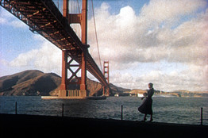
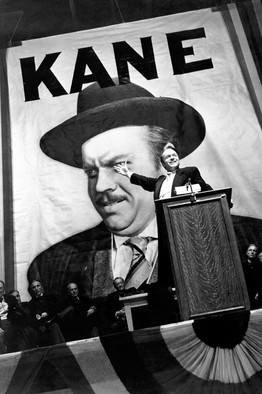

在影迷圈中，没有什么比史上最佳电影榜单更重大的事件了，该榜单每10年由英国电影协会（British 
Film Institute）旗下的权威杂志《视与听》（Sight & 
Sound）评选一次。今年的榜单在8月刊上发布，它代表了一个巨变。从1962年起一直占据榜首的奥森·威尔斯（Orson 
Welles）的《公民凯恩》（Citizen Kane，1941）被阿尔弗雷德·希区柯克（Alfred 
Hitchcock）的《迷魂记》（Vertigo，1958）取代，降至第二位。  
  

相关报道
[图片：15部史上最好的电影](http://cn.wsj.com/gb/20110406/PHO095310.asp?source=article)  
[图片：最卖座的中美合拍大片](http://cn.wsj.com/gb/20120418/PHO092628.asp?source=article)  
[图片：史上经典僵尸电影](http://cn.wsj.com/gb/20120719/PHO093448.asp?source=article)  
  
几十年来，《公民凯恩》的统治地位似乎都屹立不摇。然后，一位挑战者出现在了地平线上。《迷魂记》于1982年首次上榜，而后名次持续攀升。  
  
电影评论家不断地在问，“你最喜欢的电影是哪部？”我发现回答《公民凯恩》很容易，希望这能让提问者的目光跳过，我就能避免一场争论了。现在，我可以说《迷魂记》了。当有人和我说：“我从没看出它有什么了不起”时，我可以回答：“从自传的角度看，它很了不起。”  
  

Paramount 
Pictures/Photofest
在英国电影界评选出的一份史上全球最佳电影榜单排名中，《迷魂记》最近取代了《公民凯恩》，名列榜首。图为金·诺瓦克在电影《迷魂记》中。实际上，我并不确定哪一部是我“最爱”的电影，但这并不是这项投票所要的结果。我对《公民凯恩》、《迷魂记》和其他一些电影位居榜单前列非常满意。我个人的“最爱”或许还包括《雨中曲》（Singin' 
in the Rain）、《第三人》（The Third Man）、《卡萨布兰卡》（Casablanca）以及小津（Ozu）的《浮草》（Floating 
Weeds），我喜欢这部胜过在《视与听》榜单上排名第三的他的《东京物语》（Tokyo Story）。  
  
《迷魂记》和《公民凯恩》有何伟大之处？撇开会让我们争论一整天的技术和艺术问题，真正吸引我的是，这两部电影都具有强烈的个人性和自传性。威尔斯为我们塑造了一个拥有无尽野心和欲望的巨人形象，他所挥霍的远超过他所拥有的。希区柯克则为我们塑造了一个痴迷于控制的人，他并不只是泛泛地迷恋金发女郎，而是迷恋某位金色女郎的某个特征。想想希区柯克摄影机下玛德琳（Madeleine）脑后金色发卷的魅力吧。  
  
两部戏的剧情都很错综复杂。即使你已经看过50次《公民凯恩》，当你换台时偶然看到它时，可能也很难根据你看到的任何一方说出这是什么场景。《迷魂记》的情节很合情理，但许多观众发现自己摸不着头脑。詹姆斯·斯图尔特（James 
Stewart）扮演的角色斯考蒂（Scottie）不是迷恋于一个人，而是她的形象。当他遇到真人时，就试图将她变为一个从不存在的人。  
  
在电影中朱迪（Judy）假扮的角色玛德琳（两人均由金·诺瓦克（Kim 
Novak）扮演）代表了电影感性的核心。当“玛德琳”跳入旧金山湾（San Francisco 
Bay）时，斯考蒂把她救上来，并把不省人事的她带回自己的公寓，她是真的失去意识，还是只是朱迪装成这样？当他温暖她的身体，并温柔地将她抱到床上时，她是否开始因为自己的欺骗而开始同情他？  
  
希区柯克邀请我们跟随斯考蒂的时间线，但电影的情感深度隐藏在朱迪对事件的视角中。斯考蒂是个笑柄，而朱迪是受害者。  
  

Paramount 
Pictures/Photofest
《公民凯恩》在《公民凯恩》中，我们看到了类似的心理变化过程，查尔斯·福斯特·凯恩（Charles 
Foster Kane）如何逐渐被他理想中的苏珊·亚历山大（Susan 
Alexander）消磨殆尽──其实不是真正的苏珊本人，一个甜美普通的年轻女人，而是他将苏珊改造为一位歌剧女主角的做法，后者才能反映出他的伟大。  
  
凯恩这个角色被证明是威尔斯自己生活的神秘预示。斯考蒂这个角色不仅反映了希区柯克的恋物癖，还反映了他的恐惧。这两部电影都源于导演的自我认知（《公民凯恩》或许也源于编剧曼凯维奇（Herman 
Mankiewicz）对威尔斯的更多的了解）。  
  
当我被逼问到我“最喜欢的电影”时，我有时会被“喜爱”迈克尔·贝（Michael 
Bay）的《变形金刚》（Transformers）电影的人问到“导演主创论”。像贝这样的杰出导演会邀请我们敬畏地观看他眩目的剪辑、明亮的灯光和巨大的音效。像威尔斯或希区柯克这样的主创型导演则会引领我们的目光：“看这里……现在集中看这个……现在看那个……联系起来……感受这种缺失。关于我是什么样子，这是我能说出的最好答案。”