编辑本段人物简介

　　启功（1912年——2005年），满族，当代中国著名书画家、国学大师、鉴定家、诗人。幼年失怙且家境中落，自北京汇文中学辍学后，发愤自学。稍长，从贾羲民、吴镜汀习书法丹青，从戴姜福修古典文学。刻苦钻研，终至学业有成。 　　启功先生受业于著名史学家陈垣先生，专门从事中国文学史、中国美术史、中国历代散文、历代诗选和唐宋词等课程的教学与研究。他执教六十余年，在中国古典文学教学与研究等方面取得了突出成就，为国家培育了一大批古典文学的教学与研究人才。他为促进祖国教育事业，报答老师教育之恩，延绵陈垣先生的教泽，用出售字画所得200余万元，设立了励耘奖学金。启功先生也是中国当代著名的书画家，他的旧体诗词亦享誉国内外诗坛，故有诗、书、画“三绝”之称。[1]

编辑本段人物生平

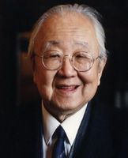

文轩画廊推荐书法家启功老先生(3张)

　　1933年经傅增湘先生推介，受业于陈垣，涉足学术流别与考证之学。后聘为辅仁中学国文教员 　　1935年任辅仁大学美术系助教 　　1938年后任辅仁大学国文系讲师，兼任故宫博物院专门委员，从事故宫文献馆审稿及文物鉴定工作 　　1949年任辅仁大学国文系副教授兼北京大学博物馆系副教授　　1952年后任北京师范大学副教授、教授，中国人民政治协商会议全国委员会常务委员、国家文物鉴定委员会主任委员、中央文史研究馆馆长、博士研究生导师。九三学社顾问、中国书法家协会名誉主席，世界华人书画家联合会创会主席，中国佛教协会、故宫博物院、国家博物馆顾问，西泠印社社长。 　　2005年6月30日2时25分病逝于北京。

编辑本段主要著作

  

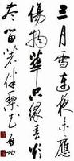

启功书法

　　其主要著作《古代字体论稿》《诗文声律论稿》《启功丛稿》《启功韵语》《启功絮语》《启功赘语》《汉语现象论丛》《论书绝句》《论书札记》《说八股》《启功书画留影册》。 　　《启功全集》由北京师范大学出版社出版生前非常崇拜明末清初著名的佛门巨匠、诗人、书法家破山禅师。

编辑本段启功家谱

　　雍正帝胤禛——五子和亲王弘昼——一子永璧——二子绵循——三子奕亨——五子载崇——二子溥良——长子毓隆——独长子恒同——独长子启功 　　启功出生于书香世家，启功之祖父毓隆（1872年－1923年）幼承家学，在光绪二十年（1894年）中甲午恩科二甲109名进士，散馆授编修。 　　启功之曾祖父溥良（1854年－1922年）年轻时，请求革去封号、俸禄，参加科举，并考中光绪六年（1880年）二甲第三十七名进士，选庶吉士，散馆授编修。 　　启功之远祖和亲王弘昼（1712年－1765年）是历史上有名的荒唐王爷，喜好办丧事，吃祭品，但亦有历史学家指他其实是为免卷入弘时（雍正三子）和弘历（雍正四子乾隆皇帝）对皇位的争夺而以“荒唐”为名韬光养晦。

编辑本段艺术特色

　　启功先生是当代著名学者、画家和书法家。他著作丰富，通晓语言文字学，甚至对已成为历史陈迹的八股文也很有研究；他做得一手好诗词，同时又是古书画鉴定家，尤精碑帖之学。 　　欣赏他的书法作品，总要联想到他对碑帖的精深研究，因为他对碑帖的研究和他的书法艺术成就有着不可分割的联系，碑帖之学是明清两代兴起的一门学问，这门学问现在随着地下墨迹的不断出土，开辟了新的境界。他就是这片园地的开拓者之一。这门学问除夸扬珍异、竞炫收藏的古董藏家不能算外，其路子约分为二类：一是研究其中历史资料，以碑刻文辞证史补事，或校读文辞；二是赏鉴、研究其书法艺术。启功先生兼于两者，更精于后者，他在两者之间融合贯通，其方法突破前人藩篱。“买椟还珠事不同，拓碑多半为书工。滔滔骈散终何用，几见藏家诵一通”。他写这首诗是有感于过去多少鉴赏家重视碑帖的书法，而对其中文辞则往往视而不见。名家如孙承泽、翁方纲以及叶昌炽莫不有此疵病，而他且不放过文辞内容。正因为这样，他把历来定论的《曹娥碑》驳得体无完肤。因此，所谓王羲之小楷《曹娥碑》，也就不存在了。更何况蔡邕的书丹。 　　启功先生的书法理论著作，我最喜欢他的发比喻，时出妙语，对书法艺术以及书法史上的许多问题，有其独特的《论书绝句百首》，这是他数十年书法实践、研究的体会。特别是诗中的自注，行文

  

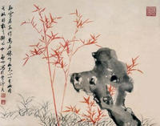

启功作品

隽逸，阐见解。我自己有些长期窒碍的问题，读了之后感到迎刃而解，有豁然开朗之感。诸如考证《鶺鸰颂》出于开元翰林供奉之手；日本藤远后之临《乐毅论》以证明王羲之书体势之雄强；鉴定张旭书庾信《步虚词作》实为大中祥符以后宋之笔；以西陲晋人残纸证《阁帖》中索靖书法的本来面目。这些都是翻书法史上成说的案，论据充分坚实有力，不得不令人信服。此外如论蔡襄、祝允明书法之未成自己体段；柳公权、黄庭坚书法用笔尽笔心之力，结字聚字心之势。而其中对历代著名书法家之特色，各时代书法的体势、风格，以至辨别书体源流，变迁原因，都是非常精辟的，山东文轩画廊推荐书法家。 　　启功先生的画《秋山》——画中远山微云掩映，楼阁隐现，恍若不可企及的仙境，与这仙境相对应的是建在水边的荒野村居、自横的小舟。披麻皴和淡墨的点染，使画中自有一种清静的意韵。

  

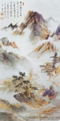

启功先生的画《秋山》

　　而温润的设色，又使这清静中多了种关怀人世的态度，从而使画家旷达、自然的胸怀尽寓其中 。（画图欣赏）

编辑本段学术成就

　　启功除了是当代著名书画家，亦通晓语言文字、古书画鉴定之学，其中尤精碑帖研究。在碑帖之学上，启功开拓了新的研究方法，启功尝作诗论曰：“买椟还珠事不同，拓碑多半为书工。滔滔骈散终何用，几见藏家诵一通。”一改以往名家学者，如叶昌炽、翁方纲等研究历代碑帖只重形式，不重内容；只知书法，而略其辞章之习。 　　除研究方法开拓新途外，启功更对《孝女曹娥碑》的真伪作出一锤定音之论，判定历代相传的《曹娥碑》殊非王羲之真迹。期间，虽有部分学者提出异议，如香港学者陈胜长曾撰〈绢本《孝女曹娥碑》墨迹考辨〉与之辩论，惟启功以其独特的研究方法与深厚学养，对陈氏之立论作出有力反驳，并深责陈氏之说乃“一派胡言”，终使《孝女曹娥碑》的真伪得以辨明。详细论述请参考启功《论书绝句》《古代字体论稿》《论书札记》等书。

  

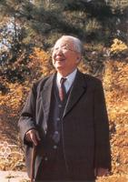

大师风采

编辑本段社会评价

　　[2]　中国书法家协会副主席彭利铭如是评价启功先生：“启功先生是中国书法界和文物收藏界的泰斗，他率直刚正、儒雅大方、幽默风趣，是为人师表的典范。启功是第二届中国书法家协会主席，为中国书法的正本清源、发展创新做出过巨大贡献，他的逝世，是中国书法界和文艺界的巨大损失。启功先生直到晚年还坚持带学生，一生桃李满天下，我们将会永远记住他。”彭利铭先生回忆说，启功老师非常幽默风趣，一生有许多有趣的小故事。曾经有收藏家拿着他所收藏的启功老师的作品请他鉴别，启功看后发现是假的，但没有直接说出来，而是风趣地说：“哎哟，这比我写得好！” 　　山东省博物馆研究馆员、中国书法家协会评审委员陈梗桥先生说：“启老是一代著名的学者、教育家、书法家，也是社会公认的鉴赏家，一直大力支持中国的文物鉴赏和文物拍卖，中国文物界对他敬爱有加。从20世纪80年代初开始，我与启功先生有过多次交往，他给我印象最深、启发最大的是在文物鉴定方面的实事求是：鉴定古代书画，知道的就是知道，不明晰的就说不知道，非常坦诚。我曾携带省博物馆收藏的一清代的册页到北京请启功先生鉴定，他给了我很多启发。另外，在交往中我感觉到他的一些观念都十分开明，并且往往以朴实的语言深入浅出地表述出来。他是个京剧迷，常说：‘京剧里板眼第一，然后才能讲韵味。写字也是如此，先讲究结体，才能求韵味。’这句话在我多年的艺术创作中起到很大的启迪作用，避免了一些弯路。”

编辑本段口述历史

　　作为启功先生口述的整理者，北师大文学院教授、启功先生的学生赵仁珪告诉记者，其实早在十多年前，他就希望能够帮先生整理出一份记录自己人生的口述历史，但是一直以来启功都婉拒了。“先生拒绝一方面是由于他的出身家族不好评价，难以措辞；另一方面也是因为他不希望重复过去的痛苦，去回忆那些藏在心底的痛苦。”但是随着时间的推移，在大家的呼吁下，启功终于勉为其难同意口述。

编辑本段书摘欣赏

我不姓爱新觉罗

　　我叫启功，字元白，也作元伯，是满洲族人，简称满族人，属正蓝旗。 　　我既然叫启功，当然就是姓启名功。有的人说您不是姓爱新觉罗名启功吗？现在很多爱新氏非常夸耀自己的姓，也希望别人称他姓爱新觉罗；别人也愿意这样称他，觉得这是对他的一种恭维。这实际很无聊。事实证明，爱新觉罗如果真的能作为一个姓，它的辱也罢，荣也罢，完全要听政治的摆布，这还有什么好夸耀的呢？何必还抱着它津津乐道呢？这是我从感情上不愿以爱新觉罗为姓的原因。 　　上世纪八十年代一些爱新觉罗家族的人，想以这个家族的名义开一个书画展，邀我参加。我对这样的名义不感兴趣，于是写了两首诗，第一首的意思是说，即使像王、谢那样的世家望族，也难免要经历“旧时王谢堂前燕，飞入寻常百姓家”的沧桑变化，真正有本事的人是不以自己的家族为重的，就像王羲之那样，他在署名时，从来不标榜自己是高贵的琅琊王家的后人，但谁又能说他不是“书圣”呢！第二首的意思是说，我就像古时戏剧舞台上的丑角“鲍老”，本来就衣衫褴褛，貌不惊人，郎当已久，怎么能配得上和你们共演这么高雅的戏呢？即使要找捧场的也别找我啊。我这两首诗也许会得罪那些同族的人，但这是我真实的想法。 　　但偏偏有人喜好这一套。有人给我写信，爱写“爱新觉罗启功”收，开始我只是一笑了之。后来越来越多。我索性标明“查无此人，请退回”。确实啊，不信你查查我的身份证、户口本，以及所有正式的档案材料，从来没有“爱新觉罗启功”那样一个人。 　　我虽然不愿称自己是爱新觉罗，但我确实是清代皇族后裔。我在这里简述一下我的家世，并不是想炫耀自己的贵族出身，之所以要简述一下，是因为其中的很多事是和中国近代史密切相关的。我是雍正皇帝的第九代孙。雍正的第四子名弘历，他继承了皇位，这就是乾隆皇帝。雍正的第五子名弘昼，只比弘历晚出生一个时辰，当然他们是异母兄弟。乾隆即位后，封弘昼为和亲王。我们这支就是和亲王的后代。

齐白石总管我叫小孩儿

　　大约从十五岁到二十五岁，我有幸结识了一些当时知名的艺术家、诗人、学者，如贾羲民、吴镜汀、戴姜福、溥心、溥雪斋、齐白石等先生。我向其中的一些人正式拜过师。在他们的教诲下，我日后比较见长的那些知识、技艺才打下根基，得到培养。在我回忆成长过程时，不能不提及他们。 　　说说齐白石（萍翁）先生。我有一个远房的四叔祖，他开棺材铺，曾给齐先生做过一口上等好寿材，因此和齐先生有些交情。他专喜欢齐先生的画，认为凡画齐先生那路画的就能赚钱，而我家当时很穷，他就让我向齐先生学画。 　　齐先生有耿直的一面，沦陷时期，国立艺专聘他为教授，他在装聘书的信封上写下“齐白石死了”五个字，原信退回。有一个伪警察想借机索要他一张画，被齐先生严词拒绝。 　　齐先生画的艺术成就不用我多说，我跟他也确实学到很多东西，开了不少眼界。比如他善于画虾，没见他亲笔画之前，我不知他那神采飞扬的虾须是怎么画的，及至亲眼所见，才知道他不是转动手，而是转动纸，把纸转向不同的方向，而手总朝着一个方向画，这样更容易掌握手的力量和感觉，这就是窍门，这就是经验。 　　我最喜欢的是他那些充满童趣和乡土气息的作品，但他有些理论比较怪异，至今我都不太理解，比如有人问“画树的要领是什么”，他说“树干、树枝一定都要直，你看大涤子（石涛）的树画得多直”，怎么能“都”直呢？我现在也想不通，再说他自己和石涛画的也未必“都”直，所以有人让我鉴定齐白石和他欣赏的石涛的画时，我常开玩笑说：“这是假的，为什么呢？因为树画得不直。” 　　齐先生曾自称书优于画，诗优于书。在我看来他的诗确实不错，但长诗不如小诗，他曾把自己的诗稿交给著名学者黎锦熙，黎先生为他编了年谱及选集，集中选了若干长诗，我觉得还不如不选。齐先生在论诗和作诗时，有时会出现一些错误，如他说金农的诗虽然不好，但词好。我记忆中金农并没有什么好的词作，就问他为什么。他说：“他是博学鸿词啊。”其实博学鸿词是清朝科举考试的一种门类，和“诗词”的“词”毫无关系。他有一首写给女学生的诗，其中有一句为“乞余怜汝有私恩”，这有点不伦不类了。我这里虽然挑了他一些毛病，但并不妨碍我对他的尊敬，他也挺喜欢我，总管我叫“小孩儿”，常念叨：“那个小孩儿怎么老没来？”就凭这句话，我就应恭恭敬敬地叫他一声老师。

姐姐妻子的贤惠

　　我的老伴儿叫章宝琛，比我大两岁，也是满人，我习惯地叫她姐姐。 　　自从结婚后，我的妻子面临着生活的艰辛，没有任何埋怨和牢骚，她自己省吃俭用，不但要把一家日常的开销都计划好，还要为我留下特殊的需要：买书和一些我特别喜欢又不是太贵的书画。 　　特别令我感动的是，我母亲和姑姑在1957年相继病倒，重病的母亲和姑姑几乎就靠我妻子一个人来照顾，累活儿脏活儿、端屎端尿都落在她一人身上。成年累月，她日益消瘦，直到送终发丧，才稍微松了一口气。我无以为报只有请她坐在椅子上，恭恭敬敬地叫她“姐姐”，给她磕一个头。 　　在“文化大革命”随时可能引火烧身的情况下，一般人惟恐避之不及，能烧的烧，能毁的毁，但她却把我的大部分手稿都保存了下来。“文化大革命”之后，当我打开箱底，重新见到那些底稿时，真有劫后重逢之感，要不是我妻子的勇敢，我这些旧作早就化为灰烬了。在她生前我们一路搀扶着经历了四十年的风风雨雨。 　　不幸的是我老伴儿身体不好，没能和我一起挺过漫漫长夜。她在1971年患严重的黄疸性肝炎，几乎病死。到了1975年旧病复发，我急忙把她再次送到北大医院。那时我正在中华书局点校《二十四史》，中华书局当时位于灯市西口，与北大医院相距不远，我白天请了一个看护，晚上就在她病床边搭几把椅子，睡在她旁边，直到第二天早上看护来接班，就这样一直熬了三个多月。 　　她撒手人寰后，我经常彻夜难眠。当年我和妻子曾戏言如果一人死后另一人会怎样，她说如果她先死，剩下我一人，我一定会在大家的撺掇下娶一个后老伴儿的，我说决不会。果然先妻逝世后，周围的好心人，包括我的亲属都劝我再找一个后老伴儿。还有自告奋勇，自荐枕席的，其牺牲精神令我感动，但我宁愿一个人，也许正应了元稹的两句诗：“曾经沧海难为水，除却巫山不是云。”就这样我孤单一人生活到现在，感谢我的内侄一家精心照料我的生活。

书画鉴定七大忌

　　我平生用力最勤、功效最显的事业之一是书画鉴定。我从实践中总结了七条忌讳，或者说社会阻力容易带来的不公正性，即一、皇威，二、挟贵，三、挟长，四、护短，五、尊贤，六、远害，七、容众。简而言之，前三条是出自社会权威的压力，后四条是源于鉴定者的私心。 　　不妨举一个例子：就拿我尊敬的张效彬先生来说，他是我的前辈，由于熟识，说话就非常随便。他晚年收藏了一幅清代人的画，正好元代有一个和他同名的画家，有人就在这幅画上加了一段明朝人的跋，说这幅画是元代那个画家的画。我和王世襄先生曾写文章澄清这一问题，张老先生知道后很不高兴。再见到我们的时候用训斥小孩子的口吻半开玩笑地说：“你们以后还淘气不淘气了？”我们说：“不淘气了。”大家哈哈一笑也就过去了。这虽然是一段可入《世说新语》的雅趣笑谈，但足以说明“挟长”、“挟贵”的现象是存在的。 　　“挟贵”“挟长”的要害是迷信权威，而迷信权威也包括对某些著录的迷信。比如端方写了一本《壬寅消夏录》，他一直想在书前放一张最古、最有分量的人物像。有一个叫蒯光典的人知道了这个消息，就拿了一张号称尉迟乙僧画的天王像，找上门去，在端方的眼前一晃。端方当然知道著录书上曾记载过尉迟乙僧曾画过这类题材的作品，于是胃口一下被吊了起来，连忙说：“今天你拿来的画拿不走了，我这里有的是好东西，你随便挑，要什么我都给你，只要把这张画留下。”这正中蒯光典的下怀。 　　后来我在美国华盛顿的弗瑞尔博物馆看到这张画，实在不行，它贴在木头板上，上面有很多题跋，但假的居多，只有宋人的一个账单是旧的，记载此画在当时流传过，但并不能说明它就是尉迟乙僧的。

编辑本段仁者谦光

　　

  

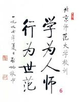

北京师范大学校训

　　启功：别说我是书法家　　书法家、文物家、史学家，所有的光环在他看来都是副业。 　　成为大名鼎鼎的书法家后，慕名求字者自然不少，启功则不论尊卑，凡有所请，便欣然从命，不忍拂意。先生作书，不择砚墨，宣纸下垫几张旧报纸，口占诗句，握管直书，珠玑满纸，章法天成。盛名之下的启功很累，但启老先生却始终保持着宽容大度、豁达幽默的处世态度。 　　随着电脑成为不可或缺的工具，人们逐渐摆脱了传统的“笔，墨，纸，砚”，越来越多的人习惯用电脑“写”字，还希望电脑“写”多种风格的好字。在方正集团推出方正启体等18款新字体时，启功应邀来到方正集团字模部现场，饶有兴趣地观看了电脑造字过程的演示，并就电脑造字提出了建设性的意见。作为著名书法家的他对于将传统书法艺术与现代电脑技术的结合大加赞赏，连说三个“好”字。如今，以之为源的方正启体点画活泼，体势清朗，眉目清秀，体态大方，体现了启体典雅遒丽、豪迈潇洒的书法风格，具有明快大方的特点。

  

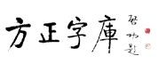

启功先生为方正题字

他早就笑称：“我就差公厕没写字了。”那是“东方之子”的名人访谈节目，记者是把启功作为大书法家来采访的。可是启功首先声明他不是一个书法家，他说他首先是一个教师，然后勉强算是一个画家，书法只是他的业余爱好而已。 　　的确，启功诗书画成就斐然，并曾荣获“中国书法艺术终身成就奖”，但书画却非主业。其主业文史，一生教授古典文学、汉语，研究古代文学、史学、经学、语言文字学、禅学，著有《汉语现象论丛》、《诗文声律论稿》、《古代字体论稿》等。他熟知清史，曾经7年点校《清史稿》；20世纪50年代注释《红楼梦》。 　　启功年幼时，祖父疼爱他，让他拜雍和宫的老喇嘛为师。1岁丧父，10岁时又失去曾祖父、祖父。因偿还债务，家道已经败落得一贫如洗，以致启功无力求学。在曾祖父门生的帮助下，他才勉强入校学习。1933年，21岁的启功虽说没有读完中学，而笔下的书画文章却有了佼佼之色。祖父的门生傅增湘拿着启功的作品，找到了当时辅仁大学的校长陈垣。为了启功的生计，陈垣帮他找到了在辅仁大学附属中学教国文的职业。家境贫寒的启功，能有这份工作实属不易。可是，虽然他兢兢业业地教书，还是被辞退了。理由很简单，他中学没有毕业，没有文凭。 　　启功悲凉地走出校门。既然是书生，就只好用书生之法讨生活，于是他终日习书作画，以卖字画为生。1935年，经陈垣介绍，启功又站在了辅仁大学美术系的讲坛上。只是又因为他没有文凭，而被再度辞退。 　　两次被“炒”的启功并未心灰意冷。他清醒地意识到，惟有自强不息，提高自己的真才实学，数倍高于别人，才能立稳脚跟。古道热肠的陈垣第三次介绍他到辅仁大学教大一国文，他又第三次站在了讲台上，并成为一位没学历的大学教授。今天，启功说：“当时师生之谊，有逾父子。” 　　从那时起，他便养成了在学术上务实、求真的习惯，几十年从未放松对自己的要求。他先后教过中国文学、中国美术和唐宋诗词、历代散文选等课程，也由助教晋升为讲师、副教授。新中国成立后，院系调整，启功继续在北京师范大学中文系任教。 　　虽然没有很高的学历，但他很早就名满学界和书画界，在全国也堪称妇孺皆知。当然，一般人知道他，多是因为他字写得好，被誉为“中华第一笔”。不过，他对自己的评价是“字不如画，画不如文物鉴定”，说因为写字不像画画费事，所以他也乐意写字，因而也就写得多，影响大。这样说，当然是自谦语，但也不无道理。也因此，他不太喜欢人称他“书法家”，更愿意人称他“教授”、“学者”。 　　书法家，文物家，史学家，所有的光环在他看来都是“副业”。他说：“我的主业是教师。”但他又从不以“教人者”自居，而总是那样谦虚自抑，不让人称是他的“学生”。 　　有人指着赝品问：“启老，这是您写的吗？”启老听了，微微一笑：“比我写得好。” 　　启功几十年过惯了穷日子，现在条件改善了，他的书画作品若论价何止“一字千金”，但生活上并没有多大变化，仍然是粗茶淡饭，土鞋布衣。他的住所除了有几张极普通的沙发可供人安坐，其他都是老旧家具，还不及一般人家的装修和陈设，不知道的人怎么也不会想到住房的主人竟会是“国宝”级的人物。“我主张生活俭朴，室内家具全是多年不变的老面孔。朋友和学生们来访，只有一杯清茶。可是他们知道我的喜好，来时从不空手，这个送来个洋娃娃，那个带来只玩具熊。我的书柜日益变得名不副实，成了十足的玩具王国。看着那些可爱的小宝贝，我有时会不自觉地笑出声来，好像又回到了童年。” 　　集诗、书、画和文物鉴赏于一身的启功，是享誉国内外的专家学者。他对历代作品特征、作者风格了然于心，见识卓异，加上他有丰富的文物知识和文史修养，又熟谙典故，劣品和赝品总逃不过他的目光。难以理解的是，他对个人的作品从不看重。有个铺子是“造假作品”的专卖店，标价不高，有人看了问店主：“是真的吗？”店主也挺痛快：“真的能这个价钱吗？”后来启老听说了这件事，就来到这个铺子，一件一件看得挺仔细。启先生谁不认识呀！有人就过来问：“启老，这是您写的吗？”启老听了，微微一笑说：“比我写得好。”在场的人全都大笑了起来。过了一会儿，启老又改口了：“这是我写的。”事后他向我们解释，他说：“人家用我的名字写字，是看得起我，再者，他一定是生活困难缺钱，他要是找我来借钱，我不是也得借给他？”他撰文称赞明代文征明、唐寅等人，说当时有人伪造他们的书画，他们不但不加辩驳，甚至在赝品上题字，使穷朋友多卖几个钱。让那些穷苦小名家得几吊钱维持一段生活，而有钱人买了真题假画，损失也不会多么大。这观念虽不合知识产权保护法，却体现出启功一向的仁者情怀。

  

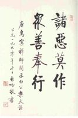

书法

　　启功越来越感到时间不够用，他要把自己一生的研究、学习的心得和经验，尽可能多地留给后人。为了整理论文和书稿，他经常晚上静下来加班加点。有时，为了不打断思路而通宵不眠。 　　启功在“上大学”一文中特别强调，“恩师陈垣这个‘恩’字，不是普通恩惠之‘恩’，而是再造我的思想、知识的恩谊之恩！”为感谢陈垣先生对自己的培养并作永久纪念，启功于1988年8月义卖书法绘画作品，以筹集基金为北师大设立“励耘奖学助学基金”。此后两年时间里，启功几乎达到了“手不停挥”的创作境界，常常是夜半书写，还捐出1万元作为装裱费。1990年12月，《启功书画义展》在香港隆重举行，从300多幅作品中选出的100幅字、10幅绘画，被香港热心教育的人士认购一空，加上启功应社会各界需要所写的100件作品的酬金，共筹得人民币163万元。当学校建议奖学金以他的名字命名时，启功推辞，他说：“以先师励耘书屋的‘励耘’二字命名，目的在于学习陈垣先生爱国主义思想，继承和发扬陈垣先生辛勤耕耘、严谨治学的精神，奖掖和培养后学，推动教学和科学研究事业的发展。” 　　2001年9月19日，启功先生一阶一阶走上二层楼，参加全国第一个大学“宏志班”励耘实验班开学典礼。见到了30名品学兼优而家境贫寒的学子，老先生将8万元“中国书法艺术终身成就奖”奖金悉数捐出。在此之前，启功还曾捐过3万元建河北希望小学，捐出两万元资助一个山里孩子在学校吃午饭。执教70年的启功，究竟为贫困生付出了多少？他摆摆手说：“记不清了。”

  

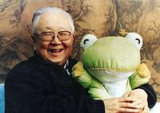

和蔼可爱的启功老人

　　他总是说过去需要钱的时候没有钱，日子真难过，现在有钱但对于他已没有多大用处了。思念亲人的启先生动情地说：“我最亲爱的人，我的母亲、姑姑、老师、老伴儿，他们活着的时候，我没有钱让他们过好日子；现在他们都死了，只留下我一个人，要这么多钱有什么用呢？”他说：“我们是有难同当，但没能有福同享。因此我的条件越好，心里就越不好受。我只有刻苦一点，心里才平衡一些。”

编辑本段题字往事

　　李保军

  

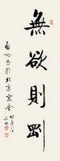

启功书法

北京京伦饭店的店名是由著名书法家启功先生题写的。由于我自幼习书法，又极喜爱启功先生的墨迹，在京伦饭店工作期间，有幸见到了他老人家的真迹，让我感到无上欣喜。 　　启功先生手书的“京伦饭店”四个字不是很大，但对他而言就算是相当大了，因为启功先生绝少书写巨幅榜书，为商家题写的店号一般也都是经过放大再拿去制作的。那日我得以独自研习和品味启功先生的笔法，真是获益颇多。 　　京伦饭店开业时，开业典礼搞得很轰动，许多画界名家都献上了他们的墨宝，这其中就有吴冠中、张仃、范曾等人的巨幅画作。这些画都高悬于饭店的殿堂之上，供来往客人驻足欣赏。但是谁也没想到，开业一段时间后，启功先生题写的店名得撤换下来。 　　有一天，主管汉字规范化的部门派人来到京伦饭店，言说启功先生写的是繁体字，且“伦”字里面的“艹”部也写得不规范，出了“冈”的顶端。这样的字按规定不允许在公共场所里使用。经他们这么一说，我们当时就傻了。启功先生的字是书法艺术的精品，怎么能说撤就撤呢。我们酒店虽然是合资的，但是高耸在世人瞩目的建国门大街，不更应该以弘扬中华传统文化作为一种标志吗？大家都觉得启功先生的字撤不得，但是，来人毕竟是专门负责这项工作的主管部门，我们虽然心有不甘，但还是将启功先生题写的匾额撤下来了，换了一个简体字的匾额挂上。店名的字体虽然规范了，但是看上去总觉得冷冰冰硬邦邦的，不如启功先生的题字圆润生动，赏心悦目。后来，趁饭店装修的时候，领导指

  

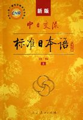

启功先生题中日交流标准日本语

示把原来的题字再换上去，大家欢天喜地的将旧牌子重新挂上，都说还是启功先生的字好，左看右看都舒心气畅。 　　由于这件事，“伦”这个字的写法在我心中成了一个谜，每在书法作品中看见都格外用心体会，很久以后我才发现，原来“伦”这个字从来都是两种写法，“艹”可以出头也可以不出头，没必要墨守成规。比如久负盛名的《圣教序》里边“众经论序”的“论”字，“艹”部就是出头的。再后来，我从其它许多典籍中也找出了类似的例子。破解一个繁体字的写法，虽然只是一件微不足道的小事，但是启功先生学养之厚重，今人见识之浅薄还是不辨自明。由此可见，对于书法惯用的古汉字，即使是专业部门也不能轻下断言。 　　“中国酒泉卫星发射中心”，发射塔楼楼的正中央是著名书法家启功先生题写的——“中国酒泉卫星发射中心”。

  

启功先生书写的“中国酒泉卫星发射中心”

编辑本段花园故居

　　——什锦花园胡同21号　　王之鸿 　　什锦花园胡同属东城区景山地区，是东四北大街路西从南往北数的第五条胡同。胡同东段曲折，自东向西沟通东四北大街和大佛寺东街，长600多米。明代，胡同西段称“红庙街”，东段称“适景园”，因成国公朱能在此建有私家园林“适景园”而得名，清乾隆时称“石景花园”，宣统时称“什锦花园”，1965年整顿地名时改称“什锦花园胡同”。 　　什锦花园胡同21号，旧时的门牌是什锦花园10号及10号旁门，在胡同中段北侧，坐北朝南。 　　据房屋档案记载：当年该院是两座院内相通的四进院落，共有房屋140.5间，占地面积近5000平方米。西院为主体建筑，有倒座南房10间，东头3间倒座南房为三开间府门，门牌为什锦花园10号；一进院有东、西厢房各3间，7间北房为带抄手廊的瓦房，中间1间作为北房腰厅连接二进院，二进院和三进院均为有游廊连接的四合院；四进院的北墙西段建有罩房。东院是配院，为两进院；一进院有倒座南房7.5间，在“巽”位建广亮大门①，门牌为什锦花园10号旁门；院内西侧有过道与西院相通，与西院府门及3间东房又构成1个小院，北侧建有垂花门②连通二进院；二进院西部是3个不规则的小院，东部中间有9间平顶砖房，平顶砖房的北面是堆有山石的花园。

  

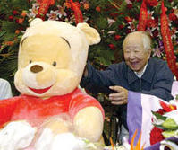

最爱维尼熊

此宅原为启功的曾祖溥良的宅第，启功出生于此，并在此生活了10年。 　　溥良是和亲王弘昼之后，生于咸丰四年(1854年)，因袭爵递降，只被封了个“奉国将军”，仅靠“奉国将军”的俸禄已难维持整个家庭的生计。溥良决定另谋他途，走科举入仕的道路。可是，清代制度规定，有爵位的人不能在科场求取功名。于是，溥良辞去封爵，参加科考，中举登第，入了翰林，先后任过理藩院左侍郎、都察院满右都御史、礼部满尚书、礼部尚书、察哈尔都统等职。溥良在任礼部尚书时正赶上光绪皇帝和慈禧太后先后“驾崩”。作为主管礼仪、祭祀的最高官员，溥良在慈禧太后临终前日夜守候在慈禧下榻的乐寿堂外，看见并询问了太监奉慈禧之命给被软禁在中南海瀛台的光绪送去一碗“塌喇”③。之后不久，隆裕皇后的太监小德张(张兰德)向太医院正堂宣布光绪皇帝“驾崩”了，接着乐寿堂内哭声大作，表明慈禧已经咽气。启功说：“光绪皇帝在死之前，西太后曾亲赐他一碗‘塌喇’，确是我曾祖亲见亲问过的。这显然是一碗毒药。”可见，光绪皇帝被毒死之说是有根据的。 　　1923年，卸任多年的溥良病故，不久，10岁的启功随着他的祖父、母亲和姑姑搬出了什锦花园10号，搬到了安定门内方家胡同。后来，此宅成为汉奸、伪蒙古联合自治政府副主席李守信的房产。 　　20世纪七八十年代，什锦花园胡同21号的原有房屋被全部拆除，在原址建成了3座六层单元式居民楼，门牌仍为什锦花园胡同21号。

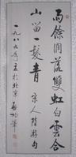

启功1989年作品(1张)

　　注　　①广亮大门，是北京四合院中等级最高的宅门，是具有相当品级的官宦人家采用的宅门形式。 　　②垂花门，在府邸、宅院建筑群中常作为二门，是内宅的宅门。 　　③塌喇，满语，意为酸奶。

编辑本段诗词选录

沁园春

　　检点平生，往日全非，百事无聊。 　　计幼时孤露，中年坎坷，如今渐老，幻想俱抛。 　　半世生涯，教书卖画，不过闲吹乞食箫。 　　谁似我，真有名无实，饭桶脓包。 　　偶然弄些蹊跷，像博学多闻见解超。 　　笑左翻右找，东拼西凑，繁繁琐琐，絮絮叨叨。 　　这样文章，人人会作，惭愧篇篇稿费高。 　　从此后，守收摊歇业，再不胡抄。 　　（末三句一作“收拾起，一孤堆拉杂，敬待摧烧。”）

贺新郎

　　癖嗜生来坏。 　　却无聊。虫鱼玩好，衣冠穿戴。 　　历代法书金石刻，哪怕单篇碎块，我看着全部可爱。 　　一片模糊残点画，读成文，拍案连称快。 　　自己觉，还不赖。 　　西陲写本零头在。 　　更如同，精金美玉，心房脑盖，黄白头麻笺分软硬，晋魏隋唐时代。 　　笔法有，方圆流派。 　　烟墨浆糊沾满手，揭还粘，躁性偏多耐。 　　这件事，真奇怪！

贺新郎

　　古史从头看。 　　几千年，兴亡成败，眼花缭乱。 　　多少王侯多少贼，早已全都完蛋，尽成了，灰尘一片。 　　大本糊涂流水帐，电子机，难得从头算。 　　竟自有，若干卷。 　　书中人物千千万。细分来，寿终天命，少于一半。 　　试问其余哪里去？脖子被人切断。 　　还使劲，龂龂争辩。 　　檐下飞蚊生自灭，不曾知，何故团团转。 　　谁参透，这公案？

编辑本段言论选录

　　启功论学书 　　1. 或问学书宜学何体，对以有法而无体。所谓无体，非谓不存在某家风格，乃谓无某体之严格界限也。以颜书论，多宝不同麻姑，颜庙不同郭庙。至于争坐，祭侄，行书草稿，又与碑版有别。然则颜体竟何在乎？欲宗颜体，又以何为准乎。颜体如斯，他家同例。 　　2. 写字不同于练杂技，并非有幼功不可者，甚至相反。幼年于字且不多识，何论解其笔趣乎。幼年又非不须习字，习字可助识字，手眼熟则记忆真也。 　　3. 作书勿学时人，尤勿看所学之人执笔挥洒。盖心既好之，眼复观之，于是自己一生，只能作次一名家之拾遗者。何谓拾遗，以己之所得，往往是彼所不满而欲弃之者。或问时人之时，以何为断。答曰：生存人耳。其人既存，乃易见其书写也。 　　4. 凡人作书时，胸中各有其欲学之古帖，亦有其自己欲成之风格。所书既毕，自观每恨不足。即偶有惬意处，亦仅是在此数幅之间，或一幅之内，略有成体段者耳。距其初衷，固不能达三四焉。他人学之，籍使是其惬心处，亦每是其三四之三四，况误得其七六处耶。 　　5. 学书所以宜临古碑帖，而不宜学时人者，以碑帖距我远。古代纸笔，及其运用之法，具有不同。学之不能及也，乃各有自家设法了事处，于此遂成另一面目。名家之书，皆古人妙处与自家病处相结合之产物耳。 　　6. 风气囿人，不易转也。一乡一地一时一代，其书格必有其同处。故古人笔迹，为唐为宋为明为清，人目可辨。性别不可强也。虽在父兄，不能移子弟。故献不同于羲，辙不同于轼，而又不能绝异也，以此。 　　7. 或问临帖苦不似奈何？告之曰：永不能似，且无人能似之。即有似之，亦只是略似，貌似，局部似，而非真拟。苟临之即得真似，则法律必不以签押为依据矣。 　　8. 古人席地而坐，左执纸卷，右操笔管，肘于腕俱无着处。故笔在空中，可作六面行动。即前后左右，异己提按也。逮宋世既有高桌椅，肘腕贴案，不复空灵，乃有悬肘悬腕之说。肘腕平悬，则肩臂俱僵矣。如知此理，纵自贴案，而指腕不死，亦足得佳书。 　　9. 赵雪松云，书法以用笔为上，而结字亦须用工，窃谓其不然。试从法帖中剪某字，如八字、人字、二字、三字等，复分剪其点画。信手掷于案上，观之宁复成字。又取薄纸覆于帖上，以铅笔划出某字每笔中心一线，仍能不失字势，其理讵不昭然哉。 　　10.每笔起止，轨道准确，如走熟路。虽举步如飞，不忧磋跌。路不熟而急奔，能免磕撞者幸矣。此义可通书法。 　　11.运笔要看墨迹，结字要看碑志，不见运笔之结字，无从知其来去呼应之致。结字不严之运笔，则见笔不见字。无恰当为之笔，自觉其龙飞凤舞，人见其杂乱无章。 　　12.行书宜当楷书写，其位置聚散始不失度。楷书宜当行书写，其点画顾盼始不呆板。

编辑本段自撰墓志

　　1978年，启功66岁时，妻子、母亲和恩师已经先后离他而去，回想半世艰辛岁月，启功悲痛之余写下了这首诙谐、精炼《自撰墓志铭》： 　　中学生，副教授。博不精，专不透。名虽扬，实不够。高不成，低不就。瘫趋左，派曾右。面微圆，皮欠厚，妻已亡，并无后。丧犹新，病照旧。六十六，非不寿。八宝山，渐相凑。计平生，谥日陋。身与名，一齐臭。（六，读如溜，见《唐韵正》）

  

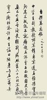

启功先生自撰墓志铭

编辑本段安葬万安

　　启功先生逝世一周年后骨灰从八宝山请来，下葬在“北京香山万安公墓”。启功先生的墓地占地3平方米。墓茔东向，前望玉泉，后倚西山；苍松侍于左，坦途通于右。

  

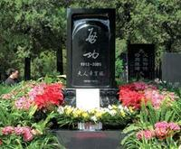

启功墓

2006年6月30日，启功先生的忌日上午，在“老师走好”的祝福中，启功先生的内侄、侍奉启功30年的章景怀将启功先生的骨灰盒缓缓送入墓穴。盒内与启功先生同在的是师母几件日常用品和二老的合影——刻画在有机玻璃上的合影。师母病逝于“十年浩劫”中的1975年，骨灰荡然，只好这样退而求其次了。不过即使没有骨灰合葬也了却了启功先生的心愿：师母逝世后，启功先生有《痛心篇二十首》倾诉苦情，最后茫茫然祈求：“爹爹久已长眠，姐姐今又千古。未知我骨成灰，能否共斯土。”(启功“自幼呼胞姑为爹”，她老人家终身不嫁，帮助太师母抚育启功。“姐姐”系启功对师母的称呼。) 　　启功先生的墓碑、碑座和墓志独具丰采，可以说是启功一生心性和修养的完美呈现。墓碑是一方放大的石砚，由浓黑而光可照人的大理石制作，正中直排镌刻着启功标准的签名，姓名下横排生卒年月(1912—2005)，再下一行横排镌刻启功法书“夫人章宝琛”，同样，姓名下也是师母的生卒年(1910—1975)。墓碑没有上下款，简洁大方，朴素端庄。 　　墓碑匠心独运的是碑阴雕刻了两条砚铭，一是启功曾经收藏的清康熙“御砚”上的“御书”“御铭”：“一拳之石取其坚，一勺之水取其净”，上有“康熙”“御铭”两方印文。启功是雍正第九代孙，生于辛亥革命第二年，他终生拒绝使用皇族姓氏，改革开放以后，皇室遗族以“爱新觉罗”自矜，但他依然不改素志，且作诗真诚讽喻。启功并不把这方“御砚”当作传家宝，但他喜欢这一“御铭”的内涵，并以这“御铭”取了室名“坚净居”，人称“坚净翁”，现在镌刻在墓碑上，何等巧思!更巧而又令人感到无比亲切的是另一砚铭：“元白用功之砚”。谁敢作这样的砚铭?是谁书写的?书者是“陈垣”，是启功先生的恩师、北师大的老校长。1990年启功年近八十远赴香港义卖自己所作字画，以设立以老校长命名的“励耘奖学助学基金”，以聊补晚年“酒酽花浓行已老，天高地厚报无门”的遗憾。以后来这里凭吊启功先生的人，读到这方墓碑，谁能说尽有多少联想和情思呢? 　　墓碑的基座是一朵舒展的莲花，也就是佛教中的莲花座。启功三岁在雍和宫按严格的仪式磕头接受灌顶礼，终生礼佛，号“元白居士”，逝世前病重入住北大医院危重病房，他左臂插针管，右手仍持念珠，昏迷中似睡似醒的时候常常手指微动在数念珠。启功自述：“我从佛教和我老师那里，学到了人应该以慈悲为怀，悲天悯人，关切众生；以博爱为怀，与人为善，宽宏大度;以超脱为怀，面对现世，脱离苦难。”启功“幼时孤露，中年坎坷”，遭大苦难而“悲天悯人”，心藏“苦情”而博爱众生，这是修炼得来的达观。然而启功骨子里是铮铮铁汉，正如他诗中的自白：“墓碑前与碑座相连的同样质地同样颜色的一方巨石上，镌刻着启功生前的《自撰墓志铭》。这是一首三言诗，诗曰：“中学生，副教授。博不精，专不透。名虽扬，实不够。高不成，低不就。瘫趋左，派曾右。面微圆，皮欠厚。妻已亡，并无后。丧犹新，病照旧。六十六，非不寿。八宝山，渐相凑。计平生，谥曰陋。身与名，一齐臭。”这里唯一与当年预想不合的是死后不在“八宝山”而隐居于“万安”。不过民间早把“八宝山”当作“死地”的隐语，这样一想还是与原诗符契。 　　启功先生修炼一生，笔耕一生，人品学问，有口皆碑：诗书画一家三绝。在先生长眠的大地上，树立这样一方墓碑碑座墓志，称得上一绝。这一绝，从选择墓地、设计墓碑、碑座的型制和镌刻的文字，都是景怀先生主创的。那一方墓碑不是康熙“御砚”的放大，也不是老师日常用砚的放大，那是两方砚池的想象，是艺术构思的结晶，它既是传统墓碑的长方形墓石，又是常见砚池的雕塑，而碑阴更是两个砚铭的并立：一位是先祖，一位是恩师。章景怀先生的这一组完整的设计，是对他姑夫的最后奉献了。启功先生生时，他三十年如一日尽心侍奉，养老送终；启功先生死后，在墓碑上抛开陈规惯例，他只把自己连同其他兄弟姐妹的姓名刻在基座上，不细心寻觅几乎看不到，毫无借光自照之意。谁说启功先生无哲嗣?启功先生的家风就这样在“润物细无声”中传承着。

编辑本段双重年表

　　一九一二年七月二十六日生于北京。 　　启功的始祖是清朝雍正皇帝的儿子，排行第五，名弘昼，封“和亲王”。其后代逐渐从王府中分离出来，至其曾祖时，家族已失去门荫，要通过科举找出路了。曾祖溥良，考中进士，入翰林，清末曾任礼部尚书、察哈尔都统。祖父毓隆，也是翰林出身，为典礼院学士，曾任学政、主考。 　　一九一三年 一岁 　　父亲去世，随祖父生活。 　　为祈福，祖父曾让他拜雍和宫的一位老喇嘛为师，做记名的小喇嘛，取名“察格多尔札布”。当时正是辛亥之后，清帝逊位，其曾祖绝意政治，不愿居京城，以示不再过问国事。恰其曾祖有一门生，名陈云诰，亦是翰林，家为河北易县首富，广有资财，于是出资在易县城中购买房舍，请其曾祖居住。曾祖乃携家人迁居易县，启功时年方三四岁。稍后，入私塾读诗文。 　　一九二二年 十岁 　　曾祖去世。家业因偿还债务而衰落。 　　一九二三年十一岁 　　祖父去世。 　　家中变卖世藏书籍以作殡葬费用。当时母亲克连珍与尚未出嫁的姑姑恒季华，都年仅二十余岁，便挑起家庭生活重担。恒季华为了教养这一线单传的侄子成人，毅然终身不嫁，并把自己看做是这个家庭中的男人。启功亦称姑姑为“爹爹”（满俗，“爹爹”即叔叔）。 　　一九二四年—一九二六年 十二岁至十四岁 　　在北京汇文小学和汇文中学读书。幼年启功，看到祖父案边墙上挂有大幅山水是叔祖画的，又见祖父拿过小扇画上竹石，几笔而成，感到非常奇妙，便产生“做一个画家”的愿望。他在学校的习作，曾被学校选为礼品赠送给知名人士。 　　一九二七年—一九二九年 十五岁至十七岁 　　经长亲带领，拜贾羲民先生学画，贾先生博通画史，对于书画鉴赏也极有素养，见解卓识。常带启功到故宫博物院看陈列的古代书画，有时还和一些朋友随看随加评论，启功也一一记下。这些活动使启功深受启迪和教育。启功想多学些画法技巧，贾先生又将他介绍给吴镜汀先生。吴先生教授画法，极为耐心，绝不笼统空谈，而是专门把极关重要的窍门指出，使启功长进很快。一次，一位长亲命他画一幅画，说要装裱后挂起，他感到很光荣。但长亲又说：“画完后不要落款，请你的老师落款”，这又给他很大刺激，从此发愤练字。 　　一九三〇年 十八岁 　　经老世交介绍，从戴姜福先生学习中国古典文学，习作旧诗词。由于老师的精心培育，加上他刻苦自学，从青年时候起，便对中国古典文学和历史打下了坚实基础。 　　一九三二年 二十岁 　　与章宝琛完婚。章氏，满族，长启功两岁。 为维持生活，教家馆，有时也作画卖钱。 　　一九三三年 二十一岁 　　经傅增湘先生介绍，受教于陈垣先生，陈垣先生看过他的作品，认为“写作俱佳”，便安排他在辅仁中学任国文教员。此后几十年一直在教育岗位，主要精力都在教授古典文学，中间也卖过字画，但他说：“那只是副业。” 　　一九三五年二十三岁 　　任辅仁大学美术系助教，业余从事书画创作。 　　一九三八年 二十六岁 　　任辅仁大学国文系讲师。抗战胜利后兼任故宫博物院专门委员，负责文献馆审稿和鉴定文物。 　　一九四九年三十七岁 　　任辅仁大学国文系副教授兼北京大学博物馆系教授。 　　一九五二年 四十岁 　　全国高等院校进行院系调整，辅仁大学与北京师范大学合并，任北京师范大学中文系副教授，教授古典文学。同年加入“九三”学社，被选为“九三”学社北京分社委员，后又被选为北京市政协委员。此后曾与向达、王重民、周一良、曾毅公、王麇菽诸人标点敦煌变文俗曲。稍后又为人民文学出版社出版的《红楼梦》程乙本作注释，这是建国后首次出版的《红楼梦》注释本。 　　一九五七年四十五岁 母亲和姑姑相继去世。 　　一九六二年 五十岁 　　撰写完成《古代字体论稿》和《诗文声律论稿》两本书稿。 　　一九六三年五十一岁 　　撰写了《〈红楼梦〉札记》 　　一九六六年 五十四岁 　　“文革”爆发，一切公开的读书写作活动被迫中止，但私下里治学不辍。由于他精通书法，常被造反派命令抄写大字报。 　　一九七一年五十九岁 　　参与中华书局组织标点《二十四史》和《清史稿》的工作，与王钟翰等负责标点《清史稿》。 　　一九七五年 六十三岁 　　夫人章宝琛逝世。 　　一九七六年六十四岁 　　粉碎四人帮之后，师大恢复课程。 　　一九七七年 六十五岁 　　《诗文声律论稿》由中华书局出版 　　一九七八年六十六岁 　　文革后落实政策仍被聘为教授。 　　一九七九年 六十七岁 　　《古代字体论稿》由文物出版社出版。 　　一九八一年六十九岁 　　《启功丛稿》由中华书局出版。同年中国书法家协会成立，被推为副主席。应香港中文大学邀请赴香港讲学，作关于汉语和《红楼梦》的讲演。 　　一九八二年 七十岁 　　国家古籍整理出版规划小组成立，任该组成员。 　　一九八三年七十一岁 　　应中宣部《中国美术全集》办公室聘请，任《中国美术全集》顾问。参与国家文物局组织的由七位专家组成的中国古代书画鉴定组，负责甄别、鉴定北京及全国各大城市博物馆收藏的古代书画作品的真伪。 　　一九八四年 七十二岁 　　被聘为博士研究生导师。被选为中国书法家协会主席。 　　一九八六年七十四岁 　　被任命为国家文物鉴定委员会主任委员。 　　一九八九年 七十七岁 　　四月，任中央文史研究馆副馆长。 《启功韵语》由北京师范大学出版社出版。 　　一九九〇年 七十八岁 　　《论书绝句一百首》由香港商务印书馆和北京三联书店出版。该书以诗的形式总结了他几十年来书法实践的系统理论，对历代书家有评论，对书法的结字、用笔有独到见解。为设立“励耘奖学助学基金”，在香港举办“启功书画义展”。 　　一九九一年七十九岁 　　任国家古籍整理出版规划小组顾问。《汉语现象论丛》由商务印书馆（香港）有限公司出版。同年十一月底，将义卖字画所得一百六十三万余元全部捐给北京师范大学，设立“励耘奖学助学基金”。九月，赴日本东京、大阪访问，参观大阪博物馆收藏的中国书画珍品。 　　一九九二年 八十岁 　　全国政协、北京师范大学、荣宝斋联合举办“启功书画展”，先后在北京、广州和日本展出。《说八股》、《启功论书札记》、《启功书画留影册》由北京师范大学出版社出版。 　　一九九四年八十二岁 　　赴韩国进行书画交流。荣宝斋与韩国东方画廊联合举办“启功·金膺显书法联展”先后在北京和汉城展出。《启功絮语》由北京师范大学出版社出版。 　　一九九五年八十三岁 　　《启功论书绝句一百首》、《启功书画作品专集》由荣宝斋出版。 　　一九九六年 八十四岁 　　十月，赴美、德、法三国访问，参观三国国家博物馆所藏中国书画珍品。 　　一九九七年八十五岁 　　四月，中央文史研究馆组织书画代表团赴新加坡，举办中央文史馆馆员书画作品展，启功先生任团长。十月，应香港商务印书馆邀请赴香港出席庆祝香港回归祖国暨商务印书馆建馆一百周年活动，为香港回归创作书画作品多件。《启功论书绝句一百首》日文译本在东京出版。 　　一九九八年八十六岁 　　北京师范大学教授、博士研究生导师。是中国人民政治协商会议全国委员会第五届委员和第六、七、八、九届常务委员、国家文物鉴定委员会主任委员、中央文史研究馆副馆长、中国书法家协会名誉主席。 　　二〇〇五年 九十三岁 　　六月三十日二时二十五分病逝于北京。

编辑本段启功先生论著出版年表

　　1953年 　　《红楼梦注释》，人民文学出版社　　1957年 　　《敦煌变文集》（与人合编），人民文学出版社 　　1965年 　　《古代字体论稿》，文物出版社　　1977年 　　《诗文声律论稿》，中华书局　　1981年 　　《启功从稿》，中华书局 　　1982年 　　《启功先生讲书法》（录像带），北京师范大学 　　1985年 　　《启功书法选》，人民美术出版社　　《启功书法作品选》，北京师范大学出版社 　　《论书绝句》，商务印书馆（香港） 　　1986年 　　《启功书法作品选》（缩印本），北京师范大学出版社 　　《书法概论》，北京师范大学出版社 　　《书法概论参考资料》，北京师范大学出版社 　　《启功－宇野雪村书画展》，（日本印刷） 　　1988年 　　《书法教学》（录像带），北京师范大学音像出版社　　1989 年 　　《启功韵语》，北京师范大学出版社 　　1990年 　　《论书绝句》，商务印书馆（香港）、三联书店　　《启功草书千字文》，中国和平出版社 　　《启功书画展留影》荣宝斋（香港）有限公司出版 　　1991年 　　《汉语现象论丛》，商务印书馆（香港） 　　《说八股》，北京师范大学出版社 　　1992年 　　《启功论书札记》，北京师范大学出版社 　　《启功书画留影册》，北京师范大学出版社 　　1993年 　　《荣宝斋画谱－启功卷》，荣宝斋出版社　　1994年 　　《启功絮语》，北京师范大学出版社 　　1995 年 　　《启功论书绝句一百首》，荣宝斋出版社 　　1997年 　　《启功书话》（即论书绝句一百首日文版），日本二玄社出版 　　《论书绝句》（再版），三联书店 　　1998年 　　《当代书法家精品集启功卷》，河北教育出版社、广东教育出版社 　　1999年 　　《古代字体论稿》，文物出版社再版 　　《启功赘语》，北京师范大学出版社 　　《启功丛稿》（论文卷、题跋卷、诗词卷），中华书局 　　2000年 　　《启功三帖集》，北京师范大学出版社 　　《说八股》，中华书局 　　《诗文声律论稿》，中华书局 　　2001年 　　《启功论书法》（宣纸本），文物出版社 　　《启功书画集》，文物出版社、北京师范大学出版社 　　《启功临帖册》，北京师范大学出版社 　　2002年 　　《启功书画絮语墨迹选》，上海书画出版社　　《启功临怀素自叙贴》，荣宝斋出版社 　　《启功临王羲之十七贴》，荣宝斋出版社 　　《论书绝句》注释本，三联书店 　　《真茗阁藏名人书画－启功卷》，文物出版社 　　《诗文声律论稿》（墨迹本）（修订版），中华书局 　　2003年 　　《启功草书千字文》（再版），中国和平出版社 　　《启功草书千字文》，上海书画出版社 　　《启功书法论丛》，文物版社 　　2004年 　　《启功讲学录》《启功韵语集》《启功题画诗墨迹选》《启功口述历史》，北京师范大学出版社 　　2005年 　　《启功临兰亭续帖》，荣宝斋出版社 　　《启功书画集》（普及本）文物出版社、北京师范大学出版社 　　《启功楷书千字文》，北京师范大学出版社 　　《启功书画选集》（宣纸本），文物出版社 　　《启功书法选》（宣纸本），西泠印社 　　《坚净局丛帖－临写辑》，北京师范大学出版社 　　《启功给你讲书法》，中华书局 　　2006年 　　《启功题跋书画碑帖选》，文物出版社 　　2009年 　　《启功讲唐代诗文》，中华书局 　　2011年 　　《启功的书画世界》，北京出版社