张国荣
===

[添加义项](http://baike.baidu.com/createpolysemyitem?lemmaid=6360)这是一个[多义词](http://www.baidu.com/search/baike_help.html#判断原则)，请在下列[义项](http://www.baidu.com/search/baike_help.html#判断原则)中选择浏览1. 1．亚洲演艺界顶级巨星
2. 2．[原上海市农场管理局党委副书记、副局长](http://baike.baidu.com/view/6360.htm#sub5600417)
3. 3．[民进荆州市委主委](http://baike.baidu.com/view/6360.htm#sub5620857)
4. 4．[原绍兴市人民医院院长](http://baike.baidu.com/view/6360.htm#sub5620939)
5. 5．[甘肃省省人大常委会副秘书长](http://baike.baidu.com/view/6360.htm#sub6732735)
6. 6．[淮北师范大学教师](http://baike.baidu.com/view/6360.htm#sub8663578)
1.亚洲演艺界顶级巨星
-----------

[编辑本义项](http://baike.baidu.com/view/6360.htm#)张国荣
===

#### [求助编辑](http://baike.baidu.com/view/6360.htm#)百科名片

[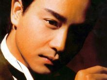](http://baike.baidu.com/picview/6360/5595080/0/b21bb051f8198618e6ace1f54bed2e738ad4e6dc.html)张国荣（1956年9月12日－2003年4月1日）生于[香港](http://baike.baidu.com/view/2607.htm)，是一位在全球华人社会和[亚洲](http://baike.baidu.com/view/2918.htm)地区具有影响力的著名[歌手](http://baike.baidu.com/view/53794.htm)、[演员](http://baike.baidu.com/view/171942.htm)和[音乐人](http://baike.baidu.com/view/101314.htm)；大中华区乐坛和影坛巨星；[演艺圈](http://baike.baidu.com/view/2231184.htm)多栖发展最成功的代表之一。他通晓[词](http://baike.baidu.com/view/39256.htm)[曲](http://baike.baidu.com/view/120628.htm)创作，曾担任过MTV导演、唱片监制、电影编剧、电影监制。张国荣是香港乐坛的[殿堂级](http://baike.baidu.com/view/4469467.htm)歌手之一，曾获得香港乐坛最高荣誉[金针奖](http://baike.baidu.com/view/961753.htm)；他是第一位[享誉](http://baike.baidu.com/view/1990624.htm)韩国乐坛的华人歌手，亦是华语唱片在韩国销量[纪录](http://baike.baidu.com/view/769735.htm)保持者。他于1991年当选[香港电影金像奖](http://baike.baidu.com/view/5988.htm)影帝；1993年主演的影片《[霸王别姬](http://baike.baidu.com/view/8506.htm)》打破[中国内地](http://baike.baidu.com/view/743070.htm)文艺片在美国的票房纪录，他亦凭此片蜚声[国际](http://baike.baidu.com/view/41732.htm)影坛，获得[日本](http://baike.baidu.com/view/1554.htm)影评人大奖最佳男主角奖以及[中国电影表演艺术学会奖](http://baike.baidu.com/view/5039042.htm)特别贡献奖。他曾受邀担任[东京国际电影节](http://baike.baidu.com/view/6165.htm)和[柏林国际电影节](http://baike.baidu.com/view/6107.htm)评委，2005年入选“[中国电影百年百位优秀演员](http://baike.baidu.com/view/4348389.htm)”，2010年当选美国[CNN](http://baike.baidu.com/view/78.htm)评出的“史上最伟大的二十五位[亚洲](http://baike.baidu.com/view/2918.htm)演员”。基本信息主要作品精彩图册

|  |  |  |  |  |  |  |  |  |  |  |  |  |  |  |  |  |  |  |  |  |  |  |  |  |  |  |  |
| --- | --- | --- | --- | --- | --- | --- | --- | --- | --- | --- | --- | --- | --- | --- | --- | --- | --- | --- | --- | --- | --- | --- | --- | --- | --- | --- | --- |
| 音乐专辑 | 

|  |  |  |  |  |  |  |  |  |  |  |  |  |  |  |  |  |  |  |  |  |  |  |  |  |  |
| --- | --- | --- | --- | --- | --- | --- | --- | --- | --- | --- | --- | --- | --- | --- | --- | --- | --- | --- | --- | --- | --- | --- | --- | --- | --- |
| 

|  |  |  |
| --- | --- | --- |
| ▪ [爱火](http://baike.baidu.com/view/699082.htm "爱火") ( 1986.10.1) | ▪ [陪你倒数](http://baike.baidu.com/view/4040681.htm "陪你倒数") ( 1999.10.13) | ▪ [戏魅](http://baike.baidu.com/view/3938042.htm "戏魅") ( 2006.9.12) |
| ▪ [salute](http://baike.baidu.com/view/939041.htm "salute") ( 1989.8.23) | ▪ [光荣岁月](http://baike.baidu.com/view/458248.htm#sub6179010 "光荣岁月") ( 1993.1.25) | ▪ [一切随风](http://baike.baidu.com/view/801505.htm "一切随风") ( 2003.7.1) |
| ▪ [挚爱](http://baike.baidu.com/view/56541.htm "挚爱") ( 2003.4.1) | ▪ [兜风心情](http://baike.baidu.com/view/801515.htm#sub801515 "兜风心情") ( 1989.1.1) | ▪ [狂恋](http://baike.baidu.com/view/2758114.htm#sub2758114 "狂恋") ( 2003.4.1) |
| ▪ [风继续吹](http://baike.baidu.com/view/1530593.htm "风继续吹") ( 1983.1.1) | ▪ [拒绝再玩](http://baike.baidu.com/view/738269.htm "拒绝再玩") ( 1988.3.7) | ▪ [情人箭](http://baike.baidu.com/view/431186.htm#sub8006961 "情人箭") ( 1979.9.1) |
| ▪ [全赖有你](http://baike.baidu.com/view/3977034.htm "全赖有你") ( 1985.7.28) | ▪ [为你钟情](http://baike.baidu.com/view/804273.htm "为你钟情") ( 1985.5.14) | ▪ [一片痴](http://baike.baidu.com/view/3982579.htm "一片痴") ( 1983.10.25) |
| ▪ [大热](http://baike.baidu.com/view/801523.htm "大热") ( 2000.7.1) | ▪ [宠爱](http://baike.baidu.com/view/698950.htm "宠爱") ( 1995.7.7) | ▪ [红](http://baike.baidu.com/view/99517.htm#sub5614589 "红") ( 1996.11.26) |
| ▪ [侬本多情](http://baike.baidu.com/view/789845.htm#sub6261669 "侬本多情") ( 1999.5) | ▪ [Stand Up](http://baike.baidu.com/view/433766.htm "Stand Up") ( 1986.5.10) | ▪ [Virgin Snow](http://baike.baidu.com/view/1013531.htm#sub1013531 "Virgin Snow") ( 1988.2.5) |
| ▪ [风继续吹](http://baike.baidu.com/view/1530593.htm "风继续吹") ( 1983.5.1) | ▪ [Untitled](http://baike.baidu.com/view/801539.htm#sub801539 "Untitled") ( 2000.3.1) |  |
|  |

 |

 |

|  |  |  |  |  |  |  |  |  |  |  |  |  |  |  |  |  |  |  |  |  |  |  |  |  |  |  |  |  |  |  |  |  |  |  |  |  |  |  |  |
| --- | --- | --- | --- | --- | --- | --- | --- | --- | --- | --- | --- | --- | --- | --- | --- | --- | --- | --- | --- | --- | --- | --- | --- | --- | --- | --- | --- | --- | --- | --- | --- | --- | --- | --- | --- | --- | --- | --- | --- |
| 电影作品 | 

|  |  |  |  |  |  |  |  |  |  |  |  |  |  |  |  |  |  |  |  |  |  |  |  |  |  |  |  |  |  |  |  |  |  |  |  |  |  |
| --- | --- | --- | --- | --- | --- | --- | --- | --- | --- | --- | --- | --- | --- | --- | --- | --- | --- | --- | --- | --- | --- | --- | --- | --- | --- | --- | --- | --- | --- | --- | --- | --- | --- | --- | --- | --- | --- |
| 

|  |  |  |  |
| --- | --- | --- | --- |
| ▪ [异度空间](http://baike.baidu.com/view/17242.htm "异度空间") ( 2002) | ▪ [阿飞正传](http://baike.baidu.com/view/160312.htm#sub160312 "阿飞正传") ( 1990) | ▪ [春光乍洩](http://baike.baidu.com/view/464102.htm#sub5822373 "春光乍洩") ( 1997) | ▪ [家有喜事](http://baike.baidu.com/view/153341.htm "家有喜事") ( 1992) |
| ▪ [胭脂扣](http://baike.baidu.com/view/156601.htm#sub156601 "胭脂扣") ( 1987) | ▪ [夜半歌声](http://baike.baidu.com/view/156614.htm "夜半歌声") ( 1995) | ▪ [霸王别姬](http://baike.baidu.com/view/8506.htm#sub5395584 "霸王别姬") ( 1993) | ▪ [东邪西毒](http://baike.baidu.com/view/65863.htm#sub7184886 "东邪西毒") ( 1994) |
| ▪ [金枝玉叶](http://baike.baidu.com/view/85339.htm "金枝玉叶") ( 1996) | ▪ [倩女幽魂](http://baike.baidu.com/view/47805.htm#sub5536672 "倩女幽魂") ( 1987) | ▪ [英雄本色](http://baike.baidu.com/view/86739.htm#sub6397390 "英雄本色") ( 1986) | ▪ [花田喜事](http://baike.baidu.com/view/391463.htm "花田喜事") ( 1993) |
| ▪ [鼓手](http://baike.baidu.com/view/1173733.htm#sub1173733 "鼓手") ( 1983) | ▪ [圣诞快乐](http://baike.baidu.com/view/286076.htm "圣诞快乐") ( 1984) | ▪ [恋战冲绳](http://baike.baidu.com/view/239205.htm "恋战冲绳") ( 2000) | ▪ [倩女幽魂2](http://baike.baidu.com/view/1666244.htm#sub1666244 "倩女幽魂2") ( 1990) |
| ▪ [东成西就](http://baike.baidu.com/view/15834.htm#sub7184865 "东成西就") ( 1993) | ▪ [纵横四海](http://baike.baidu.com/view/153460.htm "纵横四海") ( 1993) | ▪ [枪王](http://baike.baidu.com/view/603868.htm "枪王") ( 2000) | ▪ [流星语](http://baike.baidu.com/view/922091.htm#sub922091 "流星语") ( 1999) |
| ▪ [喝彩](http://baike.baidu.com/view/721507.htm#sub721507 "喝彩") ( 1980) | ▪ [失业生](http://baike.baidu.com/view/1181571.htm#sub1181571 "失业生") ( 1981) | ▪ [大富之家](http://baike.baidu.com/view/194840.htm#sub194840 "大富之家") ( 1994) | ▪ [英雄本色2](http://baike.baidu.com/view/1955882.htm#sub1955882 "英雄本色2") ( 1987) |
| ▪ [色情男女](http://baike.baidu.com/view/893091.htm "色情男女") ( 1996) | ▪ [缘份](http://baike.baidu.com/view/210402.htm#sub210402 "缘份") ( 1984) | ▪ [红楼春上春](http://baike.baidu.com/view/608409.htm#sub608409 "红楼春上春") ( 1978) | ▪ [柠檬可乐](http://baike.baidu.com/view/988452.htm#sub988452 "柠檬可乐") ( 1982) |
| ▪ [冲激21](http://baike.baidu.com/view/1641758.htm#sub1641758 "冲激21") ( 1982) | ▪ [杨过与小龙女](http://baike.baidu.com/view/898099.htm#sub898099 "杨过与小龙女") ( 1982) | ▪ [龙凤智多星](http://baike.baidu.com/view/730751.htm#sub730751 "龙凤智多星") ( 1984) | ▪ [新最佳拍档](http://baike.baidu.com/view/950415.htm#sub950415 "新最佳拍档") ( 1989) |
| ▪ [安娜玛德莲娜](http://baike.baidu.com/view/826782.htm#sub826782 "安娜玛德莲娜") ( 1998) | ▪ [星月童话](http://baike.baidu.com/view/607404.htm#sub607404 "星月童话") ( 1999) | ▪ [九星报喜](http://baike.baidu.com/view/608429.htm#sub608429 "九星报喜") ( 1998) | ▪ [大三元](http://baike.baidu.com/view/193244.htm#sub193244 "大三元") ( 1996) |
|  |

 |

 |

|  |  |  |  |  |  |  |  |  |  |  |  |
| --- | --- | --- | --- | --- | --- | --- | --- | --- | --- | --- | --- |
| 电视剧作品 | 

|  |  |  |  |  |  |  |  |  |  |
| --- | --- | --- | --- | --- | --- | --- | --- | --- | --- |
| 

|  |  |  |  |
| --- | --- | --- | --- |
| ▪ [浮生六劫](http://baike.baidu.com/view/862119.htm#sub862119 "浮生六劫") ( 1980) | ▪ [鳄鱼泪](http://baike.baidu.com/view/1626575.htm "鳄鱼泪") ( 1978) | ▪ [浣花洗剑录](http://baike.baidu.com/view/218480.htm "浣花洗剑录") ( 1979) | ▪ [甜甜廿四味](http://baike.baidu.com/view/2391960.htm#sub2391960 "甜甜廿四味") ( 1981) |
| ▪ [武林世家](http://baike.baidu.com/view/1184905.htm#sub1184905 "武林世家") ( 1985) | ▪ [凹凸神探](http://baike.baidu.com/view/1565919.htm#sub1565919 "凹凸神探") ( 1982) | ▪ [大内群英续集](http://baike.baidu.com/view/3017342.htm#sub3017342 "大内群英续集") ( 1980) | ▪ [游侠张三丰](http://baike.baidu.com/view/1173744.htm#sub1173744 "游侠张三丰") ( 1981) |
|  |

 |

 |

**2013年3月31日，张国荣逝世十周年纪念演唱会《继续宠爱。十年Miss You Much Leslie》在香港红馆举行，其经纪人陈淑芬所说埋藏了十年的秘密终于揭晓：我终于可以好好地舒服睡一觉。**详情参见：[留言曝光](http://baike.baidu.com/view/6360.htm#11_37)目录目录

[人物简介](http://baike.baidu.com/view/6360.htm#1)[个人履历](http://baike.baidu.com/view/6360.htm#2)[人物解读](http://baike.baidu.com/view/6360.htm#3)[演艺经历](http://baike.baidu.com/view/6360.htm#4)[社会活动](http://baike.baidu.com/view/6360.htm#5)[人物评价](http://baike.baidu.com/view/6360.htm#6)[社会评价](http://baike.baidu.com/view/6360.htm#7)展开[人物简介](http://baike.baidu.com/view/6360.htm#1)[个人履历](http://baike.baidu.com/view/6360.htm#2)[人物解读](http://baike.baidu.com/view/6360.htm#3)[演艺经历](http://baike.baidu.com/view/6360.htm#4)[社会活动](http://baike.baidu.com/view/6360.htm#5)[人物评价](http://baike.baidu.com/view/6360.htm#6)[社会评价](http://baike.baidu.com/view/6360.htm#7)展开[编辑本段](http://baike.baidu.com/view/6360.htm#)人物简介
-------------------------------------------------

### 人物评价

他是一位在歌坛和影坛都取得很高成就的歌手、演员和[音乐](http://baike.baidu.com/view/5434.htm)人；[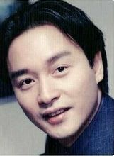](http://baike.baidu.com/albums/6360/5595080/1/2659645.html#2659645$)

影视歌巨星张国荣(55张)他是一位不但达到演艺界巅峰地位，而且屹立二十年不见褪色的[亚洲](http://baike.baidu.com/view/2918.htm)顶级巨星；　他是一位严谨，敬业，具有极高的艺术水准并作出了卓越贡献的艺术家；　他是一位以非凡的品位和[艺术](http://baike.baidu.com/view/576.htm)成就，从十几年前就被尊为[传奇](http://baike.baidu.com/view/10118.htm)的全能艺人；　他是一位善良，宽容，坚强，热诚，令所有接触过的人都赞不绝口的好人。注：中国最大的综合性辞典《[辞海](http://baike.baidu.com/view/6713.htm)》已于2009年将“张国荣”作为词条收入其中。2010年，[香港电台](http://baike.baidu.com/view/590180.htm)“爱[香港](http://baike.baidu.com/view/2607.htm)的理由”评选结果揭晓，第一名：有张国荣。　### 音乐成就

|  |
| --- |
| 他是20世纪80年代香港乐坛的天王巨星，1999年获得香港乐坛最高荣誉“[金针奖](http://baike.baidu.com/view/961753.htm)” |
| 他是第一位享誉韩国海外乐坛的华人歌手，打破了只有欧美流行歌手垄断韩国外国乐坛的传统 |
| 他是华语唱片在[韩国](http://baike.baidu.com/view/3299.htm)销量纪录保持者，首位在韩国举办个人演唱会的华人歌手[1] |
| 他发行的专辑《爱慕》，《The Greatest Hits of Leslie Cheung》，《宠爱》均曾打破华语唱片在韩国的销量纪录 |
| 他是在日本开演唱会场次最多的香港歌手，于1997年，2000年两度刷新香港歌手在日本开演唱会的场次纪录 |
| 他是第一位在[上海](http://baike.baidu.com/view/1735.htm)八万人体育场连开两场演唱会的华人歌手（2000年） |
| 2010年，国际知名传媒[CNN](http://baike.baidu.com/view/78.htm)和欧洲著名音乐杂志《Songlines》合作评选了“过去五十年里全球最知名的20位歌手或者乐团”，张国荣位列其中[2] |
| 2010年，国际知名传媒[CNN](http://baike.baidu.com/view/78.htm)举办“过去五十年闻名全球的五大指标音乐人”票选，张国荣排名第三，是唯一上榜的亚洲歌手[3] |

### 电影成就

|  |
| --- |
| 他于1991年当选香港电影金像奖影帝，1994年当选日本影评人大奖最佳外语片男主角 |
| 他于1993年荣获中国电影表演艺术学会奖特别贡献奖，并于2005年入选“中国电影百年百位优秀演员”行列 |
| 他曾多次获得韩国，日本颁发的最受欢迎国外演员奖；1989年当选“亚洲十大最受欢迎艺人” |
| 他是第一位受邀担任东京国际电影节评委的华人男演员（1993年） |
| 他是第一位受邀担任柏林国际电影节评委的华人男演员（1998年） |
| 他主演的电影《霸王别姬》曾获得法国戛纳国际电影节金棕榈大奖，他亦凭此片蜚声国际影坛 |
| 世界三大电影节他均有参加，他曾获得戛纳国际电影节以及威尼斯国际电影节的最佳男演员奖提名，受邀担任柏林国际电影节评委，其代表作《霸王别姬》入选美国《时代周刊》评出的“全球史上百部最佳电影” |
| 2010年，香港电影评论学会评选了“十大香港电影”，他主演的《阿飞正传》位列第一位 |
| 2010年3月，美国CNN评选了“史上最伟大的二十五位亚洲演员”，张国荣位列其中　 |

### 个人创作

|  |
| --- |
| 他作词、作曲四十余首，曾经连续两届担任香港作曲家及作词家协会的“音乐大使**”** |
| 他担任过MTV及音乐剧导演、唱片监制、演唱会艺术总监、电影编剧、公益电影导演、电影监制 |
| 他创作的歌曲先后获得台湾金马奖“最佳原创电影歌曲奖”、“十大中文金曲奖”、“十大劲歌金曲奖”等多项大奖 |

[编辑本段](http://baike.baidu.com/view/6360.htm#)个人履历
-------------------------------------------------

张国荣籍贯广东省梅县，是一位在全球华人社会和亚洲地区具有影响力的演艺人士，华人演艺圈影、视、歌多栖发展最成功的代表之一。作为歌手，他是[粤语流行音乐](http://baike.baidu.com/view/3319865.htm)的代表人物之一，在香港乐坛享有崇高地位。他是第一位享誉[韩国](http://baike.baidu.com/view/3299.htm)乐坛的华人[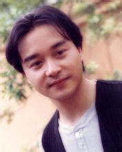](http://baike.baidu.com/albums/6360/5595080/1/3037017.html#3037017$)

影视歌巨星张国荣(5张)歌手，亦是华语唱片在韩国销量纪录保持者。1977年他获得“亚洲业余歌手大赛”亚军并由此进入歌坛。1983年推出唱片《[风继续吹](http://baike.baidu.com/view/1530593.htm)》，与唱片同名的粤语主打歌成为他历来最受欢迎的歌曲之一。1984年他的一曲《[Monica](http://baike.baidu.com/view/111704.htm)》在香港唱至街知巷闻，这首歌也奠定了张国荣歌坛巨星的地位。1987年他的大碟 《[Summer Romance](http://baike.baidu.com/view/4048120.htm)》在香港本地销量突破七白金， 成为当年IFPI唱片销量冠军；此后他的唱片屡屡斩获白金销量的佳绩，专辑《[宠爱](http://baike.baidu.com/view/698950.htm)》全亚洲年度销量突破200万张，香港本地销量超过六白金，位居IFPI香港分会公布的全年唱片销量榜榜首。除了对粤语流行音乐贡献良多外，他亦为华语流行音乐在韩国开拓市场做出了贡献。当年他的唱片在韩国热卖，引起了韩国唱片商的关注，并因此加大对华语唱片的引进力度。他是20世纪80年代香港乐坛的天皇巨星，这段时期他囊括了香港乐坛的多项[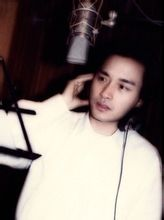](http://baike.baidu.com/albums/6360/5595080/1/3096185.html#3096185$)

影视歌巨星张国荣(4张)大奖**，**是首位连续两年同时获得“最受欢迎男歌星奖”和“叱咤乐坛男歌手金奖”的香港歌手。1999年他获得香港乐坛最高荣誉“[金针奖](http://baike.baidu.com/view/961753.htm)”，此外中国原创音乐奖、十大中文金曲奖、十大劲歌金曲奖均曾颁发他终身成就奖或者荣誉大奖。2000年，CCTV-MTV音乐盛典颁发他“[亚洲最杰出艺人奖](http://baike.baidu.com/view/4383759.htm)”；2003年，华语流行乐传媒大奖追颁张国荣“终身成就奖 ”，以表彰他对华语流行音乐的杰出贡献。 2005年香港出版了纪念邮票以表彰这位香港乐坛的殿堂级歌手。[4]2010年，国际知名传媒CNN和欧洲著名音乐杂志《Songlines》合作评选了“过去五十年里全球最知名的20位歌手或者乐团”，张国荣是唯一入选的香港歌手。截止2003年，他在香港红馆举行了121场个人演唱会，世界巡回演唱会近300场，他是第一位在上海八万人体育场连开两场演唱会的华人歌手，亦是在日本开[演唱会](http://baike.baidu.com/view/254313.htm)场次最多的华人男歌手。作为音乐人，他作词、作曲四十余首，曾经连续两届担任[香港作曲家及作词家协会](http://baike.baidu.com/view/109313.htm)的“音乐大使**”。**他谱写的歌曲先后获得台湾金马奖“最佳原创电影歌曲奖”、“十大中文金曲奖”、“十大劲歌金曲奖”、“中国原创音乐榜金曲奖”等多项大奖**,**并且5次获得金像奖和金马奖的最佳原创歌曲奖提名；1988年由他亲自作曲的《[沉默是金](http://baike.baidu.com/view/588573.htm)》成为传唱至今的经典名曲**。**他担任监制的唱片获得过香港乐坛唱片类的多项大奖；他担任艺术总监的演唱会被美国《时代》杂志评价为“Top in Passion and Fashion ”；他导演的MTV、音乐电影和公益短片都得到了业界的广泛好评。作为演员，他是华语影坛巨星**。**从影24年来他一共出演了61部电影，香港本埠票房总成绩达7.76亿港币，票[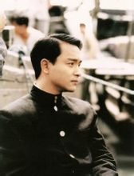](http://baike.baidu.com/albums/6360/5595080/1/3097103.html#3097103$)

张国荣电影剧照(26张)房号召力居香港男演员前列**。**他主演的电影《霸王别姬》打破中国内地电影在美国的票房纪录，《红色恋人》位居1998年国产片内地票房第三位，《金枝玉叶》曾获得1994年香港电影暑假档票房冠军，《大富之家》、《花田喜事》等影片均进入香港电影历史上最卖座的50部电影排行榜；在1996年，张国荣主演的电影有3部进入当年香港票房年度十强。他个人以精湛的演技，先后获得包括戛纳国际电影节、威尼斯国际电影节、香港金像奖、台湾金马奖在内的十八个影帝提名，当选香港电影金像奖最佳男主角、香港电影评论学会大奖最佳男主角、日本影评人大奖最佳男主角、东京电影评论家大奖最佳男主角。他戏路宽广，无论是文艺片、喜剧片亦或是剧情片，皆能挥洒自如，并以自己的气质和天赋塑造了一个个经典的银幕形象：《霸王别姬》中的程蝶衣、《阿飞正传》中的旭仔、《倩女幽魂》中的宁采臣都已成为留名影史的经典角色。他曾荣获中国电影表演艺术学会奖特别贡献奖，并且受邀担任[柏林国际电影节](http://baike.baidu.com/view/6107.htm)和[东京国际电影节](http://baike.baidu.com/view/6165.htm)评委，为繁荣香港影业作出了卓越的贡献。《霸王别姬》曾获[法国戛纳国际电影节](http://baike.baidu.com/view/29174.htm)金棕榈大奖、[美国电影金球奖](http://baike.baidu.com/view/6051.htm)最佳外语片奖、国际影评人联盟大奖费比西奖以及中国两岸三地多个电影节的最佳电影奖。2004年，他获得香港电影金像奖追颁的**“**演艺光辉永恒大奖**”**，同年留名香港尖沙咀**“**星光大道**”**。2005年，他入选“中国电影百年百位优秀演员”行列；同年，金像奖协会评选了“中国电影百年百部最佳华语片”，他主演的电影有八部，入选作品数量居华人演员之冠。2010年，[香港电影评论学会](http://baike.baidu.com/view/777120.htm)评选了“十大香港电影”，其代表作《阿飞正传》位列第一位。　### 国际影响

张国荣在亚洲地区具有很高的[知名度](http://baike.baidu.com/view/151849.htm)，是具有国际影响力的亚洲巨星。**[5]**从20世纪80年代起，他在韩国就有着极高的人气，是韩国最受欢迎的国外明星之一。他是第一位享誉韩国乐坛的华人歌手：1987年他发行的专辑《爱慕》在韩国的销量超过二十万张[6]。1989年，他发行的粤语专辑《The[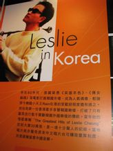](http://baike.baidu.com/albums/6360/5595080/1/3096550.html#3096550$)

韩国影响力有关资料(15张)Greatest Hits of Leslie Cheung》在韩国空前大卖三十万张**，**创造了华语唱片在韩国的销量纪录，韩国当地唱片商亦惊奇原来中文唱片也可赚取丰厚利润，于是逐渐留意中国音乐**；**同年由他亲自填词的单曲《To You》成为韩国家喻户晓的歌曲，并荣登韩国流行音乐榜[7]，其他的歌曲如《当年情》、《倩女幽魂》也得到很多韩国人的欣赏。1995年他发行的专辑《宠爱》再度打破华语唱片在韩国的销量纪录，《宠爱》中的歌曲《A Thousand Dreams Of You 》在韩国大受欢迎，并一度攀升至韩国流行歌曲排行榜榜首位置。电影方面，他首先以影片《倩女幽魂》打入韩国市场，并于1989年同时当选韩国最受欢迎外国歌星、影星第一位；而后来的一部国际大片《霸王别姬》则令他当选1994年韩国最受欢迎外国影星第一位。2003年，韩国电影频道OCN联同21家电影网合作举办“百大影星”评选，张国荣排海外影星第一位。2009年，韩国首尔举办了以“张国荣”名字命名的电影节以示纪念。2012年韩国最大的流行音乐颁奖礼[Mnet亚洲音乐大奖](http://baike.baidu.com/view/8138769.htm)在颁奖礼开场播放张国荣的告别演唱会片段，并由韩国艺人宋仲基演唱张国荣的经典歌曲《当年情》致敬。他是第一位获得“[日本影评人大奖](http://baike.baidu.com/view/6081293.htm)"最佳男主角”的华人男演员，并于1993年受邀担任日本东京国际电影节评委**。**1994年，他主演的电影《霸王别姬》在日本公映时反响强烈，曾在东京创下连续放映43周的奇迹。1996年，他获得日本著名杂志《ASIA POP》颁发[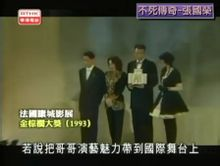](http://baike.baidu.com/albums/6360/5595080/1/3096187.html#3096187$)

海外影响力有关资料(10张)的“人气最旺”、“最佳艺人”两项大奖。1998年，他成为有日本“时代杂志”之称的著名新闻周刊《[AERA](http://baike.baidu.com/view/6110001.htm)》的封面人物。他是在日本开演唱会场次最多的华人男歌手，并且两度刷新香港歌手在日本开演唱会的场次纪录：1997年他在日本连开六场演唱会，打破了香港歌手在日本开演唱会的场次纪录。2000--2001年他在日本举办十场巡回演唱会，场场爆满，并再次打破香港歌手在日本开演唱会的场次纪录。2000--2001年，他位居日本Yahoo外国明星人气榜第一位**。**2001年，他获得日本拥有最多会员的亚洲电影影迷“CineCity”评选的“最佳男演员奖”，该奖项举办11年，张国荣有十年夺冠。2004年，他当选日本最大的娱乐月刊《日经娱乐》评出的“在日本最受欢迎的十大亚洲男艺人”。2006年，日本国家电视台NHK举办在日本最受欢迎的演员评选，张国荣当选“国际十佳男演员”，是唯一上榜的华人男演员。2007年，张国荣主演的《霸王别姬》在日本横滨的艺术展被列入中日交流年官方活动。　在泰国，他凭借电视剧《[浣花洗剑录](http://baike.baidu.com/view/218480.htm)》而走红，根据1980年《星岛晚报》报道，该电视剧在泰国创下了空前的受欢迎纪录。在马来西亚，他于2000年在可容纳三万人的吉隆坡默迪卡[体育场](http://baike.baidu.com/view/1154526.htm)举办大型演唱会，并且全场爆满。在新加坡，他曾经多次举办演唱会，1995他发行的专辑《宠爱》在新加坡销量排行榜上位居第一。2005年，新加坡《联合早报》举办“亚洲明星人气50强”评选，他位居第四位，这是香港艺人历年来最佳名次。### 海外评价

美国[有线电视](http://baike.baidu.com/view/54145.htm)BIO ：张国荣粤语流行音乐的指标性人物之一，并且是获得大奖的香港演员。[8]　美国《[洛杉矶时报](http://baike.baidu.com/view/401264.htm)》：从出演喜剧片到江湖武侠片，再到陈凯歌1993年的史诗悲剧《霸王别姬》，张国荣出众的演技为他赢得了国际性的掌声。[9]　美国[CNN](http://baike.baidu.com/view/78.htm)：他是亚洲顶级巨星，拥有激动人心的舞台表现力，惊人的美貌以及令人激赏的演绎才华。　英国《[泰晤士报](http://baike.baidu.com/view/218624.htm)》：1993年他在历史剧《霸王别姬》中成功塑造了一位京剧名伶，由此获得了国际范围内的赞誉，他是一位有着不可置信的多方面能力的全才。　[BBC](http://baike.baidu.com/view/815.htm)（英国广播公司） ：电影《霸王别姬》在世界范围内的成功使他扬名国际。[10]　

国际传媒的评价(6张)英国《[独立](http://baike.baidu.com/view/143203.htm)邮报》：张国荣在过去20年中塑造的几个最具国际声誉的电影角色让他成为他那一代人中最广泛认可的中国演员之一。　美国《[时代周刊](http://baike.baidu.com/view/365879.htm)》（亚洲版）：张国荣是粤语流行歌手和电影演员，并被加拿大评论家John Charles冠名为“香港的猫王”。[11]美国《[华盛顿邮报](http://baike.baidu.com/view/229325.htm)》：张国荣在电影《霸王别姬》中因饰演京剧男旦而闻名于西方世界。　日本《[经济新闻](http://baike.baidu.com/view/129060.htm)》：张国荣在香港和亚洲其他地区都很走红，并以电影《霸王别姬》中的角色而闻名。　日本电影杂志《[Cut](http://baike.baidu.com/view/443540.htm)》：张国荣从艺20多年来一直处于亚洲顶级明星地位，像他这样如同被上帝选中似的走完华丽人生之路的人，实在罕见。可以断言，如果没有张国荣，我们通过电影屏幕了解的亚洲，至今依然是非常有限的，而且只能是固定模式的符号，让我们目睹功夫打斗以外香港电影乐趣的人是张国荣。美国电影杂志《FilmThreat》：张国荣的离世结束了他在亚洲娱乐圈一段传奇的演艺生涯。[12]法国电影杂志《CAHIERS DU CINEMA》(电影笔记)： 他的电影以一种打破常规的魅力征服了我们。我们能够感受到他就是那样的：他是一代粤语歌王，是影响了几代青年人的艺术家偶像，也是一个有朝气的成功的浪漫主义演员。[13]澳大利亚《[澳洲新报](http://baike.baidu.com/view/4473302.htm)》：天才横溢的张国荣一生艺术成就深远，除了以他音乐造诣吸引万千歌迷外，更会在六十余部电影中扮演不同类型的角色，他在《霸王别姬》中的演出让他的精湛演技获得国际认同。　美国《[洛杉矶时报](http://baike.baidu.com/view/401264.htm)》：张国荣是一位在舞台上魅力惊人的流行文化巨星，并以电影《霸王别姬》扬名国际。美国《[新闻周刊](http://baike.baidu.com/view/229333.htm)》：张国荣是一位出色的华语歌手，而他在电影《霸王别姬》中诠释感情的态度，更给西方人士留下极为深刻的印象。[编辑本段](http://baike.baidu.com/view/6360.htm#)人物解读
-------------------------------------------------

### 提携后辈

张国荣生前一直热衷于提携演艺圈的后辈 ，港台众多艺人如黎明，古天乐，王力宏，舒淇，莫文蔚，袁咏仪，张卫健，古巨基，杨采妮等等都曾经得到过他的帮助。“其实我不比他年轻很多，只是比他少几岁，但是他觉得我是他的弟弟，便真的把我当作一个弟弟一样的去照顾。无论在起居饮食上，还是对我有什么意见、提点，他都是这样。”——[张学友](http://baike.baidu.com/view/3390.htm)　[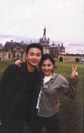](http://baike.baidu.com/albums/6360/5595080/1/2659646.html#2659646$)

张国荣与朋友的合影(71张)“张国荣真的对我蛮好的，尤其是我还是新人的时候。香港演艺圈里，每个人都是超现实的，很难得看到他这样的‘绝类’，有这样的胸襟去对待别人。我会把他当作是一个模范，我会知道以后怎么去对待晚辈。”——[王杰](http://baike.baidu.com/view/3819.htm)“我们拍《烟飞烟灭》，他第一次做导演，就教了我很多。他对我说，你一个人从美国回来，你谁都不认识，也没有朋友，也没有家人在这里，以后你来香港，我就是你的家人，你不要住酒店，你就住我家，他这样对晚辈，我非常感动。”——[王力宏](http://baike.baidu.com/view/1158.htm)“很多新演员都感激张国荣，因为很少演员会在没有他戏份的时候都在现场和一些新演员沟通。”--林纪陶“拍《红色恋人》的时候，我还是新人，没有什么拍电影的经验，却处处得到他的照顾。他算是我入行以来的第一个老师，从人格上来说他是一个伟大的演员。 ”——[梅婷](http://baike.baidu.com/view/46752.htm)“张国荣对我十分照顾。最难忘的是有时候没有他的戏份，他也会帮助我，想我可以牢记台词和表现的自然一点。有天我和他都没戏，他就主动找我说话，说要和我对台词，我总共就那么几句台词，他却陪我练了无数遍。”——[杨采妮](http://baike.baidu.com/view/7214.htm)“他一方面带领着潮流，永远站在时代的尖端；另一方面，他其实十分传统，既尊敬前辈，亦爱护后辈，我未见过一个成名的艺人，真真正正像他那样疼惜后辈。”——[黄沾](http://baike.baidu.com/view/95347.htm)“拍摄《霸王别姬》时有一场小四与程蝶衣绝裂的戏，我要说一句‘从今后，各走各的路！’，但是性格偏柔的我老是表现不出小四扭曲的心态。张国荣走过来安慰我，还亲自演示给我看。在影迷都围着张国荣签名时，张国荣把我和张丰毅等推到大家前面，说“你们应该找他，他们都是国内非常优秀的演员。”---[雷汉](http://baike.baidu.com/view/1254931.htm)### 重情重义

“那次在香港，林青霞跟我说，小川，你记住张国荣，在香港演艺圈像他这么重情义的人不多了。”—[宋小川](http://baike.baidu.com/view/484699.htm)（京剧演员[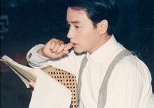](http://baike.baidu.com/albums/6360/5595080/1/2659647.html#2659647$)

张国荣生活照(14张)）“演唱会结束后，近一百位工作人员每人都收到一份张国荣亲手挑选的名牌礼物，礼物上有他亲手写的上款和下款。而他送礼物的时候，对每位工作人员，无论其岗位是大还是小，他都唤得出他们的名字，有两位同名的，他亦分得非常清楚，完全没有弄错。这件事是一位有份收礼物的朋友忍着眼泪跟我说的，他说那件礼物很美，不过他记得这件事，不是因为那件美丽的礼物，而是因为张国荣的心。”——[黄沾](http://baike.baidu.com/view/95347.htm)（音乐人）“他会帮演技生疏的演员对戏，讲笑话让心情不好的同事开心，为患病的工作人员安排医生，给生活困窘的小龙套找活干”——[黄百鸣](http://baike.baidu.com/view/308859.htm)“ 张国荣是个很有爱心的人，无论是老人、朋友、还是孩子，他都对别人很好。”——[张曼玲](http://baike.baidu.com/view/1372691.htm)（京剧演员）“他是个非常善良的人，我以前在香港落魄的时候，非常拮据，生活都成问题。 因为我那时收入很低，而他总是伸出援手资助我。 他真是一个大好人。”——[吴宇森](http://baike.baidu.com/view/28223.htm)[14]“1998年，我爱人得了癌症，张国荣听到这个消息后，专门从香港到北京来看他。当时，我爱人在家里打吊针，国荣一进门，就抱着他叫史老师，说实在的，我爱人是那种特坚强的人，可当时一下就哭了。”——[张曼玲](http://baike.baidu.com/view/1372691.htm)“我很敬佩他的为人，他会视每位同事如亲人，当时有位鼓手扭伤了手，除了表示关心，他还主动约医生为他医治.。看到他，就看到了一个‘真’字和一个‘爱’字。”——唐弈聪（音乐人）“他这个人就是心肠好。合作二十年来，我有心事，他来倾听。我的苦恼，他来劝解。我受人欺负，他出面来挡。参加活动，人潮汹涌，他马上护住我。”——[梅艳芳](http://baike.baidu.com/view/8695.htm)　“生活中的张国荣十分随和，爱交朋友，爱开玩笑。剧组有几个很可爱的小演员，张国荣对他们真像大哥哥一样，哪个孩子身体不舒服了，他会拿出药来，拿出自己带来的罐头送给他们。”——[周野芒](http://baike.baidu.com/view/592610.htm)（演员）“演艺圈的人情很淡薄，但是张国荣作为身价不菲的巨星，对我完全不会提钱，只讲情谊，这种相交相知的朋友，很难再认识了。——[刘培基](http://baike.baidu.com/view/1184597.htm)### 敬业精神

在拍摄一个从高处往下一跳的镜头时，张国荣连跳两次仍觉不满意，特别要求导演“再来一次”。第三次跳时，因地面湿滑不慎摔倒，双膝跪地，伤及筋骨，送医院打了钢圈。虽然医师一再警告他，最好躺着不要动，可是他不想因为自己脚伤，延误发片时期，隔天，他还是强忍痛楚坐在轮椅上，把这支MTV拍完。——1998年《东方日报》我和丈夫史燕生是1993年拍《霸王别姬》时认识张国荣的，我们到片场时，他在那里压腿，我丈夫问他，“张先生，你脸怎么这么红呀？”他说，“没事，练的。”后来才知道，他当时发着38度9的高烧，可他还坚持在练。我从来没见过这么敬业的人。——[张曼玲](http://baike.baidu.com/view/1372691.htm)　“他是一个非常敬业的演员，我们演对手戏的时候，哪怕镜头不对着他，他眼睛里都是戏，积极的配合我，让我很感动。”——[梅婷](http://baike.baidu.com/view/46752.htm)### 才华横溢

“他很有天赋，才华多到爆棚，但是他是努力的，从不会因天赋才华而疏懒。他的专业态度，凡跟他合作过的人都知道。”——[黄沾](http://baike.baidu.com/view/95347.htm)（音乐人）“他是歌坛和影坛的奇才。”——[吴宇森](http://baike.baidu.com/view/28223.htm)（导演）“在舞台上张国荣的才华洋溢到了恐怖的地步，他的歌唱、舞蹈、演技所有的一切都充分展现出他的style ,他是我最尊敬的艺人。”——[王力宏](http://baike.baidu.com/view/1158.htm)（歌手）“单听张国荣的曲子，觉得他写的歌很大器，和弦很美，好听又高级，应该是学过乐理的人。后来跟才知道他并不是科班出身，这更让人对他的创作感到惊艳，他根本就是个天才。”——[陈晓娟](http://baike.baidu.com/view/1701504.htm)（音乐人）“他是真正的艺术家，香港以后很难再出像他这样才华横溢的人了。”——[万梓良](http://baike.baidu.com/view/43669.htm)（演员）### 爱国爱港

他热爱自己的祖国，并以自己是中国人而自豪。1998年张国荣在接受日本著名新闻周刊《[AERA](http://baike.baidu.com/view/6110001.htm)》的采访时说：“[我是中国人](http://baike.baidu.com/view/645163.htm)，有了归属感，就有了心灵的平静。最近，我常被问起为什么不去好莱坞，可我已根本不想去外国住，因为我身体里流的是中国人的血。”他深爱着自己的家乡——香港，亦鼎力支持香港电影的发展。1999年为了给低迷的香港电影产业带来活力，由五位导演精英结成“创意联盟”，而张之亮导演的电影《流星语》亦是其中的重要活动。张之亮找了香港许多一线演员，惟有张国荣同意主演这部电影，并且象征性地只收取一元钱片酬。[编辑本段](http://baike.baidu.com/view/6360.htm#)演艺经历
-------------------------------------------------

### 传奇一生

张国荣不是横空出世、一夜成名的泡沫明星，他是踩着荆棘丛生的坎坷道路，一[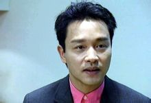](http://baike.baidu.com/albums/6360/5595080/1/2659650.html#2659650$)

影视歌巨星张国荣(12张)步一个脚印成长为华人演艺圈影、视、歌多栖天王巨星。音乐方面，他以醇厚的嗓音，出色的舞台驾驭能力以及“以情带声”的演绎方式倾倒众多歌迷，《倩女幽魂》、 《[沉默是金](http://baike.baidu.com/view/588573.htm)》、《当年情》、《风继续吹》等歌曲被许多人称为成长的背景音乐。他演唱过的歌曲三百余首，正式出品70余张专辑（含精选集），销量总计已过千万；他在香港红馆举行了121场个人演唱会，世界巡回演唱会近300场，他在舞台上的劲歌热舞更是在香港引领了一个时代的潮流。他连续获得“十大中文金曲奖”、“十大劲歌金曲奖”、“最受欢迎男歌星奖”、“叱咤乐坛男歌手金奖”等乐坛大奖，成为20世纪80年代香港乐坛无可替代的天皇巨星。除了对粤语流行音乐贡献良多外，他亦为华语流行音乐在韩国开拓市场做出了[贡献](http://baike.baidu.com/view/1448.htm)。当年他的唱片在[韩国](http://baike.baidu.com/view/3299.htm)热卖，引起了韩国唱片商的关注，并因此加大对华语唱片的引进力度。电视方面，他早年于丽的电视拍摄了多部电视剧，其中的代表作《[浣花洗剑录](http://baike.baidu.com/view/218480.htm)》更是在泰国取得了成[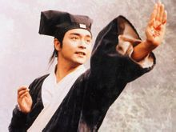](http://baike.baidu.com/albums/6360/5595080/1/2659649.html#2659649$)

电影精选(4张)功。1980年，他凭电视短剧《我家的女人》获得英联邦电影电视节最佳表演奖。电影方面，他是华语影坛巨星，从影24年来，他以自己的天才和勤奋，塑造了命运曲折跌宕、个性千变万化的数十个角色，商业价值和艺术价值并重，在华人电影史上留下了宝贵而鲜明的足印。他主演的电影名作有《霸王别姬》、《阿飞正传》、《东邪西毒》、《倩女幽魂》、《春光乍泄》等。2005年，金像奖协会评选了“中国电影百年百部最佳华语片”，他主演的电影有八部，入选作品数量居华人演员之冠，他亦被选为“[中国电影](http://baike.baidu.com/view/125697.htm)一百年最喜爱的男演员”。### 海外求学

(1956-1976)1956年9月12日出生于香港，父亲为香港著名洋服店的裁缝兼老板[张活海](http://baike.baidu.com/view/8271342.htm)，曾为好莱坞影星马龙·白兰度定做衣服。张国荣少年时独身赴英国留学，爱好时装设计的他考入[英国里兹大学](http://baike.baidu.com/view/3278070.htm)就读纺织专业，后因父亲病重辍学返港。### 出道初期

--丽的电视签约歌手(1977-1982)1977年他凭《[American Pie](http://baike.baidu.com/view/997766.htm)》获丽的电视亚洲歌唱大赛香港区亚军进而出道，并被“华侨日报”评为最有前途新人奖，随后加入丽的电视，在多部连续剧中担任主角。他初期的歌唱形象较为前卫不羁，带有占士甸（詹姆士迪恩）那种反叛和浪漫。他曾在一次户外演出中唱到兴奋时向现场观众掷帽，但竟然被人把帽子掷回台上。尽管如此，他依然坚持自己的歌唱事业。1978年他推出了首张英文唱片《Day Dreaming》。1979年推出首张粤语唱片《情人箭》。1982年他主演的电影《烈火青春》为他赢来了第一个金像奖影帝提名，这部电影也成为新浪潮电影的代表作和金像奖评选的“百年百部最佳华语片”之一。### 遇见伯乐

--最受欢迎男歌星(1982-1989)1982年，丽的约满，张国荣便跟随恩师[黎小田](http://baike.baidu.com/view/647551.htm)转投无线电视和旗下的[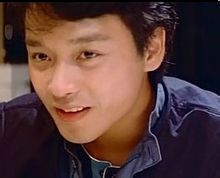](http://baike.baidu.com/albums/6360/5595080/1/2659651.html#2659651$)

张国荣早年照片(8张)华星唱片，并认识了他后来的经理人[陈淑芬](http://baike.baidu.com/view/250903.htm)。后来张国荣将黎小田和陈淑芬比喻成他生命中的伯乐。1983年，推出唱片《[风继续吹](http://baike.baidu.com/view/1530593.htm)》，与唱片同名的粤语主打歌成为张国荣历来最受欢迎的歌曲之一，这张唱片也使其歌唱事业平步青云。1984年，专辑《Leslie》轰动全港，销量突破四白金。他的一曲《[Monica](http://baike.baidu.com/view/111704.htm)》在香港唱至街知巷闻，这首歌也奠定了张国荣歌坛巨星的地位。他充满青春激情的演绎更为歌曲添上异彩，使《Monica》成为香港流行音乐史上具有里程碑式意义的作品之一，在业界和公众中都影响深远，直到15年后仍入选港台“世纪十大金曲”。1985年，他在红馆连开十场个人演唱会，打破了香港歌手初次开演唱会的场数纪录。1986年，张国荣在当年香港“十大劲歌金曲”季选中一人占有7首歌曲，在当年香港电台龙虎榜上他有5首冠[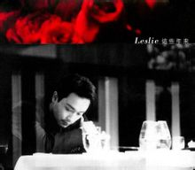](http://baike.baidu.com/albums/6360/5595080/1/3096188.html#3096188$)

唱片封面(4张)军歌曲，这两项成绩均为香港众歌手之冠；他凭一曲《有谁共鸣》压倒谭咏麟首夺十大劲歌金曲的压轴大奖“金曲金奖”，张国荣的迅速走红使得香港乐坛出现了 “[谭张争霸](http://baike.baidu.com/view/5919067.htm)”的局面。在此后的几年中，谭张二人在乐坛的竞争十分激烈。1987年张国荣的唱片《[Summer Romance](http://baike.baidu.com/view/4048120.htm)》在香港本地的销量突破七白金，击败谭咏麟获得当年香港IFPI全年销量冠军大奖[15]。1988年，1989年张国荣连续两年击败谭咏麟获得[叱咤乐坛流行榜](http://baike.baidu.com/view/176390.htm)颁发的 “叱咤乐坛男歌手金奖”（香港商业电台点播率第一的男歌手获此奖）,谭咏麟获得“叱咤乐坛男歌手银奖” （香港商业电台点播率第二的男歌手获此奖，他的奖由其公司代领）。1987年是张国荣歌坛、影坛双丰收的一年。他推出的粤语大碟《[Summer Romance](http://baike.baidu.com/view/4048120.htm)》在香港本地的销量突破七白金，是香港全年销量最高的唱片。张国荣也凭借《[Summer Romance](http://baike.baidu.com/view/4048120.htm)》夺得当年IFPI全年销量冠军大奖；该张唱片的大热歌曲《无心睡眠》横扫1987年度香港各大音乐颁奖礼，获得十大劲歌金曲的压轴大奖“金曲金奖”，十大中文金曲奖，十大劲歌金曲奖等多项乐坛大奖。同年，他凭电影《[英雄本色](http://baike.baidu.com/view/86739.htm)II》获得香港电影金像奖影帝提名，他在影片《[倩女幽魂](http://baike.baidu.com/view/47805.htm)》中扮演的宁采臣也成为香港电影史上最为经典的书生形象之一。1988年，张国荣成为第一位亚洲区[百事](http://baike.baidu.com/view/27750.htm)[巨星](http://baike.baidu.com/view/418748.htm)代言人，并在红馆连开23场演唱会。他击败[谭咏麟](http://baike.baidu.com/view/101164.htm)获得“叱咤乐坛男歌手金奖”，并囊括了十大中文金曲奖，十大劲歌金曲奖等多项乐坛大奖。同年，由他亲自作曲的歌曲《沉默是金》成为经典，他凭电影《[胭脂扣](http://baike.baidu.com/view/156601.htm)》第三次获得金像奖影帝提名，而影片中他扮演的“十二少”成为又一经典电影形象。1986至1987年张国荣连续两届夺得“十大劲歌金曲颁奖典礼”的【金曲金奖】；1988至1989年张国荣连续两届夺得“十大劲歌金曲颁奖典礼”的【最受欢迎男歌星】；1988至1989年张国荣连续两届夺得“叱咤乐坛流行榜颁奖典礼”的【叱咤乐坛男歌手金奖】。　1989年，张国荣蝉联了“最受欢迎男歌星奖”与“叱咤乐坛男歌手金奖”等多项乐坛大奖，事业如日中天的[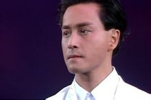](http://baike.baidu.com/albums/6360/5595080/1/3099001.html#3099001$)

1989年告别乐坛演唱会(2张)他突然宣布告别歌坛，急流勇退，并在香港红馆连开33场“告别乐坛演唱会”，随后举办了世界巡回演唱会**。**这次演唱会也被喻为香港最为经典的演唱会之一。 同年，他推出了《侧面》、《Salute》、《Final Encounter》三张大碟。大碟《侧面》短时间内在香港本地的销量就直逼七白金，并获得“叱咤乐坛大碟IFPI大奖”。作为翻唱专辑的《Salute》一经推出即成为一张叫好又叫座的唱片，它亦成为香港流行乐史上翻唱类大碟难以逾越的高峰。1989年，张国荣作为唯一的香港歌手代表，参加了于英国举行的亚洲流行音乐节。### 退出乐坛

--扬威影坛歌坛盛放的同时，张国荣在影坛也造就了同样的辉煌。1990年，张国荣主演了电影《[阿飞正传](http://baike.baidu.com/view/160312.htm)》，这部电影[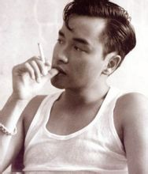](http://baike.baidu.com/albums/6360/5595080/1/3096551.html#3096551$)

电影代表作《阿飞正传》(3张)被称为香港影坛最出色的文艺电影之一；2010年，[香港电影评论学会](http://baike.baidu.com/view/777120.htm)评选了“十大香港电影”，《阿飞正传》位列第一位。影片《[阿飞正传](http://baike.baidu.com/view/160312.htm)》里，张国荣成功塑造了一位孤傲叛逆的不羁浪子形象，他饰演的旭仔对镜独舞的片段更是成为香港影史上最为经典的片段之一。凭借在本片中精彩传神的表演，他成功摘得第10届香港电影金像奖影帝桂冠；此后无论是文艺片、喜剧片亦或是剧情片，他都能挥洒自如，并以自己的气质和天赋塑造了一个个经典的银幕形象：《倩女幽魂》中的宁采臣、《胭脂扣》中的十二少、《阿飞正传》中的旭仔、 《霸王别姬》中的程蝶衣、《东邪西毒》中的欧阳锋、《春光乍泄》中的[何宝荣](http://baike.baidu.com/view/1802829.htm)都已成为留名影史的经典角色 ；《枪王》、《异度空间》等电影则展示了他在演艺生涯后期对人物内心世界更加深入的挖掘。1993年，他主演了《[霸王别姬](http://baike.baidu.com/view/8506.htm)》，这部电影被称为中国电影史上最经典的作品之一，同时也为他带来了崇高[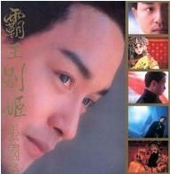](http://baike.baidu.com/albums/6360/5595080/1/3096552.html#3096552$)

电影代表作《霸王别姬》(3张)的国际声誉。张国荣以其精湛的演技把[京剧](http://baike.baidu.com/view/2088.htm)戏子“程蝶衣”这个不疯魔不成活的角色演绎得淋漓尽致，并且获得了国内外的一致好评，曾获得[奥斯卡](http://baike.baidu.com/view/16894.htm)影帝的英国演员宾京士利就曾经说：“他在《霸王别姬》里的演出让我见识到什么是完美表演!”该片先后获得第46届戛纳国际电影节金棕榈大奖（这是中国影片首次也是至今唯一一次获此殊荣），国际影评人联盟大奖费比西奖（这也是中国影片首次获此奖），第51届美国电影金球奖最佳外语片等多项国际大奖。张国荣也凭此片获得“日本影评人大奖最佳外语片男主角”、“东京电影评论家大奖最佳男主角”、 第46届戛纳国际电影节最佳男演员提名（张国荣仅以一票之差落选戛纳影帝，而且原因是组委会想要分散奖项）。1994年，他主演了《[东邪西毒](http://baike.baidu.com/view/65863.htm)》，这部电影被称为华语武侠电影的另类高峰。在影片中，张国荣饰演的[欧阳锋](http://baike.baidu.com/view/120069.htm)是一个性格相当复杂的角色，对于演员演技的考验极大。张国荣的表演不仅自然细腻，而且成功诠释了欧阳锋的多重性格。香港电影评论学会曾评论说：张国荣是一位在华人演艺圈中罕见的能将“反讽”诠释得很好的演员。凭借在此片的精彩表演，他获得1994年“香港电影评论学会大奖最佳男主角奖”。### 复出乐坛

--再登高峰1995年，退出乐坛六年的张国荣在万众期待下重新开始了他的音乐事业。复出后的他虽然宣布不再领取任何竞争性质的奖项，但是仍然保持着很高的人气，歌曲长时间在香港各大排行榜上占据头名。 他推出的专辑《宠爱》全亚洲年度销量突破200万张，香港年度销量30多万张，位居IFPI香港分会公布的全年唱片销量榜榜首，并被业界称为“救市之作”。此后他陆续推出多张唱片，皆取得销量佳绩。1996年12月，他举行了一连60场“跨越97”世界巡回演唱会。在演唱会中，他将歌曲《月亮代表我的心》送给他生命中挚爱的朋友唐先生。这份在华人社会中一向被排斥的感情，仍然因其坦率、诚挚和持久而赢得了公众的广泛尊重。1999年，他获得了香港乐坛最高荣誉－－“金针奖”以及“十大劲歌[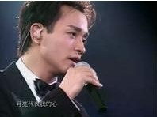](http://baike.baidu.com/albums/6360/5595080/1/2659652.html#2659652$)

张国荣演唱会现场(28张)金曲颁奖礼”的荣誉大奖。2000年7月31日－2001年4月16日，举办“热·情演唱会”世界巡回43场，他亲自担任演唱会的艺术总监，世界时尚大师Jean Paul Gaultier担任整场演唱会的服装设计。这场堪称完美的演唱会也受到国外媒体的高度评价。 　2000年**，**他在香港电台举办的“千禧十大演艺红人”评选中名列榜首 ；同年由他执导的公益电影《烟飞烟灭》上映后得到了广泛好评，他的导演才华也初露锋芒。从2000年到2001年，张国荣获得了华语乐坛的多项荣誉大奖，包括“亚洲最杰出艺人奖”，“千禧全国成就大奖”，“金曲银禧荣誉大奖”等。[编辑本段](http://baike.baidu.com/view/6360.htm#)社会活动
-------------------------------------------------

张国荣生前一直热心于公益慈善事业，总是尽自己的力量去帮助别人，即使生日都让来客将礼物折成现金捐助给慈善机构。他逝世前的一段时间，推掉了很多演艺工作，但是仍然坚持参加慈善活动。他为人低调，许许多多做过的善事只是悄悄进行，不愿意因媒体的大肆渲染而使其变味。以下节选他所做众多善事中的极少部分：1989年张国荣发行了致敬大碟《Salute》，当年张国荣将唱片收益全数捐给香港演艺学院。[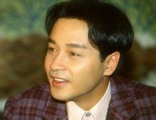](http://baike.baidu.com/albums/6360/5595080/1/3096189.html#3096189$)

张国荣生活照(4张)1997年演唱会期间，张国荣首先自己捐款一百万港币给癌症基金，其后号召歌迷捐款。演唱会期间，一共募捐到八十余万善款，张国荣与朋友再添上十余万，又凑足了一百万捐予癌症基金。“哥哥对护苗的支持不遗余力，出力又出钱，又从不博宣传。”－—萧芳芳1998年生日时，有人欲送他生日礼物，哥哥说：“我不要生日礼物。”他将收到的一张十五万支票，转赠给“儿童癌病基金”。去年五月，哥哥还以私人名义捐出十万，令不少癌病儿童受惠。－—《中国新闻网》他们今次到新加坡是为当地老人院筹款，结果共筹得六十万坡币,本来张国荣已绝少在公开场合献唱，但今次为了老人家筹款，他唱了三首电影主题曲及插曲。——1999年《东方日报》　2003年12月，“Redmission张国荣歌影迷国际联盟”成立，秉承张国荣的遗志，积极通过各种活动为慈善基金会募捐，同时也组织歌影迷向有需要的人或地区捐款。2005年印尼海啸Redmission号召张国荣歌影迷捐款，一个多星期内筹集善款46万港币。2006年张国荣50岁冥诞，Redmission在维多利亚公园举行慈善义卖和拍卖，一天之内筹款近20万港币，全数捐予儿童癌病基金。[编辑本段](http://baike.baidu.com/view/6360.htm#)人物评价
-------------------------------------------------

[中央电视台](http://baike.baidu.com/view/9242.htm)新闻频道：他是华人演艺圈影**、**视**、**歌多栖天王巨星。香港《经济日报》：除了张国荣，香港还有其他的天王巨星。但在歌艺上和演艺上都如此辉煌灿烂的巨星，舍张国荣外似未有第二人**。**Jeon chenll（韩国影评协会成员）：“他的才华不仅仅只局限在演技方面，他同时也是香港粤语流行歌坛有史以来最重要的天才横溢的歌手之一 。”南黎明(韩国KBS国际广播电台主持人）：“近年来，张国荣的演技奠定了他在韩国人心目中「演技派」明星的地位，很多人都赞叹张国荣的演技达到了炉火纯青的地步。”[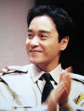](http://baike.baidu.com/albums/6360/5595080/1/3096553.html#3096553$)

张国荣生活照(5张)宾京士利(英国演员，曾获得奥斯卡影帝）：“他在《霸王别姬》里的演出让我见识到什么是完美表演!”中川阳介（日本导演）：“他是国际电影界的瑰宝，拥有卓越的演技。 ”贝·罗根（美国温斯坦电影公司副总裁）：“张国荣的独特的地方是他几乎涉及演艺界的每个领域，而且非常成功。”　[王家卫](http://baike.baidu.com/view/19227.htm)：“张国荣是一个伟大的艺人。”[陈凯歌](http://baike.baidu.com/view/6199.htm)：“没有张国荣，就没有《霸王别姬》，这部戏也是唯一在戛纳、金球奖同时赢得欧洲和好莱坞认同的中国电影。”[冯小刚](http://baike.baidu.com/view/1678.htm)：“一直以来有个愿望，能够和这样一位非常杰出的演员合拍一部电影，现在看来，是永远不可能实现的事情。”[李仁港](http://baike.baidu.com/view/1479979.htm)：“演员因人而异，有的人演某种角色很成功，但是换了一种角色就不行了。不过今我吃惊的是张国荣不管扮演什么样的角色都很成功。”　[张之亮](http://baike.baidu.com/view/321457.htm)：“张国荣能出演这部影片会带来很多效果。首先，他的演技有实力。作为实力派影星，他在国外也是很有影响力。”[周润发](http://baike.baidu.com/view/3036.htm)：“张国荣在歌坛上的发展成绩骄人，奖项无数，但他骨子里的演技细胞，近年来也大放异彩。”[张学友](http://baike.baidu.com/view/3390.htm)：“哥哥是一位具备英俊潇洒，风流倜傥，能歌善舞，演技精湛于一身的艺人。”　[吴镇宇](http://baike.baidu.com/view/43709.htm)：“我对电影（《东邪西毒》）中‘鸟笼光’印象最深刻，7位演员的表演魅力让人过目不忘，尤其是张国荣的演技更是入木三分。”[葛优](http://baike.baidu.com/view/17023.htm)：“我在《霸王别姬》里的戏份不多，但与张国荣多是对手戏。他是最优秀的演员之一，而且他演的虞姬无人能替代。”[章子怡](http://baike.baidu.com/view/2793.htm)：“他不仅歌唱得好，戏也演得非常棒，他演的《霸王别姬》、《阿飞正传》我看了很多次，我觉得他是一个非常了不起的演员。”[黄秋生](http://baike.baidu.com/view/26856.htm)看过《枪王》之后说：“简直把我吓到了，他怎么可以演得这么好！”[郭富城](http://baike.baidu.com/view/3830.htm)：“我很喜欢的一个演员，他现在已经离开了，就是张国荣，他给我很多的启发，看到他的表演，让我很感动，他在电影方面是一个不可多得的演员。”[吴彦祖](http://baike.baidu.com/view/5880.htm)：“他是个全方位的艺人，印象最深刻的就是他在《霸王别姬》里的演出，尤其因为自己小时候看过爸爸练京戏，更觉得张国荣把一个很难的角色诠释得很好。”彭纳德（CASH主席）：“张国荣在以往的日子中为香港乐坛贡献杰出，获奖无数；而且张国荣的形象及创作都极有独特的个性。”林启辉（香港特别行政区议员）：“张国荣凭演电影《霸王别姬》享誉国际，促进西方观众对中国传统艺术和京剧的认识。”[巩俐](http://baike.baidu.com/view/3677.htm)：“哥哥的个性很开朗，虽然他在演艺事业上很成功，但他仍旧很努力，我一直觉得他给了我们一个好榜样。”[顾长卫](http://baike.baidu.com/view/372948.htm)：“张国荣是我合作过的最好的演员之一，有着令人激赏的才华和敬业精神，他在《霸王别姬》里的杰出表现令人不能忘怀。”[舒克](http://baike.baidu.com/view/210507.htm)（影评人）：“看了他的影片，深深为他的演技折服，不论是《倩女幽魂》中文弱的宁采臣，还是《霸王别姬》里痴爱的程蝶衣，抑或是《纵横四海》里潇洒的阿占，不同类型的人物都被他演绎到极致。”[编辑本段](http://baike.baidu.com/view/6360.htm#)社会评价
-------------------------------------------------

他是一个罕有的艺术天才，不但没有浪费这份天赋，反而用了数倍的努力做到更多更好。他的专业精神有口[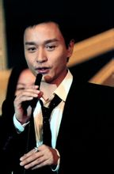](http://baike.baidu.com/picview/6360/5595080/0/0dd7912397dda144d400aa12b2b7d0a20cf48601.html)影视歌巨星张国荣

皆碑，对自己的行业怀有由衷的热爱和全心的投入，不断尝试新领域和新突破，并且一再取得成功。自成名以来，在“红”与“美”相关的评比中总有他的名字：香港电台举办的“八十年代十大红人”、“九十年代十大红人”评选中都有他的名字。韩国、日本评选十大外国影星，他多次获得第一。1989年，他在香港商台举办的“十大靓人”评选中名列榜首。九十年代香港评选“四大绝色”他即为其中之一。2000年，他再次名列香港“四大绝色”之一。2010年，美国CNN推出了香港最美男艺人排行榜，他亦名列榜首。CNN认为：张国荣性感优雅，香港银幕再也不会有这样的演员了。张国荣虽然逝世多年，其影响力仍然巨大。2009年他的纪念精选唱片《最红》一出市即登上香港唱片销量榜并蝉联多[周冠军](http://baike.baidu.com/view/6312361.htm)，并且多次卖断货。《最红》也获得了香港IFPI全年最高销量广东唱片大奖。[编辑本段](http://baike.baidu.com/view/6360.htm#)巨星殒落
-------------------------------------------------

2003年4月1日晚上18点41分，张国荣因[抑郁症](http://baike.baidu.com/view/332.htm)病情失控从[香港东方文华酒店](http://baike.baidu.com/view/2862012.htm)二十四楼健身中心坠下，紧急送往玛丽医院，经医生检验入院前已死亡（18时45分），玛丽医院于19点06分宣告抢救无效，终年46岁。这突如其来的消息震撼整个华人社会，事发后宣道会于翌晚举行祈祷运动。张国荣堕楼前与经理人陈淑芬相约在文华东方酒店的大堂咖啡室，陈淑芬等候许久未见其现身，于是步出酒店门外等候，其后亲眼看到张国荣在自己面前坠楼。经理人[陈淑芬](http://baike.baidu.com/view/250903.htm)女士证实他患上抑郁症（情绪病），努力治疗年余，因病情失控而辞世。陈淑芬并向媒体表示：“他得病的时候自己并不知道，直到后来这个病开始有了一些病态反应……你无法想像他是多么希望自己能够好起来，他一直在看医生，他没有办法接受他有这个病的事实，因为他什么都有，现在选择自己喜欢的工作，怎么这样的一个人会有抑郁症呢？不能想象，别人都不会相信的，怎么可能？哥哥在坠楼前那一两年都很痛苦。在坠楼前，他在写下的纸条中说：“Depression，多谢各位朋友，多谢麦列菲菲教授。这一年来很辛苦，不[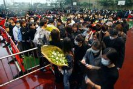](http://baike.baidu.com/albums/6360/5595080/1/2928862.html#2928862$)

张国荣葬礼照片(5张)能再忍受，多谢唐先生，多谢家人，多谢肥姐。我一生没做坏事，为何这样？”他在遗书中感谢各位朋友、唐鹤德先生以及他的医生。经纪人陈淑芬其后证实他患上抑郁症，努力医治年余，但仍因病情失控而自杀。医学教授林文杰表示：“我深信他最终的行为不是他「自愿」或能「控制」的。首先，张国荣深知自己病情之严重而又积极寻医，而遗书结尾的「一生未做坏事，为何这样？」更表达了他的极度无奈，以及留恋此世的意愿。”患病只是不幸，抑郁症的患病率高达5%到10%。在患病一年的时间里，他一边继续作曲写歌录唱片、出席慈善活动；一边忍受着“发作起来时痛得好像要把他的肉都撕开了一样”的病情，想方设法求医问药，中医、西医，能试的全部试过；2002年11月，他的病情失控，自杀获救。此后的他，或许已经预知黑暗随时降临，立好了遗嘱，捐了慈善基金，安顿了包括司机在内的一切身边人。他走的那晚，无数人缅怀着与他一起走过的青春年华。几天内，世界各大新闻媒体如[路透社](http://baike.baidu.com/view/72489.htm)、[法新社](http://baike.baidu.com/view/87749.htm)、[美联社](http://baike.baidu.com/view/95158.htm)等都做了报道，甚至中国中央电视台《[新闻30分](http://baike.baidu.com/view/616899.htm)》都史无前例地报道了一位香港艺人去世的消息。　2003年4月8日，张国荣的葬礼在香港殡仪馆举行，由唐先生以“挚爱”的身份与亲友打点身后事。大批歌迷聚集于殡仪馆外，到场的演艺明星众多，如张国荣生前的红颜知己梅艳芳，悲痛至泣不成声。他生前的三位好友，导演徐克、香港著名填词人黄沾和艺人代表张学友分别致悼词。[周润发](http://baike.baidu.com/view/3036.htm)、[徐克](http://baike.baidu.com/view/29215.htm)、[张学友](http://baike.baidu.com/view/3390.htm)、[关锦鹏](http://baike.baidu.com/view/211775.htm)、[刘培基](http://baike.baidu.com/view/1184597.htm)、[梁家辉](http://baike.baidu.com/view/8173.htm)、[林夕](http://baike.baidu.com/view/16457.htm)、刘纯豪、罗建基为其扶灵，送张国荣最后一程，遗体随后送往哥连臣角火葬场火化。海内外多家电视台均现场直播报道葬礼实况。当时正值“非典”爆发期，居民轻易不敢出门，但是出殡当日仍然有来自世界各地的四万名群众冒雨聚集在香港殡仪馆周围，人群占据了几条街道，成为香港史上最轰动的葬礼之一。### 纪念活动

**音乐会、音乐展**送别音乐会（台北市）；继续宠爱音乐会（[香港红馆](http://baike.baidu.com/view/157498.htm)、[重庆奥体中心](http://baike.baidu.com/view/429872.htm)）2008年12.17-12.21 日本横滨张国荣音乐展2011年4月1日《[我爱记歌词](http://baike.baidu.com/view/1221647.htm)》怀念张国荣专场2012年3月1日 群星追忆张国荣浮想联翩音乐会（香港湾仔会展）2013年3月31日 继续宠爱——十年MISS YOU MUCH LESLIE纪念演唱会（红馆）。日前往录音室积极排练的歌手包括：[张学友](http://baike.baidu.com/view/3390.htm)、[张智霖](http://baike.baidu.com/view/20433.htm)、[周慧敏](http://baike.baidu.com/view/29368.htm)、[陈慧琳](http://baike.baidu.com/view/6603.htm)、[容祖儿](http://baike.baidu.com/view/59779.htm)及[草蜢](http://baike.baidu.com/view/51144.htm)等，音乐会总监[陈淑芬](http://baike.baidu.com/view/250903.htm)也有到场。**电影节**2004年3月27日—4月16日，日本东京、大阪举行“张国荣电影节”2009年3月27日—4月23日，韩国首尔举行“张国荣电影节### 纪念影展

由于张国荣的国际影响力突出，他的去世在世界范围内也引起了关注，世界各大传媒都报导了张国荣离世的消息；包括法国《电影笔记》在内的权威性电影杂志都出版纪念专题，全球多个国家和地区都举办了各类纪念影展：[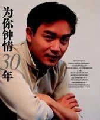](http://baike.baidu.com/picview/6360/5595080/0/960a304e251f95ca9caccd86c8177f3e670952a0.html)影视歌巨星张国荣

2003年7月6日起，英国曼彻斯特举办纪念影展，称张国荣为“西方人心目中出色的演员”。2003年10月31日起，澳大利亚影画中心于墨尔本举办名为“张国荣银幕生涯回顾”的电影欣赏会，“向这位世界影坛中最有才华的影星之一致敬”，此外还有：美国洛杉矶好莱坞“向张国荣致敬影展”、纽约“张国荣纪念影展”、芝加哥“张国荣纪念影展”；加拿大蒙特利尔“张国荣纪念影展”、多伦多“张国荣纪念影展”；瑞士纽察图“张国荣纪念影展”；法国巴黎“张国荣纪念影展”；奥地利维也纳“张国荣纪念影展”；荷兰鹿特丹电影节“张国荣纪念影展”等等。日本自2003年起，历时三年，在日本超过100家电影院举办“张国荣纪念影展”；影展的足迹覆盖了[日本](http://baike.baidu.com/view/1554.htm)多个地区。韩国除举办纪念影展外，还于2009年在首尔举办了以“张国荣”名字命名的电影节以示纪念。此外新加坡，马来西亚，中国大陆，中国香港等多个国家或地区也都举办了有关他的纪念活动。### 纪念书籍

《[禁色的蝴蝶](http://baike.baidu.com/view/2803400.htm)》、《[张国荣的时光](http://baike.baidu.com/view/1868320.htm)》、《[与他共度61世](http://baike.baidu.com/view/2963772.htm)》等### 纪念歌曲

林夕的《[不求人](http://baike.baidu.com/view/298549.htm)》、严城的《[不曾远走](http://baike.baidu.com/view/10320193.htm)》、陈奕迅的《[浮夸](http://baike.baidu.com/view/578164.htm)》、黄阅的《[折子戏](http://baike.baidu.com/view/2087.htm)》、曾一鸣的《[烟花烫](http://baike.baidu.com/view/500.htm)》等### 个人蜡像

[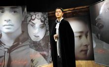](http://baike.baidu.com/picview/6360/5595080/0/cdbf6c81800a19d8051e42a533fa828ba61e4675.html)张国荣的蜡像

2004年3月31日香港杜莎夫人蜡像馆为一代歌影巨星张国荣的蜡像举行了揭幕仪式。　这座蜡像由英国首席雕塑师StephenMansfield耗时五个月制作，并在“伟人殿堂”里进行展出。张国荣的蜡像是唯一一个进驻“伟人殿堂”的演艺明星蜡像**。[16]**### 张国荣纪念奖学金

2004年，[香港演艺学院](http://baike.baidu.com/view/450046.htm)设立了“张国荣纪念奖学金”，每年5月颁发。奖学金分为两部分，一部分是奖学金，用于奖励学业出色的学生；另一部分是助学金，是为了资助家庭环境比较困难的学生。[编辑本段](http://baike.baidu.com/view/6360.htm#)主要作品
-------------------------------------------------

作为华人演艺圈多栖发展最为成功的艺人之一，张国荣一生涉及过演艺圈的多个领域：歌手、演员、作曲人、作词人、MTV及音乐剧导演、唱片监制、演唱会艺术总监（热情演唱会）、电影编剧、公益电影导演、电影监制等等。### 参与制作电影

| 年份 | 电影名称 | 备注 |
| --- | --- | --- |
| 1994 | 《金枝玉叶》 | 编剧 |
| 1995 | 《夜半歌声》 | 执行监制/副导演/配乐 |
| 1996 | 《色情男女》 | 导演 |
| 《金枝玉叶2》 | 第二组导演 |
| 1999 | 《流星语》 | 联合出品人 |
| 《左右情缘》（音乐剧） | 自编自导 |
| 2000 | 《烟飞烟灭》（公益电影） | 自编自导/剪辑 |

### 个人创作歌曲

| 年份 | 歌曲名称 | 词/曲 | 专辑/备注 | 获奖荣誉 |
| --- | --- | --- | --- | --- |
| 1983 | 情自困 | 作词 | 《[一片痴](http://baike.baidu.com/view/3982579.htm)》 |  |
| [片段](http://baike.baidu.com/view/1824511.htm) | 作词 | 《[风继续吹](http://baike.baidu.com/view/1530593.htm)》 |  |
| 1986 | [爱火](http://baike.baidu.com/view/699082.htm) | 作词 | 《[爱火](http://baike.baidu.com/view/699082.htm)》 |  |
| 1987 | [情难自控](http://baike.baidu.com/view/5573458.htm) | 作词 | 《[Summer Romance](http://baike.baidu.com/view/4048120.htm)》 |  |
| 1988 | [想你](http://baike.baidu.com/view/96004.htm) | 作曲 | 《[Virgin Snow](http://baike.baidu.com/view/1013531.htm)》 |  |
| [沉默是金](http://baike.baidu.com/view/588573.htm) | 作曲 | 《[Hot Summer](http://baike.baidu.com/view/801542.htm)》 | 第11届港台“十大中文金曲” |
| 第6届无线“十大劲歌金曲” |
| [共创真善美](http://baike.baidu.com/view/6435635.htm) | 作曲 | 香港电台《踏上公民路》主题曲 |  |
| 1989 | [由零开始](http://baike.baidu.com/view/748619.htm) | 作曲 | 《由零开始》 | 第7届无线“十大劲歌金曲 ” |
| 风再起时 | 作曲 | 《[Final Encounter](http://baike.baidu.com/view/3980775.htm)》 |  |
| [烈火灯蛾](http://baike.baidu.com/view/6435691.htm) | 作曲/词 | 《[最热](http://baike.baidu.com/view/2579373.htm)》 |  |
| [To You](http://baike.baidu.com/view/757702.htm) | 作词 | 《To You》 |  |
| 1993 | [红颜白发](http://baike.baidu.com/view/372133.htm) | 作曲 | 《[宠爱](http://baike.baidu.com/view/698950.htm)》 | 第30届台湾电影“金马奖”最佳原创歌曲 |
| 提名第13届香港电影“金像奖”最佳电影歌曲 |
| [双飞燕](http://baike.baidu.com/view/85805.htm) | 作词 | 电影《东成西就》插曲 |  |
| 1995 | 夜半歌声 | 作曲 | 《宠爱》 | 提名第15届香港电影“金像奖”最佳电影歌曲 |
| 提名第32届台湾电影“金马奖”最佳电影歌曲 |
| [深情相拥](http://baike.baidu.com/view/4161367.htm) | 作曲 | 《宠爱》 |  |
| [一辈子失去了你](http://baike.baidu.com/view/4161299.htm) | 作曲 | 《宠爱》 |  |
| 1996 | [红](http://baike.baidu.com/view/99517.htm) | 作曲 | 《红》 |  |
| [有心人](http://baike.baidu.com/view/543593.htm) | 作曲 | 《红》 | 提名第16届香港电影“金像奖”最佳电影歌曲 　 |
| 提名第33届台湾电影“金马奖”最佳电影歌曲 |
| [意犹未尽](http://baike.baidu.com/view/768743.htm) | 作曲 | 《红》 |  |
| 1998 | [以后](http://baike.baidu.com/view/200294.htm) | 作曲 | 《[这些年来](http://baike.baidu.com/view/3194807.htm)》 |  |
| 1999 | [寂寞有害](http://baike.baidu.com/view/3976186.htm) | 作曲 | 《[陪你倒数](http://baike.baidu.com/view/4040681.htm)》 |  |
| [小明星](http://baike.baidu.com/view/378246.htm) | 作曲 | 《陪你倒数》 |  |
| 2000 | [我](http://baike.baidu.com/view/8202.htm) | 作曲 | 《[大热](http://baike.baidu.com/view/801523.htm)》 | 香港作词家作曲家协会“我至爱的中文金曲”冠军 |
| 大热 | 作曲 | 《大热》 | 第23届港台“十大中文金曲” |
| [发烧](http://baike.baidu.com/view/51385.htm) | 作曲 | 《大热》 | 雪碧“中国原创音乐榜”金曲奖 |
| [被爱](http://baike.baidu.com/view/6991689.htm) | 作词 | 《Printemps》 |  |
| 2001 | 挪亚方舟 | 作曲 | 《[一切随风](http://baike.baidu.com/view/801505.htm)》 |  |
| 2002 | [这么远那么近](http://baike.baidu.com/view/1828352.htm) | 作曲 | 《[Crossover](http://baike.baidu.com/view/275241.htm)》 | 第3届华语流行乐“十大华语歌曲” |
| 2003 | [玻璃之情](http://baike.baidu.com/view/3976116.htm) | 作曲 | 《一切随风》 |  |
| [敢爱](http://baike.baidu.com/view/8045855.htm) | 作曲 | 《一切随风》 |  |
| [红蝴蝶](http://baike.baidu.com/view/332671.htm) | 作曲 | 《一切随风》 |  |
| [我知你好](http://baike.baidu.com/view/6097583.htm) | 作曲 | 《一切随风》 |  |

### 为他人作曲

| 歌曲 | 演唱歌手 |
| --- | --- |
| 《忘掉你象忘掉我》 | 王菲 |
| 《极爱自己》 | 陈冠希 |
| 《如果你知我苦衷》 | 周慧敏 |
| 《永远怀念你》 | 许志安 |
| 《自首宣言》 | 张智霖 |

### 参与制作的唱片

| 年份 | 专辑 | 备注 |
| --- | --- | --- |
| 1986 | 《迷惑我》 | 唱片监制 |
| 1987 | 《Summer Romance》 | 唱片监制 |
| 1988 | 《Hot Summer》 | 唱片监制 |
| 1988 | 《Virgin Snow》 | 唱片监制 |
| 1988 | 《拒绝再玩》 | 唱片监制 |
| 1989 | 《侧面》 | 唱片监制 |
| 1989 | 《Salute》 | 执行监制 |
| 1989 | 《Final Encounter》 | 唱片监制 |
| 1999 | 《陪你倒数》 | 唱片监制 |

### 参与制作MTV

| 年份 | MTV | 专辑/备注 | 备注 |
| --- | --- | --- | --- |
| 1987 | 当年情 | 《[英雄本色](http://baike.baidu.com/view/86739.htm)》 | 监制 |
| 1989 | [侧面](http://baike.baidu.com/view/835041.htm) | 《侧面》 | 监制 |
| 1989 | 由零开始 | 《侧面》 | 监制 |
| 1999 | [左右手](http://baike.baidu.com/view/55771.htm) | 《陪你倒数》 | 剪辑 |
| 2000 | [枕头](http://baike.baidu.com/view/21234.htm) | 《[Untitled](http://baike.baidu.com/view/801539.htm)》 | 自编自导 |
| 2000 | [你这样恨我](http://baike.baidu.com/view/3976024.htm) | 《Untitled》 | 自编自导 |
| 2000 | [I Honestly Love You](http://baike.baidu.com/view/3975753.htm) | 《Untitled》 | 自编自导 |
| 2001 | [洁身自爱](http://baike.baidu.com/view/1007438.htm) | 《[Forever](http://baike.baidu.com/view/93899.htm)》 | 自编自导 |
| 2001 | [梦到内河](http://baike.baidu.com/view/3976154.htm) | 《Forever》 | 自编自导 |
| 2002 | [芳华绝代](http://baike.baidu.com/view/4109915.htm) | 《[With](http://baike.baidu.com/view/827489.htm)》（梅艳芳专辑） | 自编自导 |

### 音乐作品

### 发行专辑

1 / 4* [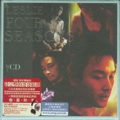](http://baike.baidu.com/view/1342115.htm)[Our Seasons](http://baike.baidu.com/view/1342115.htm)2011.4.1
* [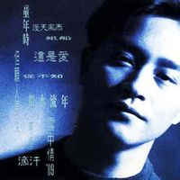](http://baike.baidu.com/view/939041.htm)[复黑王-SALUTE](http://baike.baidu.com/view/939041.htm)2010.8.23
* [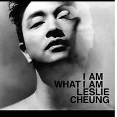](http://baike.baidu.com/view/975819.htm)[I Am What I Am](http://baike.baidu.com/view/975819.htm)2010.3.23
* [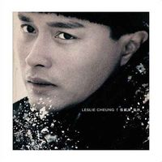](http://baike.baidu.com/view/2579373.htm)[最热](http://baike.baidu.com/view/2579373.htm)2009.4.30
* [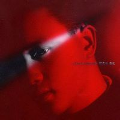](http://baike.baidu.com/view/2579252.htm)[最红](http://baike.baidu.com/view/2579252.htm)2009.4.2
* [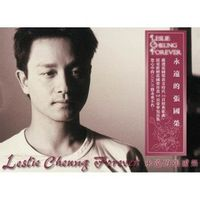](http://baike.baidu.com/view/3981157.htm)[永远张国荣](http://baike.baidu.com/view/3981157.htm)2007.10.23
* [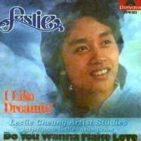](http://baike.baidu.com/view/4658682.htm)[I Like Dreaming](http://baike.baidu.com/view/4658682.htm)2006.3.28
* [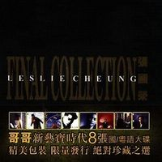](http://baike.baidu.com/view/801498.htm)[Final Collection](http://baike.baidu.com/view/801498.htm)2006.3.3
* [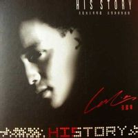](http://baike.baidu.com/view/3983205.htm)[History His Story](http://baike.baidu.com/view/3983205.htm)2004.4.1
* [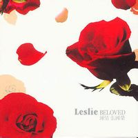](http://baike.baidu.com/view/801503.htm)[钟情张国荣](http://baike.baidu.com/view/801503.htm)2004.4.1

[< 上一页](http://baike.baidu.com/view/6360.htm) |[1](http://baike.baidu.com/view/6360.htm)|[2](http://baike.baidu.com/view/6360.htm)|[3](http://baike.baidu.com/view/6360.htm)|[4](http://baike.baidu.com/view/6360.htm)| [下一页 >](http://baike.baidu.com/view/6360.htm)### 参演电影

* [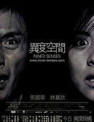](http://baike.baidu.com/albums/17242/17242/0/0.html#507321$)

### [异度空间](http://baike.baidu.com/view/17242.htm)(2002)

饰演：阿占  导演：[罗志良](http://baike.baidu.com/view/984396.htm)演员：[林嘉欣](http://baike.baidu.com/view/8340.htm)/[李子雄](http://baike.baidu.com/view/77365.htm)/[周嘉玲](http://baike.baidu.com/view/64937.htm)/[徐少强](http://baike.baidu.com/view/278208.htm)章昕自幼父母离异独自流落异乡，在得知她房东的妻儿是死于泥石流后，她的脑…
* [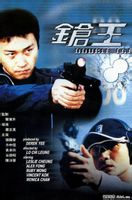](http://baike.baidu.com/albums/603868/6169665/0/0.html#0$)

### [枪王](http://baike.baidu.com/view/603868.htm)(2000)

饰演：Rick  导演：[罗志良](http://baike.baidu.com/view/984396.htm)演员：[方中信](http://baike.baidu.com/view/19277.htm)/[谷德昭](http://baike.baidu.com/view/91330.htm)/[黄卓菱](http://baike.baidu.com/view/3210774.htm)/[陈法蓉](http://baike.baidu.com/view/25202.htm)射击比赛中，一名炒股失败的警察突然精神失常，持枪威胁人群，枪手Rick…
* [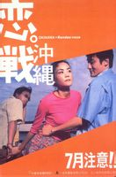](http://baike.baidu.com/albums/239205/239205/0/0.html#4386702$)

### [恋战冲绳](http://baike.baidu.com/view/239205.htm)(2000)

饰演：Jimmy  导演：[陈嘉上](http://baike.baidu.com/view/239192.htm)演员：[梁家辉](http://baike.baidu.com/view/8173.htm)/[王菲](http://baike.baidu.com/view/3208.htm)/[黎姿](http://baike.baidu.com/view/35874.htm)/[加藤雅也](http://baike.baidu.com/view/959576.htm)档案部探员阿达休假，与女友Sandy往冲绳岛旅游，期间意外地遇到大盗J…
* [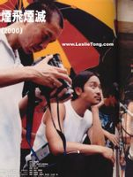](http://baike.baidu.com/albums/1501453/1501453/0/0.html#0$)

### [烟飞烟灭](http://baike.baidu.com/view/1501453.htm)(2000)

饰演：Lawrence  导演：[张国荣](http://baike.baidu.com/view/6360.htm)演员：[叶德娴](http://baike.baidu.com/view/43834.htm)/[容祖儿](http://baike.baidu.com/view/59779.htm)/[陈冠希](http://baike.baidu.com/view/3739.htm)/[王力宏](http://baike.baidu.com/view/1158.htm)Lawrence及Gladys抽烟成瘾。两人吸烟导致儿子隐藏性的血癌加…
* [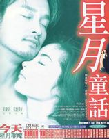](http://baike.baidu.com/albums/607404/5079061/0/0.html#0$)

### [星月童话](http://baike.baidu.com/view/607404.htm)(1999)

饰演：达也；石家宝  导演：[李仁港](http://baike.baidu.com/view/1479979.htm)演员：[常盘贵子](http://baike.baidu.com/view/31572.htm)/[高捷](http://baike.baidu.com/view/1020215.htm)/[李灿森](http://baike.baidu.com/view/261423.htm)/[廖启智](http://baike.baidu.com/view/793423.htm)年轻有为的日本青年达也即将出任香港大酒店的总经理，遂决定带未婚妻瞳到香…
* [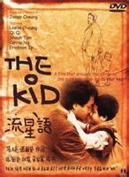](http://baike.baidu.com/albums/922091/922091/0/0.html#436000$)

### [流星语](http://baike.baidu.com/view/922091.htm)(1999)

饰演：李兆荣  导演：[张之亮](http://baike.baidu.com/view/321457.htm)演员：叶靖岚/[吴家丽](http://baike.baidu.com/view/91067.htm)/[狄龙](http://baike.baidu.com/view/258082.htm)/[李蕙敏](http://baike.baidu.com/view/341398.htm)被丈夫抛弃的年轻女子少君，把初生的儿子偷偷放在一艘豪华游艇上，希望儿子…
* [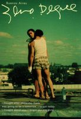](http://baike.baidu.com/albums/1397824/1397824/0/0.html#0$)

### [摄氏零度春光再现](http://baike.baidu.com/view/1397824.htm)(1999)

饰演：何宝荣  导演：[关本良](http://baike.baidu.com/view/2322162.htm)演员：[梁朝伟](http://baike.baidu.com/view/4996.htm)/[关淑怡](http://baike.baidu.com/view/28695.htm)/[张震](http://baike.baidu.com/view/46046.htm)/[王家卫](http://baike.baidu.com/view/19227.htm)黎耀辉和何保荣互换过名字和身份；黎耀辉曾为何保荣自杀过；他们之间曾经出…
* [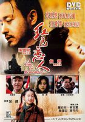](http://baike.baidu.com/albums/521135/521135/0/0.html#180842$)

### [红色恋人](http://baike.baidu.com/view/521135.htm)(1998)

饰演：靳  导演：[叶大鹰](http://baike.baidu.com/view/402698.htm)演员：[陶泽如](http://baike.baidu.com/view/205327.htm)/[梅婷](http://baike.baidu.com/view/46752.htm)/罗伯特·麦克/[巴勃考克](http://baike.baidu.com/view/9388817.htm)英租界豪华的酒吧里，佩恩结识了秋秋与靳，并对秋秋一见钟情，但他并不知自…

[< 上一页](http://baike.baidu.com/view/6360.htm) |[1](http://baike.baidu.com/view/6360.htm)|[2](http://baike.baidu.com/view/6360.htm)|[3](http://baike.baidu.com/view/6360.htm)|[4](http://baike.baidu.com/view/6360.htm)|[5](http://baike.baidu.com/view/6360.htm)| [下一页 >](http://baike.baidu.com/view/6360.htm)### 参演电视剧

* [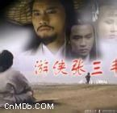](http://baike.baidu.com/albums/1173744/1173744/1/4275437.html#4275437$)

### [游侠张三丰](http://baike.baidu.com/view/1173744.htm)(1981)

饰演：懿文太子  导演：[黄泰来](http://baike.baidu.com/view/2650697.htm)演员：[万梓良](http://baike.baidu.com/view/43669.htm)/[陈秀雯](http://baike.baidu.com/view/8105.htm)/[林国雄](http://baike.baidu.com/view/592209.htm)本剧以太子和富豪之女的恋情以及宫廷权利的斗争为线索，其中穿插了许多人物…
* [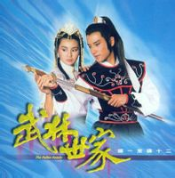](http://baike.baidu.com/albums/1184905/1184905/1/204410.html#204410$)

### [武林世家](http://baike.baidu.com/view/1184905.htm)(1985)

饰演：方浩天  导演：李鼎伦演员：[张曼玉](http://baike.baidu.com/view/16576.htm)/[谢贤](http://baike.baidu.com/view/22069.htm)/[杨泽霖](http://baike.baidu.com/view/1230006.htm)/[刘江](http://baike.baidu.com/view/198122.htm)故事源自以制造军器而闻名江湖的方家，方家表面风光，却暗藏种种权力斗争。
* 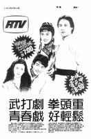

### [甜甜廿四味](http://baike.baidu.com/view/2391960.htm)(1981)

饰演：许杰  导演：[胡学文](http://baike.baidu.com/view/267101.htm)演员：[倪诗蓓](http://baike.baidu.com/view/1739756.htm)/[钟保罗](http://baike.baidu.com/view/1506328.htm)/[莫少聪](http://baike.baidu.com/view/588872.htm)/蔡镇川讲述张国荣饰演的男主角(Mike)，由会考后到广告公司工作，直至成为歌…
* [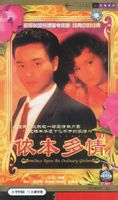](http://baike.baidu.com/albums/789845/6261664/0/0.html#0$)

### [侬本多情](http://baike.baidu.com/view/789845.htm)(1984)

饰演：詹士  导演：陈鸿楷演员：[周秀兰](http://baike.baidu.com/view/1225998.htm)/[关菊英](http://baike.baidu.com/view/358673.htm)/[刘兆铭](http://baike.baidu.com/view/813057.htm)/[商天娥](http://baike.baidu.com/view/438890.htm)在港留学的莫笑侬，双亲于国内战乱期间不幸身亡。为了上大学，她迫不得已投…
* [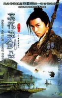](http://baike.baidu.com/albums/218480/6929263/0/0.html#0$)

### [浣花洗剑录](http://baike.baidu.com/view/218480.htm)(1978)

饰演：方宝玉  导演：[萧笙](http://baike.baidu.com/view/1016931.htm)演员：[王书麒](http://baike.baidu.com/view/43687.htm)/[文雪儿](http://baike.baidu.com/view/1777012.htm)/[陈曼娜](http://baike.baidu.com/view/1269111.htm)/[黎小田](http://baike.baidu.com/view/647551.htm)本剧讲述东瀛无名剑客白衣人西渡而来，公然挑战中原武林高手的故事。
* [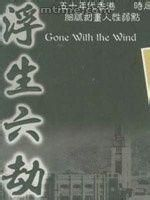](http://baike.baidu.com/albums/862119/862119/1/208497.html#208497$)

### [浮生六劫](http://baike.baidu.com/view/862119.htm)(1979)

饰演：车穗生  导演：[徐正康](http://baike.baidu.com/view/1884193.htm)演员：[岳华](http://baike.baidu.com/view/521287.htm)/[马敏儿](http://baike.baidu.com/view/2976236.htm)/[陈秀雯](http://baike.baidu.com/view/8105.htm)/[万梓良](http://baike.baidu.com/view/43669.htm)1949年，程瑞祥携妻林丽卿从内陆来港途中，因环境所迫卖妻，甚为后悔，…

[< 上一页](http://baike.baidu.com/view/6360.htm) |[1](http://baike.baidu.com/view/6360.htm)|[2](http://baike.baidu.com/view/6360.htm)| [下一页 >](http://baike.baidu.com/view/6360.htm)### 演唱会记录

| 举办时间 | 演唱会名称 | 总场次 |  |
| --- | --- | --- | --- |
| 1985 | 夏日百爵演唱会 | 12 |  |
| 1986 | 浓情演唱会 | 12 |  |
| 1983 | 1983年演唱会 |  |  |
| 1987 | “与你共鸣在海洋”演唱会 | 15 |  |
| 1987 | 美加不眠演唱会 |  |  |
| 1988 | 百事巨星演唱会 | 23 |  |
| 1989 | 告别歌坛演唱会 |  |  |
| 1997 | 跨越97演唱会 | 84 |  |
| 2000 | 拉阔音乐会 | 1 |  |
| 2000 | 热·情演唱会 | 62 |  |
|  |

[编辑本段](http://baike.baidu.com/view/6360.htm#)荣誉记录
-------------------------------------------------

### 主要成就

他是第一位既获得香港乐坛最高荣誉“[金针奖](http://baike.baidu.com/view/961753.htm)”，同时也是金像奖[影帝](http://baike.baidu.com/view/293217.htm)的香港男艺人

影视歌巨星张国荣(3张)他是第一位享誉韩国乐坛的华人歌手他是第一位在韩国举办个人演唱会的华人歌手他是华语唱片在韩国销量纪录保持者他是第一位在上海八万人体育场连开两场演唱会的华人歌手　他是在日本开演唱会场次最多的华人男歌手，并且两度刷新香港歌手在日本开演唱会的场次纪录他是第一位获得“日本影评人大奖最佳男主角奖”的华人演员他是第一位受邀担任东京国际电影节评委的华人男演员他是第一位受邀担任柏林国际电影节评委的华人男演员他是第一位亚洲区百事巨星代言人### 获奖记录

|  |
| --- |
| 音乐奖项 |
| 

|  |  |  |
| --- | --- | --- |
| ▪ | 2010-12    | 华语金曲奖30年经典评选【我最喜爱的歌手】,【我最喜爱的唱片】,【我最喜爱的歌曲】   （获奖） |

|  |  |  |
| --- | --- | --- |
| ▪ | 2010-08-02    | 入选美国CNN和杂志《Songlines》合作评选【过去五十年里全球最知名的20位音乐家】   （获奖） |

|  |  |  |
| --- | --- | --- |
| ▪ | 2010-08    | 美国CNN过去五十年闻名全球的五大指标音乐人评选第三名   （获奖） |

|  |  |  |
| --- | --- | --- |
| ▪ | 2010-04-07    | IFPI颁奖2009年【全年最高销量广东唱片】,【十大销量广东唱片】   （获奖） |

|  |  |  |
| --- | --- | --- |
| ▪ | 2010    | 华语金曲奖华语乐坛30年30人   （获奖） |

|  |  |  |
| --- | --- | --- |
| ▪ | 2005-11-08    | 香港邮政推出“香港流行歌星”邮品系列,成为获致敬的歌手之一   （获奖） |

|  |  |  |
| --- | --- | --- |
| ▪ | 2005    | IFPI颁奖礼十大销量广东唱片   《BELOVED》   （获奖） |

|  |  |  |
| --- | --- | --- |
| ▪ | 2003    | 年度CASH音乐成就大奖最佳另类作品奖   《这么远,那么近》   （获奖） |

|  |  |  |
| --- | --- | --- |
| ▪ | 2003    | 第三届   华语流行乐十大华语歌曲   《这么远,那么近》   （获奖） |

|  |  |  |
| --- | --- | --- |
| ▪ | 2003    | 第三届   华语流行乐传媒大奖终身成就奖   （获奖） |

|  |  |  |
| --- | --- | --- |
| ▪ | 2003    | 第二十五届   港台十大中文金曲银禧荣誉大奖   （获奖） |

|  |  |  |
| --- | --- | --- |
| ▪ | 2002    | 香港作曲家及作词家协会第二任音乐大使   （获奖） |

|  |  |  |
| --- | --- | --- |
| ▪ | 2001    | 香港作词家作曲家协会“金帆奖”颁奖典礼主题歌   《挪亚方舟》   （获奖） |

|  |  |  |
| --- | --- | --- |
| ▪ | 2001    | 雪碧中国原创音乐榜金曲奖   《发烧》   （获奖） |

|  |  |  |
| --- | --- | --- |
| ▪ | 2001    | 第一届   华语流行乐传媒大奖十大华语歌曲奖   《路过蜻蜓》   （获奖） |

|  |  |  |
| --- | --- | --- |
| ▪ | 2001    | 第一届   华语流行乐最佳演唱会奖   《热·情》   （获奖） |

|  |  |  |
| --- | --- | --- |
| ▪ | 2001    | 第一届   华语流行乐最佳流行男歌手奖   （获奖） |

|  |  |  |
| --- | --- | --- |
| ▪ | 2001    | 中国原创音乐榜千禧全国成就大奖   （获奖） |

|  |  |  |
| --- | --- | --- |
| ▪ | 2000    | 第二十三届   港台十大中文金曲金曲银禧荣誉大奖   《左右手》   （获奖） |

|  |  |  |
| --- | --- | --- |
| ▪ | 2000    | 香港作词家作曲家协会我至爱的中文金曲冠军   《我》   （获奖） |

|  |  |  |
| --- | --- | --- |
| ▪ | 2000    | 第十八届   无线十大劲歌金曲四台联颁大碟奖   《Untitled》   （获奖） |

|  |  |  |
| --- | --- | --- |
| ▪ | 2000    | 第二十三届   港台十大中文金曲(退出领奖)   [《大热》](http://baike.baidu.com/view/1684563.htm)   （获奖） |

|  |  |  |
| --- | --- | --- |
| ▪ | 2000    | 《明报周刊》致敬大奖   《热·情》演唱会   （获奖） |

|  |  |  |
| --- | --- | --- |
| ▪ | 2000    | 《明报周刊》最突出男歌手奖   《路过蜻蜓》   （获奖） |

|  |  |  |
| --- | --- | --- |
| ▪ | 2000    | 香港作曲家及作词家协会首任音乐大使   （获奖） |

|  |  |  |
| --- | --- | --- |
| ▪ | 2000    | 第十八届   无线十大劲歌金曲致敬大奖   （获奖） |

|  |  |  |
| --- | --- | --- |
| ▪ | 2000    | CCTV-MTV音乐盛典颁奖礼【亚洲最杰出艺人奖】   （获奖） |

|  |  |  |
| --- | --- | --- |
| ▪ | 1999    | 第二十二届   港台十大中文金曲【金针奖】   （获奖） |

|  |  |  |
| --- | --- | --- |
| ▪ | 1999    | 新城电台劲爆年度歌曲大奖十大劲爆歌曲   《左右手》   （获奖） |

|  |  |  |
| --- | --- | --- |
| ▪ | 1999    | 第十二尊歌曲大奖,十届   商台叱咤乐坛至大专业推介奖   《左右手》   （获奖） |

|  |  |  |
| --- | --- | --- |
| ▪ | 1999    | 第二十二届   港台十大中文金曲(退出领奖)   《左右手》   （获奖） |

|  |  |  |
| --- | --- | --- |
| ▪ | 1999    | 港台20世纪百年十大金曲   《Monica》   （获奖） |

|  |  |  |
| --- | --- | --- |
| ▪ | 1999    | 第十七届   无线十大劲歌金曲【荣誉大奖】   （获奖） |

|  |  |  |
| --- | --- | --- |
| ▪ | 1997    | 第十六届   香港电影金像奖最佳电影歌曲   《有心人》   （提名） |

|  |  |  |
| --- | --- | --- |
| ▪ | 1996    | 第三十三届   台湾电影金马奖最佳电影歌曲   《当真就好》   （提名） |

|  |  |  |
| --- | --- | --- |
| ▪ | 1996    | 第三十三届   台湾电影金马奖最佳电影歌曲   《有心人》   （提名） |

|  |  |  |
| --- | --- | --- |
| ▪ | 1996    | 第十五届   香港电影金像奖最佳电影歌曲   《夜半歌声》   （提名） |

|  |  |  |
| --- | --- | --- |
| ▪ | 1995    | 第十四届   香港电影金像奖最佳电影歌曲   《追》   （获奖） |

|  |  |  |
| --- | --- | --- |
| ▪ | 1995    | 第三十二届   台湾电影金马奖最佳电影歌曲   《夜半歌声》   （提名） |

|  |  |  |
| --- | --- | --- |
| ▪ | 1995    | 第十八届   十大中文金曲全年最高销量歌手大奖   （获奖） |

|  |  |  |
| --- | --- | --- |
| ▪ | 1994    | 第十三届   香港电影金像奖最佳电影歌曲   《红颜白发》   （提名） |

|  |  |  |
| --- | --- | --- |
| ▪ | 1994    | 第三十一届   台湾电影金马奖最佳电影歌曲   《追》   （提名） |

|  |  |  |
| --- | --- | --- |
| ▪ | 1993    | 第三十届   台湾电影金马奖最佳原创歌曲   《红颜白发》   （获奖） |

|  |  |  |
| --- | --- | --- |
| ▪ | 1989    | 第二届   商台叱咤乐坛IFPI大奖   《侧面》   （获奖） |

|  |  |  |
| --- | --- | --- |
| ▪ | 1989    | 第七届   无线十大劲歌金曲   《由零开始》   （获奖） |

|  |  |  |
| --- | --- | --- |
| ▪ | 1989    | 第七届   无线十大劲歌金曲【最受欢迎男歌星】   （获奖） |

|  |  |  |
| --- | --- | --- |
| ▪ | 1989    | 第二届   商台叱咤乐坛【男歌手金奖】   （获奖） |

|  |  |  |
| --- | --- | --- |
| ▪ | 1989    | 韩国【最受欢迎外国歌星第一名】   （获奖） |

|  |  |  |
| --- | --- | --- |
| ▪ | 1988    | 第六届   无线十大劲歌金曲   《贴身》   （获奖） |

|  |  |  |
| --- | --- | --- |
| ▪ | 1988    | 第六届   无线十大劲歌金曲   《沉默是金》   （获奖） |

|  |  |  |
| --- | --- | --- |
| ▪ | 1988    | 第十一届   港台十大中文金曲   《无需要太多》   （获奖） |

|  |  |  |
| --- | --- | --- |
| ▪ | 1988    | 第十一届   港台十大中文金曲   《沉默是金》   （获奖） |

|  |  |  |
| --- | --- | --- |
| ▪ | 1988    | 第十一届   港台十大中文金曲IFPI大奖   （获奖） |

|  |  |  |
| --- | --- | --- |
| ▪ | 1988    | 第六届   无线十大劲歌金曲【最受欢迎男歌星】   （获奖） |

|  |  |  |
| --- | --- | --- |
| ▪ | 1988    | 第一届   商台叱咤乐坛【男歌手金奖】   （获奖） |

|  |  |  |
| --- | --- | --- |
| ▪ | 1988    | 第七届   香港电影金像奖最佳电影歌曲   《倩女幽魂》   （提名） |

|  |  |  |
| --- | --- | --- |
| ▪ | 1987    | 第五届   无线年度【金曲金奖】   《无心睡眠》   （获奖） |

|  |  |  |
| --- | --- | --- |
| ▪ | 1987    | 第五届   无线十大劲歌金曲   《无心睡眠》   （获奖） |

|  |  |  |
| --- | --- | --- |
| ▪ | 1987    | 第十届   港台【全年销量冠军大奖】【CD镭射大奖】   《Summer Romance》   （获奖） |

|  |  |  |
| --- | --- | --- |
| ▪ | 1987    | 第十届   港台十大中文金曲最有创意歌曲奖   《无心睡眠》   （获奖） |

|  |  |  |
| --- | --- | --- |
| ▪ | 1987    | 第八届   商台擂台大碟奖   《Summer Romance》   （获奖） |

|  |  |  |
| --- | --- | --- |
| ▪ | 1987    | 第八届   商台擂台歌曲   《无心睡眠》   （获奖） |

|  |  |  |
| --- | --- | --- |
| ▪ | 1986    | 第四届   无线十大劲歌金曲年度【金曲金奖】   《有谁共鸣》   （获奖） |

|  |  |  |
| --- | --- | --- |
| ▪ | 1986    | 第四届   无线十大劲歌金曲   《有谁共鸣》   （获奖） |

|  |  |  |
| --- | --- | --- |
| ▪ | 1986    | 第四届   无线十大劲歌金曲   《当年情》   （获奖） |

|  |  |  |
| --- | --- | --- |
| ▪ | 1986    | 第九届   港台十大中文金曲   《当年情》   （获奖） |

|  |  |  |
| --- | --- | --- |
| ▪ | 1986    | 第七届   商台擂台歌曲奖   （获奖） |

|  |  |  |
| --- | --- | --- |
| ▪ | 1985    | 第八届   第8届港台十大中文金曲   《不羁的风》   （获奖） |

|  |  |  |
| --- | --- | --- |
| ▪ | 1985    | 第六届   商台擂台歌曲奖   （获奖） |

|  |  |  |
| --- | --- | --- |
| ▪ | 1985    | 第三届   无线十大劲歌金曲   《不羁的风》   （获奖） |

|  |  |  |
| --- | --- | --- |
| ▪ | 1984    | 第二届   无线十大劲歌金曲   《Monica》   （获奖） |

|  |  |  |
| --- | --- | --- |
| ▪ | 1984    | 第七届   港台十大中文金曲   《Monica》   （获奖） |

|  |  |  |
| --- | --- | --- |
| ▪ | 1984    | 第五届   商台擂台歌曲奖   （获奖） |

|  |  |  |
| --- | --- | --- |
| ▪ | 1979    | 亚洲职业歌手歌曲创作邀请赛最有前途歌星奖   （获奖） |

|  |  |  |
| --- | --- | --- |
| ▪ | 1977    | 丽的电视亚洲歌唱大赛香港区亚军   《American Pie》   （获奖） |

 |
| 影视奖项 |
| 

|  |  |  |
| --- | --- | --- |
| ▪ | 2010    | 香港电影评论学会“十大香港电影”第三名   《东邪西毒》   （获奖） |

|  |  |  |
| --- | --- | --- |
| ▪ | 2010    | 香港电影评论学会“十大香港电影”第一名   《阿飞正传》   （获奖） |

|  |  |  |
| --- | --- | --- |
| ▪ | 2010    | 美国CNN评选的亚洲最伟大25位演员之一   （获奖） |

|  |  |  |
| --- | --- | --- |
| ▪ | 2010    | 美国CNN评选“香港影坛19位最俊美的男星”第一名   （获奖） |

|  |  |  |
| --- | --- | --- |
| ▪ | 2006    | 日本国家电视台NHK举办在“日本最受欢迎的演员”评选当选【国际十佳演员】   （获奖） |

|  |  |  |
| --- | --- | --- |
| ▪ | 2006    | 香港电影金像奖特别增设“金像奖银禧选”以接近五成的得票率成为【银禧影帝】   （获奖） |

|  |  |  |
| --- | --- | --- |
| ▪ | 2005    | 【中国电影百年百位优秀演员】之一   （获奖） |

|  |  |  |
| --- | --- | --- |
| ▪ | 2005    | 张国荣8部电影作品入选金像奖评选的【百年百部最佳华语片】   （获奖） |

|  |  |  |
| --- | --- | --- |
| ▪ | 2005    | 《时代周刊》评出的全球史上百部最佳电影   [《霸王别姬》](http://baike.baidu.com/view/790637.htm)   （获奖） |

|  |  |  |
| --- | --- | --- |
| ▪ | 2005    | 第五届   华语电影传媒大奖百大演员奖   （获奖） |

|  |  |  |
| --- | --- | --- |
| ▪ | 2005    | 香港电影金像奖协会等机构合办的“中国电影一百年”选举中【中国电影一百年最喜爱的男演员】   （获奖） |

|  |  |  |
| --- | --- | --- |
| ▪ | 2004    | 第二十三届   香港电影金像奖追颁【演艺光辉永恒大奖】   （获奖） |

|  |  |  |
| --- | --- | --- |
| ▪ | 2003    | 韩国电影频道OCN联同21家网合作举办“百大影星”选举海外影星第一名   （获奖） |

|  |  |  |
| --- | --- | --- |
| ▪ | 2003    | 第二十二届   香港电影金像奖【最佳男主角】   《异度空间》   （提名） |

|  |  |  |
| --- | --- | --- |
| ▪ | 2002    | 日本“Cine City”【最佳男演员奖】   （获奖） |

|  |  |  |
| --- | --- | --- |
| ▪ | 2002    | 第三十九届   台湾电影金马奖【最佳男主角】   《异度空间》   （提名） |

|  |  |  |
| --- | --- | --- |
| ▪ | 2002    | 《明报周刊》演艺动力大奖【最佳男演员】   《异度空间》   （获奖） |

|  |  |  |
| --- | --- | --- |
| ▪ | 2001    | 日本“Cine City”【最佳男演员奖】   （获奖） |

|  |  |  |
| --- | --- | --- |
| ▪ | 2000    | 第三十七届   台湾电影金马奖【最佳男主角】   《枪王》   （提名） |

|  |  |  |
| --- | --- | --- |
| ▪ | 2000    | 日本“Cine City”【最佳男演员奖】   （获奖） |

|  |  |  |
| --- | --- | --- |
| ▪ | 2000    | 香港电台【千禧十大演艺红人】榜首   （获奖） |

|  |  |  |
| --- | --- | --- |
| ▪ | 1999    | 日本“Cine City”【最佳男演员奖】   （获奖） |

|  |  |  |
| --- | --- | --- |
| ▪ | 1998    | 第十七届   香港电影金像奖【最佳男主角】   《春光乍泄》   （提名） |

|  |  |  |
| --- | --- | --- |
| ▪ | 1998    | 日本“Cine City”【最佳男演员奖】   （获奖） |

|  |  |  |
| --- | --- | --- |
| ▪ | 1998    | 担任柏林国际电影节评委   （获奖） |

|  |  |  |
| --- | --- | --- |
| ▪ | 1997    | 日本“Cine City”【最佳男演员奖】   （获奖） |

|  |  |  |
| --- | --- | --- |
| ▪ | 1997    | 第四十九届   法国戛纳电影节【最佳男主角】   《春光乍泄》   （提名） |

|  |  |  |
| --- | --- | --- |
| ▪ | 1997    | 第三十四届   台湾电影金马奖【最佳男主角】   《春光乍泄》   （提名） |

|  |  |  |
| --- | --- | --- |
| ▪ | 1997    | 第十六届   香港电影金像奖【最佳男主角】   《色情男女》   （提名） |

|  |  |  |
| --- | --- | --- |
| ▪ | 1996    | 日本“Cine City”【最佳男演员奖】   （获奖） |

|  |  |  |
| --- | --- | --- |
| ▪ | 1996    | 全球十大华语影星(由金马奖执委会等机构主办)   （获奖） |

|  |  |  |
| --- | --- | --- |
| ▪ | 1996    | 第三十三届   台湾电影金马奖【最佳男主角】   《风月》   （提名） |

|  |  |  |
| --- | --- | --- |
| ▪ | 1996    | 第四十九届   法国戛纳电影节【最佳男主角】   《风月》   （提名） |

|  |  |  |
| --- | --- | --- |
| ▪ | 1995    | 日本“Cine City”【最佳男演员奖】   （获奖） |

|  |  |  |
| --- | --- | --- |
| ▪ | 1995    | 第十四届   香港电影金像奖【最佳男主角】   《金枝玉叶》   （提名） |

|  |  |  |
| --- | --- | --- |
| ▪ | 1995    | 第一届   香港电影评论家学会大奖【最佳男主角】   《东邪西毒》   （获奖） |

|  |  |  |
| --- | --- | --- |
| ▪ | 1995    | 东京电影评论家大奖【最佳男主角】(日本“纪念世界电影诞生100周年电影评奖”)   [《霸王别姬》](http://baike.baidu.com/view/790637.htm)   （获奖） |

|  |  |  |
| --- | --- | --- |
| ▪ | 1994    | 日本“Cine City”【最佳男演员奖】   （获奖） |

|  |  |  |
| --- | --- | --- |
| ▪ | 1994    | 韩国最受欢迎外国影星第一位   （获奖） |

|  |  |  |
| --- | --- | --- |
| ▪ | 1994    | 第五十一届   威尼斯国际电影节【最佳男演员】   《东邪西毒》   （提名） |

|  |  |  |
| --- | --- | --- |
| ▪ | 1994    | 日本影评人大奖【最佳外语片男主角】   [《霸王别姬》](http://baike.baidu.com/view/790637.htm)   （获奖） |

|  |  |  |
| --- | --- | --- |
| ▪ | 1993    | 日本“Cine City”【最佳男演员奖】   （获奖） |

|  |  |  |
| --- | --- | --- |
| ▪ | 1993    | 担任东京国际电影节评委   （获奖） |

|  |  |  |
| --- | --- | --- |
| ▪ | 1993    | 第四届   中国电影表演艺术学会奖【特别贡献奖】   （获奖） |

|  |  |  |
| --- | --- | --- |
| ▪ | 1993    | 第五十一届   美国金球奖【最佳外语片奖】   [《霸王别姬》](http://baike.baidu.com/view/790637.htm)   （获奖） |

|  |  |  |
| --- | --- | --- |
| ▪ | 1993    | 第四十六届   法国戛纳电影节最佳影片【金棕榈大奖】   [《霸王别姬》](http://baike.baidu.com/view/790637.htm)   （获奖） |

|  |  |  |
| --- | --- | --- |
| ▪ | 1993    | 第四十六届   法国戛纳电影节【最佳男主角】   [《霸王别姬》](http://baike.baidu.com/view/790637.htm)   （提名） |

|  |  |  |
| --- | --- | --- |
| ▪ | 1991    | 第二十八届   台湾电影金马奖【最佳男主角】   《阿飞正传》   （提名） |

|  |  |  |
| --- | --- | --- |
| ▪ | 1991    | 第十届   香港电影金像奖【最佳男主角】   《阿飞正传》   （获奖） |

|  |  |  |
| --- | --- | --- |
| ▪ | 1991    | 第三十六届   亚太影展【最佳男主角】   《阿飞正传》   （提名） |

|  |  |  |
| --- | --- | --- |
| ▪ | 1990    | 香港电台【八十年代十大演艺红人】   （获奖） |

|  |  |  |
| --- | --- | --- |
| ▪ | 1989    | 第八届   香港电影金像奖【最佳男主角】   《胭脂扣》   （提名） |

|  |  |  |
| --- | --- | --- |
| ▪ | 1989    | 韩国最受欢迎外国影星第一名   （获奖） |

|  |  |  |
| --- | --- | --- |
| ▪ | 1988    | 第七届   香港电影金像奖【最佳男主角】   （提名） |

|  |  |  |
| --- | --- | --- |
| ▪ | 1980    | 第二届   香港金像奖【最佳男主角】   《烈火青春》   （提名） |

|  |  |  |
| --- | --- | --- |
| ▪ | 1980    | 英联邦电影电视节【最佳表演奖】   《我家的女人》   （获奖） |

 |
| 其它综合奖项 |
| 

|  |  |  |
| --- | --- | --- |
| ▪ | 2010    | 香港电台“爱香港的理由”评选结果第一名“有张国荣”   （获奖） |

|  |  |  |
| --- | --- | --- |
| ▪ | 2009    | 中国最大的综合性辞典《辞海》将“张国荣”作为词条收入其中   （获奖） |

|  |  |  |
| --- | --- | --- |
| ▪ | 2009    | ”韩国最高人气中国明星“第三名   （获奖） |

|  |  |  |
| --- | --- | --- |
| ▪ | 2007    | 新浪粤港十年网娱盛典“最怀念明星奖”   （获奖） |

|  |  |  |
| --- | --- | --- |
| ▪ | 2005    | 马来西亚民选“十大杰出青年”   （获奖） |

|  |  |  |
| --- | --- | --- |
| ▪ | 2005    | 新加坡《联合早报》【亚洲明星人气50强】第四位(香港艺人历年最佳排名)   （获奖） |

|  |  |  |
| --- | --- | --- |
| ▪ | 2004    | 香港市民心目中的五大成功人士   （获奖） |

|  |  |  |
| --- | --- | --- |
| ▪ | 2004    | 入选日本《日经娱乐》【在日本最受欢迎的十大亚洲男艺人】之一   （获奖） |

|  |  |  |
| --- | --- | --- |
| ▪ | 2003    | 入选美国著名杂志《人物》【世界上最帅的50位男人】之一   （获奖） |

|  |  |  |
| --- | --- | --- |
| ▪ | 2003    | 中国二十世纪十大文化偶像之一   （获奖） |

|  |  |  |
| --- | --- | --- |
| ▪ | 2001    | 日本Yahoo外国明星人气榜第一位   （获奖） |

|  |  |  |
| --- | --- | --- |
| ▪ | 2000    | 香港四大绝色榜首   （获奖） |

|  |  |  |
| --- | --- | --- |
| ▪ | 2000    | 浙江区传媒颁发永恒魅力奖   （获奖） |

|  |  |  |
| --- | --- | --- |
| ▪ | 2000    | 日本Yahoo外国明星人气榜第一位   （获奖） |

|  |  |  |
| --- | --- | --- |
| ▪ | 1996    | 日本著名杂志《ASIA POP》【最佳艺人奖】   （获奖） |

|  |  |  |
| --- | --- | --- |
| ▪ | 1996    | 日本著名杂志《ASIA POP》【人气最旺奖】   （获奖） |

|  |  |  |
| --- | --- | --- |
| ▪ | 1991    | 香港商台十大健康形象   （获奖） |

|  |  |  |
| --- | --- | --- |
| ▪ | 1989    | 商台十大靓人榜首   （获奖） |

|  |  |  |
| --- | --- | --- |
| ▪ | 1989    | 亚洲十大最受欢迎艺人(韩国主办)   （获奖） |

|  |  |  |
| --- | --- | --- |
| ▪ | 1987    | 香港电台【演艺十大当红人物】   （获奖） |

|  |  |  |
| --- | --- | --- |
| ▪ | 1986    | 香港电台【演艺十大当红人物】   （获奖） |

|  |  |  |
| --- | --- | --- |
| ▪ | 1984    | 《华侨日报》十大最受欢迎艺人   （获奖） |

|  |  |  |
| --- | --- | --- |
| ▪ | 1977    | 《华侨日报》最有前途新人奖   （获奖） |

 |
|  |

[编辑本段](http://baike.baidu.com/view/6360.htm#)个人生活
-------------------------------------------------

【家庭成员】：父母，哥哥、姐姐九人【最爱的人】：[唐鹤德](http://baike.baidu.com/view/820139.htm)【求学经历】：小学：圣[路琦](http://baike.baidu.com/view/7239605.htm)小学；中学：圣芳济中学玫瑰岗学校中学部；Eccles Hall School (英国）；大学：英国里兹大学纺织管理系一年级【特别喜好】：大自然的事物，古董【会说的语言】：国语，粤语，英语，西班牙语【生活信条】：忍耐，朋友是最重要的【穿衣风格】：随心【休闲活动】：绘画、看电影、听音乐、看书、扬帆出海【择偶标准】：有内在美【最爱的运动】：羽毛球、健身【最爱的演员】：丹尼尔·戴路易斯【最爱的歌手】：[芭芭拉·史翠珊](http://baike.baidu.com/view/276666.htm)【最爱的食物】：水果、海鲜【喜欢的动物】：狗【最爱的甜品】：布甸【最害怕的事】：坐飞机，有小小畏高症，密室恐惧症【最爱的颜色】：白、黑、灰【最爱的国家】：中国【最讨厌的事】：脏【最难忘的事】：第一次拿到白金唱片，《[霸王别姬](http://baike.baidu.com/view/8506.htm)》参加法国戛纳影展【喜爱的花朵】：兰花【最喜欢作家】：[巴金](http://baike.baidu.com/view/1717.htm)【别名哥哥来源】“哥哥”的称呼来自电影《[倩女幽魂](http://baike.baidu.com/view/47805.htm)》：剧中饰演“小倩”的王祖贤在戏中唤宁采臣用了“哥哥”两个字，后来剧组人员都跟着效仿，久而久之，大家都这么称呼他。### 感情生活

哥哥与其爱人唐先生，从1983年相恋直至03年哥哥离世，已经历二十个年头，同居亦有十多年。哥哥于1996年底的[香港](http://baike.baidu.com/view/2607.htm)跨越97演唱会上公感谢唐先生以及公开其二人的关系，并以《[月亮代表我的心](http://baike.baidu.com/view/339037.htm)》一曲表达自己对唐先生以及母亲的爱，表示唐先生和母亲是生命中至爱的人。他们所有的财产是共享的，他开的所有公司也均与唐先生联名，他形影不离的[爱车](http://baike.baidu.com/view/1734065.htm)车号是DC339──粤语的“唐张长长久”。[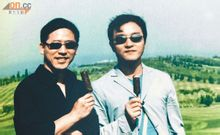](http://baike.baidu.com/albums/6360/5595080/1/3201915.html#3201915$)

张国荣与爱人唐鹤德(19张)当年哥哥的葬礼，是唐先生以[未亡人](http://baike.baidu.com/view/468188.htm)的身份，忍着悲痛一手操办的，安排葬礼程序来宾。在哥哥的讣告上的[亲属](http://baike.baidu.com/view/215803.htm)栏中，唐先生以“挚爱”的身份排在第一位，他们长达20年坚贞的恋情终受到了亲友一致尊重。**哥哥于采访中提及爱人：**  
　　“其实同一个人生活[这么多年](http://baike.baidu.com/view/8406470.htm)后，结不结婚已不重要，我觉得我们已经[结了婚](http://baike.baidu.com/view/8376019.htm)。”——1994年《东周刊》“如果讲到爱情，我只会为了一个人。[这么多年](http://baike.baidu.com/view/8406470.htm)，我只有一个。你说是不是很吝啬？因为其实以我的容貌，可以找很多个的啦，但是只有那一个。”——1994年商台<娱乐性骚扰>“除了我的爱人之外，我绝不会对第二个人说『我爱你』三个字。”记者：“从来没有？”“从来没有！我说不出口，因为我只爱他。”张国荣严肃的说。 ——1995年 《[民生周刊](http://baike.baidu.com/view/4307395.htm)》“无论有多忙，无论相隔得多远，我们每天都要给对方打电话，我是个爱家的人，虽然我的家的组成有些与众不同。”——1997年<星空下的倾情>[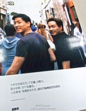](http://baike.baidu.com/picview/6360/5595080/0/f3d3572c11dfa9ece248a37663d0f703918fc169.html)十周年纪念品公布的合照

“我生命中第二重要的人（第一是母亲）就是唐先生。”——1998年<香港商台>访问“上帝造人是公平的，不分男女，不分种族，不分黑人、白人，有些人喜欢猫，有些人喜欢狗，有些人喜欢一些[特别的人](http://baike.baidu.com/view/615836.htm)，这样他们才会开心，为什么我们[不可以](http://baike.baidu.com/view/4607450.htm)成全他们……只要他们开心，其他人无权过问！（台下观众马上大喊：成全你！） ”——2000年热情演唱会[17]“他很好，他对我很好，他是一个很[爱屋及乌](http://baike.baidu.com/view/10509.htm)的人﹐对朋友、对每个人，都义无反顾的对任何身边的人，包括他的同事、朋友，对我，简直没话说！ 因为我有时候有些犀利的，他没有﹐所以他好好。好识得定位﹐甚么时候做什么角色，尤其是我们生活如此忙碌，有一个人在自己身边支持的确好好。”  
　　主持人：即是认定了，这个是你的终生的[伴侣](http://baike.baidu.com/view/411273.htm)？哥哥：一定的！很开心的，这是一种恩赐，是主赐给我的。　——2001年有线电视专访哥哥曾说**:**“在这个世界上只有一件事是我可以肯定的，那就是我爱人对[我的爱](http://baike.baidu.com/view/61066.htm)……”[编辑本段](http://baike.baidu.com/view/6360.htm#)十周年纪念
--------------------------------------------------

### 纪念活动

2013年3月31日，为纪念张国荣去世十周年而举办的《继续宠爱·十年·音乐会》将在全球联播，香港四大电子传媒——无线电视（TVB）及三间电台会在晚十时及翌日转播，[韩国](http://baike.baidu.com/view/3299.htm)、[新加坡](http://baike.baidu.com/view/3593.htm)、[马来西亚](http://baike.baidu.com/view/7009.htm)、[美加](http://baike.baidu.com/view/3354640.htm)、[英国](http://baike.baidu.com/view/3565.htm)、[澳洲](http://baike.baidu.com/view/76158.htm)、[新西兰](http://baike.baidu.com/view/10151.htm)于香港时间4月1日晚转播。[台湾](http://baike.baidu.com/view/2200.htm)、[日本](http://baike.baidu.com/view/1554.htm)会有同步院线直播，其中，日本共计33家影城会同步院线直播，这也是日本[首次](http://baike.baidu.com/view/2179391.htm)有华人演唱会于日本戏院直播。内地的[江苏卫视](http://baike.baidu.com/view/1091964.htm)将会在4月1日晚22点独家转播纪念张国荣音乐会，爱奇艺视频网也会于4月1日晚转播纪念张国荣音乐会。3月31日当晚将有包括张学友、梁朝伟、容祖儿、陈慧琳、周慧敏在内共计近20位明星在音乐会上亮相，用各自的方式与大家一起纪念张国荣逝世十周年。为纪念一代巨星张国荣(哥哥)逝世十周年，在香港时代广场举行的《继续宠爱.十年.纪念展》2013年3月31日正式开幕，哥哥生前的挚爱好友唐鹤德(唐唐)现身为哥哥6米高的半身像揭幕外，同时又代表接受吉尼斯发出的证书，因这次歌迷为哥哥所摺的纸鹤总数有1,900,119只，成功打入“吉尼斯世界纪录大全”。　[18]### 留言曝光

2013年3月31日晚，张国荣逝世十周年纪念演唱会《继续宠爱.十年Miss You Much Leslie》在香港[红馆](http://baike.baidu.com/view/1647990.htm)举行，其经纪人陈淑芬所说埋藏了十年的秘密终于揭晓，“张国荣留给大家最后的讯息是，2003年4月1号晚上6点43分，当时我在现场，突然间有个声音同我讲，我终于可以好好地舒服睡一觉。”[19]