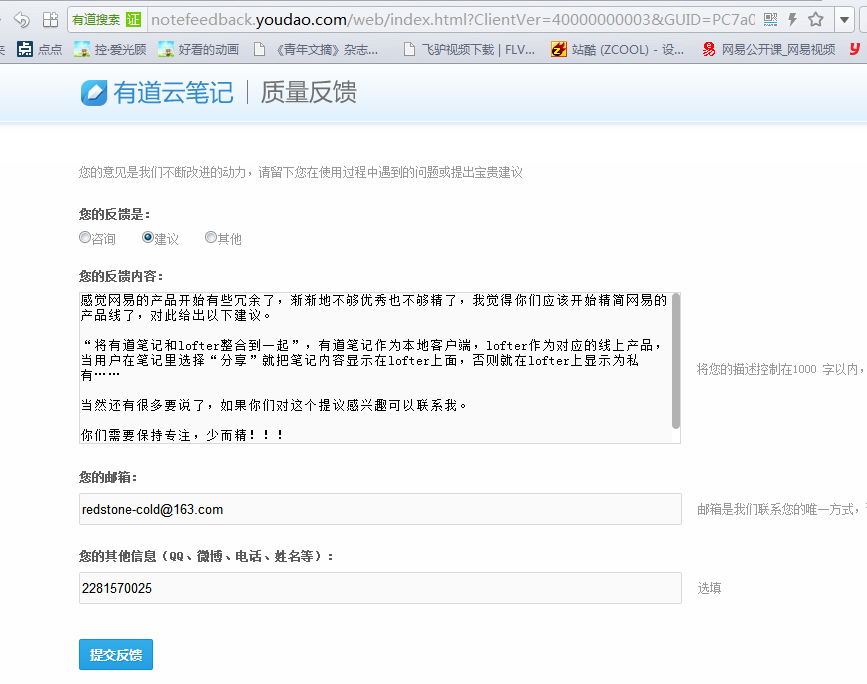

<http://www.istartedsomething.com/bingimages/?m=1&y=2015>  
  
Greasemonkey脚本百变饼，可以把Bing首页移植到Baidu。  
  
  
<http://www.wallpaperdownloader.com/bing-wallpaper/>  
  

```
win32gui.SystemParametersInfo(win32con.SPI_SETDESKWALLPAPER, "C:\bing.jpg", 1+2)
```

```
  

```

```
每天运行一下把必应的图片下下来就关掉 = =！  

```

```
start /min python %~dp0change_wallpaper.py

```
其中`start /min`表示让程序在后台（最小化）运行，`%~dp0`在bat脚本中表示脚本文件所处的目录。将run.bat与change\_wallpaper.py放在同一目录中，就可以避免脚本中出现绝对路径。这时只需在计划任务中执行run.bat即可。


```
C:\run.bat
```
  
  


|  |
| --- |
| def set\_wallpaper(picpath):  |
|  | if sys.platform == 'win32': |
|  | import win32api, win32con, win32gui |
|  |  k = win32api.RegOpenKey(win32con.HKEY\_CURRENT\_USER, 'Control Panel\Desktop', 0, win32con.KEY\_ALL\_ACCESS) |
|  |  curpath = win32api.RegQueryValueEx(k, 'Wallpaper')[0] |
|  | if curpath == picpath: |
|  | pass |
|  | else: |
|  | # win32api.RegSetValueEx(k, "WallpaperStyle", 0, win32con.REG\_SZ, "2")#2 for tile,0 for center |
|  | # win32api.RegSetValueEx(k, "TileWallpaper", 0, win32con.REG\_SZ, "0") |
|  |  win32gui.SystemParametersInfo(win32con.SPI\_SETDESKWALLPAPER, picpath, 1+2) |
|  |  win32api.RegCloseKey(k) |
|  | else: |
|  |  curpath = commands.getstatusoutput('gsettings get org.gnome.desktop.background picture-uri')[1][1:-1] |
|  | if curpath == picpath: |
|  | pass |
|  | else: |
|  |  commands.getstatusoutput('DISPLAY=:0 gsettings set org.gnome.desktop.background picture-uri "%s"' % (picpath)) |
|  |

<http://blog.csdn.net/huangbo10/article/details/39440427>  
<https://github.com/genzj/pybingwallpaper>  
  
  
  
#coding=utf8
  
#python 2.7
  

  
#操作网络需要
  
import urllib
  
#正则表达式需要
  
import re
  
#调用系统命令需要
  
import os
  

  
#设置壁纸保存目录,/ 结尾
  
#可以改成你家里的图片目录,像这样 '/home/username/图片/'
  
#如果你是python小白,只有这里你可以改！！！
  
save\_path='/tmp/'
  

  
#打开链接
  
#打不开链接誓不罢休,wifi比较慢嘛
  
#当然你也可以用time.sleep(seconds)一会儿！
  
url='<http://www.bing.com>'
  
while True:
  
 try:
  
 html=urllib.urlopen(url).read()
  
 break
  
 except:
  
 continue
  

  
#使用正则表达式寻找壁纸地址,将壁纸地址命名为 link, 壁纸名称为 pic
  
#Bing必应
  
link\_checker=re.compile(r"g\_img={url:'(?P<link>[/\w\-]\*/(?P<pic>[\w\.\-]\*))'")
  
info=link\_checker.search(html).groupdict()
  
link=url+info['link']
  

  
#检测壁纸是否存已经存在,若存在则退出，否则下载
  
fname=save\_path+info['pic']
  
if os.path.exists(fname):
  
 print 'wallpaper exists!'
  
 exit()
  

  
#下载壁纸
  
picdata=urllib.urlopen(link).read()
  

  
#保存壁纸到save\_path,save\_path咱们在前面定义了
  
f=file(fname,'w')
  
f.write(picdata)
  
f.close()
  

  
#设置壁纸
  
# 适用于gnome 3,也许适用于gnome 2
  
os.system('gsettings set org.gnome.desktop.background picture-uri "file://'+fname+'"')
  
#设置壁纸样式
  
## Possible values: centered, none, scaled, spanned, stretched, wallpaper, zoom
  
os.system('gsettings set org.gnome.desktop.background picture-options wallpaper')
  

  
  
  
  
  
# -\*- coding: utf-8 -\*- 
  
# Set the wallpaper for Windows/Linux(gnome) 
  
# with APOD or NGPOD 
  
# by henrysting 2010-08-05 
  
# Edit by AndyDavis 2014-03-08 
  

  
import ctypes 
  
import urllib 
  
import urllib2 
  
import re 
  
import socket 
  
import os 
  
import time 
  
if os.name=="nt": 
  
 import Image 
  
 import \_winreg 
  

  
def ftime(): 
  
 str = time.strftime('%y%m%d', time.localtime()) 
  
 return str 
  

  
def convertToBMP(imagePath): 
  
 im = Image.open(imagePath) 
  
 w,h = im.size 
  
 whRatio = float(w)/h 
  
 if w > screen[0]: #width conformity 
  
 im = im.resize((screen[0],int(float(screen[0])/whRatio)),Image.BILINEAR) 
  
 if im.size[1] > screen[1]: #height conformity 
  
 im = im.resize(int(screen[1]\*whRatio),screen[1]) 
  

  
 newPath = STOREDIR + '\wallpaper.bmp' 
  
 im.save(newPath,'BMP') 
  
 return newPath 
  

  
def registerCentered(): 
  
 # changes the registry to center wallpaper. 
  
 # Stretch is 2 0,Tiled is 0 1. 
  
 wallpaperStyle = '2' 
  
 tileWallpaper = '0' 
  
 desktopKey = \_winreg.OpenKey(\_winreg.HKEY\_CURRENT\_USER, 'Control Panel\\Desktop',0,\_winreg.KEY\_SET\_VALUE) 
  
 \_winreg.SetValueEx(desktopKey,'WallpaperStyle',0,\_winreg.REG\_SZ,wallpaperStyle) 
  
 \_winreg.SetValueEx(desktopKey,'TileWallpaper',0,\_winreg.REG\_SZ,tileWallpaper) 
  
 return 1 
  

  

  
def getPicture(): 
  
 if TYPE == 0: 
  
 homepage = '<http://apod.nasa.gov/apod/>' 
  
 if date == '': 
  
 siteurl = homepage 
  
 else: 
  
 siteurl = '<http://apod.nasa.gov/apod/ap>'+date+'.html' 
  
 sock = urllib.urlopen(siteurl) 
  
 htmlSource = sock.read() 
  
 if htmlSource.find('404 Not Found')+1: 
  
 print "Sever haven't updated yet" 
  
 return '' 
  
 sock.close() 
  
 pos1 = htmlSource.find('href="image/') 
  
 pos2 = htmlSource.find('.jpg"',pos1) 
  
 page2 = htmlSource[pos1+6:pos2+4] 
  
 filename = htmlSource[pos1+17:pos2+4] 
  
 fileurl = homepage+page2 
  
 elif TYPE == 1: 
  
 siteurl = '<http://photography.nationalgeographic.com>' 
  
 sock = urllib.urlopen("<http://photography.nationalgeographic.com/photography/photo-of-the-day>") 
  
 htmlSource = sock.read() 
  
 sock.close() 
  
 pos0 = htmlSource.find('download\_link') 
  
 if pos0+1: 
  
 print 'There is a Wallpaper today!' 
  
 pos1 = htmlSource.find('href="//images.',pos0) 
  
 pos2 = htmlSource.find('.jpg">Download',pos0) 
  
 else: 
  
 print 'Not so attractive ...' 
  
 pos0 = htmlSource.find('primary\_photo') 
  
 pos1 = htmlSource.find(' src="//images.',pos0) 
  
 pos2 = htmlSource.find('.jpg"',pos0) 
  

  
 fileurl = 'http:' + htmlSource[pos1+6:pos2+4] 
  
 filename = htmlSource[pos1+77:pos2+4] 
  
 elif TYPE == 2: 
  
 userMainUrl = "<http://cn.bing.com>"; 
  
 req = urllib2.Request(userMainUrl); 
  
 resp = urllib2.urlopen(req); 
  
 respHtml = resp.read(); 
  
 WallPaper = re.search("g\_img={url:'(?P<wpurl>.+?)'", respHtml); 
  
# print "WallPaper=",WallPaper; 
  
 if(WallPaper): 
  
 wpurl = WallPaper.group("wpurl"); 
  
 print 'There is a Wallpaper today!' 
  
 print "wpurl=",wpurl; 
  
 newurl = wpurl.replace('1366x768','1920x1080'); 
  
 print "newurl=",newurl; 
  
 fname = "Bing" + time.strftime( "%y-%m-%d") + ".jpg" 
  
 print "fname=",fname; 
  
 fileurl = newurl 
  
 filename = fname 
  
 else: 
  
 print 'Wrong Type Number!' 
  

  
 try: 
  
 if os.name=="nt": 
  
 fname = STOREDIR + '\\'+ filename 
  
 elif os.name=="posix": 
  
 fname = STOREDIR + '/'+ filename 
  

  
 if not os.path.exists(fname): 
  
 print 'Retrieving the picture from ' + fileurl 
  
 urllib.urlretrieve(fileurl, fname) 
  
 else: 
  
 print 'The file is already there.' 
  
 return fname 
  
 except: 
  
 print filename 
  
 print fileurl 
  
 print fname 
  
 print "Failed to retrieve the picture of ",date 
  
 pass 
  
 return fname 
  

  
def setWallpaperFromBMP(imagepath): 
  
 SPI\_SETDESKWALLPAPER = 20 
  
 ctypes.windll.user32.SystemParametersInfoA(SPI\_SETDESKWALLPAPER, 0, imagepath , 0) 
  

  

  
def setWallPaper(imagePath): 
  
 if os.name=="nt": 
  

  
 registerCentered() 
  
 newPath = convertToBMP(imagePath) 
  
 setWallpaperFromBMP(newPath) 
  
 elif os.name=="posix": 
  
 try: 
  
 os.system("gconftool-2 -t string -s /desktop/gnome/background/picture\_filename \""+imagePath+"\" -s /desktop/gnome/background/picture\_options scaled") 
  
# option can also be centered,stretched,tiled etc. 
  
 except: 
  
 os.system("dcop kdesktop KBackgroundIface setWallpaper \""+imagePath+"\" 7") 
  

  
def setWallpaperOfToday(): 
  
 fname = getPicture() 
  
 if fname != '': 
  
 print 'Local file is ' + fname 
  
 setWallPaper(fname) 
  
 print 'Wallpaper is set!' 
  
 else: 
  
 print 'Nothing done.' 
  

  
if \_\_name\_\_ == "\_\_main\_\_": 
  
 if os.name=="nt": 
  
 STOREDIR = os.path.expanduser('~\\Pictures\\DeskFeed\\') 
  
 else: 
  
 STOREDIR = os.getcwd() 
  
 sites = ['Astronomy POD','National Geographic POD',"Bing POD"] 
  
 TYPE = 1 # 从哪个站点取图:0，1，2 
  
 screen = (1920,1680) # 屏幕分辨率 
  
 date = '' # 日期格式为 'yymmdd' 
  
 print sites[TYPE],date 
  
 setWallpaperOfToday()  
  
  
  
  
  
  
  
  
  
  
  
  
  
  
