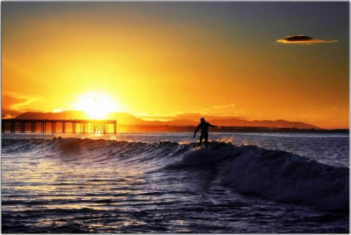

当我十七岁的时候，我读到一段话，它是这么说的：“如果你把每天都当做最后一天来活着，那么有一天你将会是对的。”这句话让我留下了深刻的印象，从那时候开始，过去的 33 年来，我每天早上都对着镜子问我自己：“如果今天是我人生的最后一天，我会想做我正要去做的事情吗?”如果答案连续好几天都是：不，那我就知道我是该改变些什么了。 –Steve Jobs

很多人都问我：“Jamie，为什么你每天可以那么早起阅读和写作?”答案其实很简单，因为一天中找不到更好的时间做这件事情。阅读和写作是我每天最重要的功课，所以当然应该排在每天的第一个小时。况且一大早写作还有一个好处，就是当你的读者醒来时，新的文章已经送到他们的面前。如果你可以每天早上给人们一个启发，让他们的一天有很棒的开始，这不是很美好的贡献?

当然我的一天跟大家一样，都只有 24 小时，虽然我可能睡得比大部分人少，但时间仍然是不够用。所以当我把阅读写作排在第一位，相对的，有些事情的优先顺序就必须被排到后面，例如 email。事实上，认识我的人就知道，我是全世界最差劲的「回信者」，寄给我的 email，常常五天、七天，甚至两个礼拜之后才回。因为 email 对我来说是投资报酬率最低的任务，所以只能留到有空档的时候尽量处理。

当然我不是说每个人的人生都应该跟我一样， 事实上，每个人的优先顺序都应该是不一样的，所以你还可以参考别人都是怎么利用他们的早晨的，今天在 Fast Company 读到这篇不错的「What Successful People Do With The First Hour Of Their Work Day」，以下就摘录一些重点与大家分享：

不要检查 Emails

Tumblr 的创办人 David Karp 的规矩是 10 点到公司以前不看 email，因为『如果有要紧事，他们会打电话或是传简讯来』。Julie Morgenstern 甚至写了一本名为「Never Check Email in the Morning」畅销管理丛书。似乎越来越多人跟我一样，认为减少 email 时间，可以完成更多更重要的工作，「训练」你的同事，不应该期待 email 会瞬间的被回覆。

活动、感恩、冥想

自我训练达人 Tony Robbins 的建议是每天一起床就开始活动，例如健走，然后一边让大脑专注在冥想上面，想着那些你感谢的人和事，接着想想你想要达到的目标，他称这个叫做「The Hour of Power」。我的行程没办法天天运动，但是大约每两天在到公司之前，会先游半个小时的泳。虽然没有固定的主题，但我发现这个节奏转换，常常让我可以想通很多事情。

吃掉那只活青蛙(最难处理的事情)

这是 Mark Twain (马克吐温) 说法，每天早上先把最恼人、最讨厌、最大的事情解决掉，那样一天之中你就不再需要烦恼那件事情。我们常常会有鸵鸟心态，把恼人的事情留在后面处理，但那反而会让我们无法专注在其他任务上面，所以你还不如先把青蛙给吃了吧。

先把青蛙准备好

Gina Trapani 甚至进一步建议，在你每天傍晚离开办公桌前，先把第二天早上要吃的青蛙准备好，甚至把相关的调味料 (资料) 也都备好。这样不但可以帮助你每天都有个成功的早晨，也可以提早发现需要的东西，而不会到最后一秒才在跟同事要资料。

服务客户

Craigslist 的创办人 Craig Newmark 每天的第一个钟头， 一定是花在客户服务上面，无论是回答用户的问题，在网站上清理垃圾讯息，或是亲自把灌水者停权。当然身为一个执行长，这些事情大可以交给「客服」去做，但 Craig 认为这个工作会把他「带回现实」，亲身去体验用户的感受。

所以以上，就是一些关于安排一日之计的建议。希望大家都能好好把握每天的开始，趁头脑最清澈、世界最安静的时候做些最有意义的事情，从高点展开美好的一天，与大家共勉之。

作者： MR JAMIE