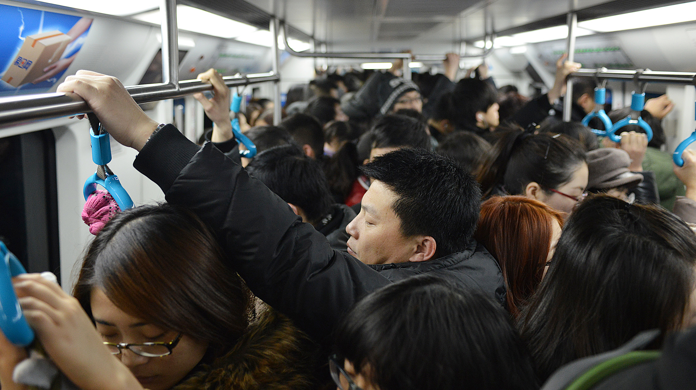
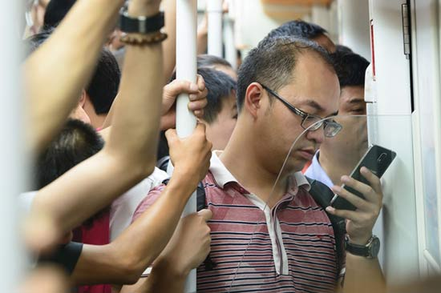
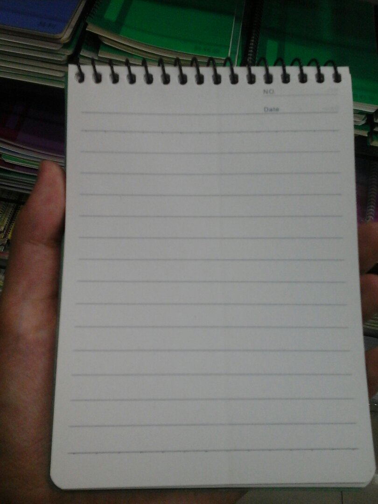

前一久地铁里举办了“带一本书坐地铁”的活动  
  
  
但是，，，拥挤不堪的地铁岂能容下一本书的位置，尤其是早晚高峰期  
  
  
不过，，，拥挤的地铁里却能容下一个手机的位置——我们可以在地铁里看手机  
那么如果我偏要在地铁里看书该怎么办呢？这就需要出版社或印刷厂改变书籍的尺寸了——我们可以把书籍的大尺寸改为现在的智能手机大小的尺寸，比如5.5英寸，这样我们就可以在地铁里单手握住书籍看书了，好棒！！！然后建议这种大小的书籍不要做成传统的侧边翻页的方式，而要改成下面这种顶部锁环翻页的方式，这主要也是为了在拥挤的地铁里单手握书。最终做出来的这种尺寸的书基本就像下面这种样式了，如果这种尺寸的书呈现的是《红楼梦》这种大部头的书，那么我们可以把这个大著作分开成多个小册，这也是为了单手握书的体验才这么设计的。  
  
  
