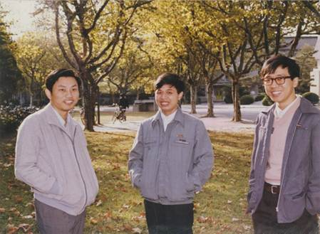
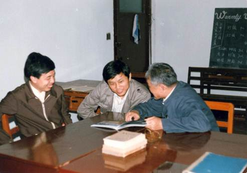
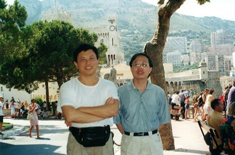
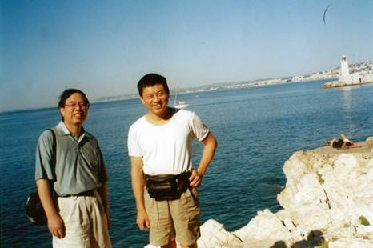
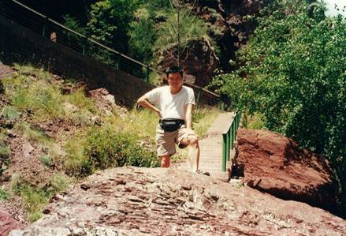
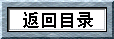

王建磐

6月28日我在北京大学参加纪念段学复院士百年诞辰的座谈会。席间，多人提起"文革"结束后不久以段学复院士为首的老一辈代数学家带领一批中青年同志开展了各种学术活动， 重振中国的代数学研究。其中一个重要活动便是1977年在北京师范大学组织的李型单群讨论班。肖刚是参加讨论班的青年人之一，当时年方二十六岁，而且是讨论班所用的教材 R. Carter所着的《李型单群》（Simple Groups of Lie Type）的中文译者之一。可是，在会场上我完全不知情的是，就在若干小时之前，肖刚已经在万里之遥的法国尼斯与世长辞了， 时年不足六十三岁。

1977年我还在福建老家准备参加高考，当然没有参加北京师大的李型单群讨论班。然而，1978年10月我进入华东师范大学师从曹锡华教授做代数群方向的研究生时， 《李型单群》一书却成了我数学职业生涯的启蒙书之一，而且用的就是油印的肖刚等人的中文译本。

我真正见到肖刚，是在1984年5月他获得法国国家博士后来到华东师范大学任职的时候。他年轻，睿智，却又随性，不拘小节。 陈志杰老师的悼念文章谈到他没有因为自己“奇货可居”而向学校提出高的要价。他一家蜗居在姑妈的一套面积并不大的房子里，还要面对邻里纠纷。 这些足以让一些取得一点小成绩就待价而沽的人汗颜。

左起：肖刚、王建磐、郑伟安。这张照片多次用在学校招生宣传材料中

肖刚在数学上的成就是国际国内学术界所公认的。他开创的用纤维化方法对代数曲面的分类和性质的研究，长时期引领了有关领域的学术发展。 他奠定了国内代数几何研究的基础和在国际上的地位，特别是培养了一批有影响的学者。 现在华东师范大学、复旦大学、北京大学和中国科学院数学与系统科学研究院的代数几何学科带头人或学术骨干不少出自他的门下， 他和他当年的硕士学生孙笑涛（现中国科学院数学与系统科学研究院数学研究所副所长）双双获得陈省身数学奖， 是少有的师徒双获奖的例子（据我所知，另一个例子是姜伯驹院士与他的弟子段海豹）。 肖刚与年纪相仿的郑伟安（目前为华东师范大学千人计划学者）一起于1988年被评为博士生导师（当时博士生导师需要国务院学位委员会审批），是当时国内最年轻的博士生导师。

在华东师范大学数学系简陋的代数教研室。左起：王建磐、肖刚、曹锡华

肖刚的兴趣与能力不仅仅在数学研究上。我第一次注意到这一点是1988年在南开数学研究所。那一年为筹备"代数几何年"我和他同时在南开数学所。当时国内各数学研究单位普遍资料缺乏， 而由于陈省身的缘故，南开数学所得天独厚，所资料室有很多最新的图书和资料。于是到南开数学所访问的人必然要到资料室复印一大堆资料带回去，以至于资料室的复印机常常累趴下来。 那天我和肖刚一进资料室就被告知复印机坏了好几天了，厂家来过也没解决问题。肖刚说着“让我看看”，就打开了复印机的外壳，不知他怎么折腾的，半个时辰不到，复印机就工作正常了。

后来和肖刚的交往中更多发现肖刚的多才多艺。比如当时的TeX还不能打印中文文章，肖刚在写自己的中文数学专着时编写一个预处理软件从中文字库生成TeX能够使用的临时字库， 解决了这个难题，这促成了后来得到较广泛使用的天元排版系统；初期的TeX画几何图形困难，肖刚又编写了TeXDraw程序和相应的字库。 天元和TeXDraw在后来数学系开展数学排版创收中起了至关重要的作用，为数学系在最困难的几年中稳定教师队伍出了一把力。到法国以后，肖刚对数学教育感兴趣， 并超前地用建立互动式共享网站的形式吸引全球有相同志趣的人一起参与。这就是他创立的WIMS网站（中文版由陈志杰等人翻译和维护）。 在网站开发过程中他又对网络安全有自己的见解（据说他的WIMS网站没有被攻破过）。前几年他回国时曾在华东师范大学软件学院做了一个关于网络安全的报告，我听了颇受启发； 软件学院院长何积丰院士也出席了报告会，并和肖刚作了学术上的讨论。近年来，他又对太阳能利用感兴趣，把数学原理用到太阳能技术的改进上，并希望做出产品，打开市场。 他曾和我联系希望华东师范大学投资，参与开发。但由于我已经离开领导岗位，而且上级对学校资金的使用有了比以前更为严格的规定，学校无法参与此事。 肖刚与其他单位的合作过程似乎也不太成功，成为他的一个遗憾。

肖刚和王建磐在在尼斯

和肖刚的交往过程中有一件事不能不提。1999年夏天，我从意大利乘火车去巴黎的途中顺路到了尼斯。肖刚热情地接待了我。正好陈馨回国了，我就住在肖刚家里。 肖刚不仅到火车站接送，还花了两天时间陪我看了尼斯大学，参观了摩纳哥城堡，欣赏了尼斯海滨和阿尔卑斯山的美丽风光。他的热情好客和对同事和朋友的一片真挚之情，令人难以忘怀。

斯人已逝，友谊长存。愿肖刚一路走好。

肖刚在尼斯大学附近

